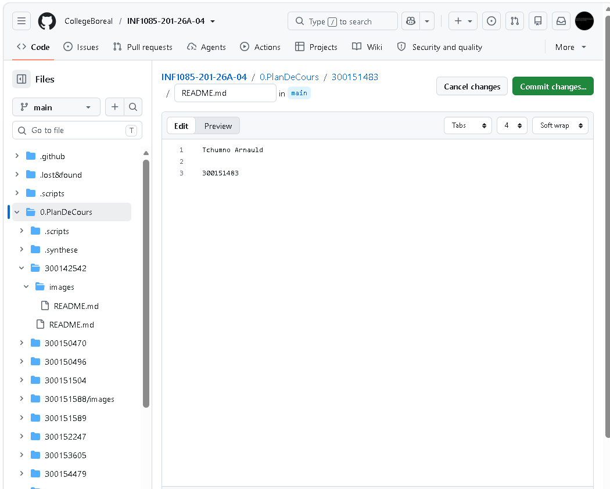

# INF1085 - Plan de cours

## Informations de l'étudiant

| Champ | Valeur |
|-------|--------|
| Nom | Arnauld Tchumno |
| Numéro étudiant | 300151483 |
| GitHub | [arnauld-ttad](https://github.com/arnauld-ttad) |
| Cours | INF1085-201 Administration Linux |

## Travail réalisé

- [x] Création d'un compte GitHub
- [x] Création du répertoire `300151483` avec le fichier `README.md`
- [x] Création du répertoire `images` avec le fichier `.gitkeep`
- [x] Ajout d'images dans le répertoire `images`
- [x] Ajout des images au fichier `README.md`

## Images

*Figure 1 : « Dans la vie, quoi qu'il arrive, tiens le cou ! »*

*Figure 2 : Modification de mon `README.md` directement dans l'interface GitHub.*
