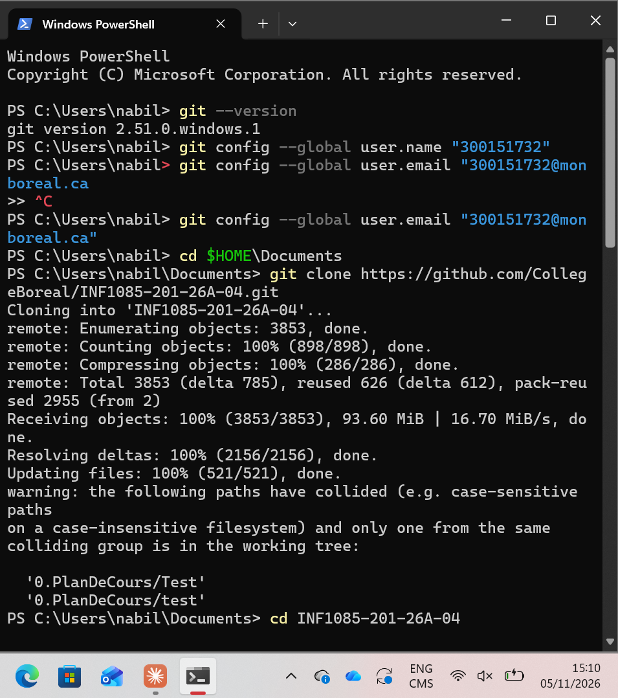
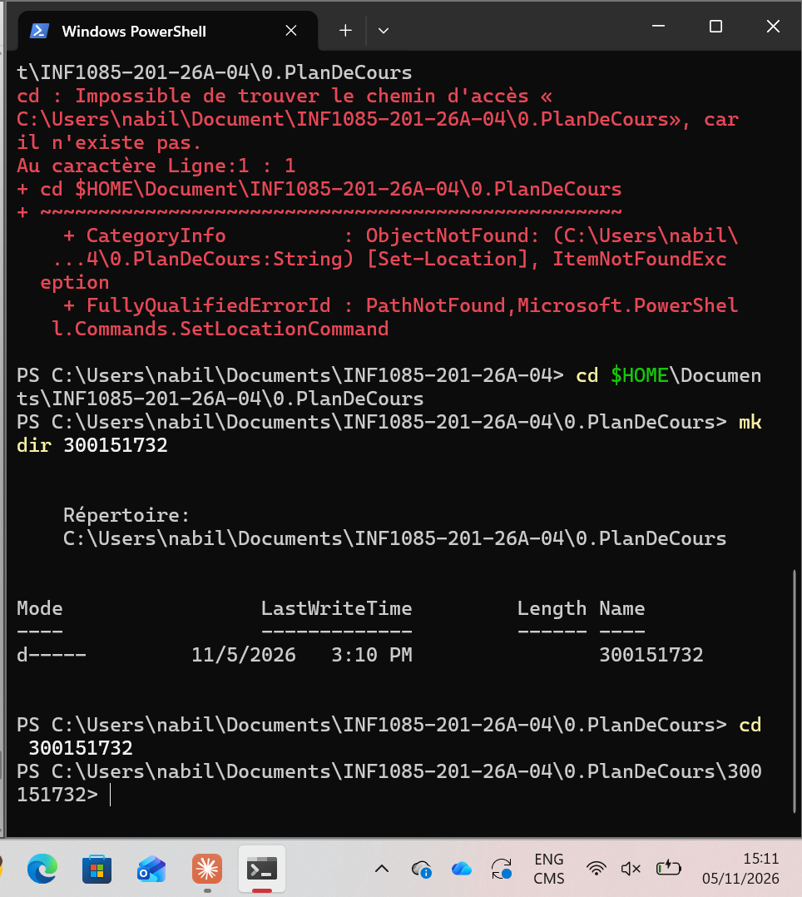
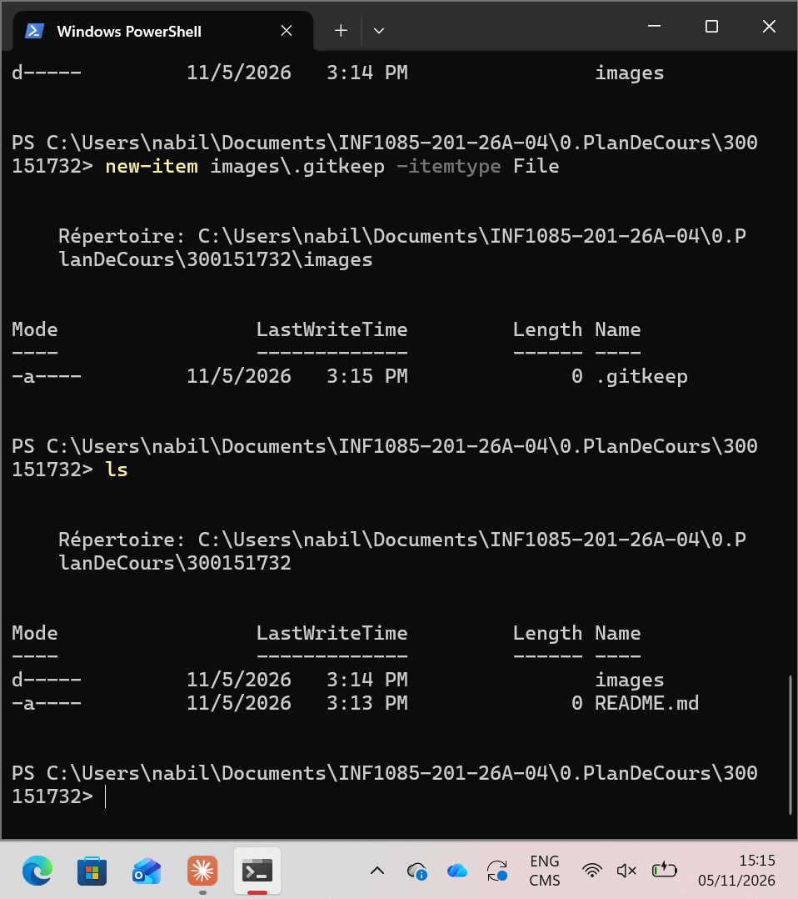
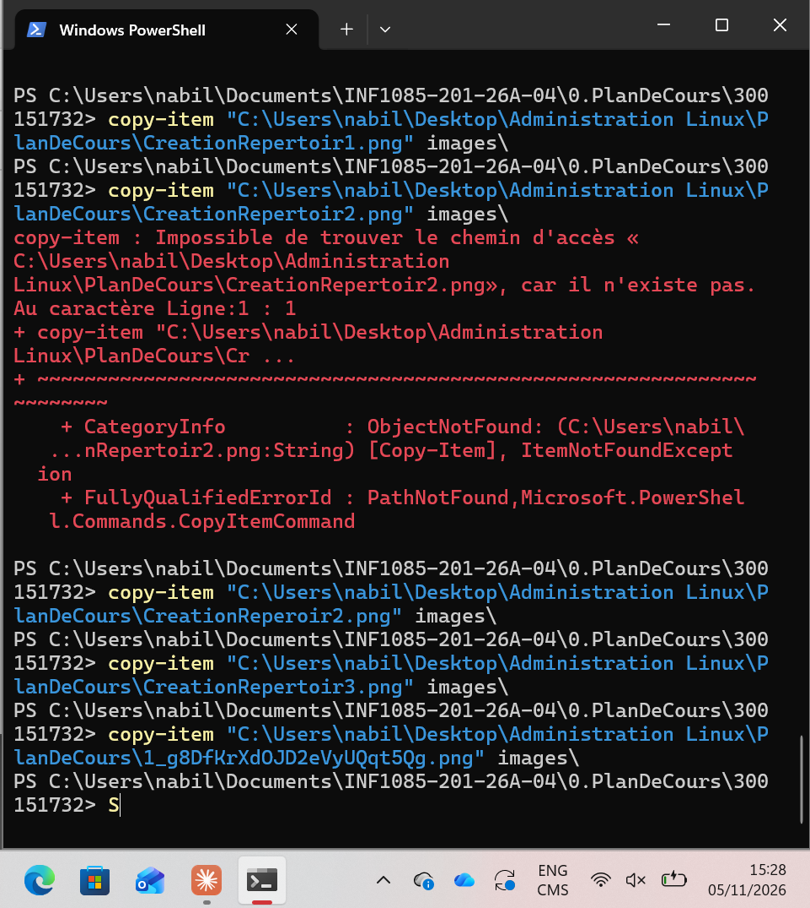

<p align="center">
  
</p>

<h1 align="center">🐧 Administration Linux</h1>
<h3 align="center">Étape 0 · Plan de cours</h3>

<p align="center">
  
  
  
  
</p>

---

## 👤 Informations de l'étudiant

| | |
|---|---|
| **Nom** | Nabil Hafsi |
| **Identifiant (ID)** | `300151732` |
| **Courriel** | 300151732@monboreal.ca |
| **Cours** | Administration Linux |
| **Dépôt** | `INF1085-201-26A-04` |
| **Étape** | 0 · Plan de cours |
| **Date** | 5 novembre 2026 |

---

## 📑 Table des matières

1. [Objectif de l'étape](#-objectif-de-létape)
2. [Environnement de travail](#-environnement-de-travail)
3. [Structure du répertoire](#-structure-du-répertoire)
4. [Déroulement](#-déroulement)
   - [Configuration de Git et clonage du dépôt](#1--configuration-de-git-et-clonage-du-dépôt)
   - [Création du répertoire à mon ID](#2--création-du-répertoire-à-mon-id)
   - [Création du README et du dossier images](#3--création-du-readme-et-du-dossier-images)
   - [Ajout des images](#4--ajout-des-images)
   - [Envoi vers GitHub](#5--envoi-vers-github)
5. [Galerie d'images](#-galerie-dimages)
6. [Conclusion](#-conclusion)

---

## 🎯 Objectif de l'étape

Cette première étape consiste à :

- ✅ créer un répertoire portant mon **ID** et y ajouter le fichier `README.md` ;
- ✅ créer, dans ce répertoire, le dossier `images` contenant le fichier `.gitkeep` ;
- ✅ ajouter des images dans le dossier `images` ;
- ✅ référencer ces images dans le fichier `README.md`.

---

## 💻 Environnement de travail

| Élément | Détail |
|---|---|
| **Système** | Windows |
| **Terminal** | Windows PowerShell |
| **Gestionnaire de versions** | Git `2.51.0.windows.1` |
| **Hébergement** | GitHub |

---

## 🗂️ Structure du répertoire

```text
INF1085-201-26A-04/
└── 0.PlanDeCours/
    └── 300151732/
        ├── README.md
        └── images/
            ├── .gitkeep
            ├── 1_g8DfKrXdOJD2eVyUQqt5Qg.png
            ├── CreationRepertoir1.png
            ├── CreationReperoir2.png
            ├── CreationRepertoir3.png
            ├── InsertionImages.png
            └── test.png
```

> 💡 Le fichier `.gitkeep` est vide : il sert uniquement à forcer Git à conserver un dossier vide dans le dépôt.

---

## 🚀 Déroulement

### 1. 🔧 Configuration de Git et clonage du dépôt

Vérification de la version de Git, configuration de mon identité (mon ID et mon courriel étudiant), puis clonage du dépôt du cours.

```powershell
git --version
git config --global user.name "300151732"
git config --global user.email "300151732@monboreal.ca"

cd $HOME\Documents
git clone https://github.com/CollegeBoreal/INF1085-201-26A-04.git
cd INF1085-201-26A-04
```

<p align="center">
  
</p>

---

### 2. 📁 Création du répertoire à mon ID

Dans le dossier `0.PlanDeCours`, création du répertoire portant mon ID, puis déplacement à l'intérieur.

```powershell
cd $HOME\Documents\INF1085-201-26A-04\0.PlanDeCours
mkdir 300151732
cd 300151732
```

<p align="center">
  
</p>

---

### 3. 📝 Création du README et du dossier images

Création du fichier `README.md`, du dossier `images` et du fichier `.gitkeep`, puis vérification avec `ls`.

```powershell
New-Item README.md -ItemType File
mkdir images
New-Item images\.gitkeep -ItemType File
ls
```

<p align="center">
  
</p>

---

### 4. 🖼️ Ajout des images

Copie des images depuis mon poste vers le dossier `images` avec `Copy-Item`.

```powershell
Copy-Item "C:\Users\nabil\Desktop\Administration Linux\PlanDeCours\CreationRepertoir1.png" images\
```

<p align="center">
  
</p>

Les images sont ensuite référencées dans ce fichier avec la syntaxe Markdown :

```markdown

```

---

### 5. ☁️ Envoi vers GitHub

Une fois le travail terminé, les fichiers sont ajoutés, validés puis envoyés vers le dépôt distant.

```powershell
git add .
git commit -m "Ajout du répertoire 300151732 : README et images"
git push
```

---

## 🖼️ Galerie d'images

<table align="center">
  <tr>
    <td align="center">
      <br>
      <sub><b>Linux Administration</b></sub>
    </td>
    <td align="center">
      <br>
      <sub><b>Image de test</b></sub>
    </td>
  </tr>
</table>

---

## ✅ Conclusion

Cette étape m'a permis de pratiquer les bases du travail avec **Git** et **GitHub** en ligne de commande : configuration, clonage, création de répertoires et de fichiers, ajout d'images et rédaction d'un fichier `README.md` en **Markdown**.

<p align="center">
  <sub>Réalisé par <b>Nabil Hafsi</b> · ID <code>300151732</code> · Administration Linux</sub>
</p>
