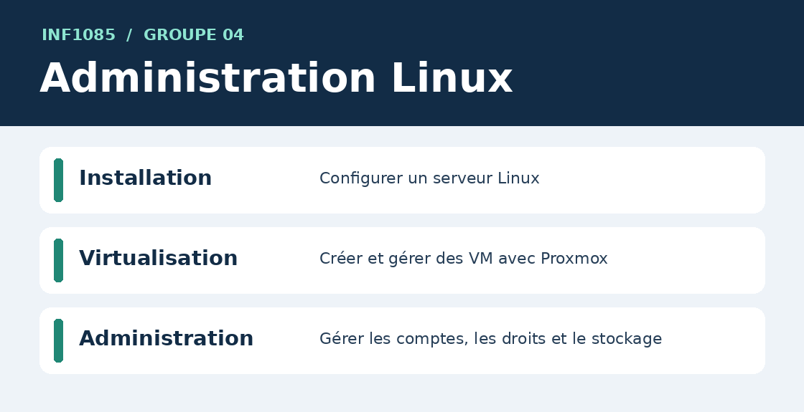

# Plan de cours — INF1085

**Meriem Abdedou · Groupe 04**

## Ce que je vais apprendre

Dans le cours d’administration Linux, je vais apprendre à :

- Installer et configurer un système Linux.
- Créer et gérer des machines virtuelles avec Proxmox.
- Gérer les utilisateurs, les groupes et les permissions.
- Vérifier l’état du serveur et diagnostiquer les problèmes.
- Documenter mes manipulations et mes résultats de laboratoire.

