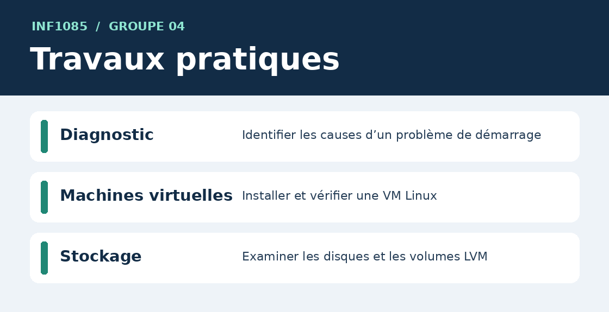

# Plan de cours

Le cours INF1085 couvre l’installation d’un serveur Linux, l’administration des comptes et des permissions, puis la sécurité et la surveillance. Le parcours passe par les commandes Linux, la virtualisation avec Proxmox, le stockage, les scripts Bash et le déploiement de services réseau.

## Plan de cours

## Parcours étudiant

