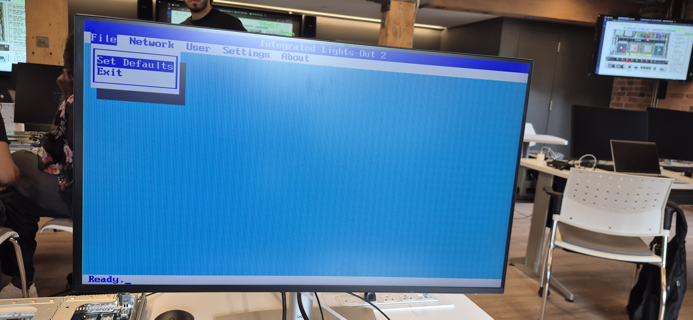

# INF1085 - Plan de cours

| Champ | Valeur |
|-------|--------|
| Prénom | Mohamed Karim |
| Nom | Bamba |
| Numéro étudiant | 300153972 |
| GitHub | [rimfive](https://github.com/rimfive) |
| Cours | INF1085-201 Administration Linux |
| Section | 04 (groupe 3) |

## Travail réalisé

- [x] Création d'un compte GitHub
- [x] Exploration de [GitHub Education](https://education.github.com)
- [x] Création du répertoire `300153972` avec le fichier `README.md`
- [x] Création du répertoire `images` avec le fichier `.gitkeep`
- [x] Ajout d'une image dans le répertoire `images`
- [x] Ajout de l'image au fichier `README.md`

## Ce que j'attends du cours

Le cours commence par l'installation de Linux, puis la ligne de commande, les utilisateurs et les groupes, les permissions et la sécurité, les scripts, et à la fin les services réseau.

Mes objectifs personnels :

1. Être à l'aise avec la ligne de commande Linux (fichiers, dossiers, processus).
2. Savoir gérer les utilisateurs, les groupes et les permissions (`chmod`, `chown`, `sudo`).
3. Installer et administrer un serveur Proxmox et des machines virtuelles.
4. Me connecter à mes serveurs en SSH avec une clé.
5. Écrire des scripts Bash pour automatiser des tâches.

## Image

*Figure 1 : Photo prise en classe pendant le labo de diagnostic. On voit l'écran de configuration iLO 2 du serveur HP, avec le menu File (Set Defaults, Exit).*
