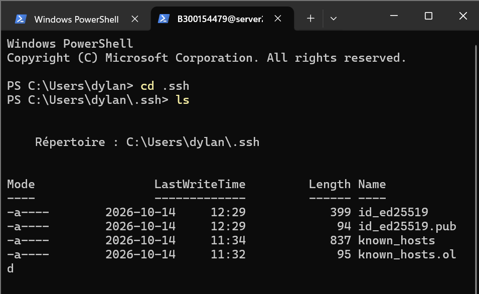

# 📘 INF1085 - Plan de cours

| Champ | Valeur |
|-------|--------|
| Prénom | Joris Dylane |
| Nom | Touossock Ngabou |
| Numéro étudiant | 300154479 |
| Cours | INF1085-201 Administration Linux |

## ✅ Travail réalisé

- [x] Création d'un compte GitHub
- [x] Exploration de [GitHub Education](https://education.github.com)
- [x] Création du répertoire `300154479` avec le fichier `README.md`
- [x] Création du répertoire `images` avec le fichier `.gitkeep`
- [x] Ajout d'une image dans le répertoire `images`
- [x] Ajout de l'image au fichier `README.md`

## 🎯 Ce que j'attends du cours

Le cours suit le parcours :

🛠️ Installer → 💻 Administrer → 👤 Gérer les utilisateurs → 🔒 Sécuriser → 🤖 Automatiser → 🌐 Déployer → 📈 Surveiller → 🚀 Exploiter

Mes objectifs personnels :

1. Maîtriser la ligne de commande Linux (navigation, fichiers, processus).
2. Gérer les utilisateurs, les groupes et les permissions (`chmod`, `chown`, ACL).
3. Installer et administrer un hyperviseur **Proxmox VE** et des machines virtuelles.
4. Me connecter à un serveur en **SSH** avec une clé publique.
5. Automatiser des tâches avec des scripts Bash.

## 🖼️ Image

*Figure 1 : Dans PowerShell, le dossier `C:\Users\dylan\.ssh` contient ma paire de clés `id_ed25519` / `id_ed25519.pub` et le fichier `known_hosts`. Le deuxième onglet montre ma session SSH `B300154479@server…`.*
