# Rapport de diagnostic et de dépannage – HP ProLiant DL360 G6

> **Cours :** INF1085-201 – Administration Linux
> **Laboratoire :** 1. Diagnostics
> **Objectif :** identifier les composants du serveur, isoler les pannes et amener le serveur jusqu'à un POST réussi.

---

## 1. Présentation du serveur

Le serveur utilisé pendant le laboratoire est un **HP ProLiant DL360 G6**. C'est un serveur de format **rack 1U** (une seule unité de hauteur dans une baie). Il a été sorti de la baie, puis ouvert pour être examiné et dépanné.

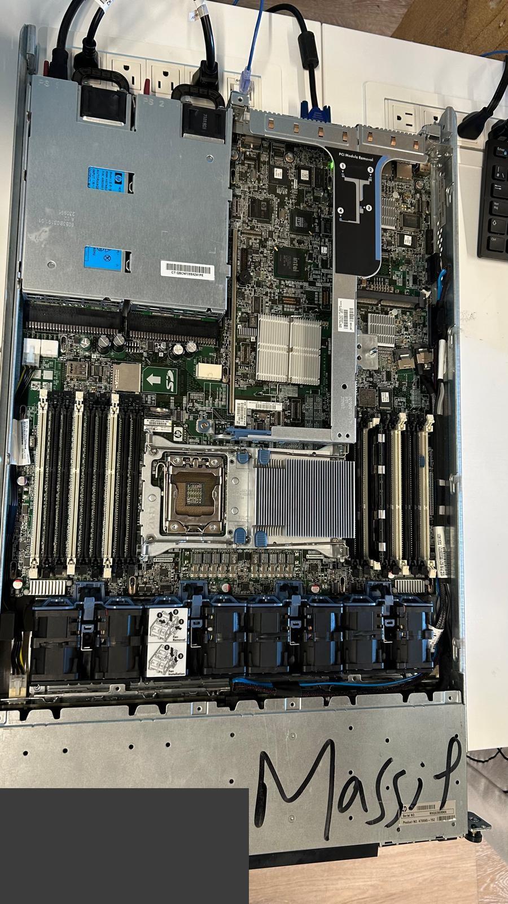

### Caractéristiques relevées pendant le laboratoire

| Élément | Valeur observée |
|---|---|
| Modèle | HP ProLiant DL360 G6 |
| BIOS | HP P64 (versions 2009 et 2010 observées) |
| Processeurs testés | Intel Xeon E5540 @ 2,53 GHz et Intel Xeon E5620 @ 2,40 GHz (4 cœurs, Hyperthreading activé) |
| Emplacements processeur | 2 (Proc 1 et Proc 2) – un seul processeur installé |
| Mémoire vive | 18 emplacements (9 par processeur), configurations de 8 Go et 64 Go testées |
| Contrôleur de disques | HP Smart Array P410i, avec module de cache de 512 Mo |
| Disques | 3 disques SAS de 146 Go |
| Alimentations | 2 blocs d'alimentation (PS1 et PS2) |
| Gestion à distance | iLO 2 (Integrated Lights-Out) |
| Réseau | Cartes réseau intégrées Broadcom NetXtreme II |

---

## 2. Les composants du serveur

### 2.1 Le processeur (CPU)

Le processeur est le **cerveau du serveur** : il exécute toutes les instructions et tous les calculs. Le DL360 G6 possède **deux emplacements (sockets)** pour processeurs. Pendant le laboratoire, un seul processeur Intel Xeon était installé.

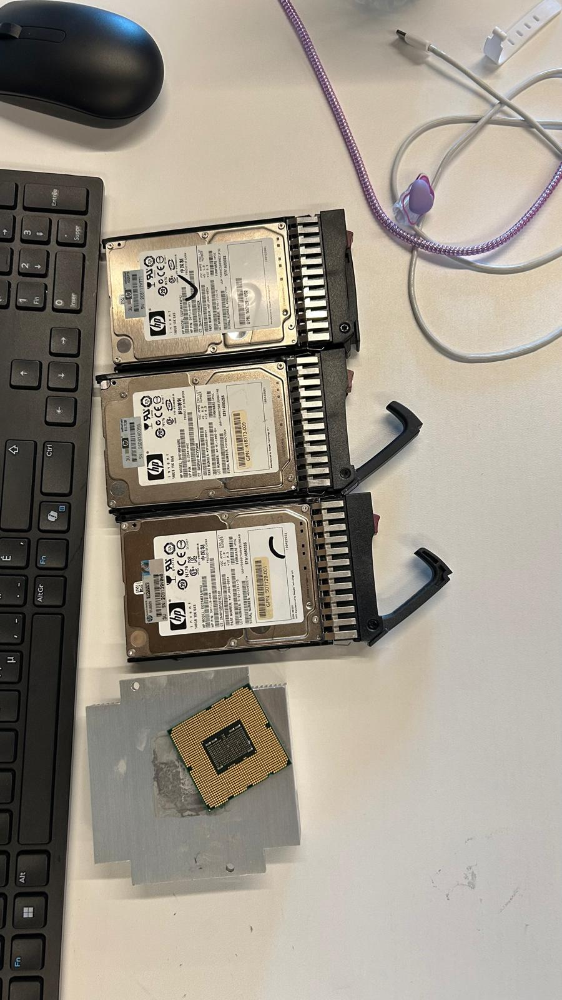

> **NB :** quand un seul processeur est installé, il doit **obligatoirement être dans l'emplacement n°1 (Proc 1)**. Sinon, le serveur refuse de démarrer (voir la section 3.4).

### 2.2 Le dissipateur thermique et les ventilateurs

Le **dissipateur thermique** est le bloc en aluminium posé sur le processeur. Il absorbe la chaleur produite par le processeur. Les **ventilateurs**, alignés dans une rangée à l'avant du serveur, font circuler l'air pour **refroidir l'ensemble des composants**. Sans eux, le serveur surchauffe et peut s'arrêter tout seul pour se protéger.

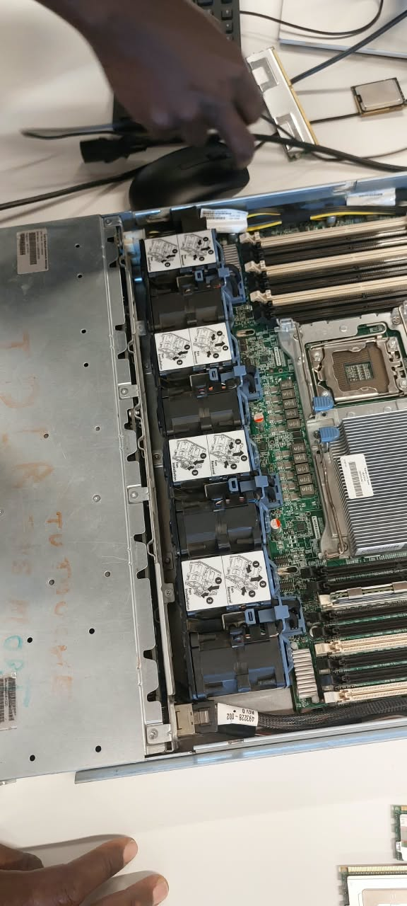

### 2.3 La mémoire vive (RAM)

Les barrettes de RAM sont installées dans les longs emplacements situés de chaque côté du processeur. La RAM stocke **temporairement** les données et les programmes en cours d'utilisation. Elle s'efface à chaque arrêt du serveur.

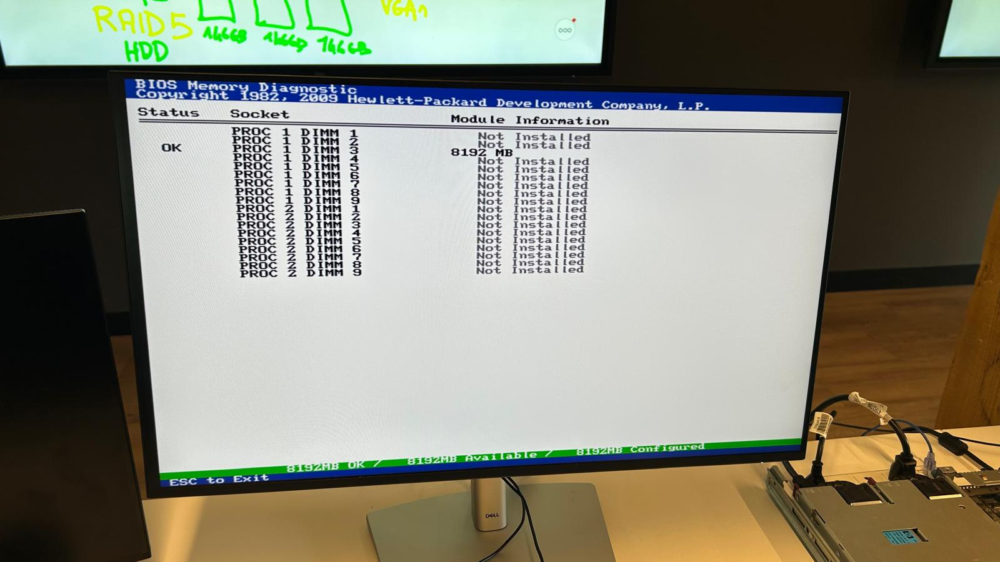

Le diagnostic mémoire du BIOS montre une barrette de **8 Go** détectée dans l'emplacement **PROC 1 DIMM 3**, avec le statut **OK**.

### 2.4 Les disques durs

Le serveur utilise **3 disques durs SAS de 146 Go**, montés dans des tiroirs amovibles (on peut les retirer par l'avant du serveur). Ils servent à **stocker les données de façon permanente** : le système d'exploitation, les fichiers et les applications.

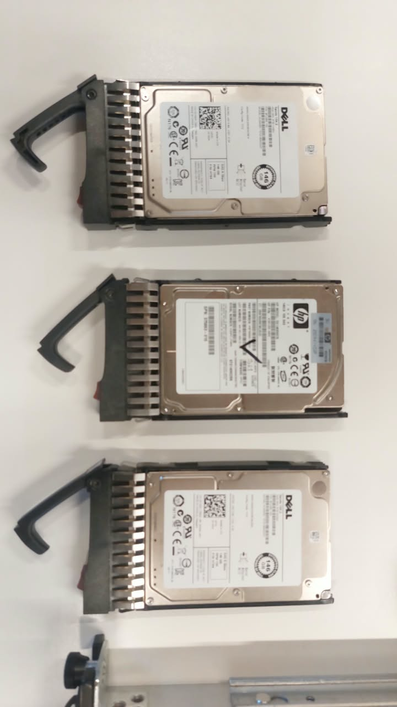

Exemple d'un disque en gros plan : **Dell Savvio 15K.2**, 146 Go, interface **SAS 6 Gb/s**, vitesse de rotation de **15 000 tours/minute**. Ce sont des disques de classe « entreprise », plus rapides et plus fiables que les disques d'ordinateurs personnels.

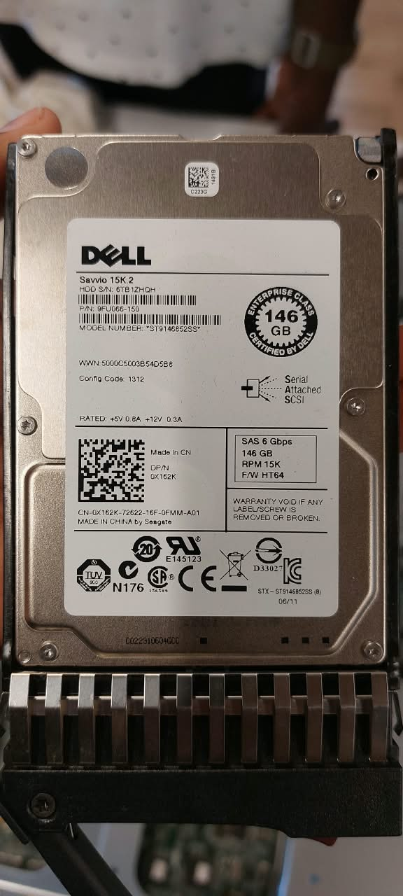

### 2.5 Le module de mémoire cache du contrôleur RAID

Ce module de **512 Mo** se branche sur le contrôleur de disques **HP Smart Array P410i**. Il sert de **mémoire tampon** : il garde temporairement les données avant qu'elles soient écrites sur les disques, ce qui accélère les lectures et les écritures.

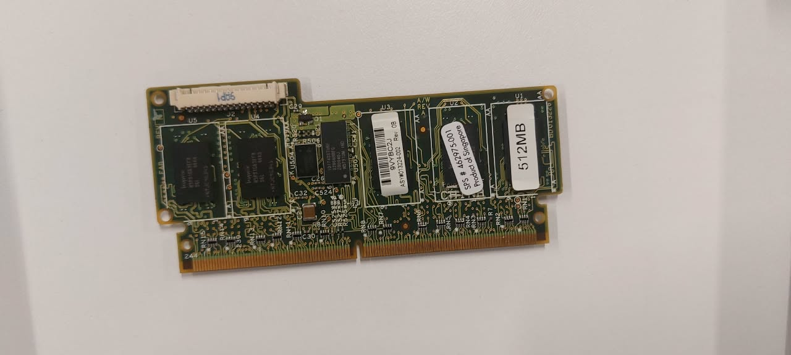

>  **Problème rencontré :** voir la section 3.1.

### 2.6 Les blocs d'alimentation (PSU)

Le serveur possède **deux blocs d'alimentation**, PS1 et PS2. Ils transforment le courant électrique de la prise en courant utilisable par les composants. Ils sont **redondants** : si l'un tombe en panne, l'autre continue d'alimenter le serveur sans interruption.

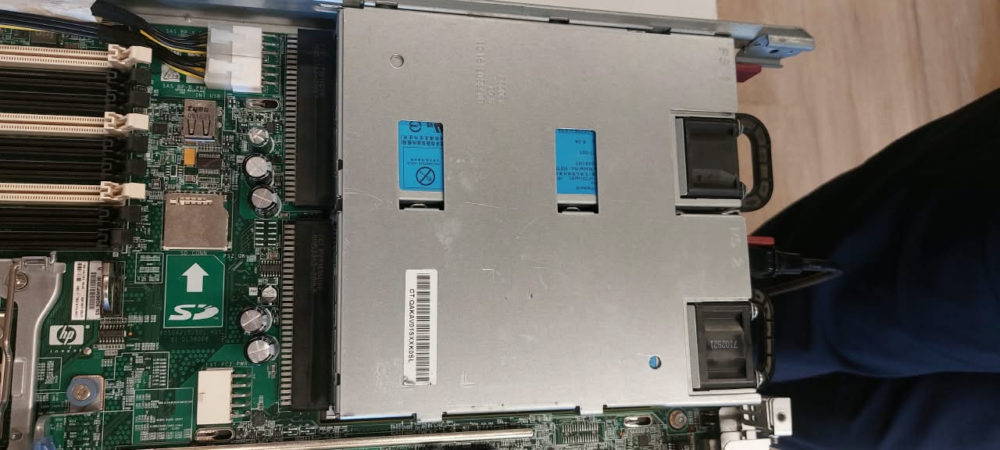

### 2.7 La pile CMOS

C'est une **pile bouton (type CR2032)** placée sur la carte mère. Elle garde en mémoire les **réglages du BIOS** ainsi que la **date et l'heure**, même quand le serveur est débranché.

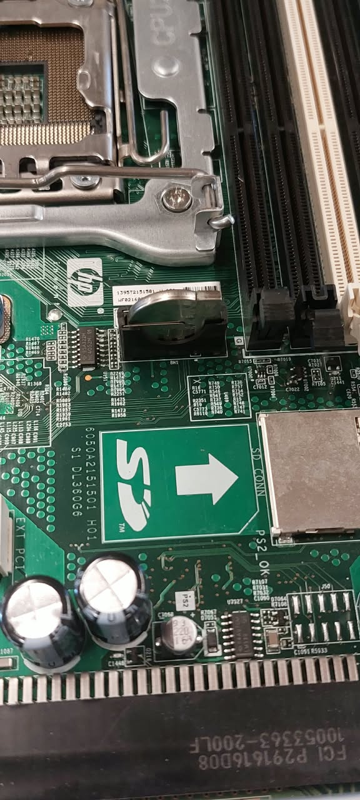

### 2.8 L'interrupteur de maintenance (System Maintenance Switch – SW1)

C'est une rangée de **petits interrupteurs** sur la carte mère. Chacun a un rôle précis. L'interrupteur **n°6** permet de **réinitialiser la configuration du serveur** (effacer les réglages enregistrés et revenir aux paramètres d'usine).

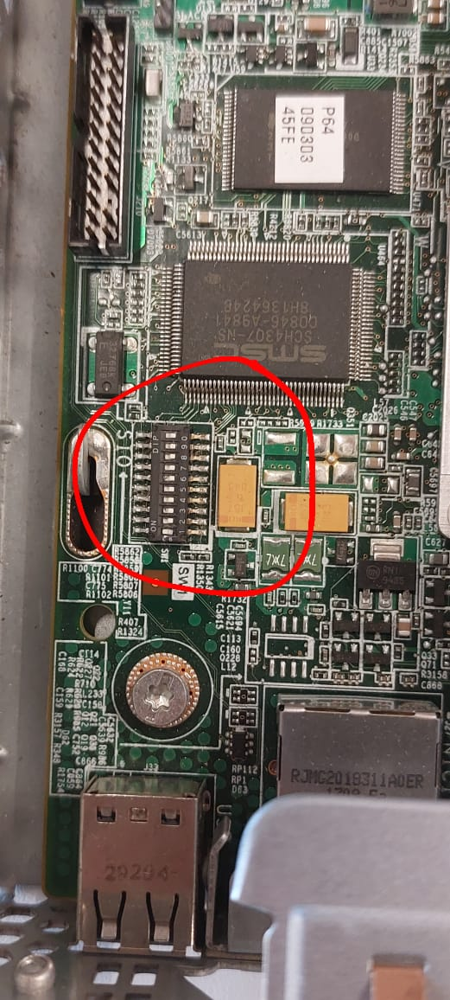

### 2.9 Les ports réseau et USB

Les deux petits blocs métalliques encerclés en vert sont les **ports réseau RJ-45**. C'est là qu'on branche les câbles Ethernet pour connecter le serveur au réseau. Le boîtier en métal protège la connexion des interférences. Juste à côté, on trouve un **port USB**, qui sert par exemple à brancher une clé USB d'installation.

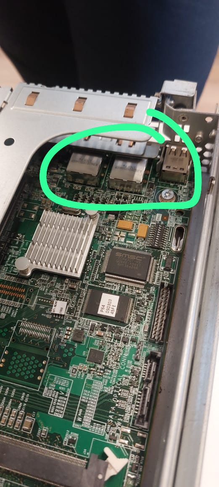

---

## 3. Démarche de dépannage

Au début du laboratoire, **le serveur n'arrivait pas à terminer le POST** (Power-On Self-Test). Le POST est le test automatique que le serveur fait au démarrage pour vérifier ses composants. Nous avons appliqué une méthode d'**isolation de panne** : tester ou changer **un seul élément à la fois** pour trouver la cause.

### 3.1 Étape 1 – Retrait du module de mémoire cache

**Problème :** avec le module de cache de 512 Mo installé sur le contrôleur RAID, le serveur ne parvenait pas jusqu'à l'écran du POST.

**Action :** nous avons **retiré le module de cache**.

**Résultat :** le serveur a pu avancer dans son démarrage.

> **Conseil :** sur ces serveurs, il vaut mieux retirer le module de cache dès le début du diagnostic. Un module de cache défectueux ou dont la batterie est usée peut bloquer complètement le démarrage.

### 3.2 Étape 2 – Remplacement de la pile CMOS

**Problème :** le serveur n'atteignait toujours pas le POST de façon fiable.

**Action :** nous avons **remplacé la pile CMOS** de la carte mère.

**Pourquoi :** une pile usée peut corrompre les réglages du BIOS et empêcher le démarrage.

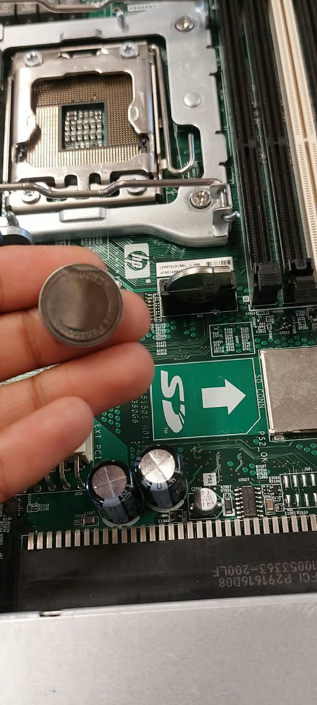

### 3.3 Étape 3 – Réinitialisation de la configuration avec l'interrupteur SW1

**Action :** nous avons utilisé l'**interrupteur n°6 du SW1** pour remettre le serveur à zéro :

1. Éteindre le serveur et débrancher les câbles d'alimentation.
2. Basculer l'interrupteur **n°6** en position **ON**.
3. Rebrancher et allumer le serveur. Il efface sa configuration.
4. Éteindre le serveur.
5. **Remettre l'interrupteur n°6 dans sa position de départ (OFF).** C'est important : sinon, le serveur se réinitialise à chaque démarrage.
6. Rallumer le serveur normalement.

### 3.4 Étape 4 – Vérification de la mémoire, puis découverte du problème de slot

**Première hypothèse :** nous avons d'abord pensé que la **mémoire RAM** était en cause.

**Ce qu'on a observé ensuite :** le serveur s'arrêtait avec ce message :

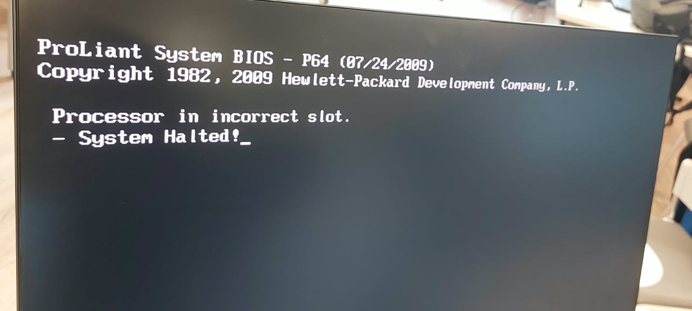

> **Processor in incorrect slot – System Halted!**

Ce message veut dire que **le processeur n'était pas dans le bon emplacement**. Quand un seul processeur est installé, il doit être dans l'emplacement **n°1**. Nous avons aussi remarqué que le BIOS de ce serveur était **très ancien** (version P64 du 24/07/2009).

**Action :** nous avons **déplacé le processeur dans l'emplacement n°1**.

**Résultat :** le serveur a **démarré correctement**. Le BIOS fonctionnait bien : le vrai problème venait de l'emplacement du processeur.

> **Tres important :** il faut toujours vérifier dans quel emplacement le processeur est installé. Une simple erreur de slot suffit à bloquer complètement le serveur.

---

## 4. Validation du POST

Une fois les corrections faites, le serveur passe le POST avec succès.

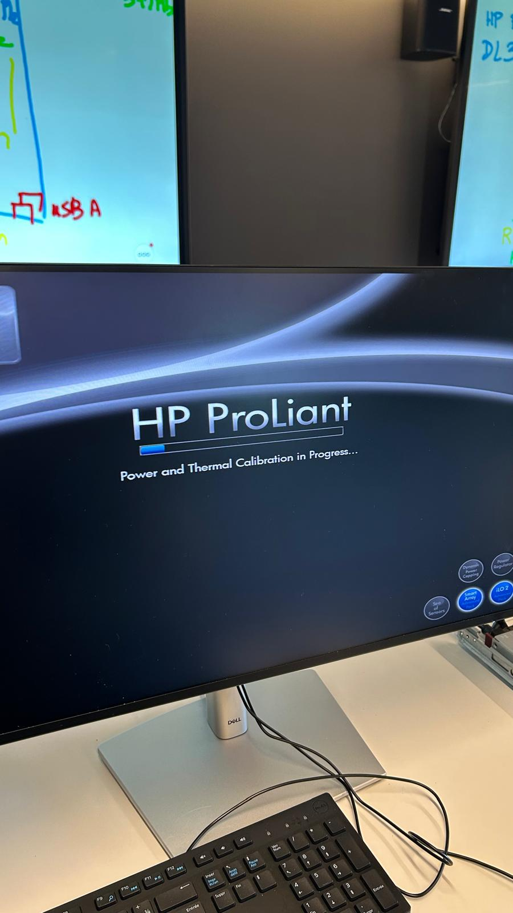

Au démarrage, le serveur fait d'abord une **calibration de l'alimentation et de la température**, puis affiche ses informations :

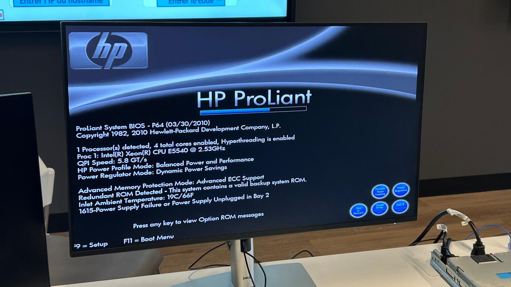

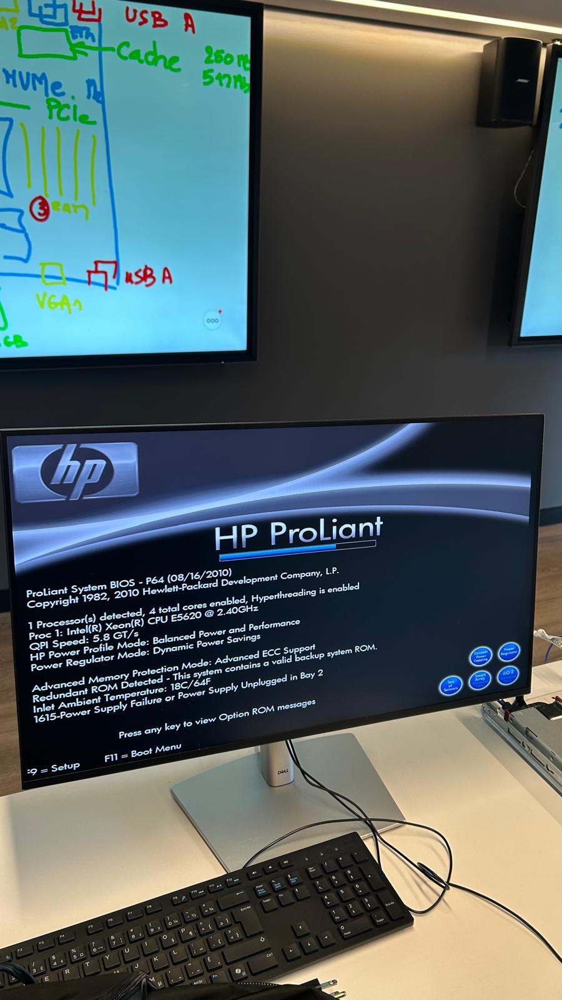

- **1 processeur détecté**, 4 cœurs activés, Hyperthreading activé
- **Processeur :** Intel Xeon (E5540 @ 2,53 GHz ou E5620 @ 2,40 GHz selon le test)
- **Température ambiante :** 18 à 19 °C
- **Message 1615 – Power Supply Failure or Power Supply Unplugged in Bay 2** : l'alimentation n°2 n'était pas branchée. Le serveur fonctionne quand même grâce à l'alimentation n°1. C'est un **avertissement**, pas une erreur bloquante.

### Outils de vérification utilisés

**ROM-Based Setup Utility (touche F9)** : le menu de configuration du BIOS. Il confirme le modèle (DL360 G6), la mémoire configurée et le processeur installé (Proc 1 installé, Proc 2 non installé).

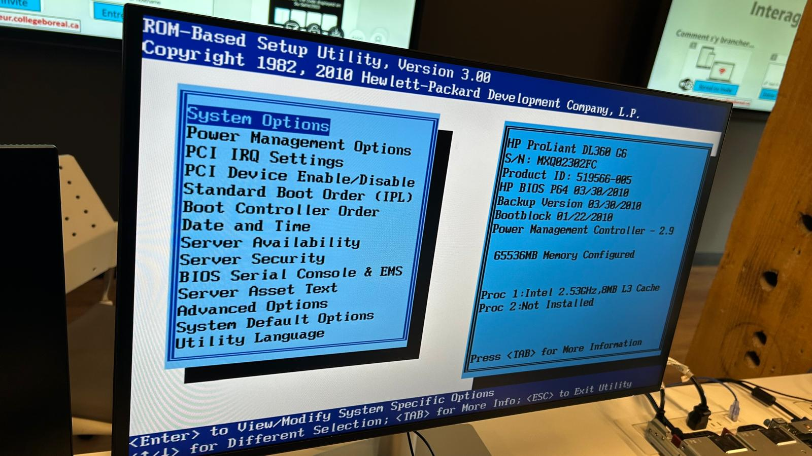

**Diagnostic Utility** : permet de lancer un test de la mémoire (Memory Test), du processeur (CPU Test) et du disque de démarrage (Boot Disk Test).

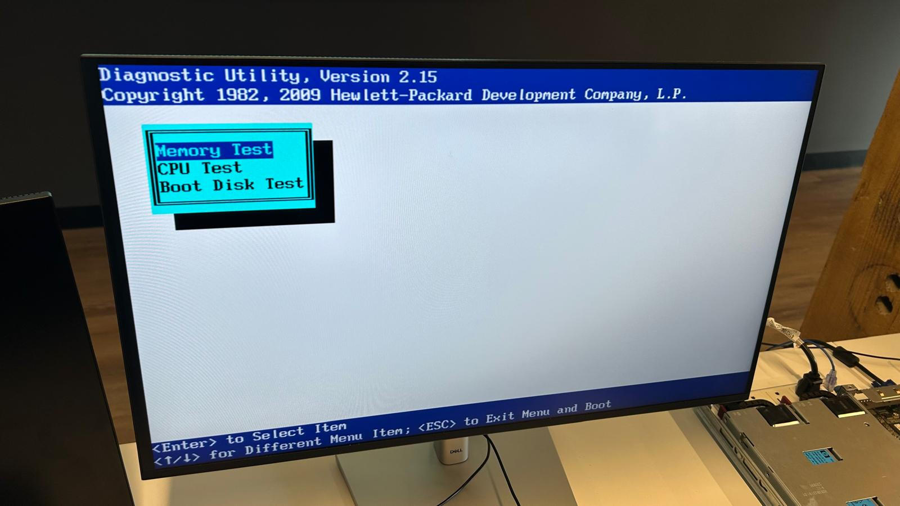

**BIOS CPU Diagnostic** : le processeur dans l'emplacement **Proc 1** a le statut **OK**.

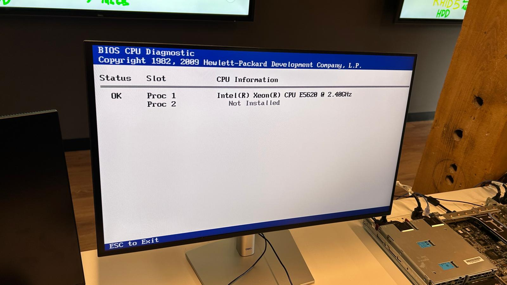

---

## 5. Conclusion

Ce laboratoire nous a permis de connaître les principaux composants d'un serveur HP ProLiant DL360 G6 et d'appliquer une méthode de dépannage étape par étape. Les problèmes rencontrés venaient de plusieurs sources : le **module de cache du contrôleur RAID**, la **configuration du BIOS** et surtout **l'emplacement du processeur**.

### Leçons apprises

- Toujours tester **un seul changement à la fois** pour isoler la panne.
- Retirer le **module de cache** du contrôleur RAID dès le début du diagnostic.
- Un seul processeur doit toujours être dans l'**emplacement n°1**.
- Après une réinitialisation avec l'interrupteur **SW1 n°6**, toujours le **remettre en position OFF**.
- Lire attentivement les **messages affichés au POST** : ils indiquent souvent directement la cause du problème.
- Ne pas publier de photo montrant des **mots de passe** (l'étiquette iLO a été masquée sur la photo du serveur).
