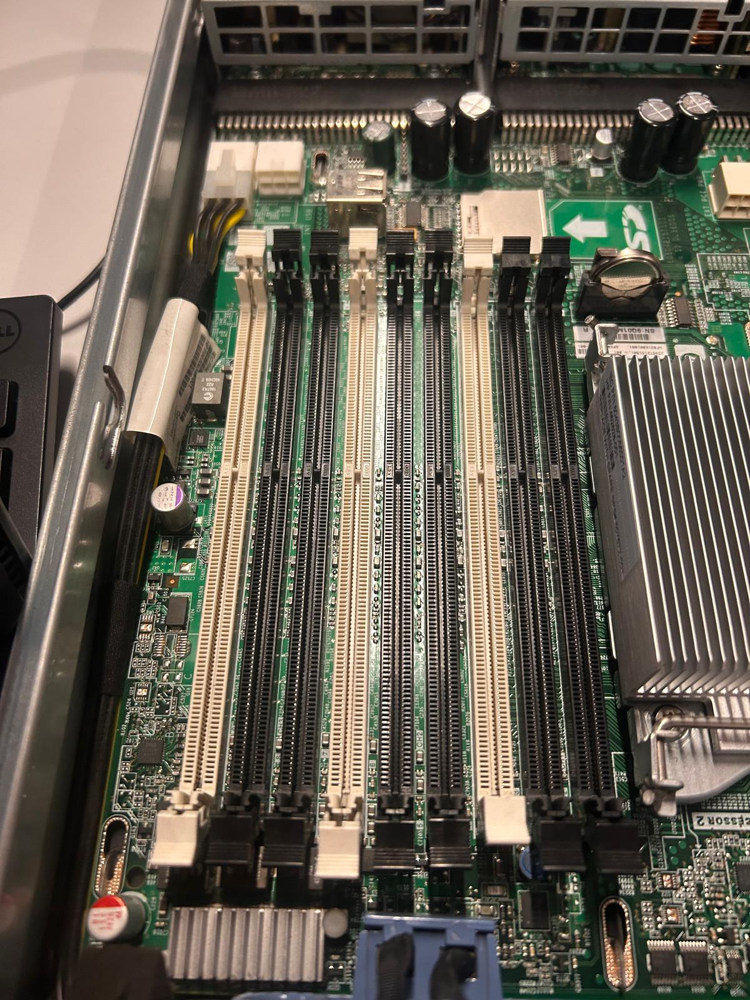
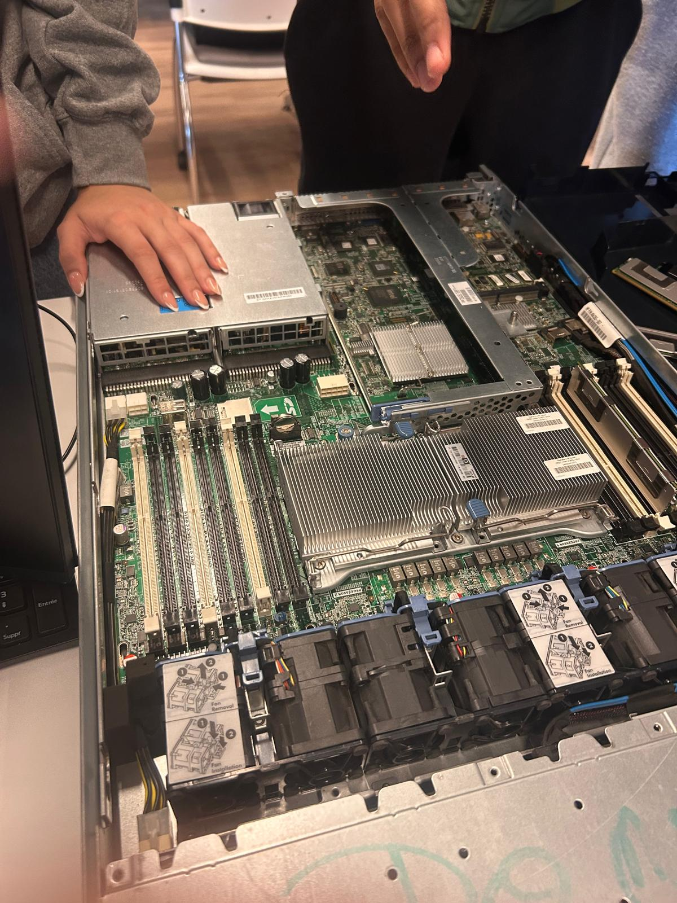
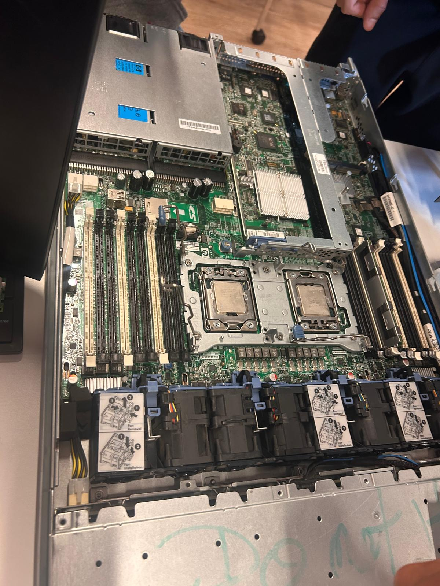
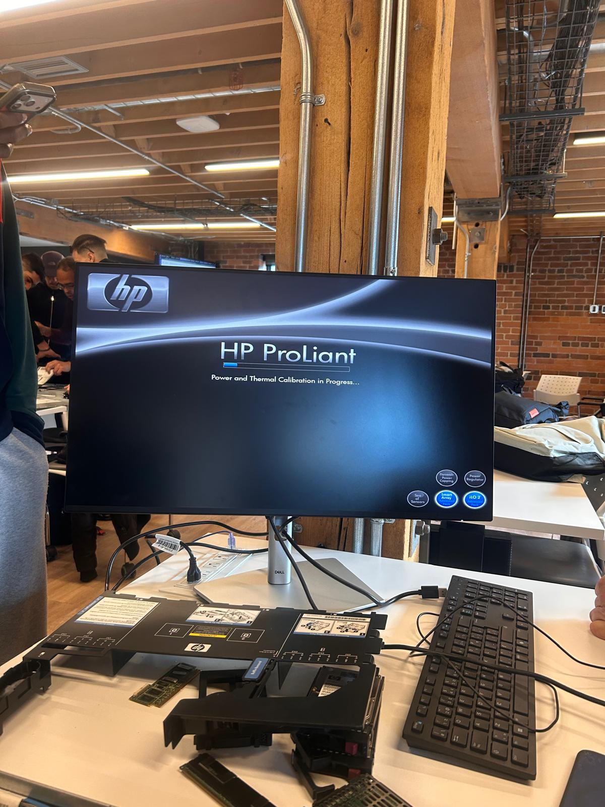
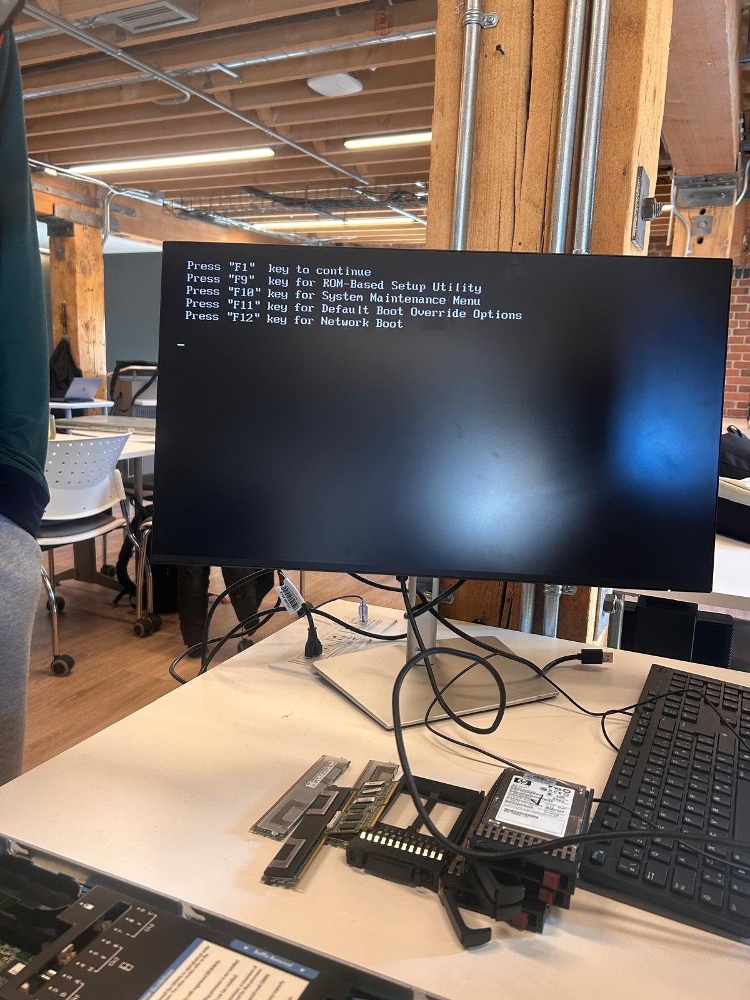
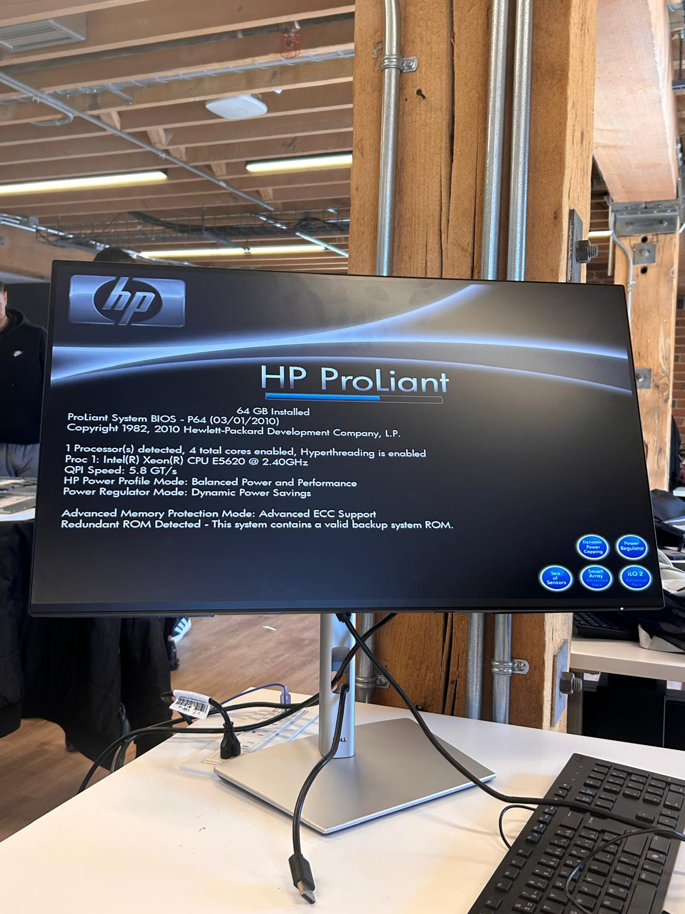
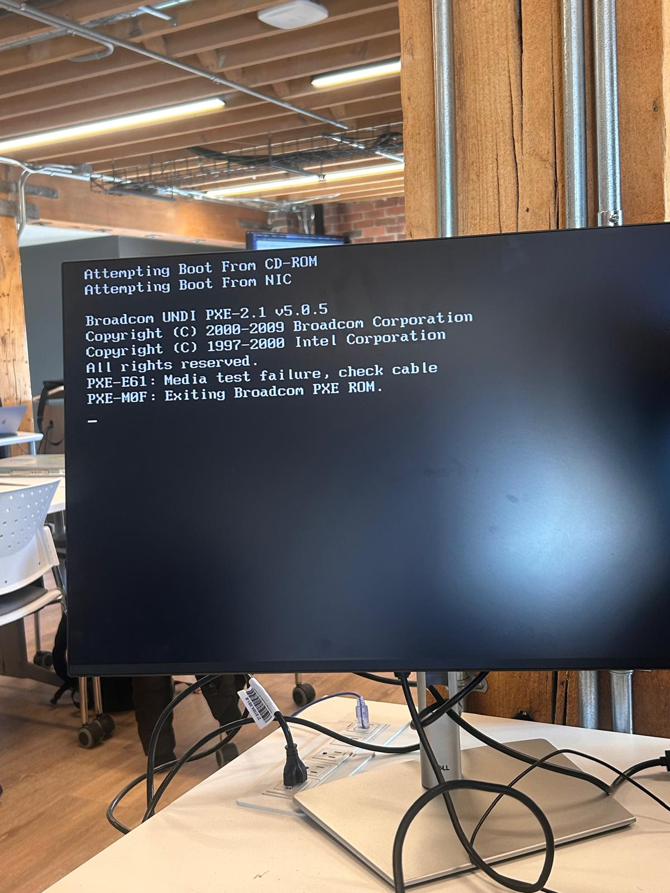

# INF1085 — Diagnostics

## 300150470

## Rapport de diagnostic — Serveur HP ProLiant DL360 G6

### 1. Problème de départ

Le serveur ne démarrait pas normalement. L'objectif du travail était simple :
vérifier les composants un par un, au lieu de tout changer en même temps, pour
trouver d'où venait la panne.

### 2. Inspection du matériel

Nous avons ouvert le serveur et observé la carte mère, les emplacements mémoire,
les processeurs sous leurs dissipateurs, les ventilateurs et le déflecteur d'air.

*Figure 1 : Serveur ouvert, dissipateurs, barrettes de RAM retirées et ventilateurs visibles.*

*Figure 2 : Emplacements DIMM, blancs et noirs, sur la carte mère.*

*Figure 3 : Vue complète du serveur ouvert, avec les dissipateurs et les ventilateurs.*

### 3. Processeurs et sockets

Les processeurs ont été retirés, inspectés, puis réinstallés. C'est l'étape la
plus délicate : il faut manipuler le dissipateur avec soin et vérifier le socket
avant de remettre le processeur en place.

*Figure 4 : Manipulation du dissipateur thermique sur le processeur.*

*Figure 5 : Socket ouvert, avec les broches visibles, dissipateur retiré.*

*Figure 6 : Les deux emplacements processeurs, avec les processeurs installés.*

### 4. Démarrage et test POST

Après avoir réinstallé les composants nécessaires, le serveur a été mis sous
tension. Il commence par la calibration thermique, puis il passe le POST
(Power-On Self-Test).

*Figure 7 : Écran HP ProLiant, « Power and Thermal Calibration in Progress... ».*

*Figure 8 : Écran BIOS avec les options F1 pour continuer, F9 pour le ROM-Based
Setup Utility, F10 pour le System Maintenance Menu, F11 pour le Default Boot
Override et F12 pour le Network Boot. Sur la table, les barrettes de RAM et les
disques retirés pendant les tests.*

### 5. Ce que le BIOS a détecté

Sur un premier démarrage, le BIOS affichait :

- **1 Processor(s) detected, 4 total cores enabled, Hyperthreading is enabled**
- **Proc 1 : Intel(R) Xeon(R) CPU E5620 @ 2.40GHz**
- **QPI Speed : 5.8 GT/s**
- **16 GB Installed**
- **Advanced Memory Protection Mode : Advanced ECC Support**
- BIOS : ProLiant System BIOS - P64 (03/01/2010)

*Figure 9 : Écran POST, processeur Xeon E5620 détecté, 16 Go installés.*

### 6. Diagnostic de la mémoire

Le diagnostic mémoire du BIOS confirme la configuration complète :

- 4 barrettes de **16 384 Mo** sur le processeur 1
- Total : **65 536 Mo, soit 64 Go**, affichés comme « Available » et « Configured »
- Les autres emplacements sont indiqués « Not Installed » sur cet écran

*Figure 10 : BIOS Memory Diagnostic, 4 x 16 384 Mo, 65 536 Mo au total.*

Après la réinstallation complète de la mémoire, le POST affiche bien 64 Go.

*Figure 11 : Écran POST, 64 GB Installed, même processeur Xeon E5620, avec la
mention « Redundant ROM Detected ».*

### 7. Erreur de démarrage PXE

Sans disque bootable installé au moment du test, le serveur a essayé le CD-ROM,
puis le réseau, et il a échoué :

- Attempting Boot From CD-ROM
- Attempting Boot From NIC
- **PXE-E61 : Media test failure, check cable**
- **PXE-M0F : Exiting Broadcom PXE ROM.**

*Figure 12 : Tentative de démarrage réseau, erreur PXE-E61 puis sortie du PXE ROM.
C'est normal dans cette configuration de test, sans disque bootable : le serveur
n'a rien trouvé d'où démarrer.*

### 8. Résultats

| Composant | Résultat |
| --- | --- |
| Processeur 1 | Détecté, Xeon E5620 @ 2.40 GHz, 4 cœurs |
| Sockets processeurs | Inspectés, processeurs retirés puis réinstallés |
| Mémoire RAM | 4 x 16 Go détectés, 64 Go au total |
| POST | Réussi |
| BIOS | Accessible, version P64 |
| Ventilateurs et refroidissement | En place, calibration thermique passée |
| Démarrage réseau | PXE-E61, aucun périphérique bootable à ce moment-là |

### 9. Conclusion

En procédant composant par composant, nous avons pu vérifier que le processeur
et la mémoire fonctionnent : le POST passe, le BIOS détecte le Xeon E5620 et
les 64 Go de RAM sont confirmés par le diagnostic mémoire. Le serveur n'a pas
démarré sur un système à ce stade parce qu'aucun disque bootable n'était
installé pendant les tests, ce que l'erreur PXE montre clairement.
