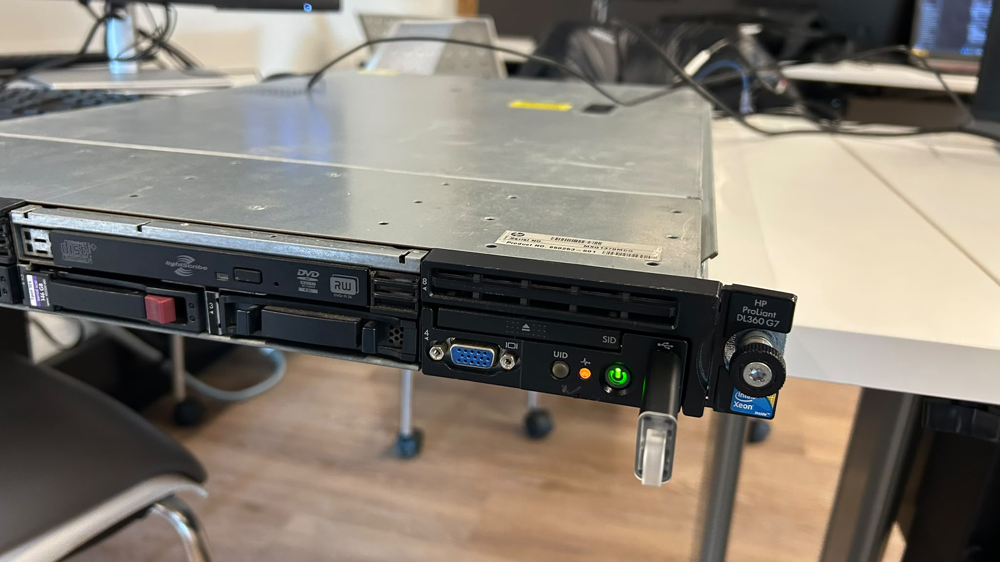
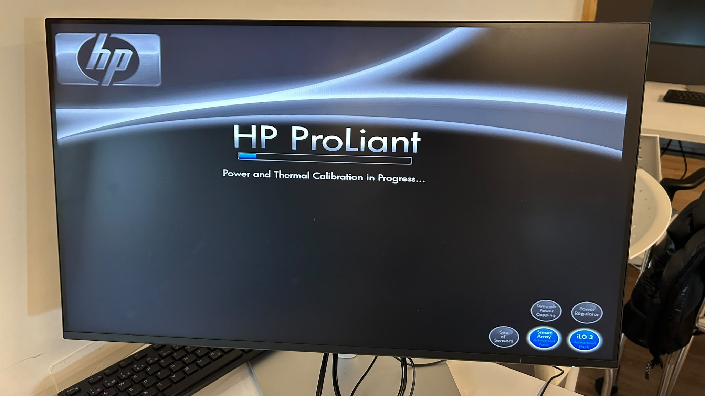
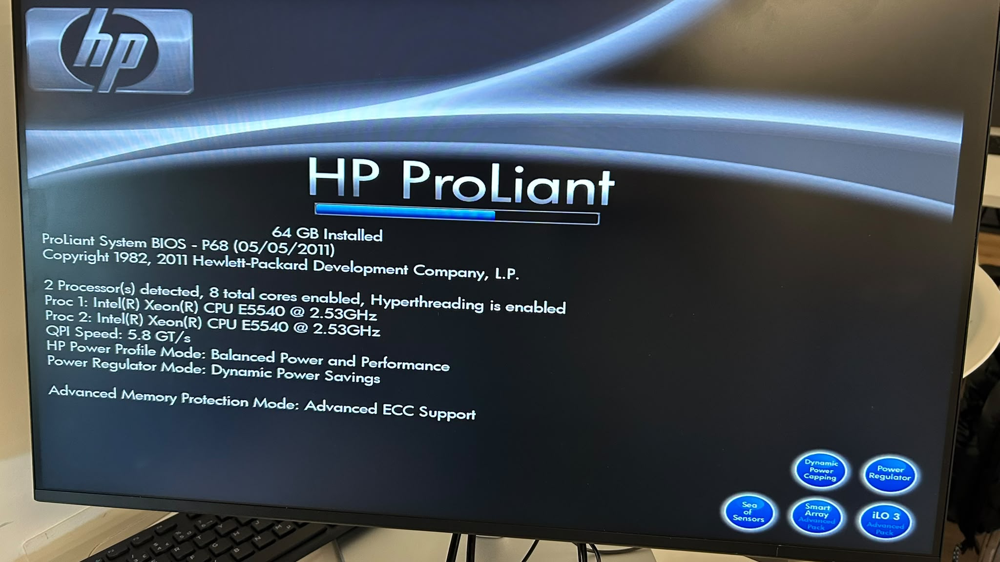
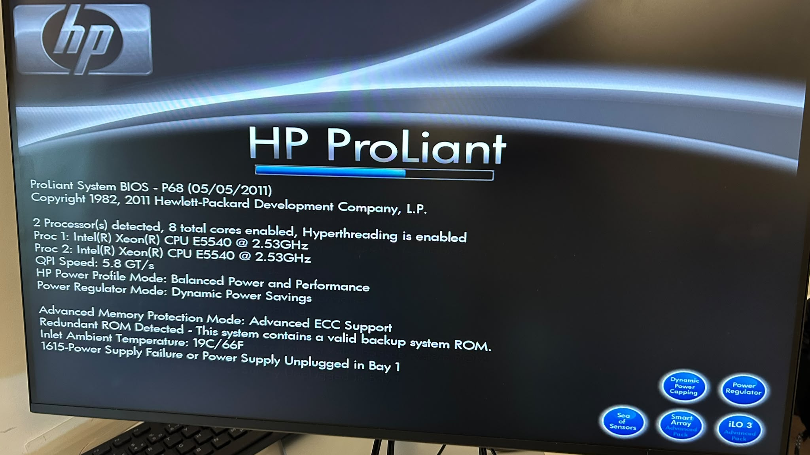
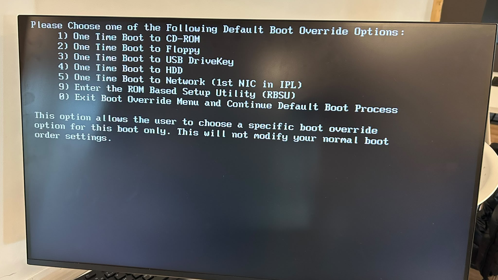

# 🔌 Diagnostics - Serveur HP ProLiant DL360 G7

| Champ | Valeur |
|-------|--------|
| Nom | Arnauld Tchumno |
| Numéro étudiant | 300151483 |
| Serveur | HP ProLiant DL360 G7 - Rack 2, U34 - `server237` |
| Date des photos | 7 octobre 2026 |

## 1. Problème de départ

Le serveur HP ProLiant ne démarrait pas correctement. Pour trouver la cause sans tout remplacer, on a utilisé une méthode d'**élimination** : démarrer avec la configuration minimale (1 processeur, 1 barrette de RAM, sans disque), puis remettre les composants un par un.

*Figure 1 : Face avant du HP ProLiant DL360 (1U). On voit les baies de disques hot-swap, le lecteur optique, le port VGA/USB, le bouton d'alimentation et la clé USB d'installation branchée.*

---

## 2. Composants matériels

| Composant | Détail | Ce qu'on vérifie |
|-----------|--------|------------------|
| Processeurs | **2 × Intel Xeon E5540 @ 2.53 GHz** (4 cœurs, Hyperthreading) | Broches du socket LGA1366, dissipateur, pâte thermique |
| Mémoire | DDR3 ECC, **64 Go** au total | Barrettes dans les bons slots selon CPU1 / CPU2 |
| Contrôleur RAID | HP **Smart Array** P410i + module cache | Détection au POST |
| Disques SAS | Baies *hot-swap* à l'avant | Retirés pendant les premiers tests |
| SSD NVMe | SK hynix PC811 **1 To** (sur carte PCIe) | Vu par l'installateur comme `/dev/nvme0n1` |
| Alimentations | 2 blocs redondants (Bay 1 / Bay 2) | Branchement des deux cordons |
| Gestion | **iLO 3** | Administration à distance |

> **Hot-swap** : un disque peut être retiré ou remplacé sans arrêter complètement le serveur.

---

## 3. Démarrage et calibration

*Figure 2 : Au démarrage, le serveur affiche « Power and Thermal Calibration in Progress… ». Les ventilateurs tournent à fond pendant que le système mesure les températures. Si le serveur reste bloqué ici, il faut vérifier les CPU, la RAM et les ventilateurs.*

---

## 4. Écran POST - configuration complète

Après la remise en place de tous les composants, le POST (*Power-On Self-Test*) réussit :

*Figure 3 : POST réussi avec la configuration complète.*

| Information affichée | Valeur |
|---------------------|--------|
| BIOS | ProLiant System BIOS **P68 (05/05/2011)**, ce qui correspond à un **G7** |
| Mémoire | **64 GB Installed** |
| Processeurs | **2 Processor(s) detected, 8 total cores enabled, Hyperthreading is enabled** |
| Proc 1 / Proc 2 | Intel Xeon **E5540 @ 2.53 GHz** |
| QPI Speed | 5.8 GT/s |
| Protection mémoire | Advanced ECC Support |

✅ Les **deux** sockets fonctionnent. Linux devrait donc voir 2 sockets × 4 cœurs × 2 threads = **16 processeurs logiques**. Ce résultat est confirmé plus tard avec `nproc` dans [2.Proxmox](../../2.Proxmox/300151483/README.md).

---

## 5. Alerte détectée : alimentation

*Figure 4 : Lors d'un autre démarrage, de nouveaux messages apparaissent sous la même configuration.*

| Message | Signification |
|---------|---------------|
| `Redundant ROM Detected - This system contains a valid backup system ROM.` | ✅ Une copie de secours du BIOS existe, c'est normal |
| `Inlet Ambient Temperature: 19C/66F` | ✅ La température d'entrée d'air est correcte |
| `1615-Power Supply Failure or Power Supply Unplugged in Bay 1` | ⚠️ Le bloc d'alimentation de la **baie 1** est débranché ou en panne |

**Diagnostic** : le serveur démarre quand même grâce à l'alimentation **redondante** de la baie 2. Mais il n'y a plus de redondance : si la seconde alimentation tombe, le serveur s'arrête.
**Action** : vérifier que le cordon de la baie 1 est bien branché. Si l'erreur persiste, remplacer le bloc (il est hot-plug).

---

## 6. Menu de démarrage (F11)

*Figure 5 : Menu « Default Boot Override », obtenu avec **F11** pendant le POST.*

| Option | Usage |
|--------|-------|
| 1) CD-ROM | Démarrer sur le lecteur optique |
| 2) Floppy | Disquette (obsolète) |
| **3) USB DriveKey** | ✅ **Choisi** pour lancer l'installateur Proxmox depuis la clé USB |
| 4) HDD | Démarrer sur le disque (volume RAID) |
| 5) Network (PXE) | Démarrage réseau |
| 9) RBSU | ROM-Based Setup Utility (BIOS) |

Le choix ne s'applique qu'à **ce démarrage**, sans modifier l'ordre de démarrage normal.

Touches utiles au POST : **F8** (ORCA / iLO), **F9** (RBSU), **F10** (Maintenance), **F11** (Boot Override), **F12** (PXE).

---

## 7. Configuration et formatage des disques (RAID 5)

Avec l'utilitaire du contrôleur **Smart Array P410i** (ORCA, touche **F8** au POST) :

1. Remise en place des **3 disques SAS de 146,8 Go**.
2. Création d'un **Logical Drive** en **RAID 5**.
3. Capacité utile : (3 − 1) × 146,8 Go ≈ **293,6 Go = 273,4 GiB**. L'équivalent d'un disque sert à la parité.

Le volume RAID apparaît ensuite dans l'installateur Proxmox comme **`/dev/sda (273.40GiB, LOGICAL VOLUME)`** (voir [2.Proxmox, figure 6](../../2.Proxmox/300151483/README.md)). C'est la preuve que la configuration RAID est bien reconnue.

> **Parité** : en RAID 5, les données et la parité sont réparties sur tous les disques. Si **un** disque tombe en panne, ses données sont reconstruites à partir des deux autres.

| Disque vu par Linux | Type | Taille | Usage |
|---------------------|------|--------|-------|
| `/dev/sda` | Logical Volume RAID 5 (Smart Array) | 273,40 GiB | **Système Proxmox** |
| `/dev/nvme0n1` | SSD NVMe SK hynix PC811 | 953,87 GiB (1 To) | Stockage rapide pour les VM |

---

## 8. Résultats

| Composant | Résultat |
|-----------|----------|
| Processeur 1 | ✅ Xeon E5540 @ 2.53 GHz |
| Processeur 2 | ✅ Xeon E5540 @ 2.53 GHz |
| Mémoire | ✅ 64 Go, Advanced ECC |
| BIOS | ✅ P68 (05/05/2011), ROM de secours valide |
| Température | ✅ 19 °C en entrée |
| Alimentation | ⚠️ Bay 1 débranchée ou en panne (erreur 1615) |
| Disques | ✅ RAID 5 de 273,4 GiB + NVMe de 1 To |
| POST | ✅ Réussi |

## 9. Conclusion

La méthode composant par composant a permis de valider les deux processeurs et les 64 Go de RAM. Le POST signale seulement un problème d'alimentation en baie 1, qui n'empêche pas le démarrage grâce à la redondance. Après la création du volume RAID 5, le serveur est prêt pour l'installation de Proxmox VE.
