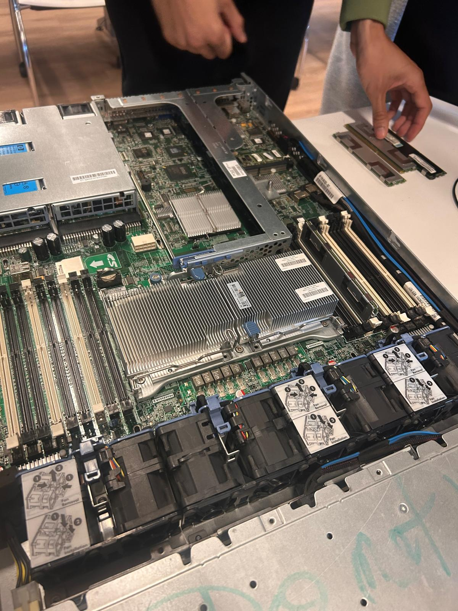
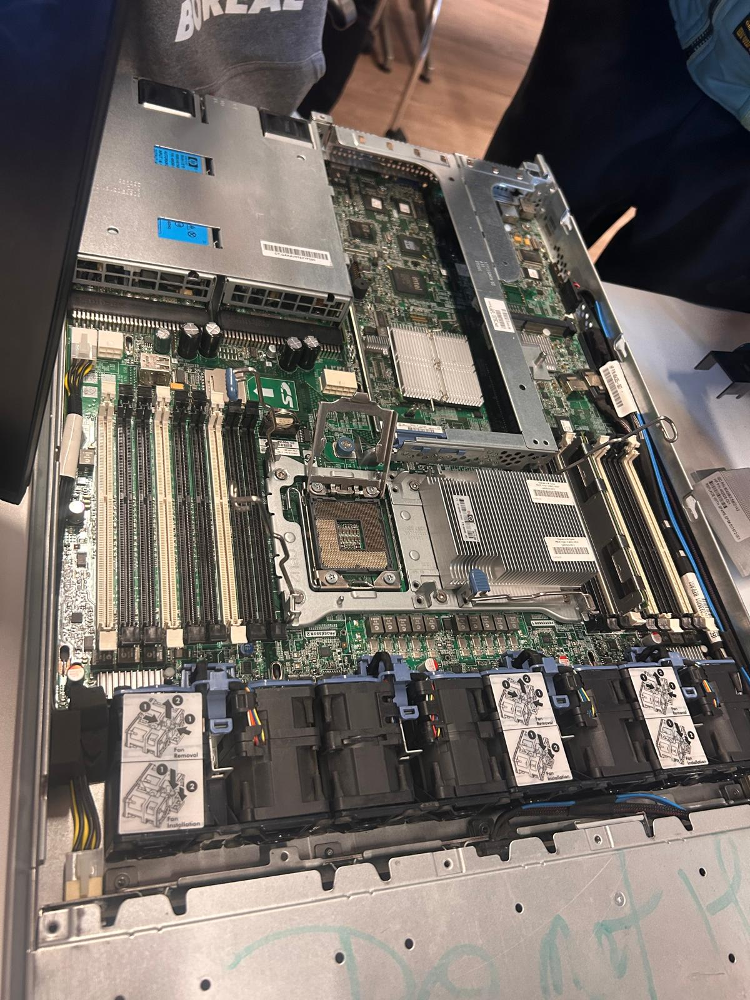
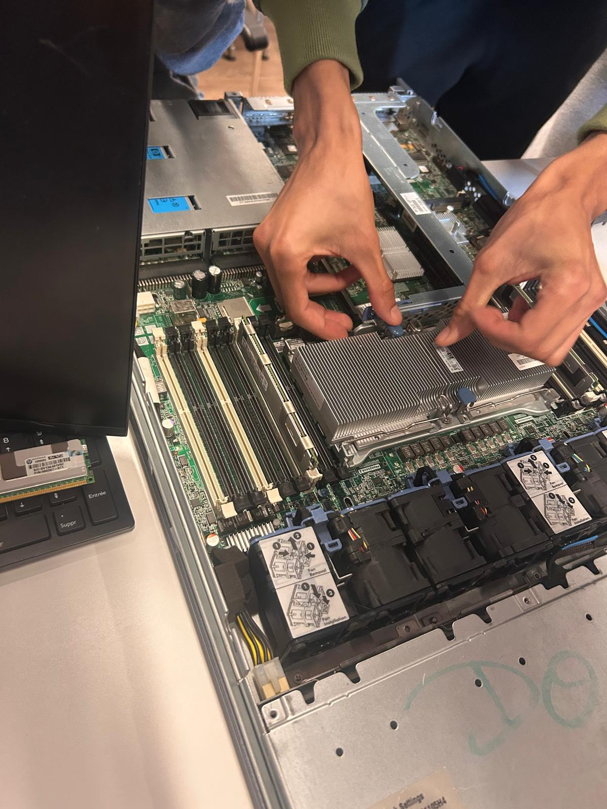
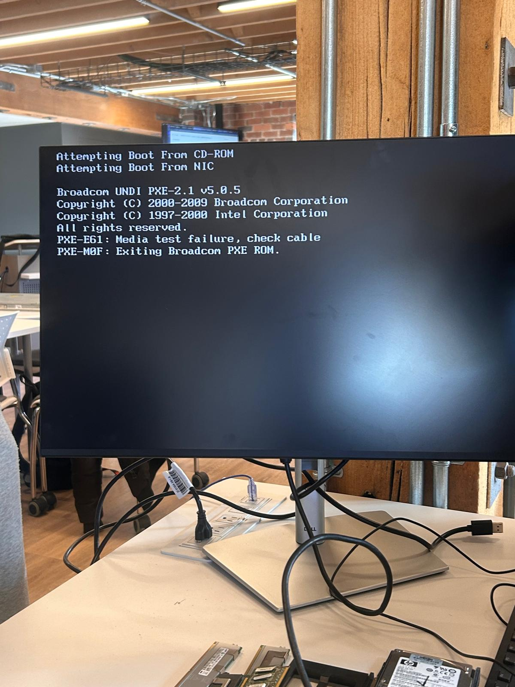
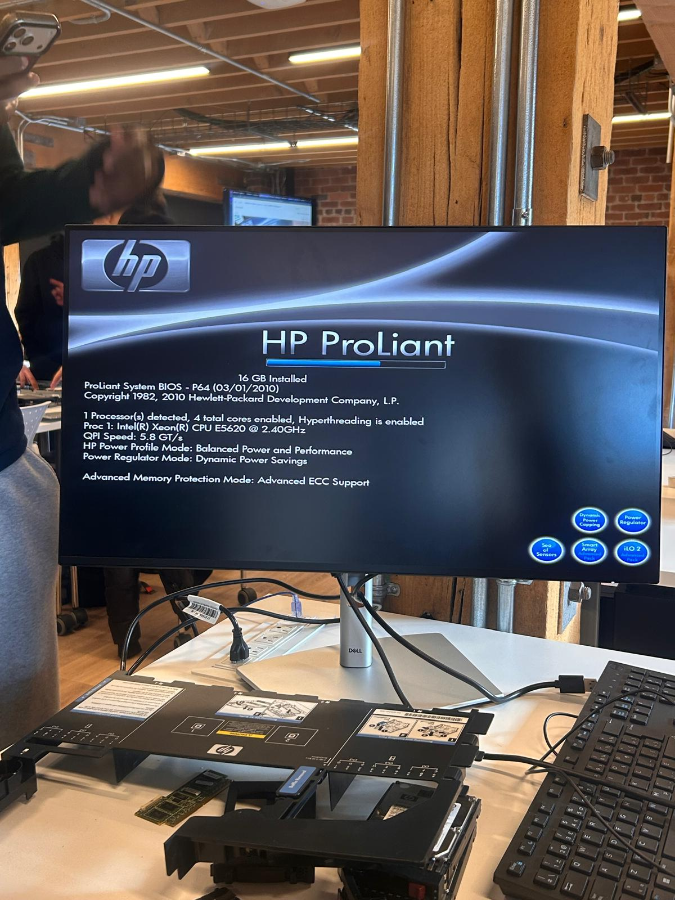
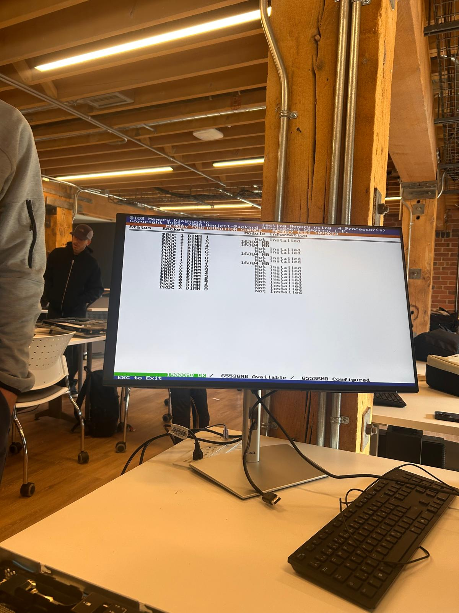

# INF1085 – Administration Linux

## Rapport de diagnostic et de validation matérielle — Serveur HP ProLiant

**Par :** Amirouche Lounaci
**Cours :** INF1085-201 — Administration Linux

## 1. Introduction

Dans le cadre du travail pratique du cours INF1085, nous avons pris en charge un serveur HP ProLiant qui ne démarrait pas normalement. Plutôt que de remplacer des pièces au hasard, nous avons appliqué une démarche de diagnostic ordonnée : observer l'intérieur de la machine, isoler chaque composant, tester, puis valider l'ensemble avant de conclure. Ce rapport retrace chaque étape, avec les photos prises pendant la manipulation.

## 2. Inspection du matériel

La première étape a consisté à ouvrir le capot du serveur pour observer ses composants internes : la carte mère, les emplacements pour processeurs, les emplacements de mémoire, les dissipateurs thermiques et les ventilateurs. Cette vue d'ensemble permet de repérer un composant mal installé, un élément manquant ou un dommage visible avant de passer aux tests.

## 3. Vérification des processeurs

Le serveur possède deux emplacements pour processeurs. Nous avons retiré les processeurs pour examiner les sockets et l'état des contacts, puis nous les avons réinstallés avec soin. Cette vérification permet d'écarter un mauvais positionnement ou un processeur défectueux comme cause du problème de démarrage.

## 4. Installation des dissipateurs thermiques

Une fois les processeurs vérifiés, les dissipateurs thermiques ont été remis en place sur chacun d'eux. Le dissipateur évacue la chaleur produite par le processeur pendant le fonctionnement : mal installé, il peut provoquer une surchauffe et empêcher le serveur de fonctionner normalement.

## 5. Vérification de la mémoire RAM

Nous avons ensuite contrôlé les emplacements DIMM et les barrettes de mémoire. Les barrettes doivent être placées dans les bons emplacements, selon la configuration du serveur et les processeurs installés. Pour faciliter le diagnostic, la méthode consiste à commencer avec une seule barrette, puis à ajouter les autres progressivement : cela permet de savoir si une barrette ou un emplacement précis est responsable d'un problème.

## 6. Composants retirés pendant le diagnostic

Pour isoler la cause du problème, plusieurs composants ont été retirés temporairement pendant les tests : des barrettes de mémoire et le disque dur. Retirer le disque permet par exemple de réaliser le test de démarrage indépendamment du système de stockage, et donc de déterminer si le problème vient du processeur, de la mémoire ou du stockage.

## 7. Problème de démarrage constaté

Au démarrage, le serveur a tenté de démarrer sur le CD-ROM, puis sur la carte réseau (NIC). La tentative réseau s'est soldée par un échec : le message « PXE-E61: Media test failure, check cable » s'est affiché, suivi de « PXE-M0F: Exiting Broadcom PXE ROM ». Autrement dit, aucun périphérique de démarrage valable n'a été trouvé à ce moment-là. Ce constat a orienté la suite du diagnostic vers le matériel plutôt que vers le système installé.

## 8. Démarrage du serveur et test POST

Une fois les composants vérifiés et remis en place, le serveur a été mis sous tension. L'écran HP ProLiant s'est affiché avec l'étape « Power and Thermal Calibration in Progress ». Le serveur entrait donc dans sa séquence de démarrage normale. Le POST (Power-On Self-Test) permet au serveur de vérifier ses principaux composants avant de lancer un système d'exploitation.

## 9. Premier démarrage : 16 Go détectés

Le premier écran de démarrage validé affichait la configuration suivante : BIOS ProLiant System BIOS P64, 1 processeur détecté, 4 cœurs activés, Hyperthreading activé, et 16 Go de mémoire installée. Le processeur détecté est un Intel Xeon E5620 à 2,40 GHz, avec une vitesse QPI de 5,8 GT/s.

## 10. Diagnostic de la mémoire avec le BIOS

Nous avons ensuite utilisé l'utilitaire BIOS Memory Diagnostic. Le diagnostic a affiché des barrettes de 16 384 Mo chacune et un total de 65 536 Mo configurés, soit 64 Go de mémoire. Cette étape permet de vérifier que les barrettes sont bien reconnues par le serveur et que le BIOS peut accéder à la mémoire installée.

## 11. Configuration finale validée

Après la vérification complète, le serveur a démarré avec 64 Go de mémoire installée, le même processeur Xeon E5620 détecté, et la mention d'une ROM redondante valide. Chaque composant avait été vérifié un par un avant cette validation finale.

## 12. Résultats obtenus

| Composant | Résultat |
|---|---|
| Processeur | Intel Xeon E5620 @ 2,40 GHz, détecté, 4 cœurs, Hyperthreading activé |
| Processeurs détectés | 1 |
| Mémoire installée | 16 Go au premier démarrage, 64 Go après validation |
| Mémoire configurée | 65 536 Mo (64 Go) |
| BIOS | ProLiant System BIOS P64 |
| POST | Réussi, calibration thermique terminée |
| Disque dur | Vérifié et réinstallé |
| Ventilateurs | En place et fonctionnels |
| iLO | iLO 2 présent |

## 13. Conclusion

Ce travail pratique nous a permis de réaliser un dépannage complet, étape par étape. Nous avons commencé par inspecter les composants internes, puis nous avons vérifié les processeurs, les dissipateurs thermiques et la mémoire, en retirant et en réinstallant les éléments un par un. Le problème de démarrage observé (échec PXE) a été identifié, puis le serveur a réussi son test POST et son diagnostic mémoire. La machine est maintenant fonctionnelle avec sa configuration validée de 64 Go de mémoire, prête pour l'installation d'un système d'exploitation.
