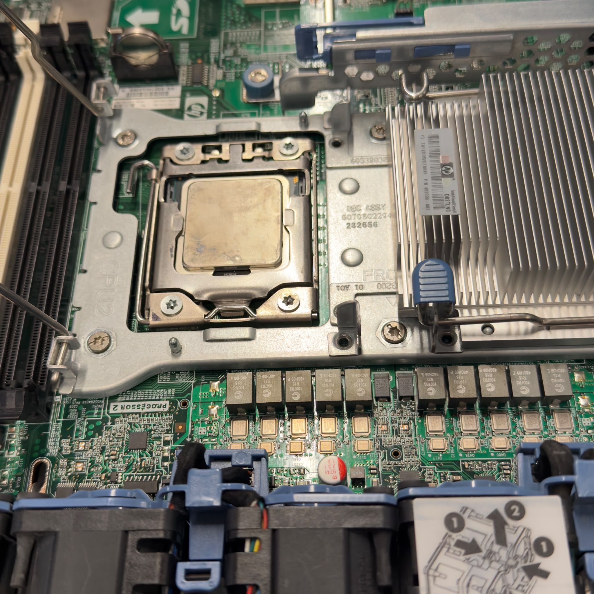

# Diagnostic du démarrage d’un HP ProLiant DL360 G6

Le problème à diagnostiquer est l’absence de POST après l’ajout du deuxième processeur. Les causes possibles sont un processeur défectueux, un socket endommagé ou une barrette mal placée sur le canal mémoire associé.

1. Relever les voyants, les bips et le comportement des ventilateurs.
2. Arrêter le serveur, débrancher l’alimentation et suivre les procédures antistatiques du laboratoire.
3. Confirmer que la configuration connue avec CPU1 démarre. Tester ensuite CPU2 seul dans le socket 1 avec une barrette fonctionnelle dans l’emplacement recommandé.
4. Si CPU2 démarre dans le socket 1, inspecter le socket 2, ses broches et la configuration de sa mémoire. Si CPU2 échoue alors que CPU1 fonctionne dans la même configuration, CPU2 devient la cause la plus probable.
5. Si des broches sont cassées, comparer le coût du remplacement de la carte système avec celui d’une réparation spécialisée.

## Bilan du diagnostic documenté

Le rapport de référence décrit le retrait et la réinstallation des processeurs pour contrôler leur position et leur fixation. Après remontage, le serveur a affiché l’écran HP ProLiant, lancé la calibration thermique et poursuivi son démarrage jusqu’à Proxmox VE.

[Rapport de référence](https://github.com/CollegeBoreal/INF1085-201-26A-04/tree/main/1.Diagnostics/300153401#-7-d%C3%A9marrage-du-serveur-et-test-post)

## Photo du laboratoire

Cette photo illustre la position et la fixation du processeur.

[Source de la photo](https://github.com/CollegeBoreal/INF1085-201-26A-04/tree/main/1.Diagnostics/300153401)
