# 🔌 Diagnostics - Serveur HP ProLiant DL360 G7

| Champ | Valeur |
|-------|--------|
| Nom | Yacoub Bâ |
| Numéro étudiant | 300153932 |
| Serveurs | HP ProLiant DL360 G7 - Rack 2 (`server237`, `server239`) |
| Date du laboratoire | Octobre 2026 |

> 📸 Les photos ont été prises par notre équipe pendant le laboratoire.

## 🎯 Objectif

Vérifier qu'un ancien serveur HP ProLiant démarre correctement avant d'y installer Proxmox : identifier le matériel, lire les messages du POST, puis préparer les disques (RAID).

---

## 1. Le matériel

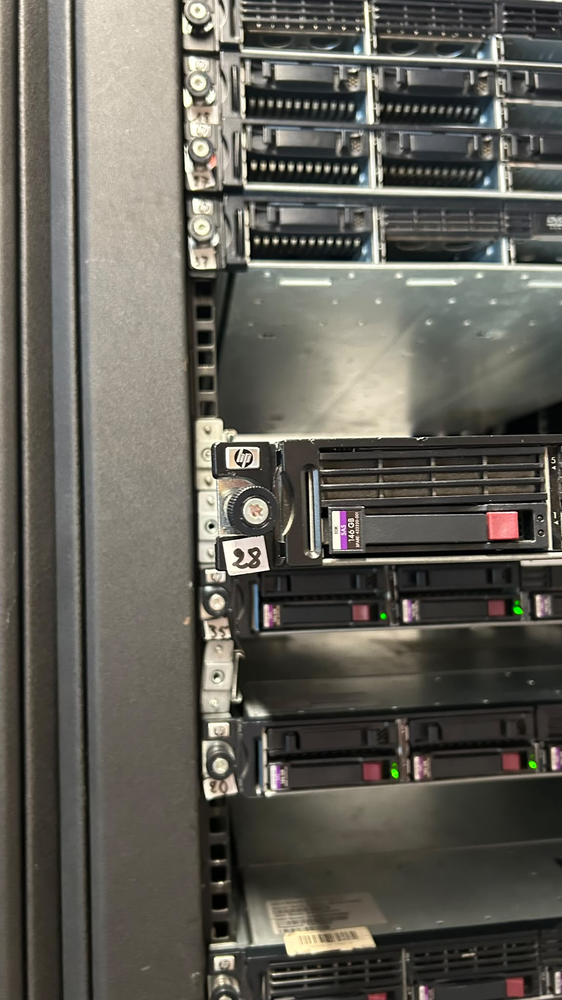

*Figure 1 : Le rack 42U du laboratoire. Le commutateur réseau est en haut, les serveurs DL360 (format 1U) en dessous.*

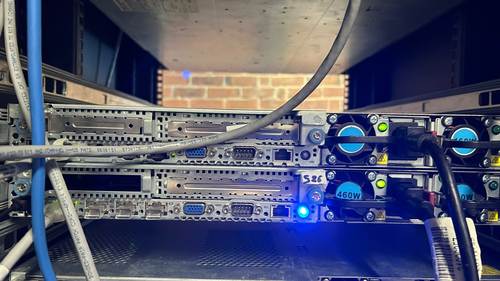

*Figure 2 : L'arrière des serveurs : câbles réseau, sortie VGA et les deux blocs d'alimentation.*

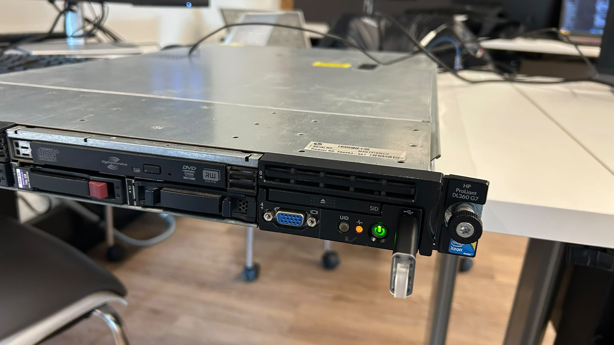

*Figure 3 : La face avant d'un DL360 : baies de disques *hot-swap*, lecteur optique, port USB (clé d'installation branchée) et bouton d'alimentation.*

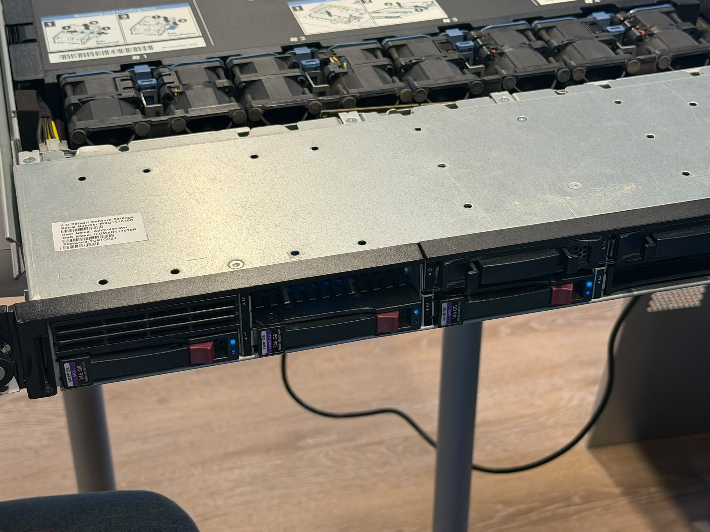

*Figure 4 : Le serveur ouvert : on voit la rangée de ventilateurs, les emplacements CPU et les barrettes de mémoire.*

| Composant | Détail |
|-----------|--------|
| Processeurs | 2 × Intel Xeon **E5540** @ 2.53 GHz (4 cœurs chacun, Hyperthreading) |
| Mémoire | **64 Go** DDR3 ECC |
| Contrôleur RAID | HP **Smart Array P410i** |
| Disques | 3 × 146.8 Go SAS (baies avant) + SSD NVMe 1 To sur carte PCIe |
| Gestion à distance | **iLO 3** |
| BIOS | ProLiant System BIOS **P68 (05/05/2011)** |

---

## 2. Démarrage et POST

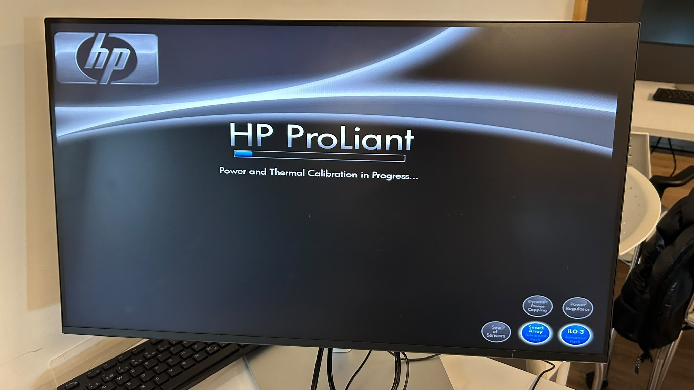

*Figure 5 : « Power and Thermal Calibration in Progress… ». Au démarrage, les ventilateurs tournent à fond pendant que le serveur mesure les températures.*

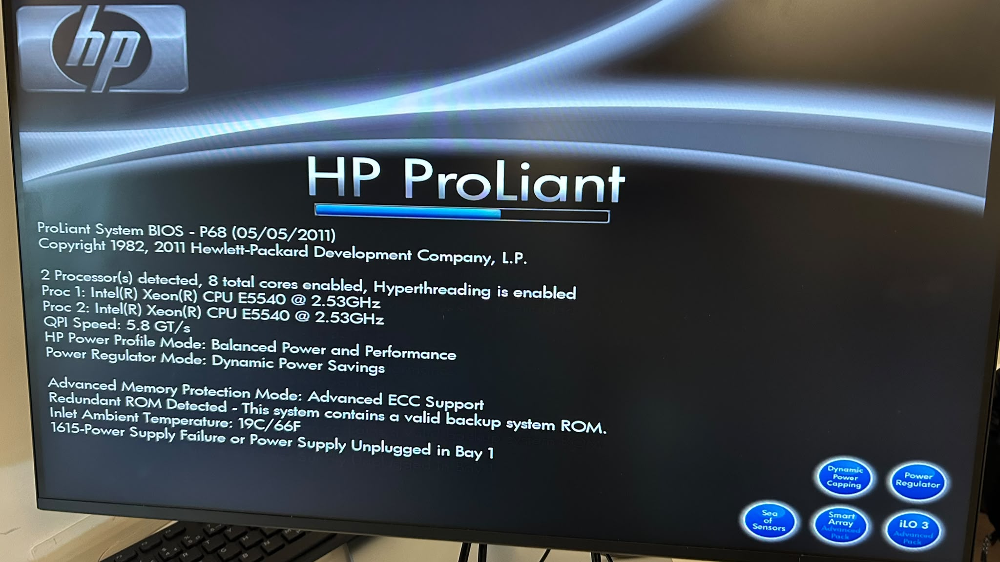

*Figure 6 : Le POST détecte les 2 processeurs (8 cœurs) mais affiche le message **1615 - Power Supply Failure or Power Supply Unplugged in Bay 1**.*

**Diagnostic :** le message 1615 veut dire que le bloc d'alimentation de la baie 1 n'est pas branché ou est défectueux. Le serveur peut démarrer avec un seul bloc, mais il n'y a plus de redondance. **Solution :** vérifier que les deux cordons d'alimentation sont bien branchés à l'arrière.

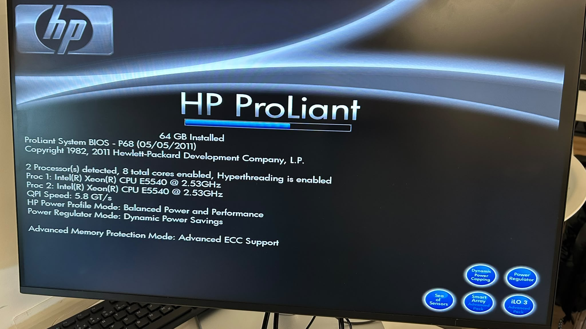

*Figure 7 : Après correction, le POST est propre : **64 GB installed**, 2 processeurs E5540, QPI 5.8 GT/s, mémoire en mode *Advanced ECC*.*

| Ce qu'on lit au POST | Signification |
|----------------------|---------------|
| `2 Processor(s) detected, 8 total cores enabled` | Les deux sockets CPU fonctionnent |
| `Hyperthreading is enabled` | Linux verra 16 processeurs logiques |
| `64 GB Installed` | Toute la mémoire est reconnue |
| `Advanced ECC Support` | La mémoire corrige les erreurs simples |
| `Redundant ROM Detected` | Une copie de secours du BIOS existe |

---

## 3. Choisir le périphérique de démarrage (F11)

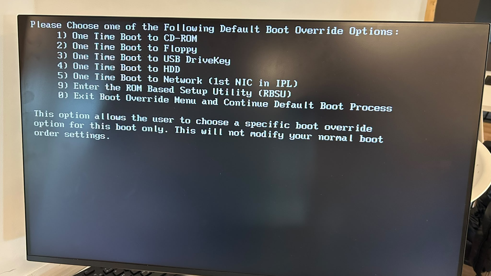

*Figure 8 : Le menu **F11** (*Boot Override*). On choisit **3) One Time Boot to USB DriveKey** pour démarrer une seule fois sur la clé USB d'installation.*

---

## 4. Préparation des disques - RAID

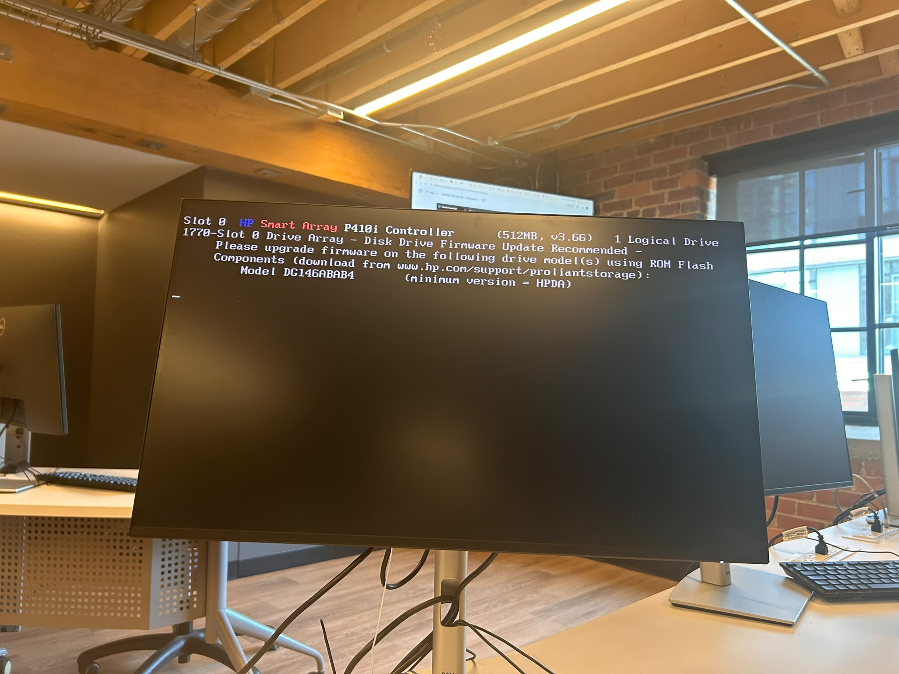

*Figure 9 : Le contrôleur **Smart Array P410i** est détecté au démarrage. On entre dans son utilitaire (ORCA) avec **F8**.*

Le serveur contenait un ancien volume logique. Nous l'avons supprimé, puis recréé.

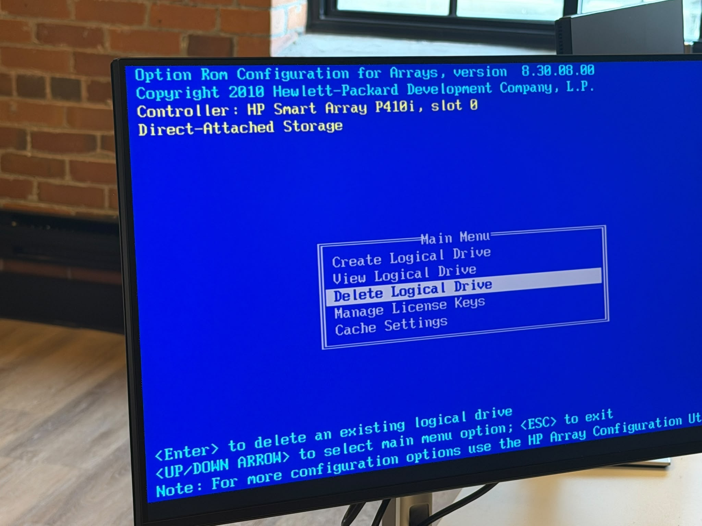

*Figure 10 : Menu principal de l'utilitaire : **Delete Logical Drive**.*

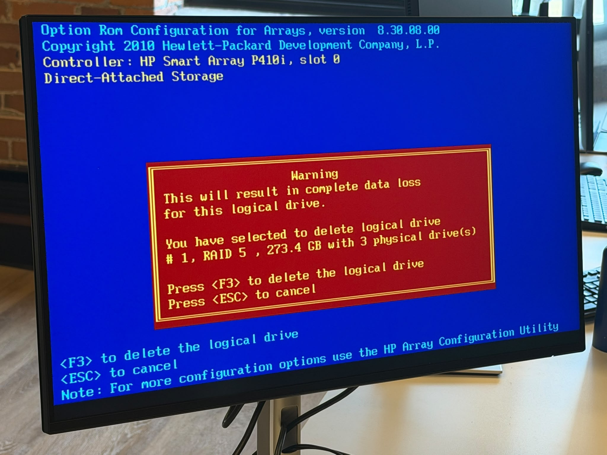

*Figure 11 : Avertissement : toutes les données du volume RAID 5 (273.4 Go, 3 disques) seront perdues. On confirme avec **F3**.*

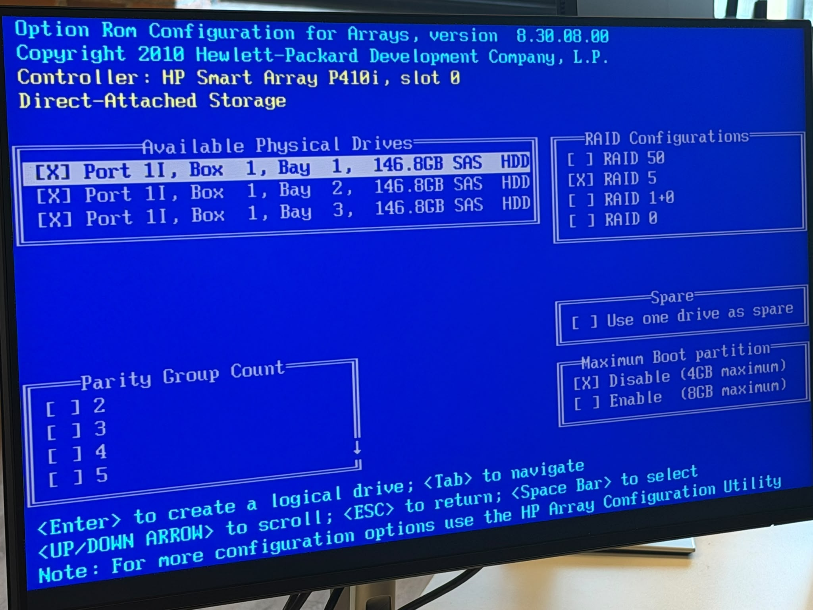

*Figure 12 : **Create Logical Drive** : on sélectionne les 3 disques SAS de 146.8 Go et on choisit **RAID 5**.*

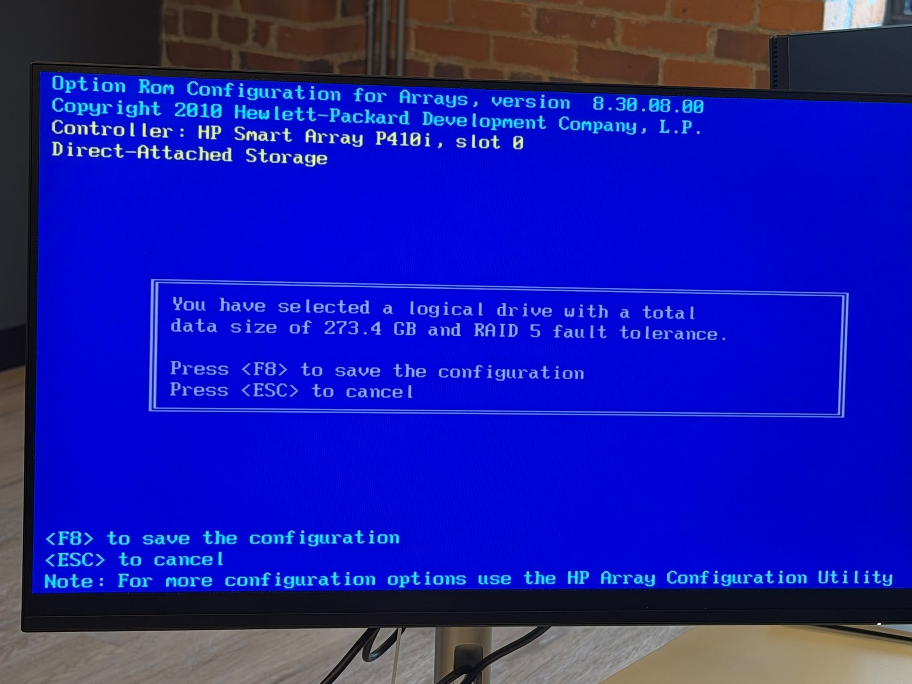

*Figure 13 : Le nouveau volume fait **273.4 Go** avec une tolérance aux pannes RAID 5. On sauvegarde avec **F8**.*

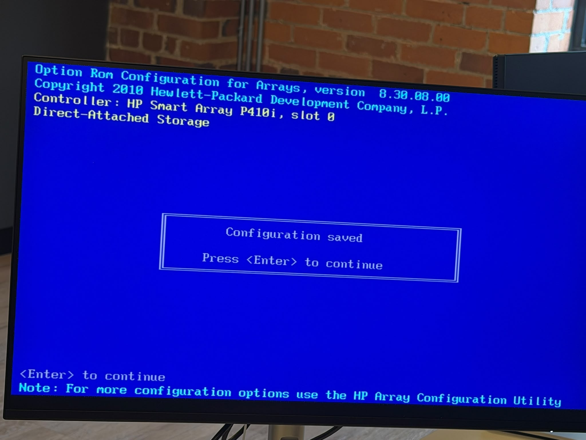

*Figure 14 : « Configuration saved ».*

**Pourquoi 273.4 Go ?** En RAID 5, la capacité d'un disque sert à la parité : (3 − 1) × 146.8 Go ≈ 293 Go, soit environ 273 Gio affichés. Si un disque tombe en panne, les données restent disponibles.

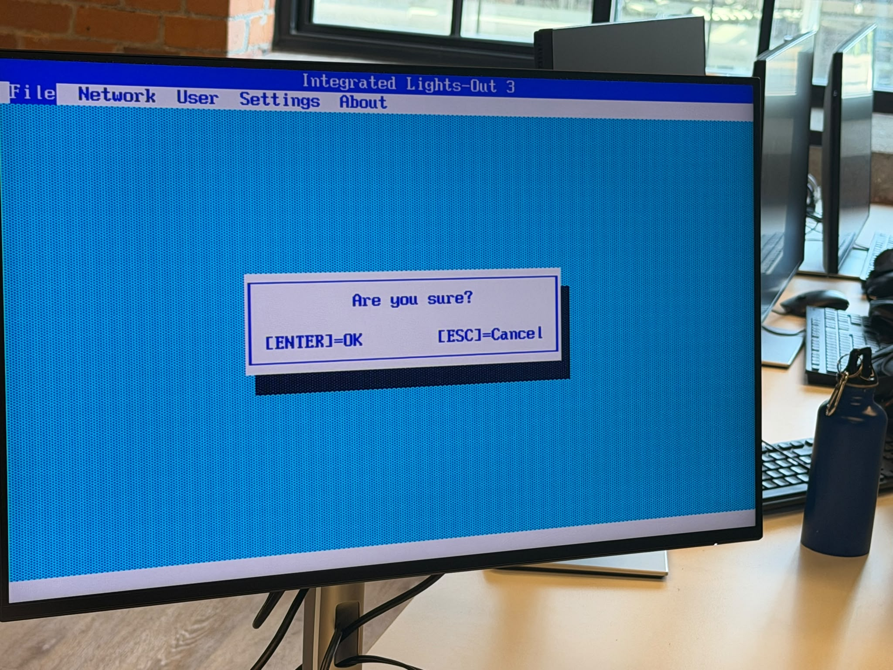

*Figure 15 : L'utilitaire **iLO 3** (Integrated Lights-Out). Nous avons remis la configuration par défaut (*Set Defaults*) pour repartir sur une base propre.*

---

## 5. Méthode de diagnostic retenue

1. **Observer** : lire tous les messages du POST et les voyants.
2. **Isoler** : démarrer avec le minimum (1 CPU, 1 barrette) si le serveur ne POST pas, puis ajouter les composants un par un.
3. **Corriger** : rebrancher, remplacer ou déplacer le composant fautif.
4. **Vérifier** : refaire le POST et confirmer que tout est détecté (2 CPU, 64 Go).

## 6. Ce que j'ai appris

- Le POST donne beaucoup d'informations : il faut le lire avant de chercher plus loin.
- Un code d'erreur (comme **1615**) indique précisément la pièce à vérifier.
- Le RAID 5 protège contre la panne d'un disque, mais supprimer un volume efface toutes ses données.
- Les touches importantes d'un ProLiant : **F8** (RAID / iLO), **F9** (configuration), **F11** (menu de démarrage).
