# 🔌 Diagnostics - Serveur HP ProLiant DL360 G7

| Champ | Valeur |
|-------|--------|
| Prénom | Joris Dylane |
| Nom | Touossock Ngabou |
| Numéro étudiant | 300154479 |
| Serveur | HP ProLiant DL360 G7 - Rack 2 (`server239` - 10.7.236.239) |
| Date du laboratoire | Octobre 2026 |

> 📸 Photos prises par notre équipe pendant le laboratoire.

## 🎯 Objectif

S'assurer que le serveur démarre correctement avant d'installer Proxmox :
reconnaître le matériel, lire les messages du POST, puis préparer les disques en RAID.

---

## 1. Le matériel

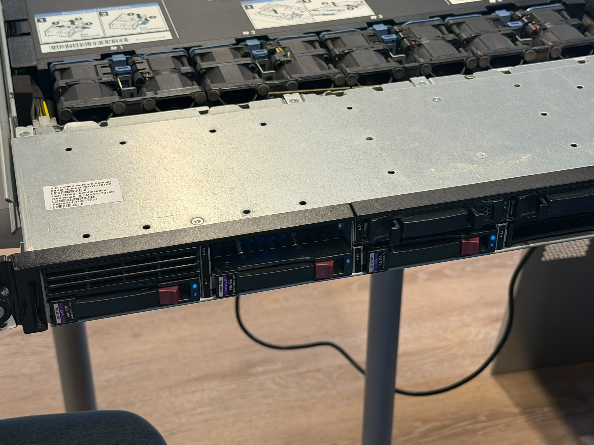

*Figure 1 : Le DL360 G7 (format 1U) avec le capot ouvert : rangée de ventilateurs, emplacements des processeurs et de la mémoire, baies de disques à l'avant.*

| Composant | Détail |
|-----------|--------|
| Processeurs | 2 × Intel Xeon **E5540** @ 2.53 GHz (4 cœurs chacun, Hyperthreading) |
| Mémoire | **64 Go** DDR3 ECC |
| Contrôleur RAID | HP **Smart Array P410i** (512 Mo de cache) |
| Disques | 3 × 146.8 Go SAS + SSD NVMe 1 To (SK hynix PC611) |
| Cartes réseau | Broadcom NetXtreme II (4 ports) |
| Gestion à distance | **iLO 3** |
| BIOS | ProLiant System BIOS **P68** |

---

## 2. Le POST (Power-On Self-Test)

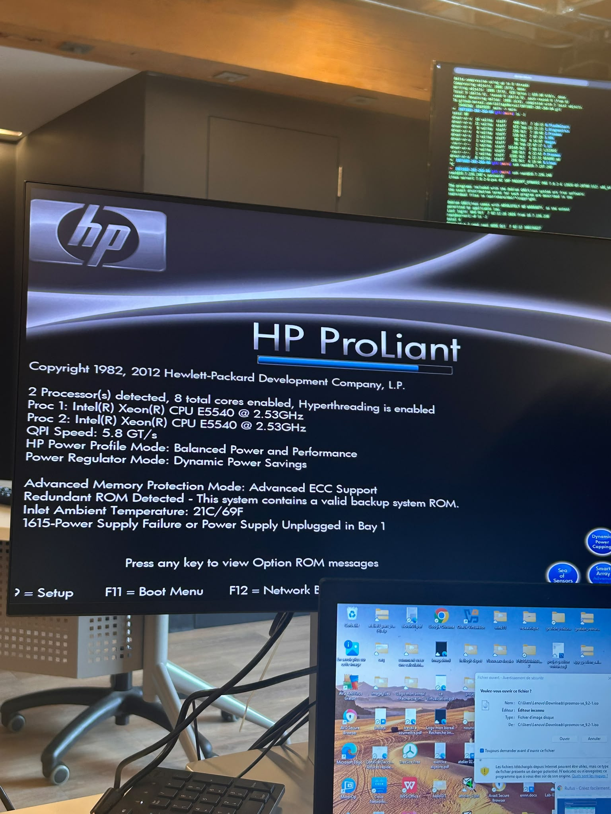

*Figure 2 : Premier démarrage. Les 2 processeurs sont détectés (8 cœurs, Hyperthreading activé), mais le POST affiche **1615 - Power Supply Failure or Power Supply Unplugged in Bay 1**.*

**Diagnostic :** le code **1615** signifie que le bloc d'alimentation de la baie 1 est débranché ou défectueux. Le serveur fonctionne avec un seul bloc, mais sans redondance.
**Solution :** vérifier et rebrancher le cordon d'alimentation de la baie 1 à l'arrière du serveur.

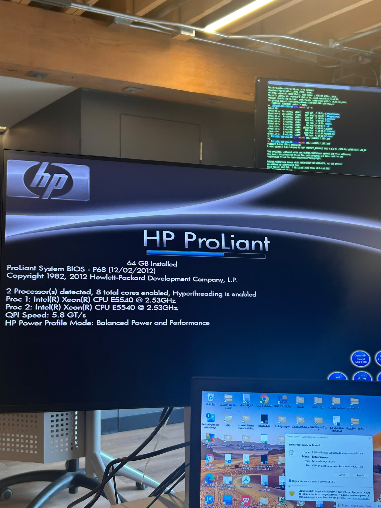

*Figure 3 : Après vérification, le POST est propre : 64 Go installés, Proc 1 et Proc 2 = Xeon E5540 @ 2.53 GHz, QPI 5.8 GT/s.*

| Message du POST | Signification |
|-----------------|---------------|
| `2 Processor(s) detected, 8 total cores enabled` | Les deux sockets CPU fonctionnent |
| `Hyperthreading is enabled` | Linux verra 16 processeurs logiques |
| `Advanced ECC Support` | La mémoire corrige les erreurs d'un bit |
| `Redundant ROM Detected` | Une copie de secours du BIOS existe |
| `Inlet Ambient Temperature: 21C/69F` | La température d'entrée d'air est normale |

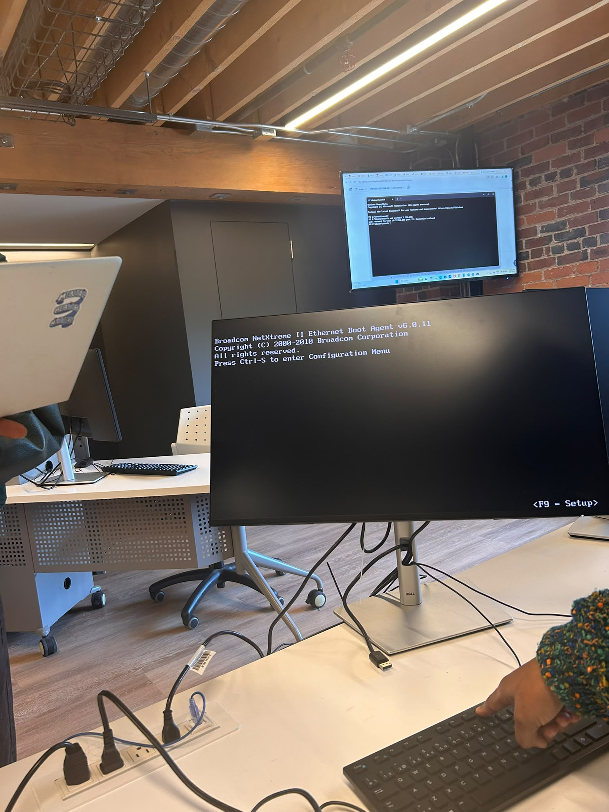

*Figure 4 : Les cartes réseau **Broadcom NetXtreme II** s'initialisent (Boot Agent v6.0.11). `Ctrl-S` permet de configurer le démarrage réseau (PXE), ce dont nous n'avons pas besoin.*

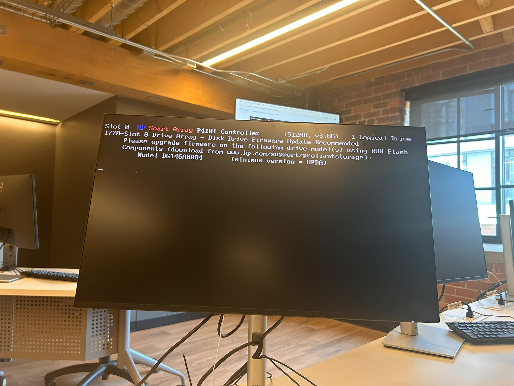

*Figure 5 : Message **1770 - Disk Drive Firmware Update Recommended** du Smart Array P410i pour les disques `DG146ABAB4`. C'est un simple avertissement : les disques fonctionnent, mais HP recommande une mise à jour du micrologiciel.*

---

## 3. Préparation des disques - RAID 5 (utilitaire ORCA, touche F8)

Le serveur contenait un ancien volume logique. Nous l'avons supprimé, puis recréé proprement.

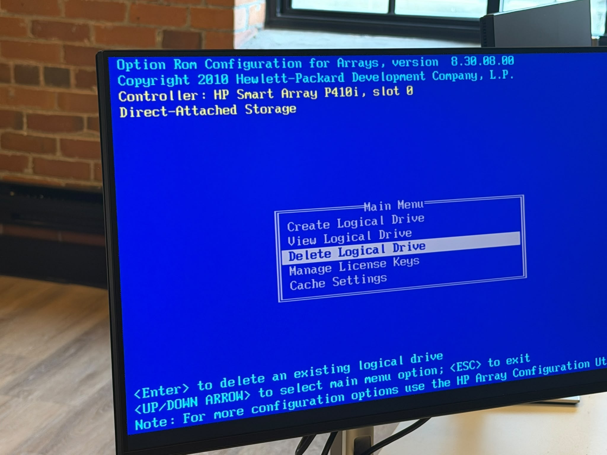

*Figure 6 : Option ROM Configuration for Arrays (ORCA) v8.30 : on choisit **Delete Logical Drive**.*

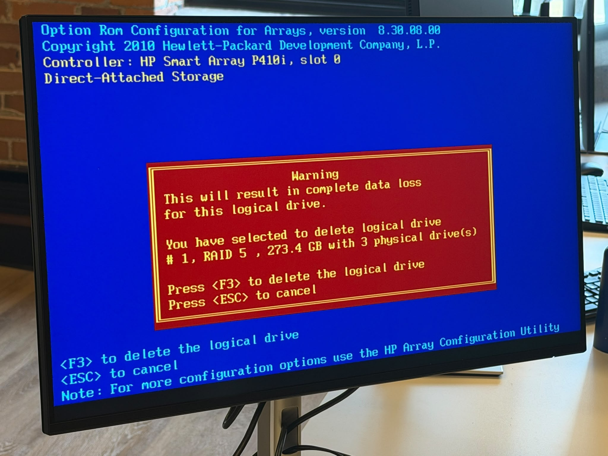

*Figure 7 : Avertissement : le volume RAID 5 de 273.4 Go (3 disques physiques) sera effacé. On confirme avec **F3**.*

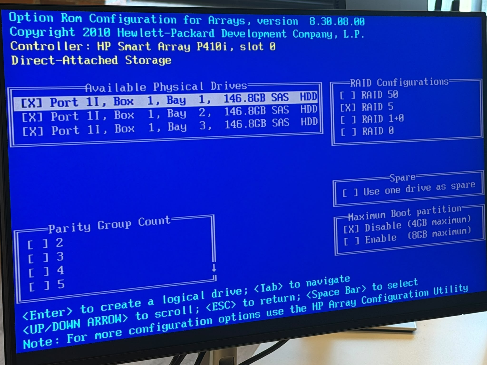

*Figure 8 : **Create Logical Drive** : les 3 disques SAS de 146.8 Go sont cochés et on choisit **RAID 5**.*

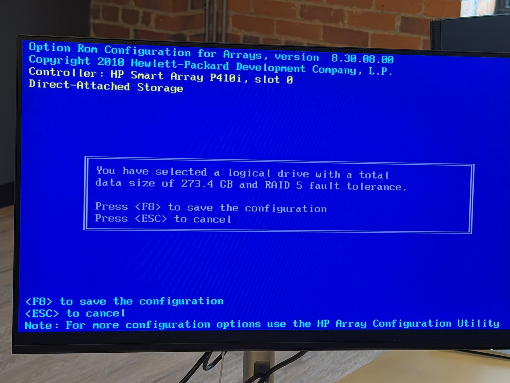

*Figure 9 : Le volume fait **273.4 Go** avec tolérance de panne RAID 5. On enregistre avec **F8**.*

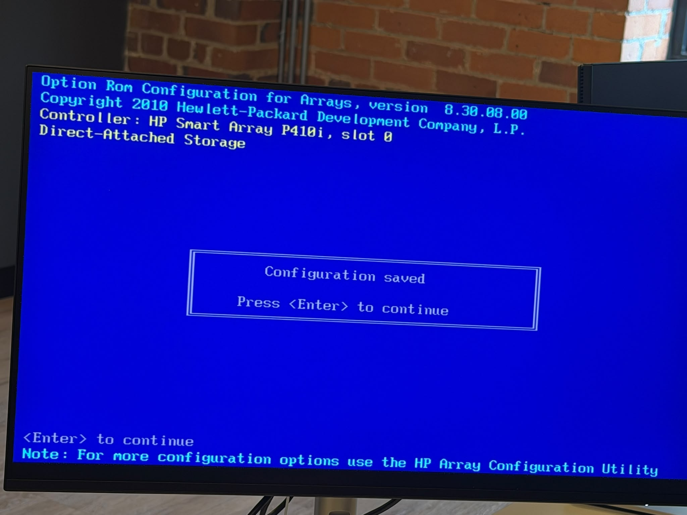

*Figure 10 : « Configuration saved ».*

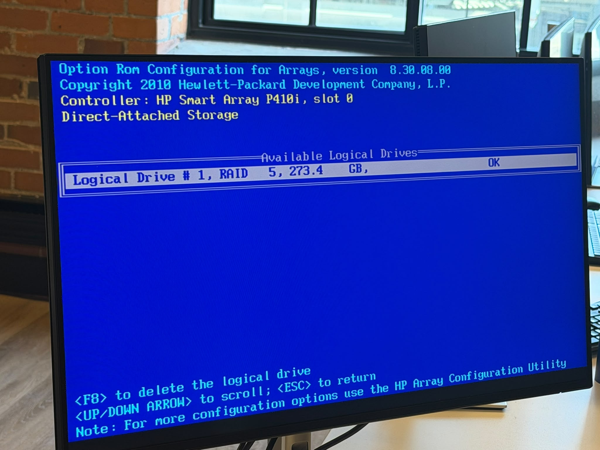

*Figure 11 : **View Logical Drive** : `Logical Drive #1, RAID 5, 273.4 GB, OK`.*

**Pourquoi 273.4 Go ?** En RAID 5, l'équivalent d'un disque est utilisé pour la parité : (3 − 1) × 146.8 Go ≈ 293.6 Go, soit environ 273.4 Gio affichés. Le volume survit à la panne d'un disque.

---

## 4. Remise à zéro de l'iLO 3

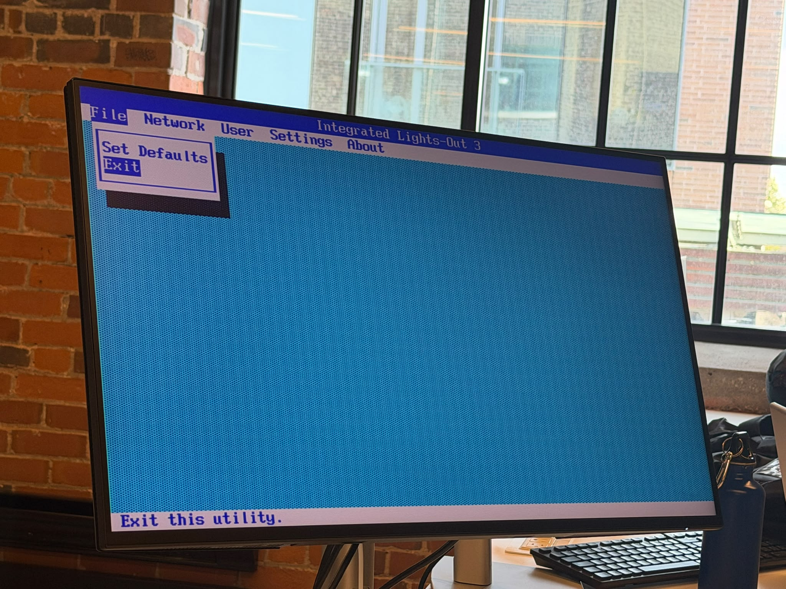

*Figure 12 : Dans l'utilitaire **Integrated Lights-Out 3**, menu **File → Set Defaults**.*

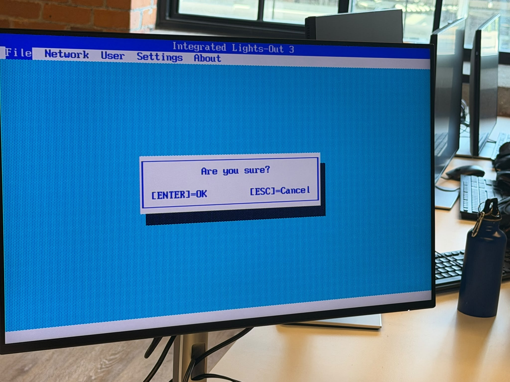

*Figure 13 : « Are you sure? » → **Enter** pour restaurer la configuration d'usine de l'iLO.*

---

## 5. Démarrer sur la clé USB (F11)

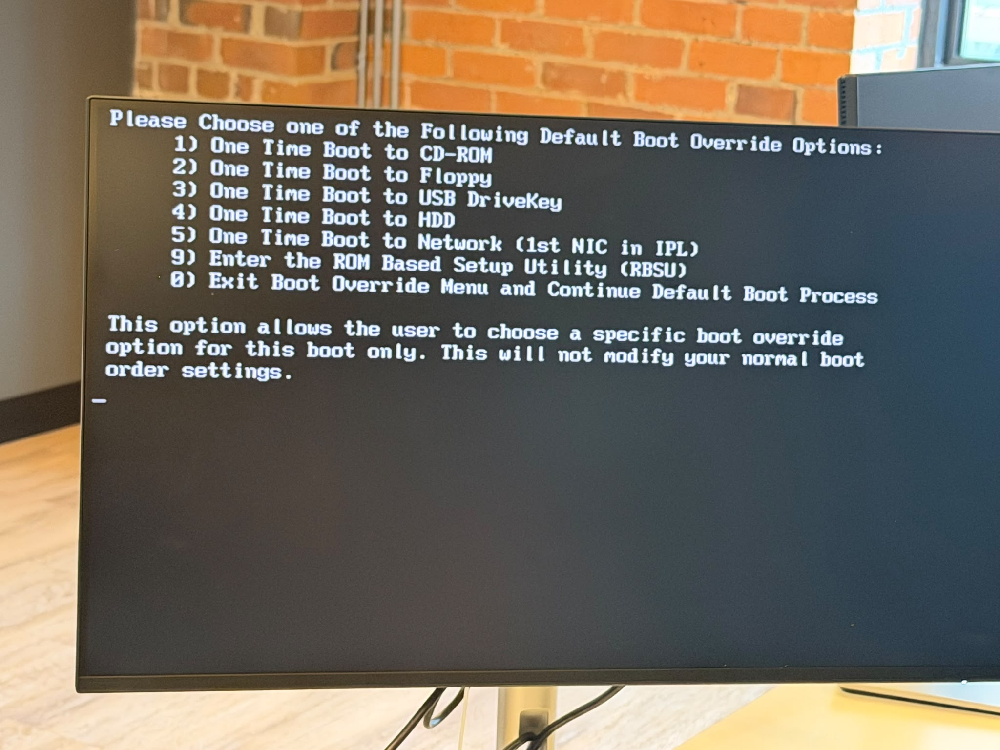

*Figure 14 : Le menu **Boot Override** (F11). On choisit **3) One Time Boot to USB DriveKey** : le serveur démarre une seule fois sur la clé, sans modifier l'ordre de démarrage normal.*

---

## 6. Méthode de diagnostic

1. **Observer** : lire tous les messages du POST et les voyants du panneau avant.
2. **Interpréter** : chercher la signification du code (ex. 1615, 1770).
3. **Isoler** : si le serveur ne POST pas, démarrer avec le minimum (1 CPU, 1 barrette) et ajouter les pièces une à une.
4. **Corriger** : rebrancher, déplacer ou remplacer la pièce fautive.
5. **Vérifier** : refaire un POST et confirmer que tout est détecté (2 CPU, 64 Go, volume RAID OK).

## 7. Ce que j'ai appris

- Le POST donne énormément d'informations : il faut le lire avant de démonter quoi que ce soit.
- Les codes HP (1615 = alimentation, 1770 = firmware disque) pointent directement vers la pièce concernée.
- Supprimer un volume RAID efface toutes ses données : il faut confirmer deux fois.
- Les touches utiles d'un ProLiant : **F8** (RAID / iLO), **F9** (configuration RBSU), **F11** (menu de démarrage), **F12** (démarrage réseau).
