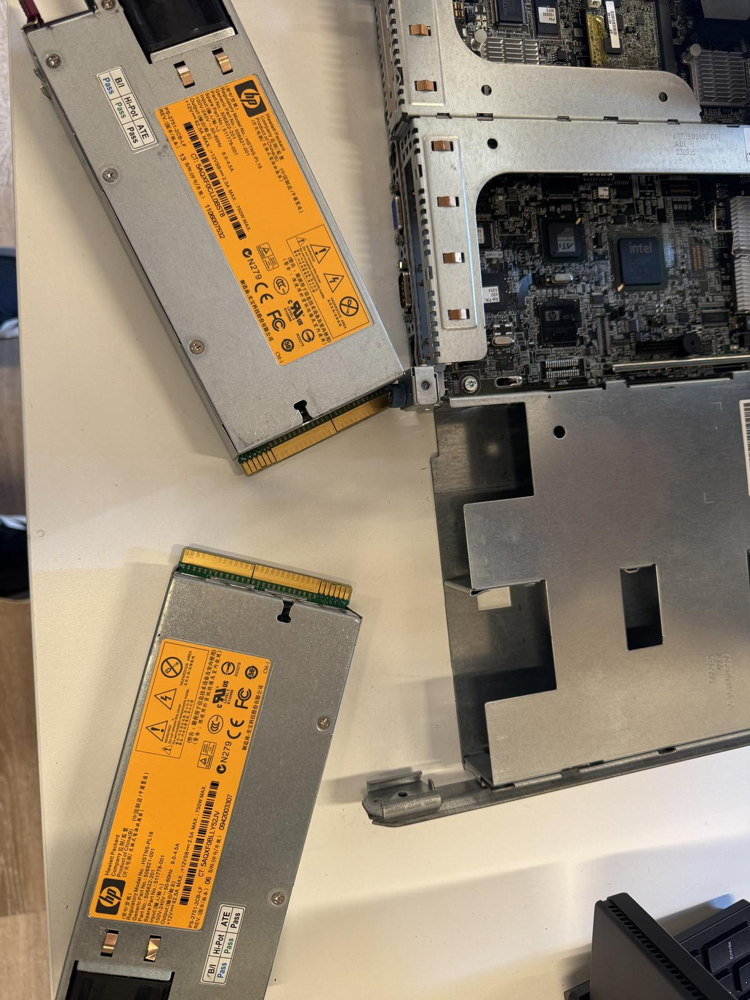
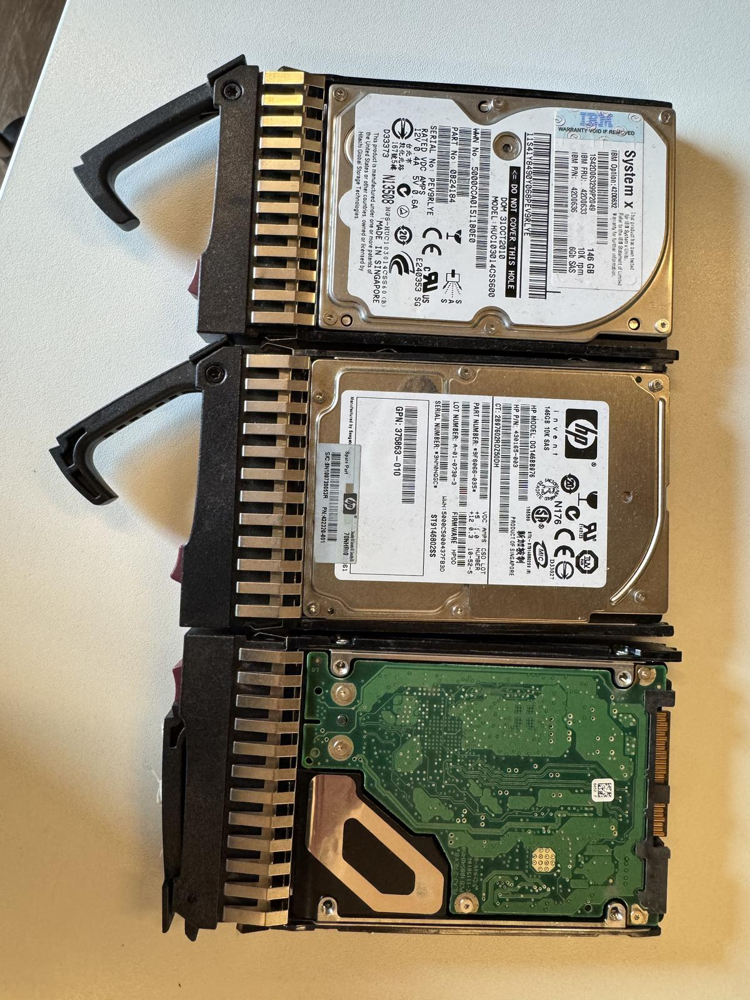
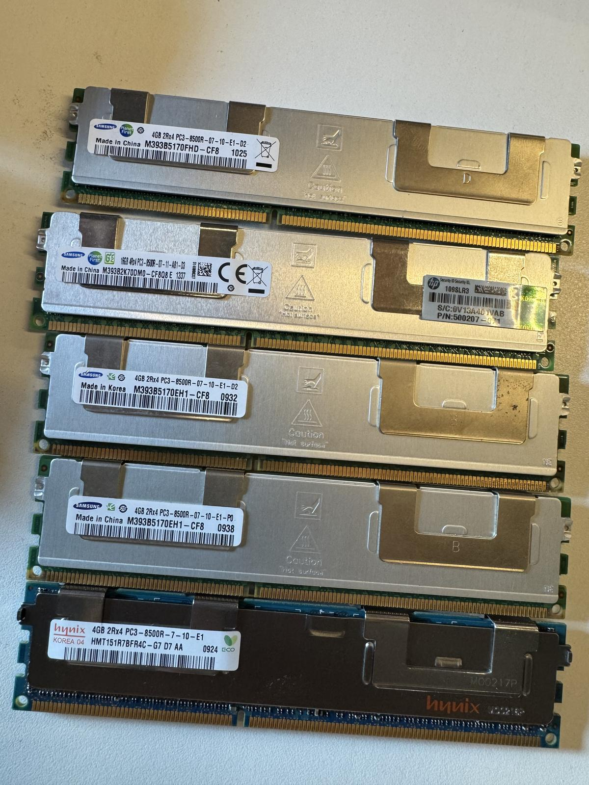
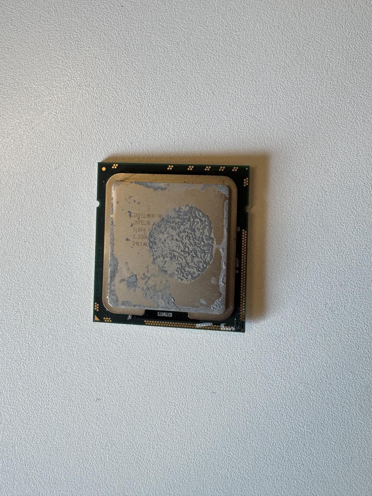
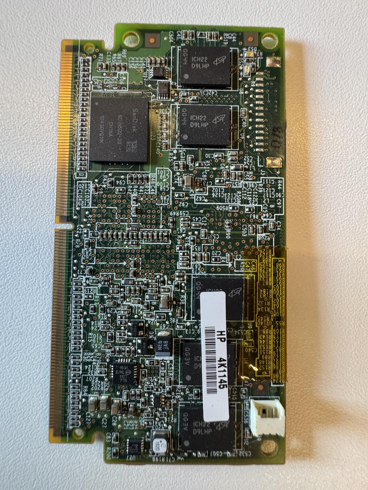
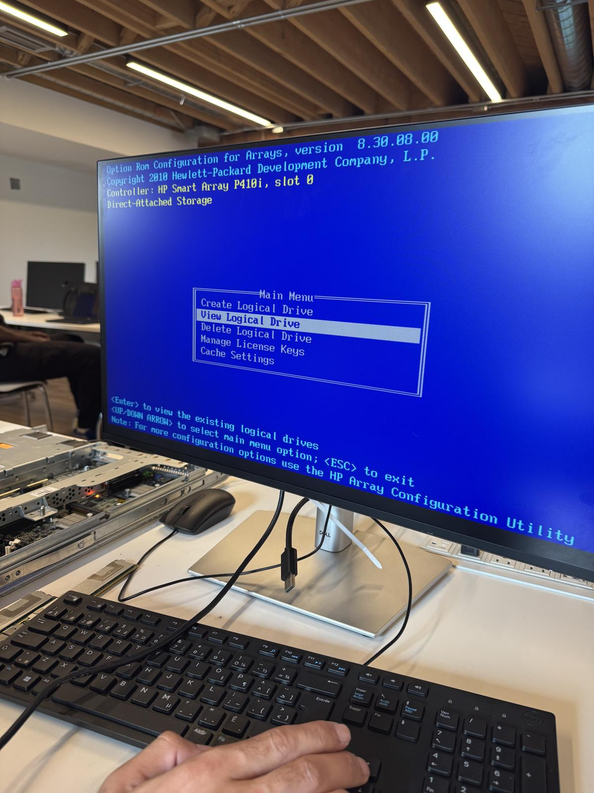

# 🖥️ Démontage et remontage d'un serveur HP ProLiant DL360 G6

**Étudiante :** Fairouz Sadoun  
**Matricule :** 300155881  
**Programme :** Techniques des systèmes informatiques  
**Module :** INF1085 – Administration Linux  

---

## 🎯 Objectif du laboratoire

Dans ce laboratoire, j'ai étudié le démontage et le remontage d'un serveur HP ProLiant DL360 G6.

L'objectif était d'identifier les principaux composants matériels du serveur, de comprendre leur fonctionnement et de vérifier les informations affichées au démarrage dans le BIOS.

J'ai également étudié la configuration du stockage RAID et les différentes étapes du diagnostic.

## 🔍 Matériel identifié

Le matériel présenté dans le modèle du laboratoire comprend :

- 💽 3 disques durs SAS de 146 Go
- 🔌 2 blocs d'alimentation HP
- 🧠 2 barrettes RAM de 16 Go
- 🧠 8 barrettes RAM de 4 Go
- ⚙️ 2 processeurs Intel Xeon
- 💾 1 contrôleur RAID avec module de mémoire cache

Ces caractéristiques doivent être comparées au matériel réellement observé.

---

# 🔧 Partie 1 — Démontage du serveur

## 🔌 Étape 1 — Retrait des blocs d'alimentation

Pendant le laboratoire, j'ai étudié les deux blocs d'alimentation du serveur HP ProLiant DL360 G6.

J'ai observé leur emplacement et la manière de les retirer après avoir éteint et débranché le serveur.

Cette étape m'a permis de mieux comprendre le rôle des alimentations dans le fonctionnement du serveur.

## 💽 Étape 2 — Retrait des disques durs

J'ai examiné les trois disques durs SAS installés à l'avant du serveur.

J'ai identifié leurs baies hot-swap et étudié leurs caractéristiques.

Dans le modèle du laboratoire, les disques possèdent une capacité de 146 Go chacun.

## 🧠 Étape 3 — Retrait des barrettes RAM

J'ai étudié les barrettes de mémoire RAM et leurs emplacements sur la carte mère.

J'ai appris à reconnaître les différentes capacités de mémoire et à comprendre leur rôle dans le fonctionnement du serveur.

Le modèle présente notamment des barrettes de 16 Go et de 4 Go.

## ⚙️ Étape 4 — Retrait du processeur

Pendant cette étape, j'ai observé le processeur Intel Xeon et son système de refroidissement.

J'ai étudié son emplacement sur la carte mère et les précautions nécessaires pendant le démontage.

J'ai compris que le socket et ses contacts sont fragiles et doivent être manipulés avec précaution, sous supervision.

## 💾 Étape 5 — Identification du module de mémoire cache

J'ai identifié le module de mémoire cache associé au contrôleur RAID.

Cette étape m'a permis de comprendre son rôle dans la gestion des opérations de stockage.

---

# 🧪 Partie 2 — Tests des composants

## 🟢 Étape 6 — Premier démarrage avec un processeur

Lors du démarrage du serveur, j'ai observé les informations affichées à l'écran.

Sur ma capture, le BIOS indique :

- 16 Go de mémoire RAM installée
- 1 processeur Intel Xeon E5620
- Fréquence de 2,40 GHz
- 4 cœurs activés

Cette vérification m'a permis d'identifier la configuration matérielle reconnue au démarrage.

### Vérification du BIOS avec 64 Go de RAM

Lors d'un autre démarrage, j'ai observé que le serveur HP ProLiant détectait 64 Go de mémoire RAM.

L'écran indiquait également un processeur Intel Xeon E5620 à 2,40 GHz avec quatre cœurs activés.

Cette observation m'a permis de comparer les informations détectées dans les deux configurations.

## 🟢 Étape 7 — Deuxième démarrage avec deux processeurs

J'ai étudié le test de démarrage avec deux processeurs présenté dans le laboratoire.

Dans le modèle fourni, le BIOS affiche :

- Processor 1
- Processor 2
- 16384 MB Memory Configured

Cette étape permet de vérifier si les deux processeurs sont correctement reconnus.

---

# 💽 Partie 3 — Configuration du stockage RAID

## 🛠️ Étape 8 — Accès à l'utilitaire RAID

J'ai étudié l'utilitaire de configuration RAID du serveur HP.

Cet outil permet de gérer les volumes logiques associés aux disques durs.

Il permet notamment de :

- Créer un volume logique
- Consulter la configuration RAID
- Supprimer un volume existant

## 🗑️ Étape 9 — Vérification de l'ancien volume RAID

J'ai étudié la configuration RAID existante présentée dans le modèle du laboratoire.

L'ancien volume était configuré en RAID 5 avec une capacité d'environ 273,4 Go.

J'ai compris qu'il faut vérifier la configuration avant de supprimer un volume, car cette opération peut entraîner une perte de données.

## 💿 Étape 10 — Sélection des trois disques SAS

J'ai étudié la sélection des trois disques SAS dans l'utilitaire de configuration RAID.

Le niveau RAID utilisé dans le modèle est RAID 5.

Le RAID 5 permet de répartir les données et les informations de parité entre plusieurs disques.

## 💾 Étape 11 — Enregistrement de la configuration RAID

J'ai examiné l'étape de sauvegarde de la configuration RAID.

Dans le modèle du laboratoire, la touche F8 permet de confirmer l'enregistrement.

J'ai compris qu'il est important de vérifier les paramètres avant de sauvegarder les modifications.

## ✅ Étape 12 — Vérification du volume logique

J'ai étudié les informations affichées après la création du volume RAID.

Le modèle présente les résultats suivants :

- Logical Drive : #1
- Type de RAID : RAID 5
- Capacité : environ 273,4 Go
- Statut : OK

Cette vérification permet de confirmer que le volume logique a été créé et reconnu par le contrôleur RAID.

---

# 🔩 Partie 4 — Remontage du serveur

## 🧠 Étape 13 — Réinstallation des barrettes RAM

J'ai étudié la réinstallation des barrettes RAM et la vérification de la mémoire pendant le démarrage.

Dans le modèle du laboratoire, le diagnostic mémoire indique environ 61 440 Mo disponibles, soit approximativement 60 Go.

Cette étape permet de vérifier la quantité de mémoire reconnue par le serveur.

## 🖥️ Étape 14 — Vérification finale

J'ai étudié les différentes vérifications nécessaires après le remontage du serveur.

Les éléments à contrôler sont :

- La reconnaissance des processeurs
- La quantité de mémoire RAM détectée
- La détection des disques SAS
- Le fonctionnement des alimentations
- L'état du volume RAID

Ces vérifications permettent de déterminer si les principaux composants sont correctement reconnus.

---

# 📊 Résultats du laboratoire

| Composant | Configuration de référence |
|---|---|
| Serveur | HP ProLiant DL360 G6 |
| Processeurs | 2 Intel Xeon dans le modèle |
| Processeur observé sur mes captures | Intel Xeon E5620 à 2,40 GHz |
| Mémoire RAM observée | 16 Go puis 64 Go |
| Disques du modèle | 3 disques SAS de 146 Go |
| Configuration RAID du modèle | RAID 5 |
| Volume logique du modèle | Environ 273,4 Go |
| Alimentations du modèle | 2 blocs HP |

Les valeurs provenant du modèle ne constituent pas toutes des résultats confirmés par mes propres captures.

---

# ✅ Conclusion

Ce laboratoire m'a permis de mieux comprendre le fonctionnement matériel d'un serveur HP ProLiant DL360 G6.

J'ai étudié les principaux composants du serveur, notamment les blocs d'alimentation, les disques durs SAS, les barrettes RAM, les processeurs et le contrôleur RAID.

J'ai également observé les informations affichées pendant les démarrages du serveur, notamment la mémoire RAM et le processeur détectés dans le BIOS.

J'ai appris à mieux comprendre les différentes étapes du diagnostic matériel et l'importance de vérifier les composants avant de mettre un serveur en service.

Enfin, l'étude de la configuration RAID 5 m'a permis de comprendre comment plusieurs disques peuvent être regroupés dans un volume logique.

Ce laboratoire m'a aidée à développer mes connaissances en administration des systèmes informatiques et en diagnostic des serveurs.
