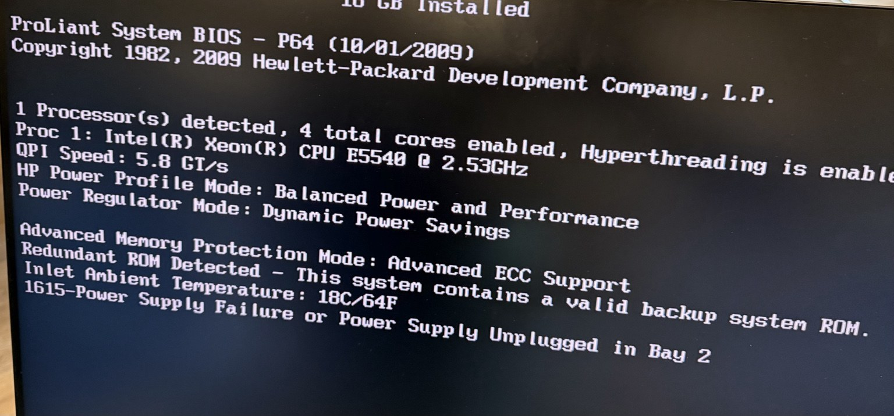
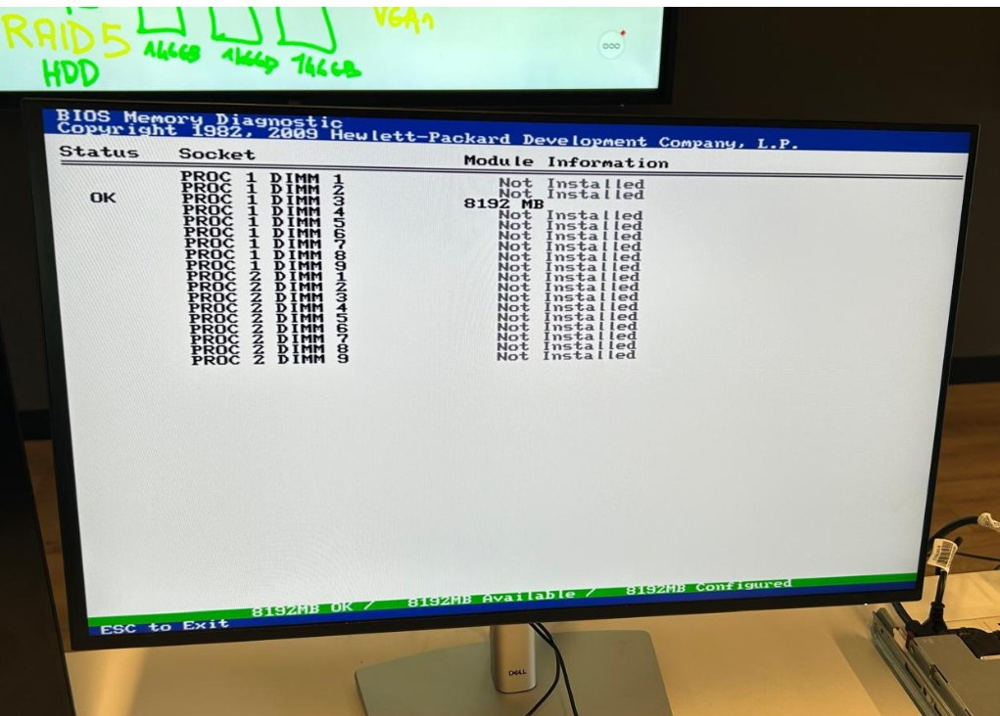
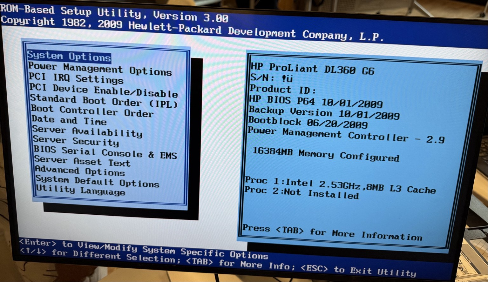
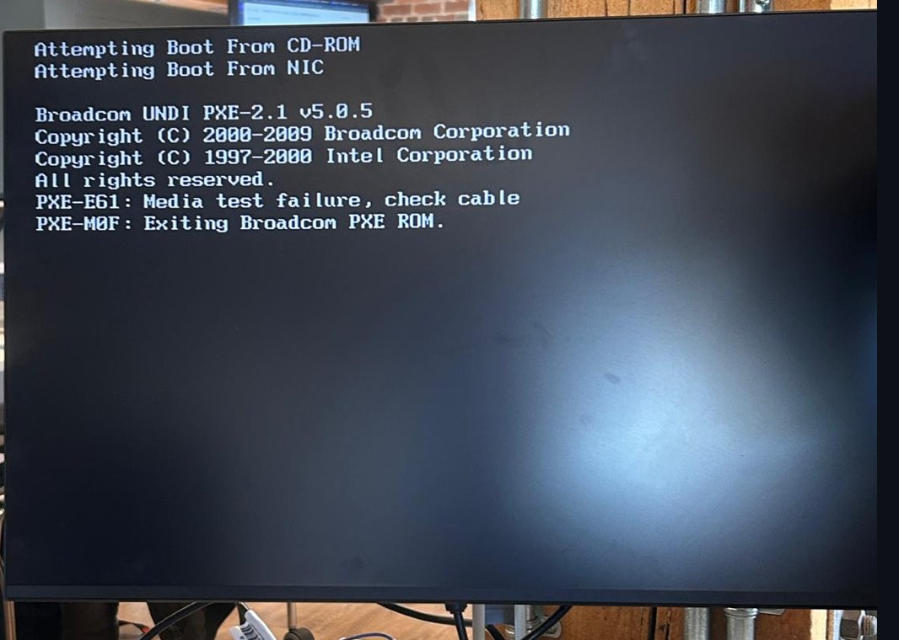

# Rapport de dépannage et validation POST – HP ProLiant DL360 G6

**Étudiant :** Ibrahim Hamdan Alhamed  
**Matricule :** 300157287  
**Cours :** INF1085 – Administration Linux  
**Établissement :** Collège Boréal  

## 1. Contexte et problématique

Au départ, le serveur ne démarrait pas après l’installation du processeur. L’objectif du dépannage était d’isoler la cause du problème et de vérifier la détection du processeur et de la mémoire.

Le POST correspond aux vérifications effectuées par le serveur à la mise sous tension. Cette étape permet de contrôler le démarrage matériel avant de poursuivre avec Linux ou Proxmox.

Pour vérifier le deuxième processeur, nous l’avons testé seul dans le socket 1. **Le serveur a démarré dans cette configuration.**

## 2. Configuration matérielle de test (configuration minimale POST)

Nous avons utilisé une configuration réduite avec un seul processeur, puis testé la mémoire avec **8 Go**, suivis de **16 Go**.

| Élément | Configuration observée |
| --- | --- |
| Serveur | HP ProLiant DL360 G6 |
| Processeur | Un processeur détecté pendant les essais retenus |
| Modèles visibles sur les captures | Xeon E5540 à 2,53 GHz et Xeon E5620 à 2,40 GHz |
| Cœurs | 4 cœurs, Hyperthreading activé |
| Mémoire | Essai avec 8 Go, puis avec 16 Go |
| Alimentation | Deuxième bloc d’alimentation débranché pendant les essais |

Les captures montrent différents relevés de configuration. Les modèles de processeurs sont donc présentés séparément.

.jpeg>)

*Figure 1 – Vue interne pendant le démontage : socket vide, dissipateur, emplacements mémoire et ventilateurs.*

## 3. Résultats des tests et captures d’écran

### A. Écran de démarrage BIOS et détection du processeur

La première capture affiche :

- Un **Intel Xeon E5540 à 2,53 GHz**.
- **4 cœurs** activés.
- L’**Hyperthreading activé**.
- Le BIOS **P64**, avec la date affichée `10/01/2009`.
- Le mode de protection mémoire **Advanced ECC Support**.

*Figure 2 – Détection du Xeon E5540 au POST.*

Une autre capture montre un **Xeon E5620 à 2,40 GHz**, avec un seul processeur détecté, 4 cœurs et l’Hyperthreading activé. Le BIOS P64 porte ici la date affichée `08/16/2010`.

.jpeg>)

*Figure 3 – Écran HP ProLiant et détection du Xeon E5620.*

**Résultat du test croisé :** le processeur CPU2 a permis le démarrage lorsqu’il a été installé seul dans le socket 1. Il peut donc fonctionner dans cette configuration. Ce résultat oriente la suite du diagnostic vers le socket 2, la mémoire associée ou les conditions de montage, sans confirmer une panne précise.

Le message suivant apparaît également :

`1615 – Power Supply Failure or Power Supply Unplugged in Bay 2`

Dans notre cas, **la deuxième alimentation était simplement débranchée**. Ce message ne prouve donc pas une défaillance du bloc.

### B. Diagnostic de la mémoire BIOS (BIOS Memory Diagnostic)

Le diagnostic mémoire affiche :

| Information | Résultat |
| --- | --- |
| Emplacement | PROC 1 DIMM 3 |
| Capacité | 8 192 Mo, soit 8 Go |
| Statut | OK |
| Mémoire disponible | 8 192 Mo |
| Mémoire configurée | 8 192 Mo |

Les autres emplacements sont indiqués **Not Installed**.

*Figure 4 – Module de 8 Go reconnu avec le statut OK.*

Ce résultat confirme la reconnaissance de la mémoire dans cet essai. Il ne constitue pas un test prolongé de stabilité. Nous avons ensuite effectué un essai avec **16 Go**, visibles dans le RBSU.

### C. Configuration système BIOS (utilitaire RBSU)

Nous avons accédé au **ROM-Based Setup Utility, version 3.00**.

Le panneau système affiche :

- **HP ProLiant DL360 G6**.
- BIOS **P64**, date affichée `10/01/2009`.
- **16 384 Mo**, soit **16 Go de mémoire configurée**.
- Processeur 1 : **Intel à 2,53 GHz**, avec **8 Mo de cache L3**.
- Processeur 2 : **Not Installed**.

*Figure 5 – RBSU : un processeur reconnu et 16 Go de mémoire configurée.*

L’accès au RBSU permet de consulter les informations matérielles et les options de démarrage. Cette capture confirme l’accès à l’utilitaire, sans établir qu’un réglage a été modifié.

### Observation complémentaire : démarrage réseau PXE

Le serveur a tenté de démarrer sur le CD-ROM, puis sur le réseau. L’écran affiche :

`PXE-E61: Media test failure, check cable`

`PXE-M0F: Exiting Broadcom PXE ROM.`

*Figure 6 – Échec de la tentative de démarrage réseau PXE.*

Le serveur atteint la recherche d’un périphérique de démarrage, mais cette tentative réseau échoue. Ce résultat ne prouve pas une panne du disque. Le support amorçable, l’ordre de démarrage et la connexion réseau doivent être contrôlés selon le mode d’installation choisi.

## 4. Conclusion du diagnostic

Le dépannage a permis d’obtenir le démarrage du serveur avec **CPU2 seul dans le socket 1**, d’observer la détection du processeur et d’accéder aux outils du BIOS.

La mémoire a été testée avec **8 Go**, affichés avec le statut **OK**, puis avec **16 Go**, reconnus dans le RBSU. L’avertissement concernant l’alimentation en baie 2 était expliqué par le deuxième bloc débranché.

Le test du processeur oriente la recherche vers le socket 2 ou sa configuration, mais ne permet pas d’affirmer que le socket est défectueux.

La validation du démarrage matériel est documentée. Le fonctionnement du stockage et le démarrage de Linux ou de Proxmox restent à vérifier.
