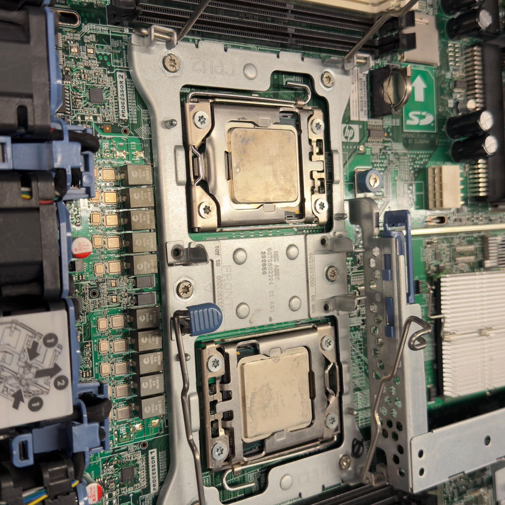
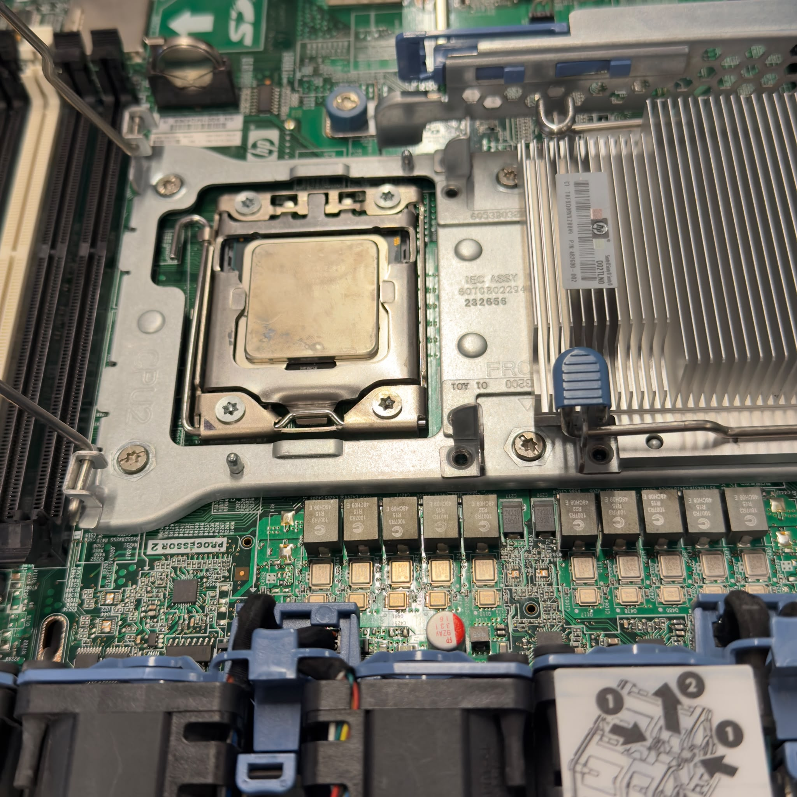
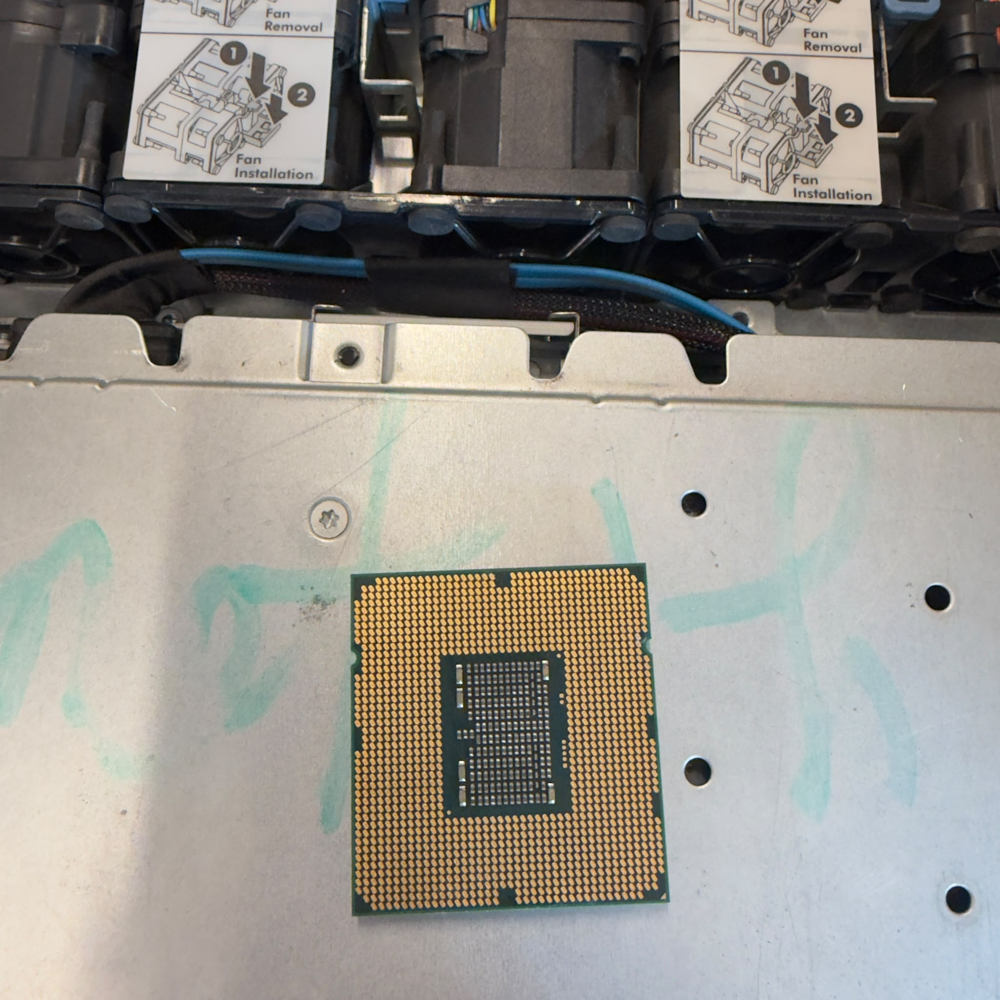
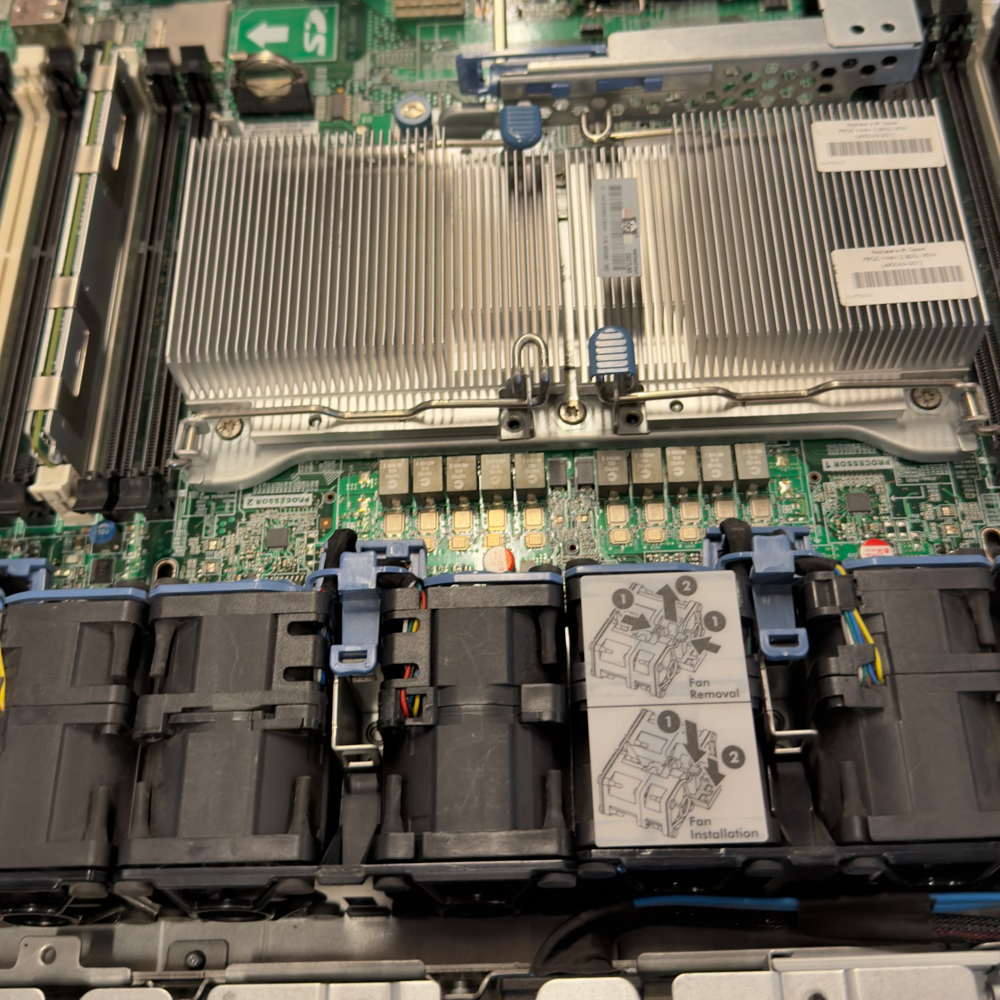
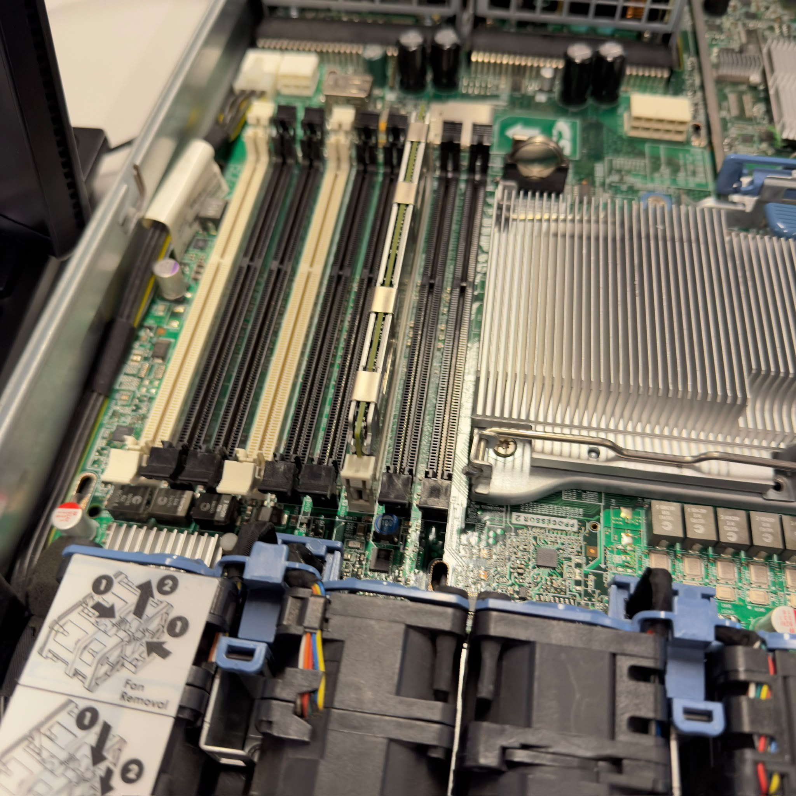
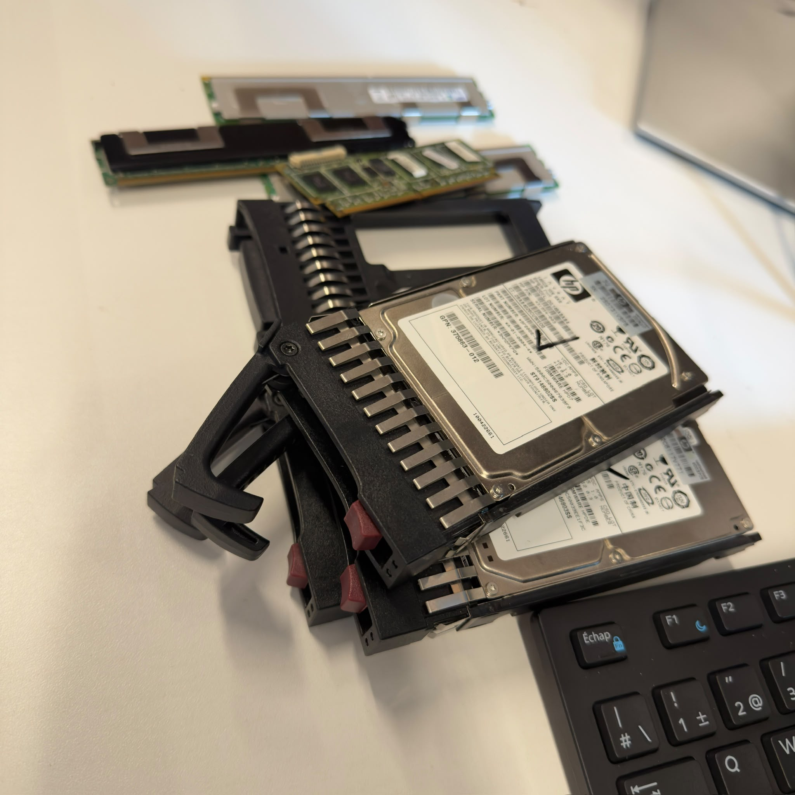
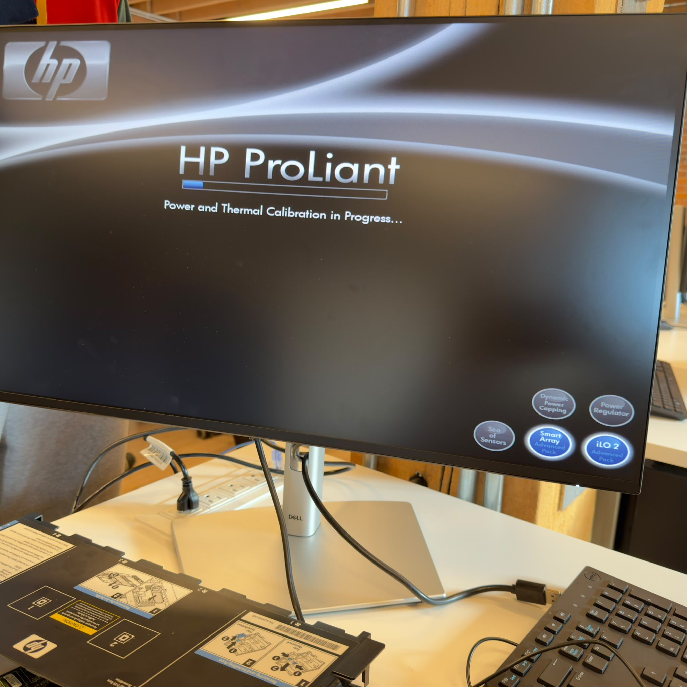
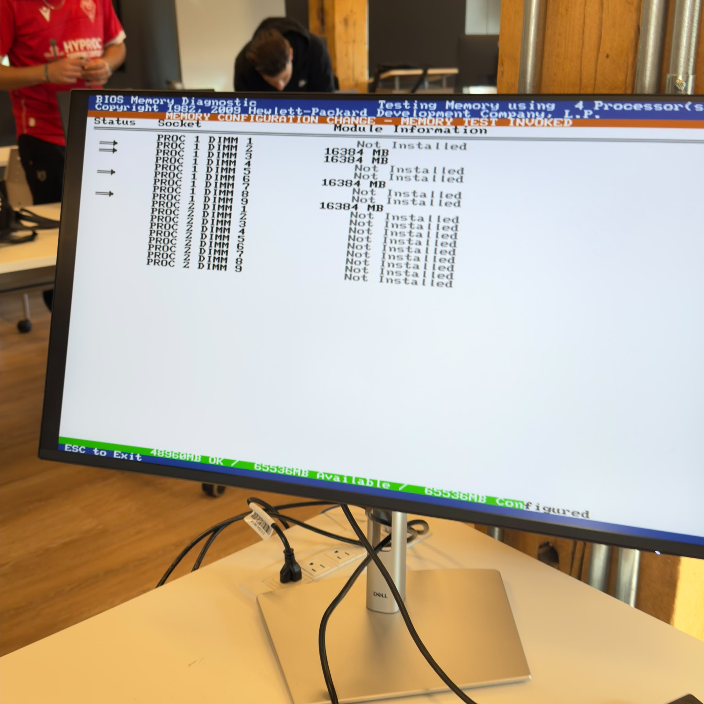
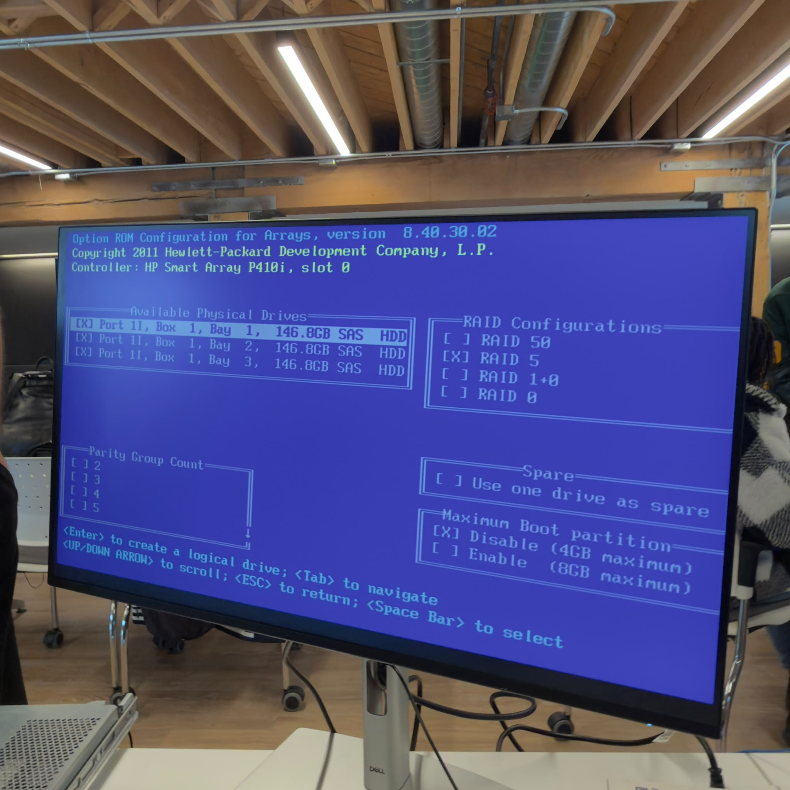

# INF1085 – Administration Linux

## Rapport de diagnostic et de vérification d'un serveur

**Étudiant :** Houssam Rachdi  
**Numéro étudiant :** 300157440  
**Équipement :** Serveur HP ProLiant DL360 G6

\---

## 1\. Introduction

Ce rapport présente les principales étapes d'un diagnostic matériel d'un serveur HP ProLiant DL360 G6 : inspection de la carte mère, contrôle des processeurs, de la mémoire et du stockage, puis examen des écrans de démarrage et des outils de gestion. L'objectif est de comprendre comment isoler une défaillance éventuelle avant de remettre le serveur en service.

Les observations ci-dessous sont fondées sur les photographies disponibles. Les résultats des manipulations et des tests doivent être confirmés en fonction du travail réellement effectué pendant la séance.

## 2\. Inspection intérieure du serveur

*Figure 1 — Carte mère et emplacements des deux processeurs.*

La première vue permet de repérer les supports des processeurs, les composants électroniques voisins et une partie du mécanisme de fixation. Avant d'effectuer un test, une inspection visuelle sert notamment à rechercher des éléments mal installés et à identifier les parties nécessitant une vérification.

## 3\. Vérification des processeurs

*Figure 2 — Processeur installé dans son socket.*

Le processeur doit être correctement positionné dans son support et retenu par son système de verrouillage. Un mauvais contact peut empêcher le serveur de terminer sa séquence d'initialisation.

*Figure 3 — Vue rapprochée du processeur et du mécanisme de fixation.*

Cette étape permet d'examiner le socket et les éléments de fixation. Toute dépose ou réinstallation d'un processeur doit se faire hors tension, en suivant les précautions contre les décharges électrostatiques.

## 4\. Refroidissement des processeurs

*Figure 4 — Dissipateurs thermiques placés au-dessus des processeurs.*

Les dissipateurs transmettent la chaleur des processeurs vers le flux d'air du serveur. Leur fixation et le bon fonctionnement des ventilateurs sont indispensables pour limiter la surchauffe.

## 5\. Contrôle de la mémoire RAM

*Figure 5 — Emplacements de mémoire DIMM sur la carte mère.*

Les barrettes doivent être installées dans les emplacements prévus par le constructeur, selon le processeur et la configuration mémoire. Lors d'un dépannage, on peut tester les barrettes progressivement afin de rechercher un module ou un emplacement problématique.

## 6\. Vérification des disques et des barrettes retirées

*Figure 6 — Disques de serveur et modules RAM examinés séparément.*

Le retrait temporaire de certains périphériques peut aider à isoler l'origine d'un problème de démarrage. Il faut toutefois noter précisément leur emplacement initial pour permettre un remontage correct.

## 7\. Mise sous tension et test POST

*Figure 7 — Écran de démarrage du serveur HP ProLiant.*

Au démarrage, le serveur exécute le **POST** (*Power-On Self-Test*), qui contrôle les principaux éléments matériels. La présence de l'écran de démarrage montre que l'initialisation a commencé ; il faut ensuite vérifier les messages affichés pour conclure que le POST est entièrement réussi.

## 8\. Diagnostic de mémoire dans le BIOS

*Figure 8 — Utilitaire de diagnostic mémoire accessible au démarrage.*

Cet écran sert à identifier les barrettes reconnues et à suivre la vérification de la mémoire. Sur le rapport de référence, la configuration indiquée est d'environ **64 Go de RAM** ; cette valeur doit être validée sur le serveur utilisé pendant votre séance. Un test en cours ne signifie pas encore qu'il est terminé sans erreur.

## 9\. Configuration du stockage RAID

*Figure 9 — Interface de configuration des disques du contrôleur RAID.*

L'interface permet de regrouper plusieurs disques physiques en un volume logique. Le **RAID 5** répartit les données et les informations de parité entre au moins trois disques : il peut tolérer la panne d'un disque, sans remplacer une sauvegarde. Le rapport de référence décrit trois disques SAS de 146,8 Go pour une capacité logique d'environ 293,6 Go ; il reste à confirmer les valeurs relevées lors de votre TP.

## 10\. Démarrage de Proxmox Virtual Environment

*Figure 10 — Écran de la console Proxmox Virtual Environment.*

Proxmox VE est une plateforme d'administration et de virtualisation permettant notamment de gérer des machines virtuelles et des conteneurs. Une console Proxmox accessible constitue un indice que le système a démarré, mais la vérification finale doit aussi inclure les services et l'accès réseau.

## 11\. Bilan des vérifications

|Élément|Vérification représentée|Résultat à confirmer|
|-|-|-|
|Carte mère et sockets|Inspection visuelle|Absence de dommage apparent|
|Processeurs|Positionnement et fixation|Détection correcte au démarrage|
|Dissipateurs et ventilation|Installation des éléments de refroidissement|Fonctionnement normal|
|Mémoire RAM|Emplacements DIMM et diagnostic BIOS|Capacité reconnue et test terminé|
|Disques et RAID|Présence des disques et interface RAID|Volume logique et état des disques|
|POST|Écran d'initialisation HP|Aucune erreur bloquante|
|Proxmox|Console du système|Démarrage et accès réseau|

## 12\. Difficultés rencontrées et solutions

**Problème constaté pendant la séance :** \[À compléter avec votre expérience réelle.]  
**Manipulations réalisées :** \[À compléter.]  
**Résultat du test final :** \[À compléter.]

## 13\. Conclusion

Ce diagnostic illustre une méthode progressive de dépannage : observer le matériel, contrôler séparément les éléments essentiels, vérifier les informations fournies par le BIOS, puis examiner le stockage et le système d'exploitation. Cette approche permet de limiter les causes possibles d'un dysfonctionnement.

**Bilan personnel :** \[Ajoutez ici ce que vous avez réellement testé et appris pendant le TP.]

