# Rapport de diagnostic et validation POST — HP ProLiant DL360 G6

| | |
|---|---|
| **Cours** | INF1085-201-26A-04 — 1. Diagnostics |
| **Étudiante** | Salma Baali (300158383) |
| **Équipement** | Serveur HP ProLiant DL360 G6 |
| **Travail réalisé** | En équipe |

---

## Table des matières

1. [Contexte et problématique](#1-contexte-et-problématique)
2. [Inspection du serveur](#2-inspection-du-serveur)
3. [Manipulation du dissipateur thermique](#3-manipulation-du-dissipateur-thermique)
4. [Vérification des processeurs](#4-vérification-des-processeurs)
5. [Configuration minimale POST](#5-configuration-minimale-post)
6. [Démarrage et résultats du POST](#6-démarrage-et-résultats-du-post)
7. [BIOS et RBSU](#7-bios-et-rbsu)
8. [Mémoire système](#8-mémoire-système)
9. [Analyse des causes possibles](#9-analyse-des-causes-possibles)
10. [Composants complémentaires et dépannage observés en équipe](#10-composants-complémentaires-et-dépannage-observés-en-équipe)
11. [Disques : détection et configuration RAID](#11-disques--détection-et-configuration-raid)
12. [Formatage et montage sous Linux](#12-formatage-et-montage-sous-linux)
13. [Conclusion](#13-conclusion)
14. [Difficultés rencontrées et leçons apprises](#14-difficultés-rencontrées-et-leçons-apprises)
15. [Glossaire](#15-glossaire)
16. [Références](#16-références)

---

## 1. Contexte et problématique

Le serveur présentait un problème de démarrage : le **deuxième processeur n'était pas détecté**. Selon la procédure d'isolation de panne du laboratoire, on teste le processeur concerné **seul dans le socket 1 (PROC 1)**, avec une configuration minimale. Le but est de savoir si le défaut vient **du processeur lui-même** ou **du socket 2**.

**Méthode : procéder par élimination.**

1. Retirer tout ce qui n'est pas indispensable (configuration minimale POST).
2. Démarrer et observer les messages du POST.
3. Vérifier la détection du CPU et de la mémoire dans le BIOS.
4. En déduire quel élément est fautif.

### Objectifs du travail

- Inspecter les composants internes du serveur.
- Vérifier l'installation des processeurs et de la mémoire.
- Observer la séquence de démarrage (POST) et les informations du BIOS.
- Isoler la cause de la panne par élimination.
- Préparer le stockage : volume RAID 5 avec le contrôleur Smart Array.
- Installer et démarrer Proxmox VE.
- Relever les informations nécessaires à l'administration du serveur.

### Fiche technique du matériel

| Élément | Détail |
|---|---|
| Serveur | HP ProLiant DL360 G6, format rack **1U** |
| Sockets processeur | 2 × **LGA1366** |
| Processeurs rencontrés | Intel Xeon **E5620** (2,40 GHz, 4 cœurs, 8 threads, 12 Mo de cache L3) et Intel Xeon **E5540** (2,53 GHz, 4 cœurs, 8 threads, 8 Mo de cache L3) |
| Mémoire | DDR3 ECC, **9 emplacements DIMM par processeur** (18 au total) |
| Contrôleur de stockage | Smart Array **P410i** intégré |
| Alimentation | 2 blocs *hot-plug* (baies 1 et 2) |
| Refroidissement | Ventilateurs *hot-plug* |
| BIOS observé | P64 (03/01/2010), RBSU 3.00, utilitaire de diagnostic 2.15 |

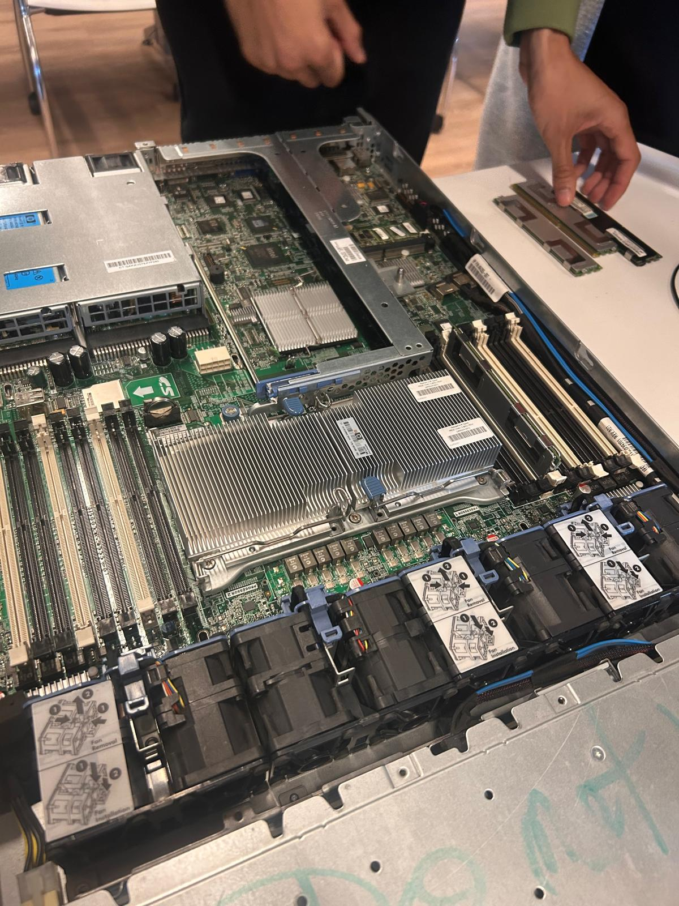

*Figure 1 — Vue générale de l'intérieur du serveur : processeur avec dissipateur, ventilateurs, emplacements mémoire et barrettes retirées.*

---

## 2. Inspection du serveur

Avant toute manipulation, le capot est retiré et on observe les composants internes : ventilateurs hot-plug, dissipateurs, carte mère et emplacements mémoire (DIMM).


*Figure 2 — Serveur ouvert, prêt pour l'inspection.*

Les emplacements mémoire sont répartis en slots **blancs** et **noirs**. Le premier slot blanc de chaque processeur est celui à utiliser en configuration minimale.


*Figure 3 — Emplacements DIMM (blancs et noirs) à côté du processeur 2.*

---

## 3. Manipulation du dissipateur thermique

Pour accéder aux processeurs, il faut retirer le dissipateur. Cette étape permet d'observer le processeur et son socket (broches, pâte thermique).

> **Précautions :** serveur éteint et débranché, décharge électrostatique (bracelet antistatique), manipulation du processeur par les bords uniquement, ne jamais toucher les broches du socket.


*Figure 4 — Manipulation du dissipateur thermique.*

---

## 4. Vérification des processeurs

Le DL360 G6 comporte deux sockets. L'inspection visuelle permet de voir les deux processeurs et leur emplacement.


*Figure 5 — Vue des deux processeurs sur la carte mère.*

L'inspection visuelle seule **ne suffit pas** à confirmer la cause du problème : un test croisé est nécessaire (voir [section 9](#9-analyse-des-causes-possibles)).

---

## 5. Configuration minimale POST

| Élément | Configuration utilisée |
|---|---|
| Processeur | 1 Intel Xeon dans le socket 1 (PROC 1) |
| Mémoire | 1 barrette de 8 Go |
| Emplacement mémoire | PROC 1 DIMM 3 (slot blanc A1) |
| Cartes PCIe | Aucune carte supplémentaire |
| Alimentation | Bloc dans la baie 1 uniquement |

Processeurs rencontrés : **Intel Xeon E5620 (2,40 GHz)** et **Intel Xeon E5540 (2,53 GHz)**.

> Avec un seul bloc d'alimentation, le message **« 1615 – Power Supply Failure or Power Supply Unplugged in Bay 2 »** s'affiche. C'est **normal** : seule la baie 1 est alimentée.

### 5.1 Retrait temporaire des composants

Pendant les tests, les **disques durs** et plusieurs **barrettes de mémoire** ont été retirés.


*Figure 5 bis — Disques HP et barrettes de mémoire retirés pendant le diagnostic.*

Retirer les disques permet d'observer le **démarrage matériel** sans que le serveur tente de charger le système installé dessus. Cela aide à distinguer un problème matériel d'un problème lié au stockage ou au système d'exploitation. Les composants sont ensuite réinstallés un par un.

---

## 6. Démarrage et résultats du POST

### 6.1 Calibration thermique

Au démarrage apparaît l'écran HP ProLiant avec le message **« Power and Thermal Calibration in Progress… »**. Il s'affiche pendant l'initialisation du serveur.

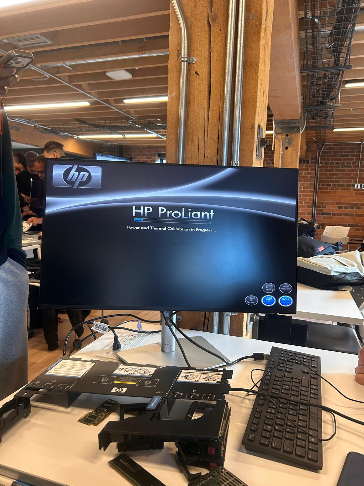

*Figure 6 — Écran de calibration thermique au démarrage.*

### 6.2 Détection du processeur

Le serveur passe le POST (Power-On Self-Test) et affiche :

- `1 Processor(s) detected, 4 total cores enabled, Hyperthreading is enabled` ;
- modèle : Intel Xeon E5620 @ 2,40 GHz (ou E5540 @ 2,53 GHz selon le processeur testé) ;
- chargement du BIOS **sans erreur critique de socket**.

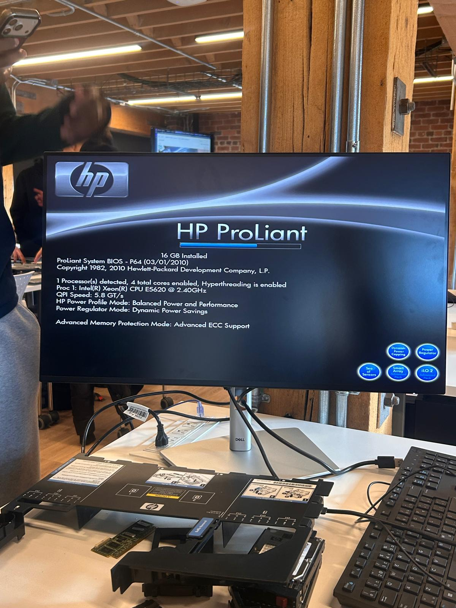

*Figure 7 — Écran POST : `16 GB Installed`, BIOS P64 (03/01/2010), `1 Processor(s) detected, 4 total cores enabled, Hyperthreading is enabled`, `Proc 1 : Intel Xeon E5620 @ 2.40GHz`, `QPI Speed : 5.8 GT/s`, `Advanced ECC Support`.*

### 6.3 Tentative de démarrage sur un périphérique

Une fois le POST terminé, le serveur cherche un périphérique de démarrage. Il a essayé le CD-ROM, puis le réseau, et affiche :

- `PXE-E61 : Media test failure, check cable` ;
- `PXE-M0F : Exiting Broadcom PXE ROM`.

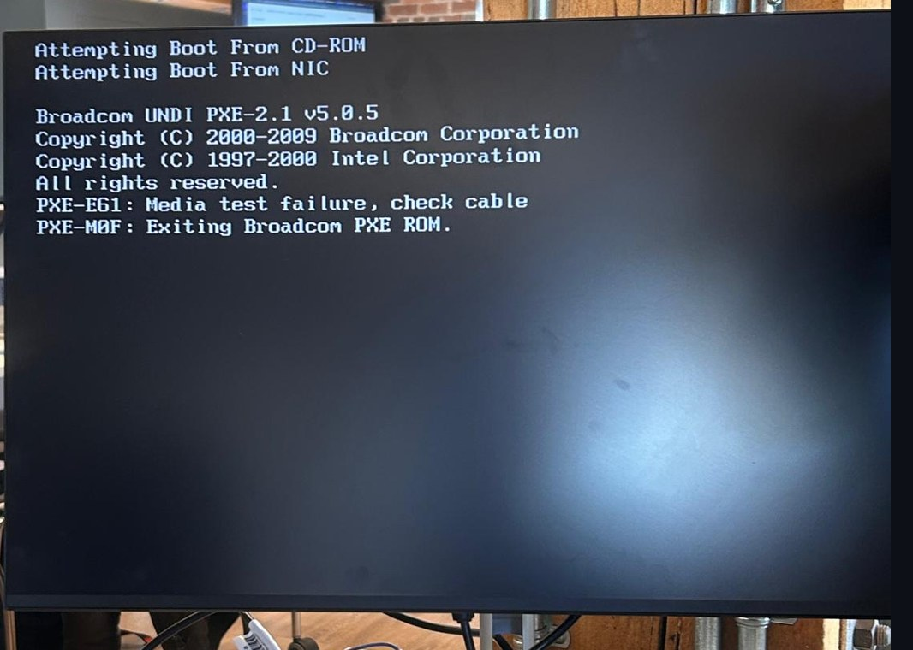

*Figure 7 bis — Échec de la tentative de démarrage réseau (PXE) : le message demande de vérifier le câble réseau.*

Le serveur atteint donc la **recherche d'un périphérique de démarrage**, ce qui valide le matériel jusqu'à cette étape. L'échec PXE **ne prouve pas** une panne de disque : il faut contrôler le support amorçable, l'ordre de démarrage et la connexion réseau selon le mode d'installation choisi.

---

## 7. BIOS et RBSU

À la fin du POST, le menu suivant s'affiche :

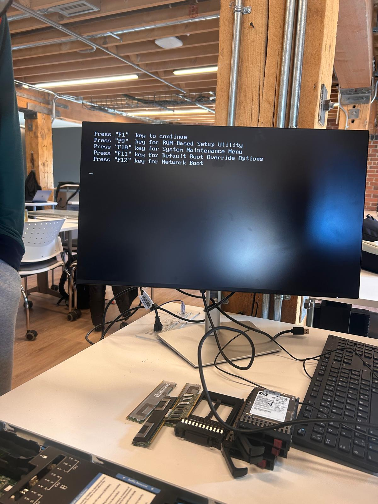

*Figure 8 — Menu affiché à la fin du POST.*

| Touche | Fonction |
|---|---|
| **F1** | Continuer le démarrage |
| **F9** | ROM-Based Setup Utility (RBSU) |
| **F10** | System Maintenance Menu |
| **F11** | Default Boot Override Options |
| **F12** | Network Boot (démarrage réseau) |

### Configuration processeur dans le RBSU (version 3.00)

| Élément | Valeur observée |
|---|---|
| Proc 1 | Intel 2,53 GHz, 8 Mo de cache L3 |
| Proc 2 | Not Installed |

### Utilitaire de diagnostic HP (version 2.15)

Il permet de lancer des tests ciblés : **Memory Test**, **CPU Test**, **Boot Disk Test**.

---

## 8. Mémoire système

| Vérification | Résultat |
|---|---|
| Configuration minimale (1 barrette) | PROC 1 DIMM 3 : **8 192 Mo** détectés |
| Autres emplacements (PROC 1 et PROC 2) | Not Installed |
| Autre essai au POST | 16 GB Installed |
| Configuration finale au POST | 64 GB Installed |
| Diagnostic mémoire (configuration finale) | 65 536 Mo configurés et disponibles |

Les capacités affichées changent selon le nombre de barrettes installées à chaque essai. Chaque valeur correspond à une configuration différente, pas à une anomalie.

### 8.1 POST avec 16 Go

Voir la figure 7 : `16 GB Installed`.

### 8.2 BIOS Memory Diagnostic (configuration finale)


*Figure 9 — BIOS Memory Diagnostic : 4 barrettes de 16 384 Mo, le reste des slots en `Not Installed`. Total : `65536MB Available / 65536MB Configured`.*

Ce diagnostic confirme que la mémoire est **reconnue** par le BIOS. Il ne constitue pas un test prolongé de stabilité : un test complet demande de laisser le diagnostic terminer son exécution.

---

## 9. Analyse des causes possibles

Le test demandé par la procédure du laboratoire est de placer **le processeur seul dans le socket 1**, avec une barrette dans le premier slot de PROC 1. Le résultat observé : le serveur **passe le POST** (voir la section 6).

| Hypothèse | Indice observé | Conclusion |
|---|---|---|
| Processeur défectueux | Le processeur testé seul dans le socket 1 démarre et réussit le POST (CPU Diagnostic : OK) | **Écartée** |
| Mauvais emplacement du processeur | Le message « *Processor in incorrect slot – System Halted* » apparaît quand l'unique processeur est dans le socket 2 | **Cause confirmée de l'arrêt** : un seul CPU doit être dans le socket 1 |
| Socket 2 défectueux (broches pliées ou endommagées) | Non démontré : un processeur seul dans le socket 2 s'arrête de toute façon, même si le socket est sain | **À confirmer** par un test croisé |
| Canal mémoire du CPU 2 | Les emplacements de PROC 2 sont « Not Installed » | **Possible** |
| Module de cache RAID, pile CMOS | Retrait du cache et remplacement de la pile ont permis d'avancer vers le POST | **Corrigés** |
| Barrette mémoire défectueuse | Configuration minimale validée avec 8 Go | **Peu probable** |
| Alimentation | Seul l'avertissement normal 1615 de la baie 2 | **Écartée** |

**Point important :** un serveur avec un seul processeur ne démarre pas si celui-ci est dans le socket 2. L'arrêt observé dans ce cas ne prouve donc **pas** que le socket 2 est endommagé.

**Test croisé pour conclure sur le socket 2 :** installer un processeur reconnu sain (celui qui vient de passer le POST dans le socket 1) dans le **socket 2 avec un second processeur dans le socket 1**. Si le serveur ne détecte alors pas le processeur du socket 2 (RBSU : *Proc 2 : Not Installed*), le défaut vient du **socket 2 ou de son canal mémoire**. Si les deux sont détectés, le socket est sain.

---

## 10. Composants complémentaires et dépannage observés en équipe

Le laboratoire a été réalisé en équipe : les observations ci-dessous sont celles du groupe.

### 10.1 Composants identifiés

| Composant | Observation |
|---|---|
| Disques | **3 disques SAS de 146 Go** dans des tiroirs amovibles accessibles par l'avant |
| Modèle de disque observé | Dell Savvio 15K.2 : SAS 6 Gb/s, **15 000 tr/min**, classe entreprise |
| Contrôleur de disques | HP Smart Array **P410i** |
| Module de cache | **512 Mo**, branché sur le contrôleur P410i |
| Alimentations | 2 blocs redondants, **PS1 et PS2** |
| Pile CMOS | Pile bouton **CR2032** sur la carte mère |
| Interrupteur de maintenance | **SW1** : l'interrupteur n°6 réinitialise la configuration |
| Gestion à distance | iLO 2 |

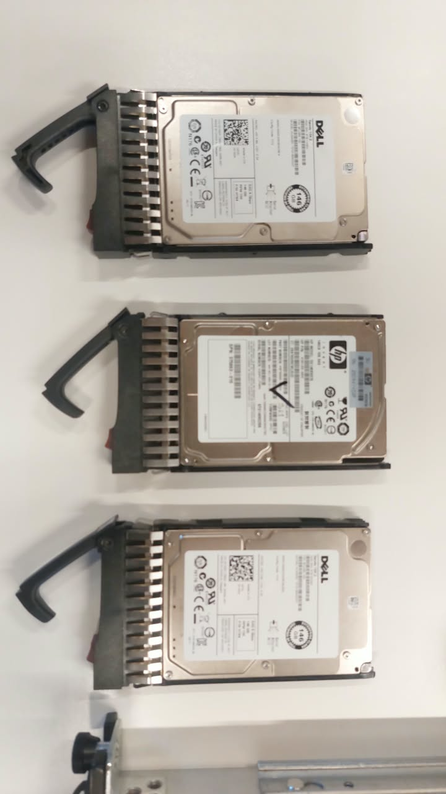

*Figure 10 — Les trois disques SAS de 146 Go retirés de leurs baies.*

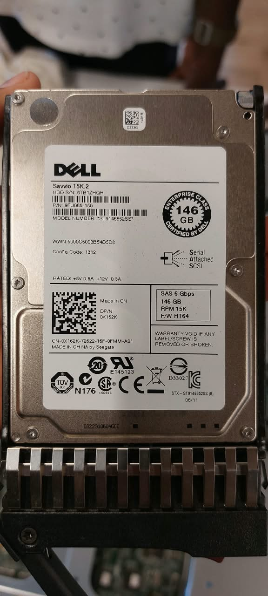

*Figure 11 — Gros plan sur un disque : Dell Savvio 15K.2, 146 Go, SAS 6 Gb/s, 15 000 tr/min.*


*Figure 12 — Module de cache de 512 Mo du contrôleur Smart Array P410i.*

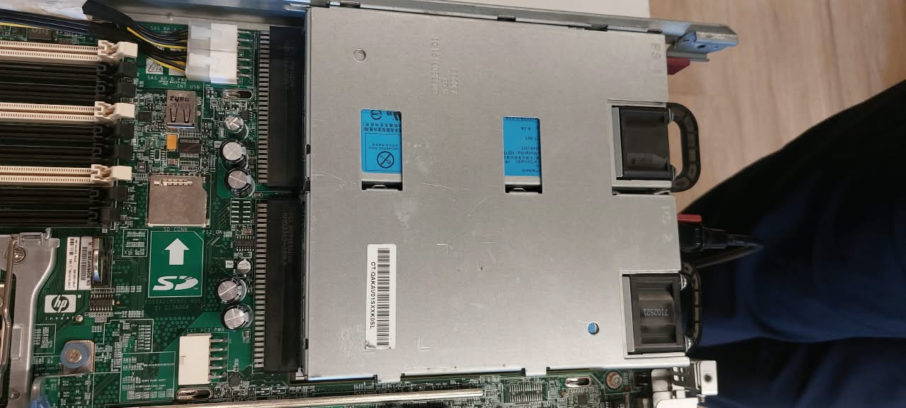

*Figure 13 — Les deux blocs d'alimentation redondants (PS1 et PS2).*

### 10.2 Démarche de dépannage appliquée

Le groupe a procédé **un changement à la fois**, en observant le résultat de chacun :

| Étape | Action | Pourquoi |
|---|---|---|
| 1 | Retrait du **module de cache** du contrôleur RAID | Un module défaillant ou à batterie usée peut empêcher le serveur d'atteindre le POST |
| 2 | Remplacement de la **pile CMOS** | Une pile usée peut corrompre les réglages du BIOS |
| 3 | Réinitialisation par l'interrupteur **SW1 n°6** | Revenir à la configuration d'usine |
| 4 | Déplacement du processeur dans le **socket 1** | Message d'arrêt « *Processor in incorrect slot – System Halted* » |

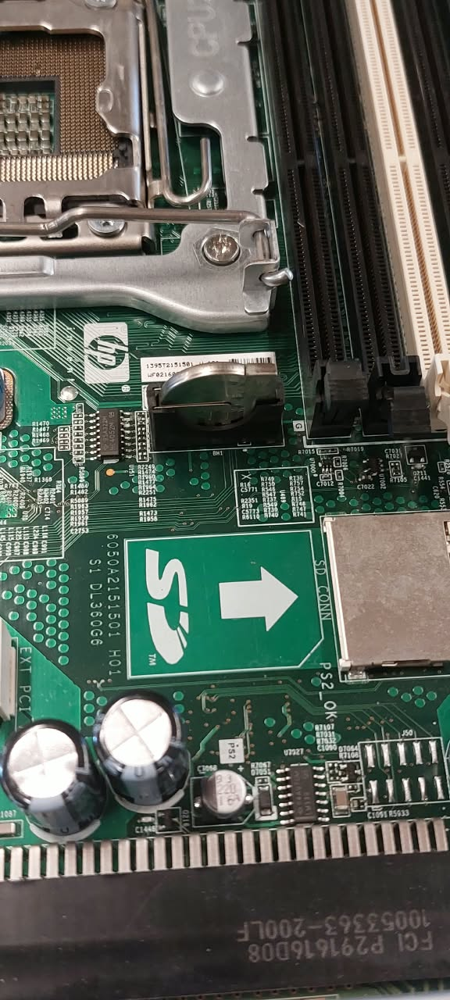

*Figure 14 — Pile CMOS sur la carte mère.*

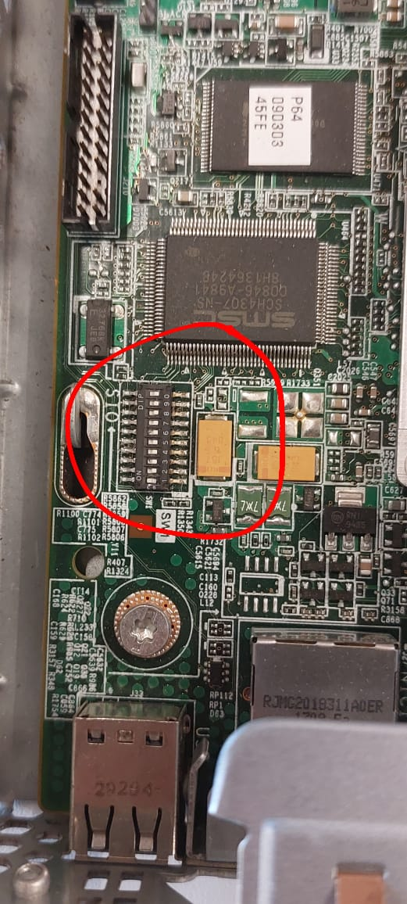

*Figure 15 — Interrupteur de maintenance SW1 (l'interrupteur n°6 réinitialise la configuration).*

**Procédure de réinitialisation par SW1 n°6 :**

1. Éteindre le serveur et débrancher les câbles d'alimentation.
2. Basculer l'interrupteur n°6 sur **ON**.
3. Rebrancher et allumer : la configuration est effacée.
4. Éteindre de nouveau.
5. **Remettre l'interrupteur n°6 sur OFF** ; sinon le serveur se réinitialise à chaque démarrage.
6. Rallumer normalement.

### 10.3 Le message « Processor in incorrect slot »


*Figure 16 — Arrêt du serveur : « Processor in incorrect slot – System Halted! ».*

Avec **un seul processeur**, celui-ci doit être dans le **socket 1 (Proc 1)**. Placé dans le socket 2, le serveur s'arrête avant le POST. Le déplacer dans le socket 1 a permis de démarrer : le BIOS fonctionnait, et la panne venait de l'**emplacement du processeur**.

### 10.4 Vérification du processeur

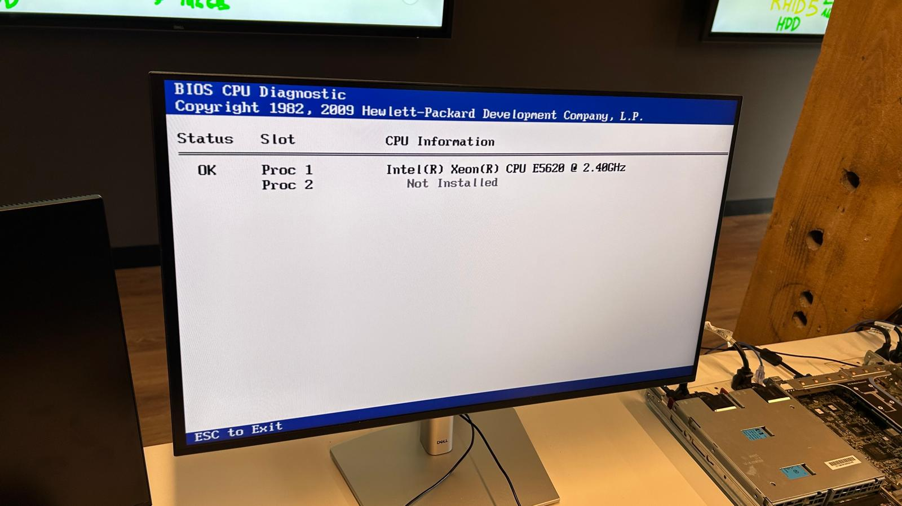

*Figure 17 — BIOS CPU Diagnostic : le processeur du socket Proc 1 a le statut OK.*

---

## 11. Disques : détection et configuration RAID

Après la validation du processeur et de la mémoire, la dernière étape du diagnostic est de vérifier les **disques** : un serveur qui passe le POST doit aussi voir son stockage avant de pouvoir installer un système.

Le DL360 G6 utilise un contrôleur **Smart Array P410i** intégré, avec un module de cache de 512 Mo. Dans notre serveur, il gère **3 disques SAS de 146 Go** (voir la [section 10](#10-composants-complémentaires-et-dépannage-observés-en-équipe)). Il présente au système des **volumes logiques** (*logical drives*) construits à partir des disques physiques ; les disques individuels ne sont donc pas visibles directement par Linux.

### 11.1 Détection au POST

Pendant le POST, le message du contrôleur Smart Array liste les disques détectés et l'état des volumes logiques. On y lit :

- le nombre de disques physiques détectés (baies SFF 2,5") ;
- l'état du volume logique (*OK*, *Failed*, *Not configured*) ;
- l'invite **F8 : Option ROM Configuration for Arrays** pour entrer dans l'utilitaire de configuration.

> Si aucun volume logique n'est configuré, le POST l'indique et le système ne verra aucun disque : c'est l'étape suivante à réaliser.

### 11.2 Configuration d'un volume logique (ORCA / ACU)

| Étape | Action |
|---|---|
| 1 | Appuyer sur **F8** à l'invite du Smart Array pour ouvrir l'ORCA (*Option ROM Configuration for Arrays*) |
| 2 | Choisir **Create Logical Drive** |
| 3 | Cocher les disques physiques à inclure dans le volume |
| 4 | Choisir le niveau **RAID** selon le besoin (tableau ci-dessous) |
| 5 | Valider avec **F8 (Save)**, puis redémarrer |

| RAID | Disques min. | Capacité utile | Tolérance de panne | Usage |
|---|---|---|---|---|
| RAID 0 | 2 | 100 % | Aucune | Performance, laboratoire jetable |
| RAID 1 | 2 | 50 % | 1 disque | Système (miroir) |
| RAID 1+0 | 4 | 50 % | 1 disque par miroir | Performance et sécurité |
| RAID 5 | 3 | N − 1 disques | 1 disque | Capacité et sécurité |

Pour un serveur de laboratoire, le **RAID 1** (système) ou le **RAID 5** (données) sont les choix usuels. L'utilitaire graphique **HP Array Configuration Utility (ACU)** permet les mêmes opérations avec une interface plus complète (extension d'un volume, disque de secours).

### 11.3 Vérification après configuration

Au redémarrage, le POST doit afficher le volume logique créé avec l'état **OK**. Un volume à l'état *Failed* ou *Rebuilding* signale un disque défectueux : on remplace le disque et le contrôleur reconstruit le volume.

### 11.4 Réalisation en équipe : volume RAID 5

Avant d'installer le système, le groupe a utilisé le contrôleur **Smart Array P410i** pour regrouper les **trois disques SAS** dans un seul volume logique en **RAID 5**.


*Figure 18 — Sélection des trois disques SAS pour la création du volume RAID 5.*

| Élément | Configuration |
|---|---|
| Contrôleur | HP Smart Array P410i (cache 512 Mo) |
| Disques | 3 disques SAS de **146,8 Go** chacun |
| Niveau RAID | **RAID 5** |
| Capacité utile | environ **293,56 Go** |
| Tolérance de panne | 1 disque |

**Calcul de la capacité.** En RAID 5, l'équivalent d'un disque sert à la parité : (3 − 1) × 146,8 Go ≈ **293,6 Go** utilisables, ce qui correspond à la capacité affichée par le contrôleur.

### 11.5 Installation de Proxmox VE

Une fois le volume logique créé, le groupe a installé **Proxmox Virtual Environment** sur le serveur. Le **partitionnement et le formatage** du volume ont été faits **par l'installateur de Proxmox**, qui prépare lui-même le disque.


*Figure 19 — Console de Proxmox VE après le démarrage.*

| Observation | Valeur |
|---|---|
| Message affiché | *Welcome to the Proxmox Virtual Environment* |
| Adresse d'administration | `https://192.168.100.2:8006/` |
| Invite de commande | `root@server1:~#` |
| Session | Locale, avec le compte **root** |

Le démarrage de Proxmox montre que le serveur poursuit sa séquence **jusqu'au chargement du système d'exploitation**, ce qui valide le matériel nécessaire à cette étape (processeur, mémoire, contrôleur RAID et volume logique). L'accessibilité de l'interface Web depuis un autre ordinateur reste à confirmer avec un navigateur.

---

## 12. Formatage et montage sous Linux

Une fois le volume logique créé, Linux le voit comme un disque ordinaire (par exemple `/dev/sda`). Il reste à le partitionner, à le formater et à le monter. Pendant le labo, l'installateur de Proxmox a fait cette préparation (section 11.5) ; les commandes ci-dessous détaillent la méthode manuelle sous Linux.

### 12.1 Identifier le disque

```bash
lsblk
sudo fdisk -l
```

`lsblk` liste les disques, leurs partitions et leurs points de montage. **Toujours vérifier le nom du disque avant de le formater** : formater le mauvais disque détruit ses données.

### 12.2 Partitionner

```bash
sudo parted /dev/sdb --script mklabel gpt
sudo parted /dev/sdb --script mkpart primary ext4 0% 100%
```

Ici `/dev/sdb` est un exemple : à remplacer par le disque identifié à l'étape précédente. Le schéma **GPT** est le choix moderne pour les disques de plus de 2 To.

### 12.3 Formater

```bash
sudo mkfs.ext4 /dev/sdb1
```

Le système de fichiers **ext4** est le plus courant sous Linux. Le formatage crée la structure qui permet de stocker des fichiers.

### 12.4 Monter

```bash
sudo mkdir -p /mnt/data
sudo mount /dev/sdb1 /mnt/data
df -h
```

`df -h` confirme que la partition est montée et affiche sa taille.

### 12.5 Montage permanent

Pour que le montage survive au redémarrage, on ajoute une ligne dans `/etc/fstab`, en utilisant l'**UUID** (plus stable que le nom `/dev/sdb1`) :

```bash
sudo blkid /dev/sdb1
echo 'UUID=<uuid-affiché> /mnt/data ext4 defaults 0 2' | sudo tee -a /etc/fstab
sudo mount -a
```

`mount -a` teste le fichier `fstab` : une erreur ici doit être corrigée avant tout redémarrage, sinon le système peut ne pas démarrer.

### 12.6 Résumé du flux

| Étape | Outil | Résultat |
|---|---|---|
| Créer le volume logique | ORCA (F8) / ACU | Disque visible par Linux |
| Identifier | `lsblk`, `fdisk -l` | Nom du disque (`/dev/sdX`) |
| Partitionner | `parted` | Table GPT + partition |
| Formater | `mkfs.ext4` | Système de fichiers |
| Monter | `mount`, `/etc/fstab` | Disque utilisable et persistant |

---

## 13. Conclusion

### 13.1 Bilan des vérifications

| Élément | Résultat ou observation |
|---|---|
| Inspection interne | Serveur ouvert, composants identifiés |
| Processeurs | Retirés, inspectés, réinstallés ; testés seuls dans le socket 1 |
| Dissipateurs thermiques | Retirés puis remontés |
| Mémoire RAM | Reconnue par le BIOS (8 Go, 16 Go, puis 64 Go selon l'essai) |
| Retrait temporaire | Disques et barrettes retirés puis réinstallés progressivement |
| POST | Réussi : `1 Processor(s) detected`, calibration thermique, BIOS accessible |
| Diagnostic CPU | Processeur du socket Proc 1 : **OK** |
| Alimentation | Avertissement 1615 normal (un seul bloc branché) |
| Dépannage | Cache RAID retiré, pile CMOS remplacée, SW1 n°6 utilisé, processeur placé dans le socket 1 |
| Disques SAS | 3 disques de 146,8 Go regroupés en **RAID 5** (environ 293,56 Go) |
| Proxmox VE | Installé et démarré en console (`root@server1`) |
| Accès Web | Adresse affichée ; connexion à vérifier depuis un navigateur |

### 13.2 Résultats obtenus

À la fin du travail, le groupe a réussi à :

1. Ouvrir le serveur et identifier ses principaux composants.
2. Inspecter et réinstaller les processeurs, puis remonter les dissipateurs.
3. Vérifier l'installation des barrettes de mémoire.
4. Isoler la panne par élimination et atteindre le POST.
5. Accéder au BIOS, au RBSU et aux diagnostics mémoire et processeur.
6. Observer jusqu'à 64 Go de mémoire configurée.
7. Créer un volume RAID 5 avec les trois disques SAS.
8. Poursuivre le démarrage jusqu'au système d'exploitation.
9. Installer et démarrer Proxmox VE, avec une session locale root.

### 13.3 Conclusion générale

- Le **processeur testé et le socket 1 sont fonctionnels** : le serveur réussit le POST (`1 Processor(s) detected`), le CPU Diagnostic indique **OK** et la mémoire est détectée (8 192 Mo sur PROC 1 DIMM 3).
- L'arrêt « *Processor in incorrect slot* » vient de l'**emplacement du processeur** : avec un seul CPU, il doit être dans le socket 1.
- Le retrait du **module de cache RAID**, le remplacement de la **pile CMOS** et la réinitialisation par **SW1 n°6** ont permis au serveur d'atteindre le POST.
- Le RBSU indique **Proc 2 : Not Installed**. Le **socket 2** reste une hypothèse à confirmer par le test croisé décrit en section 9.
- Le serveur contient **3 disques SAS de 146 Go** derrière un Smart Array P410i (cache 512 Mo) : ils se gèrent en deux temps, avec le **volume logique** créé dans le contrôleur (ORCA/ACU), puis Linux qui le **partitionne, formate et monte** (`parted`, `mkfs.ext4`, `/etc/fstab`).
- **Résultat principal :** un volume **RAID 5** d'environ 293,56 Go a été créé avec les trois disques SAS, puis **Proxmox VE** a été installé et a démarré jusqu'à la console locale (`root@server1`).
- **Limites :** l'accès à l'interface Web (`https://192.168.100.2:8006/`) depuis un autre ordinateur et le résultat final complet du diagnostic mémoire restent à confirmer.
- Ce laboratoire a permis de pratiquer l'isolation de panne par configuration minimale, la lecture des messages POST, l'utilisation du RBSU, du diagnostic mémoire et CPU, et la préparation du stockage.

---

## 14. Difficultés rencontrées et leçons apprises

| Difficulté | Solution / leçon |
|---|---|
| Le deuxième processeur n'était pas détecté | Isolation par **configuration minimale** et test du processeur seul dans le socket 1 (le socket 2 reste à confirmer par un test croisé) |
| Message **1615** (alimentation baie 2) | Normal avec un seul bloc branché : ne pas le confondre avec une panne |
| Capacité mémoire différente d'un essai à l'autre (8, 16, 64 Go) | Chaque valeur correspond à la configuration testée, pas à une anomalie |
| Arrêt au démarrage : « Processor in incorrect slot » | Un seul processeur doit être dans le **socket 1** ; le déplacer a permis de démarrer |
| Le serveur n'atteignait pas le POST | Retrait du module de cache RAID, remplacement de la pile CMOS, réinitialisation par SW1 n°6 |
| Distinguer un défaut de CPU d'un défaut de socket | Le **test croisé** est indispensable : l'inspection visuelle seule ne suffit pas |

**Bonnes pratiques retenues :**

- Travailler serveur éteint et débranché, avec un bracelet antistatique.
- Ne jamais toucher les broches du socket LGA1366 ; manipuler le processeur par les bords.
- Ne changer qu'**un seul élément à la fois** pour pouvoir conclure.
- Retirer le **module de cache** du contrôleur RAID dès le début du diagnostic.
- Après une réinitialisation par **SW1 n°6**, remettre l'interrupteur sur OFF.
- Lire attentivement les **messages du POST** : ils indiquent souvent la cause directement.
- Noter chaque configuration testée et son résultat.
- Vérifier le nom du disque avec `lsblk` avant tout formatage.

---

## 15. Glossaire

| Terme | Définition |
|---|---|
| **POST** | *Power-On Self-Test* : auto-test exécuté au démarrage |
| **BIOS** | Micrologiciel qui initialise le matériel au démarrage |
| **RBSU** | *ROM-Based Setup Utility* : configuration du BIOS HP (touche F9) |
| **ORCA** | *Option ROM Configuration for Arrays* : configuration RAID au démarrage (touche F8) |
| **ACU** | *Array Configuration Utility* : outil HP de gestion des volumes RAID |
| **LGA1366** | Socket Intel où les broches sont sur la carte mère |
| **DIMM** | Barrette de mémoire vive |
| **ECC** | Mémoire avec correction d'erreurs |
| **QPI** | *QuickPath Interconnect* : lien entre processeurs et chipset Intel |
| **RAID** | Regroupement de disques pour la performance ou la tolérance de panne |
| **GPT** | Table de partitions moderne, adaptée aux grands disques |
| **UUID** | Identifiant unique d'une partition, stable dans `/etc/fstab` |

---

## 16. Références

- LGA 1366 : <https://fr.wikipedia.org/wiki/LGA_1366>
- Spécifications Intel Xeon E5620 / E5540 : fiches produit Intel ARK (ark.intel.com)
- Dépôt du cours : <https://github.com/CollegeBoreal/INF1085-201-26A-04>
