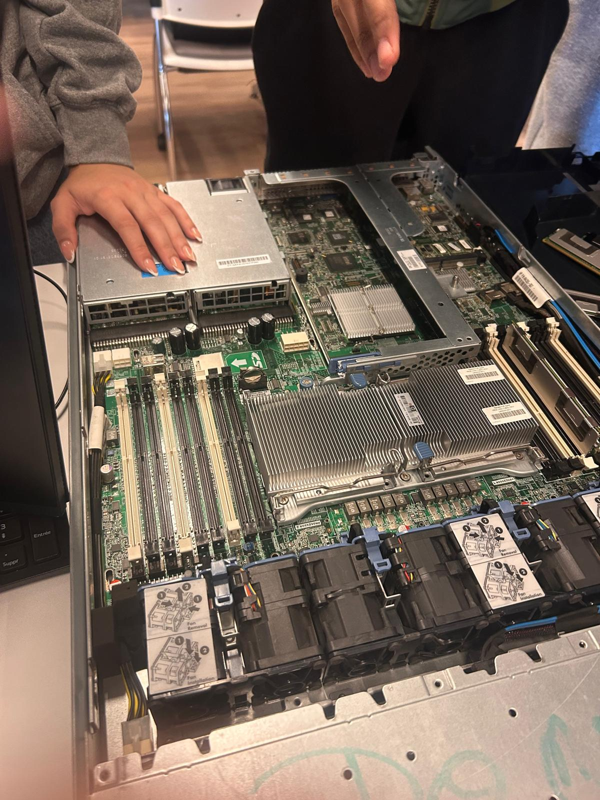
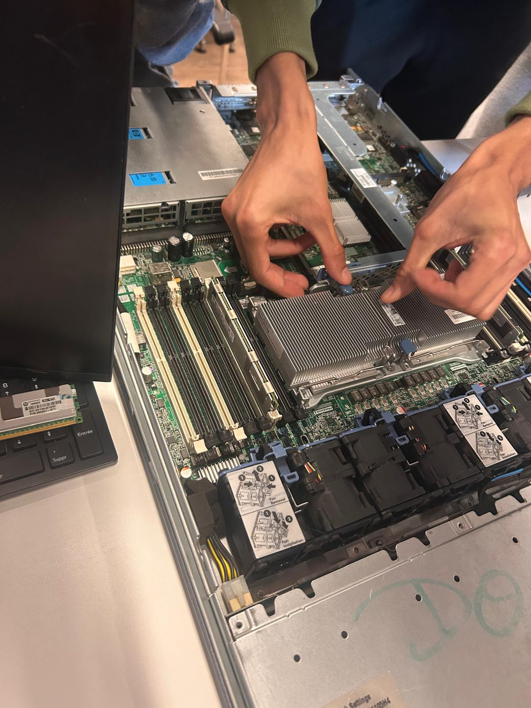
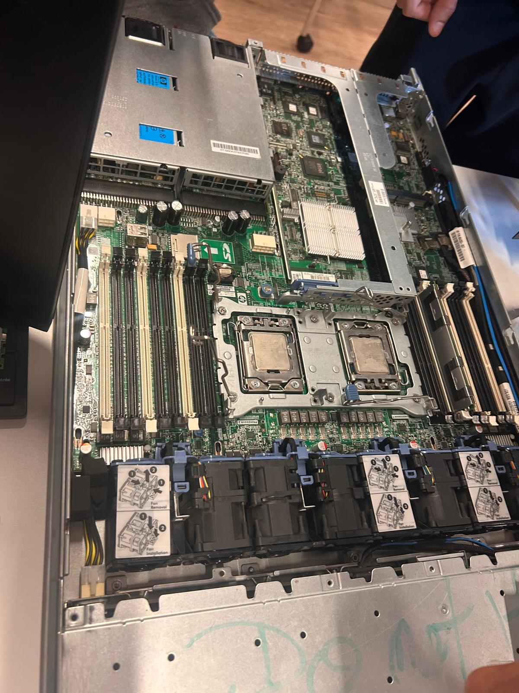
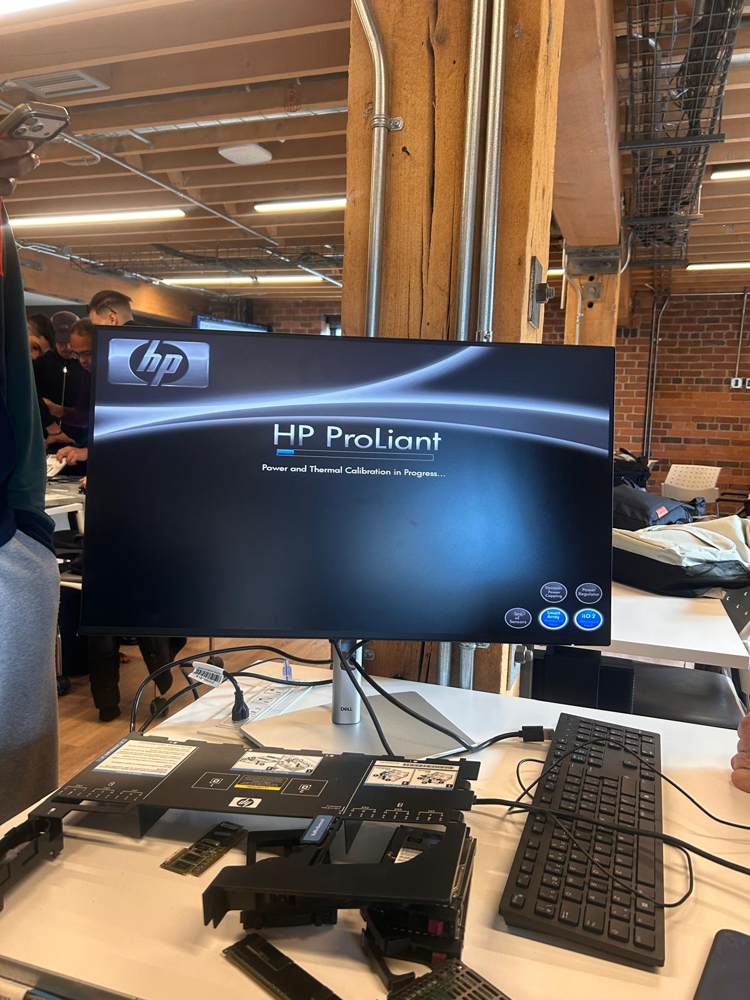
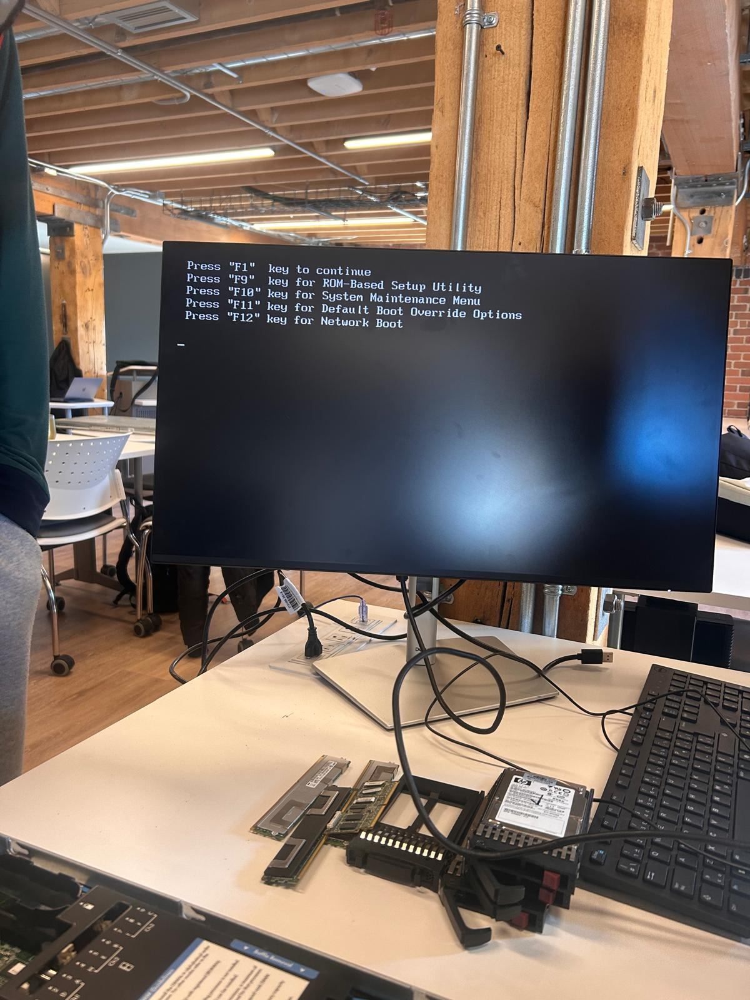
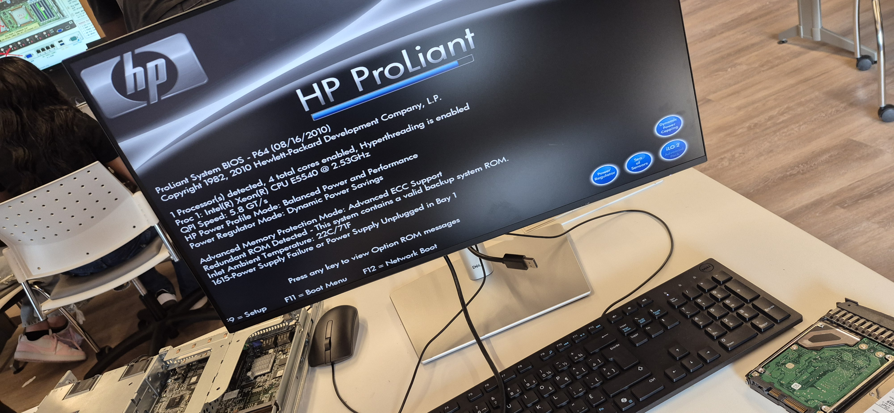

# Diagnostic matériel et configuration — HP ProLiant DL360 G6

**Cours :** INF1085-201-26A-04 — 1.Diagnostics  
**Étudiante :** Salma Baali  
**Serveur :** HP ProLiant DL360 G6

---

## 1. Objectif du laboratoire

L'objectif de ce laboratoire est d'examiner un serveur HP ProLiant DL360 G6, de vérifier son démarrage matériel (POST), d'observer la détection des processeurs et de la mémoire système, puis d'analyser les problèmes rencontrés.

Les vérifications abordées sont :

- l'inspection des composants matériels ;
- la manipulation du dissipateur thermique ;
- la vérification des processeurs et de leur installation ;
- le démarrage et les messages POST ;
- l'accès au BIOS et au ROM-Based Setup Utility (RBSU) ;
- la détection et le diagnostic de la mémoire ;
- les options de démarrage et le message d'erreur PXE ;
- l'analyse des causes possibles d'un problème de détection du deuxième processeur.

## 2. Inspection du serveur

Le serveur est ouvert afin d'observer ses composants internes avant les vérifications matérielles.

*Figure 1 — Vue du serveur ouvert.*

## 3. Manipulation du dissipateur thermique

L'accès aux processeurs nécessite de manipuler le système de refroidissement. Cette opération permet d'observer les composants et leur installation. Les manipulations doivent être réalisées en respectant les consignes de sécurité et de maintenance du laboratoire.

*Figure 2 — Manipulation du dissipateur thermique.*

## 4. Vérification des processeurs

Le serveur possède deux emplacements pour processeurs. L'inspection visuelle permet d'observer les deux processeurs et leur emplacement sur la carte système.

*Figure 3 — Vue des deux processeurs.*

Le diagnostic doit permettre de déterminer si le problème de détection est associé au processeur secondaire, au socket 2 ou à un autre élément de la configuration. Une inspection visuelle seule ne permet pas de confirmer la cause.

## 5. Configuration minimale utilisée pour le POST

Les consignes du laboratoire indiquent une configuration minimale pour isoler le problème :

| Élément | Configuration indiquée |
|---|---|
| Processeur | Un processeur installé dans le socket 1 (PROC 1) |
| Mémoire | Une barrette de 8 Go |
| Emplacement mémoire | PROC 1 DIMM 3 (emplacement blanc A1) |
| Cartes PCIe | Aucune carte PCIe supplémentaire |
| Alimentation | Bloc d'alimentation dans la baie 1 uniquement |

Les modèles de processeurs mentionnés dans les observations sont Intel Xeon E5620 à 2,40 GHz et Intel Xeon E5540 à 2,53 GHz. Il faut conserver le modèle réellement observé sur chaque capture et ne pas supposer qu'ils ont été utilisés simultanément.

## 6. Démarrage et calibration thermique

Au démarrage, le serveur affiche le message « Power and Thermal Calibration in Progress ». Ce message apparaît pendant la phase d'initialisation du serveur.

*Figure 4 — Écran de calibration thermique.*

## 7. BIOS et RBSU — configuration générale

Le ROM-Based Setup Utility (RBSU) est l'utilitaire de configuration intégré au serveur HP ProLiant. Il permet d'accéder aux paramètres de configuration du système, notamment aux réglages matériels, à la mémoire et aux options de démarrage.

L'accès au RBSU se fait avec la touche **F9** pendant le démarrage.

*Figure 5 — Menu de démarrage et accès aux utilitaires.*

Les options affichées dans le menu comprennent :

| Touche | Fonction affichée |
|---|---|
| F1 | Continuer |
| F9 | ROM-Based Setup Utility (RBSU) |
| F10 | System Maintenance Menu |
| F11 | Options de démarrage |
| F12 | Démarrage réseau |

**Version du RBSU mentionnée dans les observations :** 3.00.

La capture disponible montre le menu d'accès. Elle ne montre pas les pages internes du RBSU. Par conséquent, les valeurs détaillées des paramètres généraux et de mémoire ne doivent pas être inventées : elles doivent être ajoutées à partir des écrans réellement consultés pendant le laboratoire.

## 8. Mémoire système

La mémoire est vérifiée à partir des informations affichées au POST et de l'utilitaire de diagnostic mémoire.

Les observations fournies indiquent les résultats suivants :

| Vérification | Résultat observé |
|---|---|
| Premier affichage POST | 16 GB Installed |
| Autre affichage POST | 64 GB Installed |
| Diagnostic mémoire | 65 536 MB configurés |
| Mémoire disponible affichée | 65 536 MB |

### 8.1 POST — affichage de 16 Go

*Figure 6 — Affichage de 16 GB Installed.*

### 8.2 Diagnostic mémoire

*Figure 7 — Diagnostic de la mémoire système.*

### 8.3 POST — affichage de 64 Go

*Figure 8 — Affichage de 64 GB Installed.*

Ces captures montrent des capacités différentes selon les essais. Le diagnostic affiche 65 536 MB configurés et disponibles au moment de la capture. Elles ne suffisent pas, à elles seules, à expliquer pourquoi les affichages POST diffèrent.

## 9. Vérifications du processeur secondaire

Les observations du POST indiquent qu'un processeur est détecté et que le deuxième processeur peut apparaître comme « Not Installed » dans la configuration testée.

Le document de référence du laboratoire propose un test croisé pour distinguer un problème du processeur secondaire d'un problème du socket 2 :

- retirer CPU2 ;
- placer CPU2 seul dans le socket 1 ;
- installer une barrette de mémoire dans le premier emplacement mémoire associé à CPU1 ;
- démarrer le serveur et observer s'il effectue le POST.

Interprétation indiquée dans le document de référence :

- Si le serveur effectue le POST avec CPU2 dans le socket 1, CPU2 fonctionne dans cette configuration ; le problème pourrait alors se situer au niveau du socket 2 ou de son circuit mémoire.
- Si le serveur n'effectue pas le POST, CPU2 pourrait être défectueux.

Ce test doit être effectué uniquement selon les consignes du professeur et la procédure de maintenance appropriée. **Ne pas déclarer le socket 2 ou CPU2 défectueux sans avoir réalisé et documenté ce test.**

*Figure 9 — Image de référence du test croisé fournie dans le dossier du laboratoire.*

## 10. Scénarios possibles en cas de broches ou de socket endommagés

Le document de référence présente trois scénarios possibles :

### Cas 1 — Quelques broches légèrement pliées

Le document indique que les sockets LGA1366 possèdent leurs broches sur la carte mère. Une inspection visuelle peut aider à repérer une anomalie. Toute intervention sur les broches doit être confiée à une personne qualifiée et réalisée selon la procédure de maintenance : une manipulation improvisée risque d'endommager davantage le socket.

### Cas 2 — Socket endommagé

Si le socket présente des broches cassées, arrachées ou écrasées, ou si son support est endommagé, une réparation spécialisée ou un remplacement peut être nécessaire. Le document de référence précise que cette opération demande un équipement professionnel et de l'expérience.

### Cas 3 — Remplacement de la carte système

Le document de référence présente le remplacement de la carte système comme une solution possible lorsque le socket est gravement endommagé. Le choix doit dépendre du diagnostic confirmé, de la disponibilité des pièces et de la valeur du serveur.

Ces scénarios sont des possibilités de diagnostic. Ils ne prouvent pas qu'un socket est effectivement endommagé sur le serveur examiné.

## 11. Démarrage réseau — erreur PXE

Lors d'une tentative de démarrage réseau, les messages suivants sont affichés :

`PXE-E61: Media test failure, check cable`

`PXE-M0F: Exiting Broadcom PXE ROM`

*Figure 10 — Échec de la tentative de démarrage réseau.*

Ces messages indiquent que la tentative de démarrage par le réseau n'a pas abouti. Les vérifications pertinentes comprennent la connexion réseau, la disponibilité du service de démarrage réseau et l'ordre de démarrage configuré. Cette erreur ne prouve pas, à elle seule, que le disque ou le système d'exploitation est absent.

## 12. Configuration et formatage des disques

Le barème fourni mentionne la configuration et le formatage des disques comme un critère de niveau supérieur. Toutefois, les informations et les photographies communiquées jusqu'ici ne montrent pas les étapes de configuration d'un volume logique, de création d'une grappe RAID ou de formatage d'un disque.

**À compléter uniquement si cette manipulation a réellement été effectuée :**

- contrôleur de stockage utilisé : [à renseigner] ;
- disques détectés : [nombre et capacité à renseigner] ;
- niveau RAID ou configuration choisie : [à renseigner] ;
- volume logique créé : [à renseigner] ;
- système de fichiers et formatage : [à renseigner] ;
- résultat observé : [à renseigner] ;
- capture d'écran de l'utilitaire de stockage ou du formatage : [à ajouter].

Ne pas indiquer qu'un disque a été configuré ou formaté si cette opération n'a pas été réalisée.

## 13. Tableau récapitulatif

| Élément vérifié | Observation |
|---|---|
| Inspection matérielle | Serveur ouvert et composants observés |
| Processeurs | Deux emplacements observés ; détection à vérifier par les tests |
| Configuration minimale | Un processeur dans PROC 1 et une barrette de 8 Go dans PROC 1 DIMM 3, selon les consignes |
| Calibration thermique | Message de calibration affiché |
| BIOS/RBSU | Accès par F9 ; version 3.00 mentionnée dans les observations |
| Mémoire | 16 Go puis 64 Go affichés selon les captures |
| Diagnostic mémoire | 65 536 MB configurés et disponibles |
| Test croisé CPU2 | Procédure proposée dans le document de référence ; résultat à documenter si le test a été réalisé |
| Démarrage réseau | Erreurs PXE-E61 et PXE-M0F |
| Disques | Configuration/formatage non documentés dans les éléments fournis |

## 14. Conclusion

Le laboratoire porte sur le diagnostic matériel d'un serveur HP ProLiant DL360 G6. Les observations permettent de documenter l'inspection du serveur, la manipulation du dissipateur thermique, l'observation des deux processeurs, le démarrage, l'accès au BIOS/RBSU et les résultats de détection de la mémoire.

Les captures montrent des affichages POST de 16 Go et de 64 Go, ainsi qu'un diagnostic mémoire indiquant 65 536 MB configurés et disponibles. Le problème de détection du deuxième processeur doit être analysé à l'aide du test croisé proposé dans le document de référence. Sans résultat documenté de ce test, il n'est pas possible de conclure définitivement que le processeur secondaire ou le socket 2 est défectueux.

Enfin, la tentative de démarrage réseau échoue avec les messages PXE-E61 et PXE-M0F. La configuration et le formatage des disques doivent être documentés séparément si ces opérations font partie des manipulations réalisées.

## 15. Références

- [Dossier du laboratoire INF1085 — 1.Diagnostics](https://github.com/CollegeBoreal/INF1085-201-26A-04/tree/main/1.Diagnostics)
- [Référence LGA 1366](https://fr.wikipedia.org/wiki/LGA_1366)

---

*Rapport rédigé à partir des observations, des photographies et des informations de référence communiquées pour le laboratoire.*
