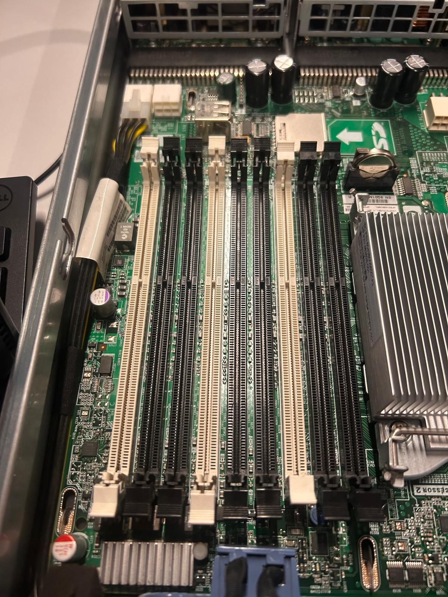

# Rapport de diagnostic et validation POST — HP ProLiant DL360 G6

| | |
|---|---|
| **Cours** | INF1085-201-26A-04 — 1. Diagnostics |
| **Étudiante** | Salma Baali (300158383) |
| **Équipement** | Serveur HP ProLiant DL360 G6 |
| **Travail réalisé** | En équipe |

---

## Table des matières

1. [Contexte et problématique](#1-contexte-et-problématique)
2. [Inspection du serveur](#2-inspection-du-serveur)
3. [Manipulation du dissipateur thermique](#3-manipulation-du-dissipateur-thermique)
4. [Vérification des processeurs](#4-vérification-des-processeurs)
5. [Configuration minimale POST](#5-configuration-minimale-post)
6. [Démarrage et résultats du POST](#6-démarrage-et-résultats-du-post)
7. [BIOS et RBSU](#7-bios-et-rbsu)
8. [Mémoire système](#8-mémoire-système)
9. [Analyse des causes possibles](#9-analyse-des-causes-possibles)
10. [Conclusion](#10-conclusion)

---

## 1. Contexte et problématique

Le serveur présentait un problème de démarrage : le **deuxième processeur n'était pas détecté**. Selon la procédure d'isolation de panne du laboratoire, on teste le processeur concerné **seul dans le socket 1 (PROC 1)**, avec une configuration minimale. Le but est de savoir si le défaut vient **du processeur lui-même** ou **du socket 2**.

**Méthode : procéder par élimination.**

1. Retirer tout ce qui n'est pas indispensable (configuration minimale POST).
2. Démarrer et observer les messages du POST.
3. Vérifier la détection du CPU et de la mémoire dans le BIOS.
4. En déduire quel élément est fautif.

*Figure 1 — Vue générale de l'intérieur du serveur : processeur avec dissipateur, ventilateurs, emplacements mémoire et barrettes retirées.*

---

## 2. Inspection du serveur

Avant toute manipulation, le capot est retiré et on observe les composants internes : ventilateurs hot-plug, dissipateurs, carte mère et emplacements mémoire (DIMM).

*Figure 2 — Serveur ouvert, prêt pour l'inspection.*

Les emplacements mémoire sont répartis en slots **blancs** et **noirs**. Le premier slot blanc de chaque processeur est celui à utiliser en configuration minimale.

*Figure 3 — Emplacements DIMM (blancs et noirs) à côté du processeur 2.*

---

## 3. Manipulation du dissipateur thermique

Pour accéder aux processeurs, il faut retirer le dissipateur. Cette étape permet d'observer le processeur et son socket (broches, pâte thermique).

> **Précautions :** serveur éteint et débranché, décharge électrostatique (bracelet antistatique), manipulation du processeur par les bords uniquement, ne jamais toucher les broches du socket.

*Figure 4 — Manipulation du dissipateur thermique.*

---

## 4. Vérification des processeurs

Le DL360 G6 comporte deux sockets. L'inspection visuelle permet de voir les deux processeurs et leur emplacement.

*Figure 5 — Vue des deux processeurs sur la carte mère.*

L'inspection visuelle seule **ne suffit pas** à confirmer la cause du problème : un test croisé est nécessaire (voir [section 9](#9-analyse-des-causes-possibles)).

---

## 5. Configuration minimale POST

| Élément | Configuration utilisée |
|---|---|
| Processeur | 1 Intel Xeon dans le socket 1 (PROC 1) |
| Mémoire | 1 barrette de 8 Go |
| Emplacement mémoire | PROC 1 DIMM 3 (slot blanc A1) |
| Cartes PCIe | Aucune carte supplémentaire |
| Alimentation | Bloc dans la baie 1 uniquement |

Processeurs rencontrés : **Intel Xeon E5620 (2,40 GHz)** et **Intel Xeon E5540 (2,53 GHz)**.

> Avec un seul bloc d'alimentation, le message **« 1615 – Power Supply Failure or Power Supply Unplugged in Bay 2 »** s'affiche. C'est **normal** : seule la baie 1 est alimentée.

---

## 6. Démarrage et résultats du POST

### 6.1 Calibration thermique

Au démarrage apparaît l'écran HP ProLiant avec le message **« Power and Thermal Calibration in Progress… »**. Il s'affiche pendant l'initialisation du serveur.

*Figure 6 — Écran de calibration thermique au démarrage.*

### 6.2 Détection du processeur

Le serveur passe le POST (Power-On Self-Test) et affiche :

- `1 Processor(s) detected, 4 total cores enabled, Hyperthreading is enabled` ;
- modèle : Intel Xeon E5620 @ 2,40 GHz (ou E5540 @ 2,53 GHz selon le processeur testé) ;
- chargement du BIOS **sans erreur critique de socket**.

*Figure 7 — Écran POST : `16 GB Installed`, BIOS P64 (03/01/2010), `1 Processor(s) detected, 4 total cores enabled, Hyperthreading is enabled`, `Proc 1 : Intel Xeon E5620 @ 2.40GHz`, `QPI Speed : 5.8 GT/s`, `Advanced ECC Support`.*

---

## 7. BIOS et RBSU

À la fin du POST, le menu suivant s'affiche :

*Figure 8 — Menu affiché à la fin du POST.*

| Touche | Fonction |
|---|---|
| **F1** | Continuer le démarrage |
| **F9** | ROM-Based Setup Utility (RBSU) |
| **F10** | System Maintenance Menu |
| **F11** | Default Boot Override Options |
| **F12** | Network Boot (démarrage réseau) |

### Configuration processeur dans le RBSU (version 3.00)

| Élément | Valeur observée |
|---|---|
| Proc 1 | Intel 2,53 GHz, 8 Mo de cache L3 |
| Proc 2 | Not Installed |

### Utilitaire de diagnostic HP (version 2.15)

Il permet de lancer des tests ciblés : **Memory Test**, **CPU Test**, **Boot Disk Test**.

---

## 8. Mémoire système

| Vérification | Résultat |
|---|---|
| Configuration minimale (1 barrette) | PROC 1 DIMM 3 : **8 192 Mo** détectés |
| Autres emplacements (PROC 1 et PROC 2) | Not Installed |
| Autre essai au POST | 16 GB Installed |
| Configuration finale au POST | 64 GB Installed |
| Diagnostic mémoire (configuration finale) | 65 536 Mo configurés et disponibles |

Les capacités affichées changent selon le nombre de barrettes installées à chaque essai. Chaque valeur correspond à une configuration différente, pas à une anomalie.

### 8.1 POST avec 16 Go

Voir la figure 7 : `16 GB Installed`.

### 8.2 BIOS Memory Diagnostic (configuration finale)

*Figure 10 — BIOS Memory Diagnostic : 4 barrettes de 16 384 Mo, le reste des slots en `Not Installed`. Total : `65536MB Available / 65536MB Configured`.*

---

## 9. Analyse des causes possibles

| Hypothèse | Indice | Conclusion |
|---|---|---|
| Processeur défectueux | Le CPU testé seul dans le socket 1 démarre et réussit le POST | **Écartée** |
| Socket 2 défectueux (broches pliées ou endommagées) | Le problème n'apparaît que lorsque le socket 2 est utilisé | **Hypothèse principale** |
| Canal mémoire du CPU 2 | Les barrettes du CPU 2 ne sont pas détectées | **Possible** |
| Barrette mémoire défectueuse | Configuration minimale validée avec 8 Go | **Peu probable** |
| Alimentation | Seul l'avertissement normal de la baie 2 | **Écartée** |

**Test croisé recommandé pour confirmer :** installer le processeur « fautif » dans le socket 1 (fait ici, résultat OK), puis un processeur sain dans le socket 2. Si ce dernier n'est pas détecté non plus, le défaut vient bien du **socket 2**.

---

## 10. Conclusion

- Le **processeur testé et le socket 1 sont fonctionnels** : le serveur réussit le POST (`1 Processor(s) detected`) et la mémoire est détectée (8 192 Mo sur PROC 1 DIMM 3).
- Le RBSU indique **Proc 2 : Not Installed**.
- Le défaut de démarrage initial est donc attribué au **socket 2** (broches pliées ou endommagées) ou à son **canal mémoire**, et non au processeur.
- Ce laboratoire a permis de pratiquer l'isolation de panne par configuration minimale, la lecture des messages POST, l'utilisation du RBSU et la vérification de la mémoire.
