# Installation de Proxmox VE 9.2 sur un HP ProLiant DL360 G7

> **TP INF1085 — Administration Linux et virtualisation**  
> Documentation basée sur les consignes du professeur et les captures du laboratoire.

## 1. Objectif

Installer l'hyperviseur **Proxmox Virtual Environment (VE) 9.2** sur un serveur physique **HP ProLiant DL360 G7**, préparer le stockage et configurer l'interface réseau de gestion pour l'administration ultérieure des machines virtuelles.

## 2. Matériel et environnement

| Composant | Valeur observée |
|---|---|
| Serveur | HP ProLiant DL360 G7 |
| Processeurs | 2 × Intel Xeon E5540 à 2,53 GHz |
| Cœurs physiques | 8 au total (4 par processeur) |
| Hyper-Threading | Activé |
| RAM | 64 Go |
| BIOS | ProLiant System BIOS P68, daté du 05/05/2011 |
| Hyperviseur | Proxmox VE 9.2 (ISO release 1) |
| Support cible | `/dev/sda`, volume logique de 273,40 GiB |
| Autre disque visible | `/dev/nvme0n1`, SK hynix 1024 GB, 953,87 GiB |
| Système de fichiers | ext4 |

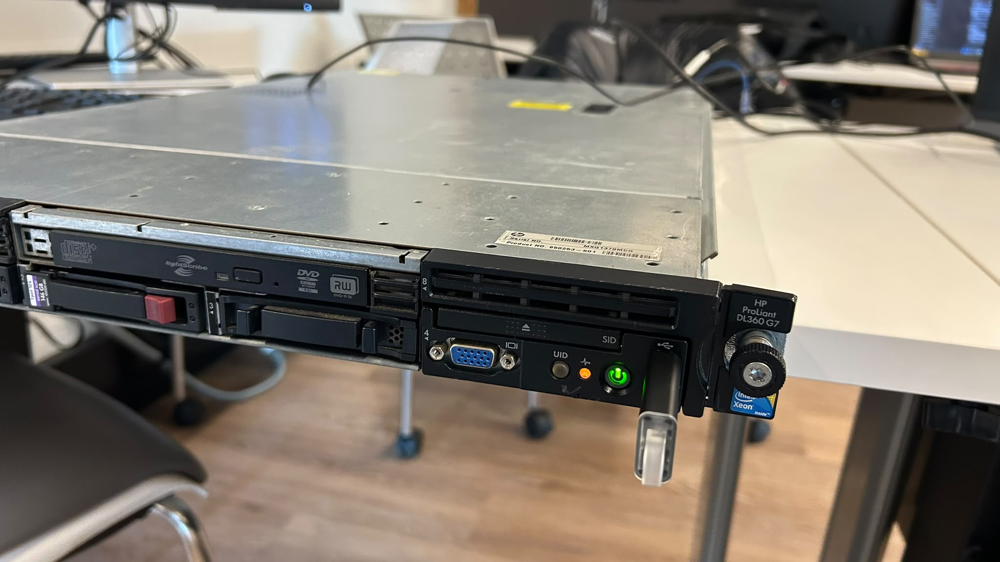

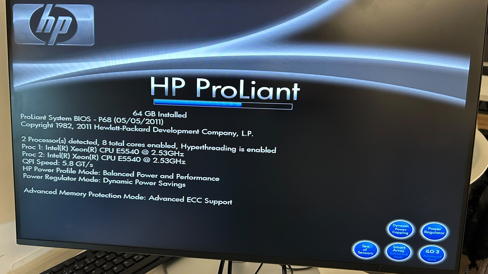

**Observation matérielle :** le BIOS indique une alimentation débranchée ou défaillante dans la baie 1 (`1615-Power Supply Failure or Power Supply Unplugged in Bay 1`). Ce message doit être signalé à l'administrateur du laboratoire. Le système affiche également un BIOS de secours valide (`Redundant ROM Detected`).

## 3. Démarrage sur le support d'installation

À partir du menu de démarrage ponctuel du serveur, sélectionner le support qui contient l'ISO de Proxmox VE. Le menu propose notamment **CD-ROM**, **USB DriveKey**, **HDD** et **Network**. Les captures ne permettent pas d'établir avec certitude lequel a été utilisé.

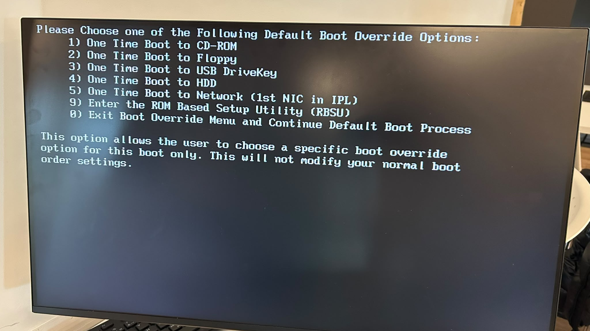

Le serveur procède à une phase de calibration matérielle, puis lance l'installateur Proxmox VE.

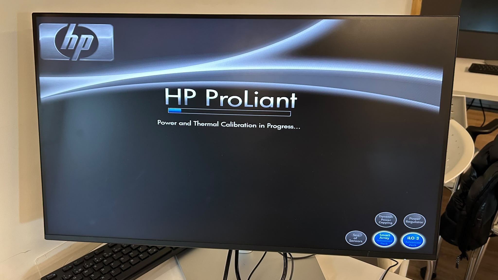

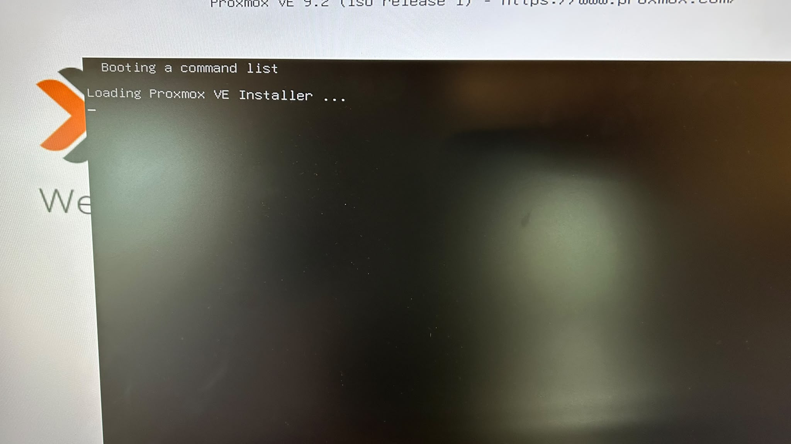

## 4. Lancement de l'installation

Depuis le menu d'accueil de Proxmox VE 9.2, l'installation graphique a été utilisée. Les captures montrent le chargement du programme d'installation et l'affichage du contrat de licence (EULA).


L'installateur demande ensuite de sélectionner le disque de destination.

## 5. Choix du disque et du système de fichiers

Deux périphériques de stockage sont visibles :

- `/dev/nvme0n1` : **953,87 GiB**, SK hynix 1024 GB ;
- `/dev/sda` : **273,40 GiB**, volume logique.

Le récapitulatif de l'installation confirme le choix de **`/dev/sda`** avec le système de fichiers **ext4**.

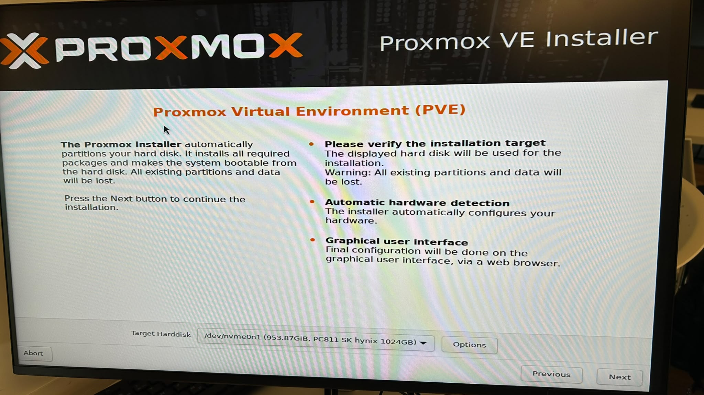

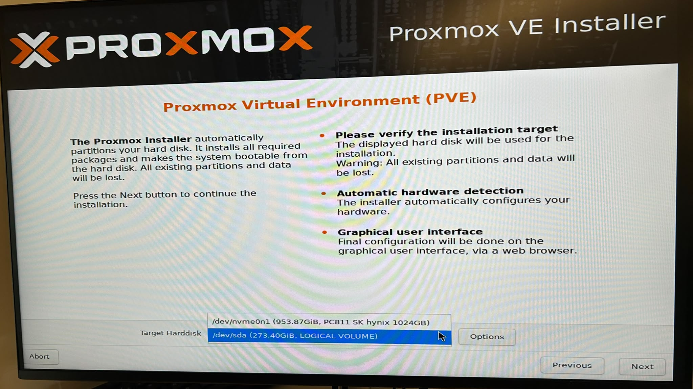

> **Attention :** l'installation partitionne et efface les données du disque cible. Toujours vérifier le périphérique choisi avant de confirmer.

## 6. Particularités rencontrées pendant l'installation

Une capture montre une modification des paramètres de démarrage GRUB, notamment l'option `nomodeset`, puis le chargement de l'installateur. Cette option est souvent employée pour contourner des problèmes d'affichage pendant l'installation ; les captures ne permettent toutefois pas de confirmer la cause exacte de son utilisation ici.

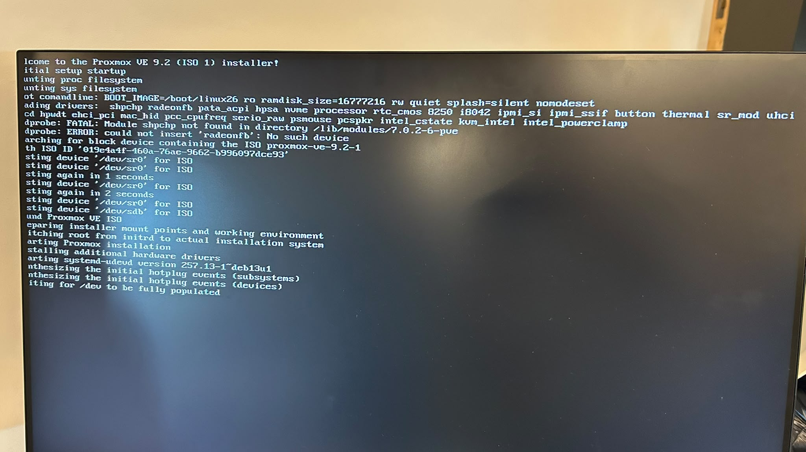

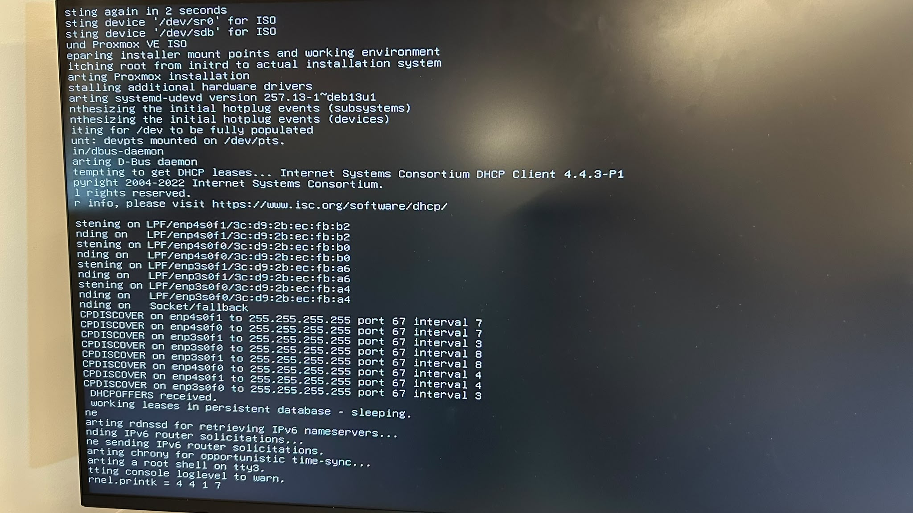

L'installateur a aussi détecté un ancien groupe de volumes LVM nommé `pve` et proposé de le renommer en `pve-OLD-810787F6`. La capture atteste de l'apparition de cette boîte de dialogue, mais pas du choix final effectué.

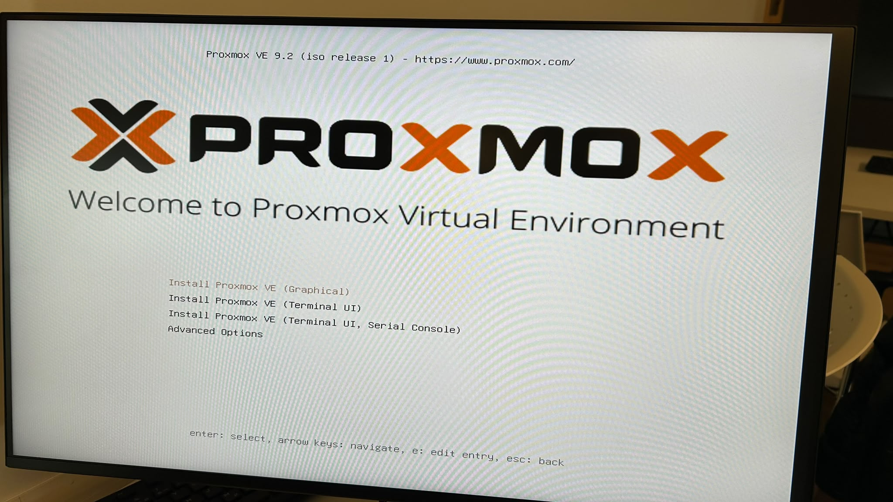

## 7. Configuration du réseau de gestion

Les paramètres saisis dans l'installateur sont :

| Paramètre | Valeur |
|---|---|
| Interface | `nic0` |
| FQDN | `server237.labinfo.local` |
| Adresse IPv4 | `10.7.236.237/23` |
| Masque | `255.255.254.0` |
| Passerelle | `10.7.237.1` |
| DNS | `8.8.8.8` |
| Pays / fuseau | Canada / America/Toronto |
| Clavier | `en-us` |

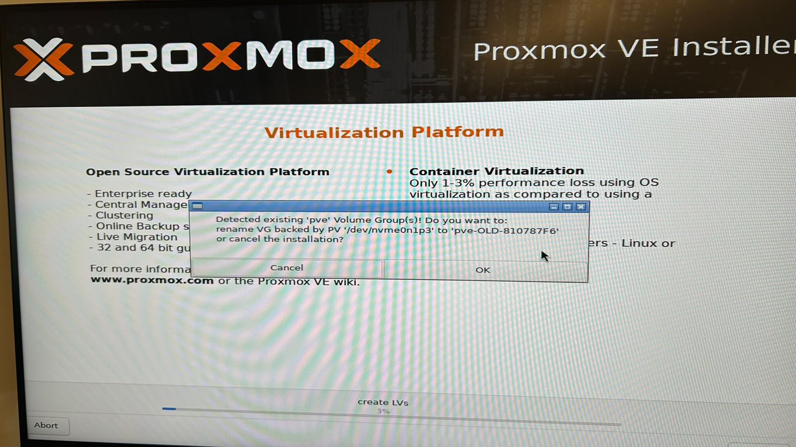

Le masque `/23` correspond au réseau `10.7.236.0/23`. Cette adresse est celle de l'hôte Proxmox et ne doit pas être attribuée à une VM.

## 8. Lancement de l'installation

Après validation du récapitulatif, l'installateur lance la création des volumes logiques puis l'extraction des paquets. Une capture montre la progression à environ **3 %** lors de l'étape `create LVs`, et une autre montre l'extraction de paquets à **51 %**. Ces étapes ne constituent pas à elles seules une preuve de fin d'installation.

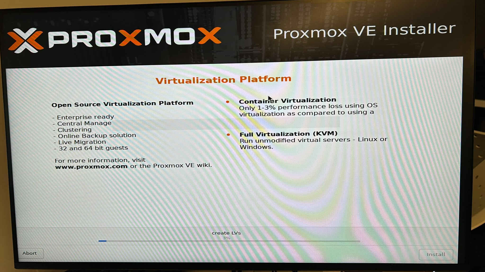

## 9. Validation après installation

Le serveur a redémarré sur le système installé et affiche l'adresse de l'interface Web de gestion : **`https://10.7.236.237:8006/`**. Une session locale avec l'utilisateur `root` est visible.

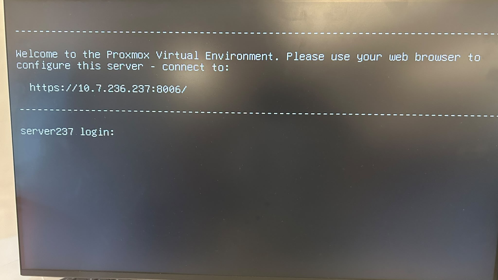

### 9.1 Paramètres de démarrage du noyau

```bash
cat /proc/cmdline
```

La sortie visible indique notamment :

```text
BOOT_IMAGE=/boot/vmlinuz-7.0.2-6-pve root=/dev/mapper/pve-root ro nomodeset quiet
```

Le paramètre **`nomodeset`** est actif. Les options **`nolapic`** et **`noapic`** ne figurent pas dans la ligne affichée. Le paramètre `acpi=off`, présenté dans les consignes comme une solution possible aux problèmes de compatibilité, n'est pas non plus présent dans cette capture.

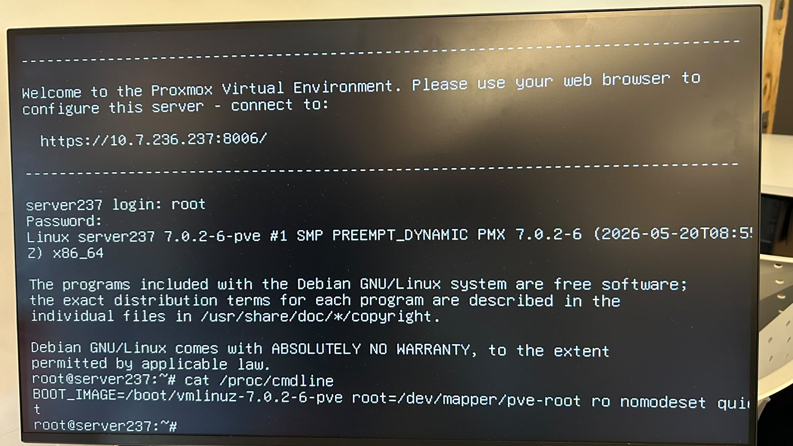

### 9.2 Détection des processeurs

```bash
nproc
```

**Résultat : `16` processeurs logiques disponibles.** Ce résultat correspond à l'objectif du TP. Il ne confirme toutefois pas à lui seul le nombre de sockets et de cœurs physiques : `lscpu` est la commande appropriée pour contrôler cette topologie.

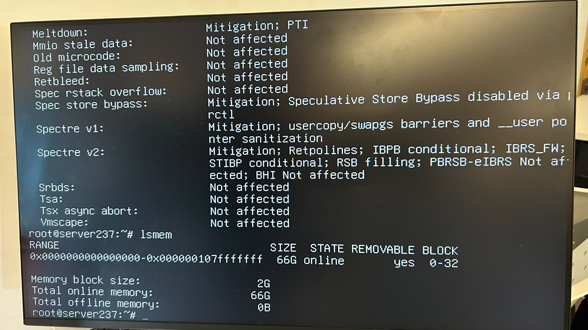

### 9.3 Mémoire et stockage

```bash
lsmem
lsblk
```

La commande `lsmem` affiche **66G de mémoire en ligne** et **0B hors ligne**. La commande `lsblk` affiche un disque système `sda` de **273,4G**, contenant notamment `pve-root` (78G), `pve-swap` (8G) et `pve-data` (166,6G), ainsi qu'un périphérique `nvme0n1` de **953,9G** avec des volumes LVM préexistants nommés `pve-OLD-...`.

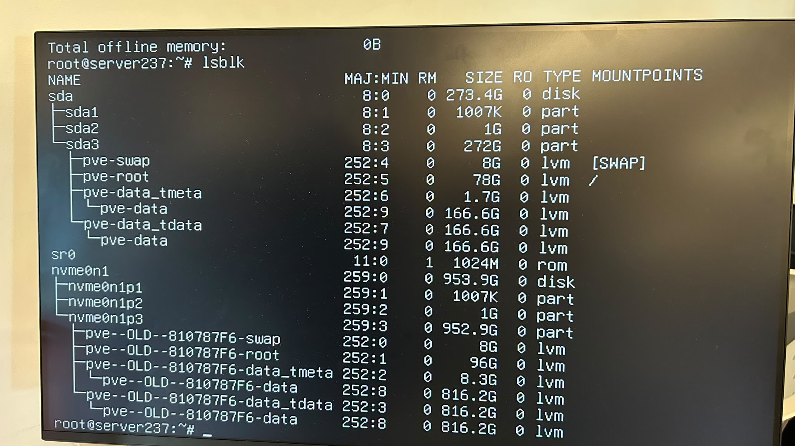

### 9.4 Périphériques PCI et modules du noyau

```bash
lspci
lsmod
```

`lspci` permet d'identifier les contrôleurs PCI, notamment les contrôleurs mémoire Intel. `lsmod` montre le chargement de modules tels que `nvme`, `nvme_core`, `hpsa` et `scsi_transport_sas`, liés notamment à la prise en charge du stockage.

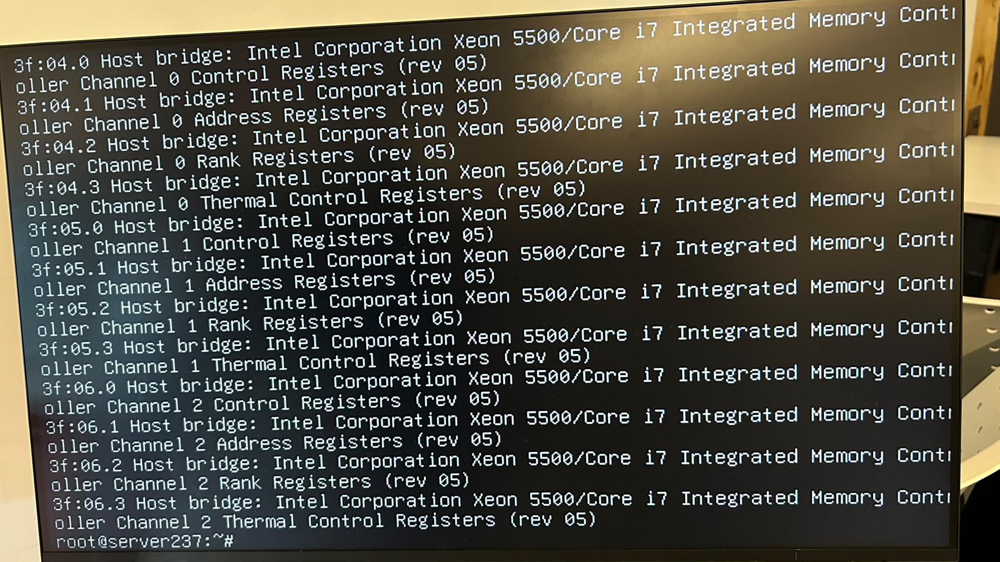

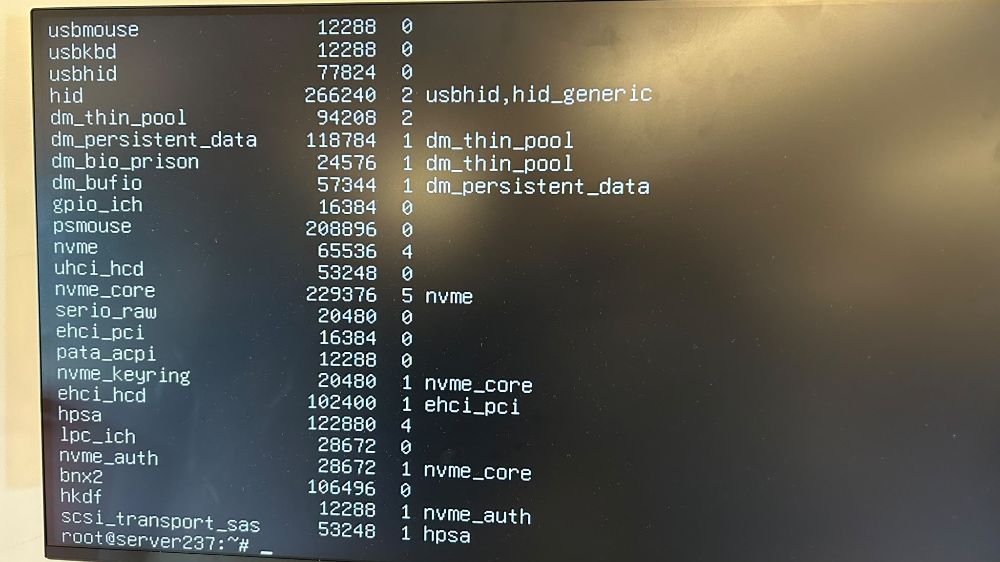

Une autre capture confirme l'utilisation correcte de `cat /proc/cmdline` après correction d'une erreur de syntaxe (espace manquant entre `cat` et le chemin).

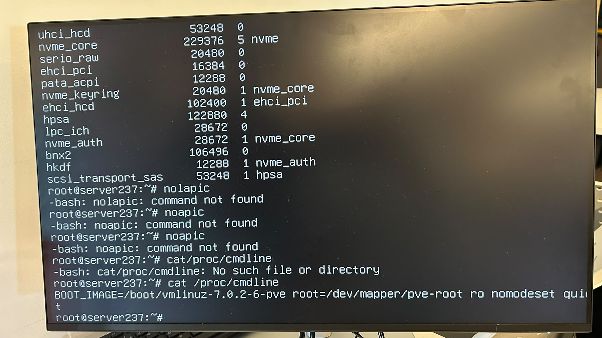

### 9.5 Interruptions matérielles

```bash
cat /proc/interrupts
```

Cette commande affiche les compteurs d'interruptions du noyau, notamment des événements liés aux APIC et aux vérifications matérielles. Elle contribue au diagnostic du fonctionnement multiprocesseur.

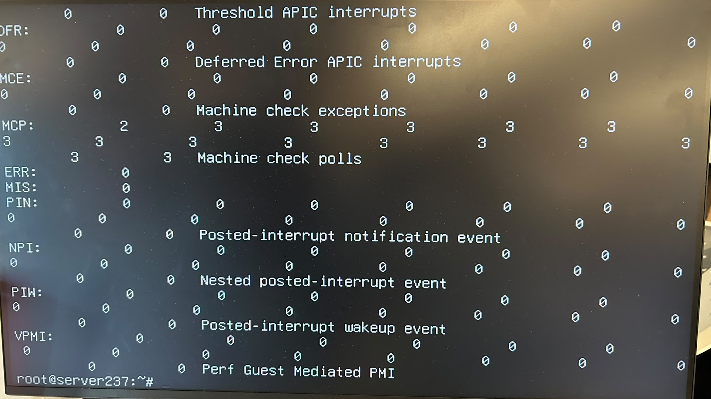

## 10. Configuration et tests réseau

L'interface `vmbr0` porte l'adresse **`10.7.236.237/23`**. La passerelle prévue par le TP est **`10.7.237.1`** et le DNS indiqué dans les consignes est **`8.8.8.8`**. La capture du ping vers `8.8.8.8` valide la connectivité IP, mais ne suffit pas à confirmer le paramétrage du résolveur DNS.

### 10.1 Premier essai : échec

```bash
ping -c 4 8.8.8.8
```

Le premier essai a produit `Destination Host Unreachable` et `No route to host`. Un ping de la passerelle `10.7.237.1` a ensuite été lancé.

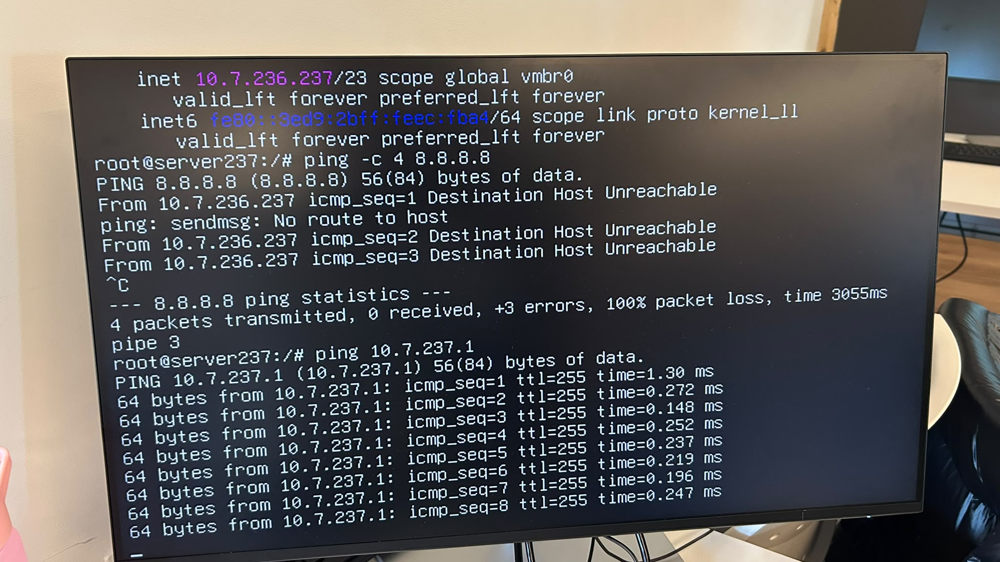

### 10.2 Vérification réussie

Les captures montrent **12 paquets reçus sur 12** vers la passerelle (`0 %` de perte), puis **4 paquets reçus sur 4** vers `8.8.8.8` (`0 %` de perte). La connectivité était donc fonctionnelle lors du second test.

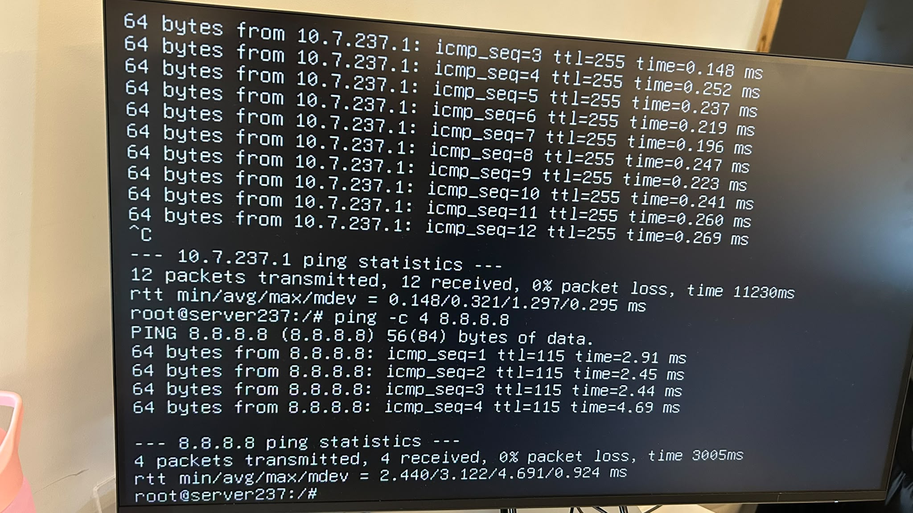

### 10.3 Accès SSH depuis Windows

Depuis le terminal Windows :

```powershell
ssh root@10.7.236.237
```

Les premières tentatives ont expiré, puis une connexion a été établie avec succès après validation de l'empreinte SSH et authentification. Le terminal affiche alors `root@server237:~#`.

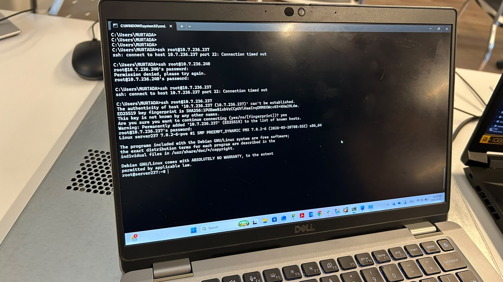

Les photos suivantes documentent également le contexte physique du laboratoire, notamment le commutateur Cisco et les connexions à l'arrière des serveurs.

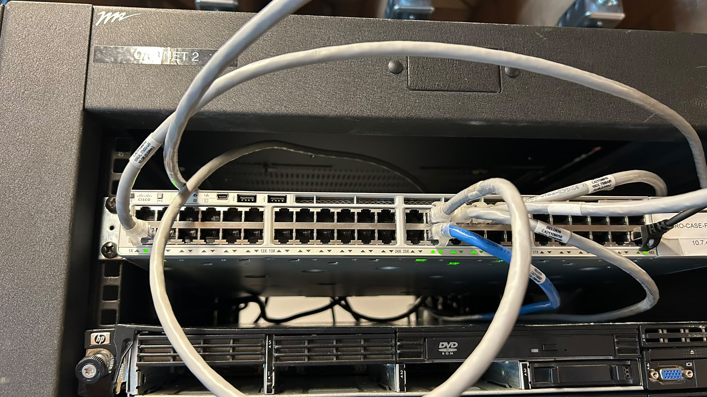

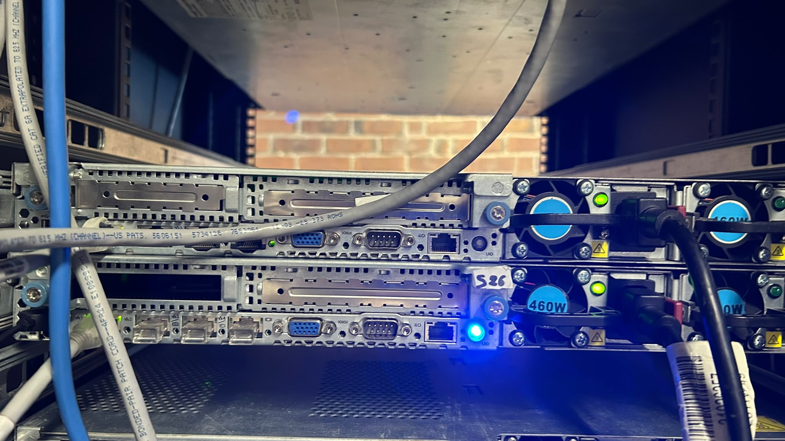

## 11. Difficultés rencontrées

- **Compatibilité graphique :** utilisation du paramètre `nomodeset` pour démarrer avec un affichage minimal.
- **Multiprocesseur :** contrôle de l'absence de `nolapic` et `noapic`, puis vérification de `16` processeurs logiques avec `nproc`.
- **Connectivité réseau :** échec initial vers `8.8.8.8`, suivi de tests concluants vers la passerelle et Internet.
- **Accès distant :** premières tentatives SSH expirées, puis connexion réussie.
- **Syntaxe Linux :** correction de commandes mal saisies, dont `cat /proc/cmdline`.

## 12. Questions de réflexion

**1. À quoi sert `nomodeset` ?**  
Il empêche le noyau Linux d'activer le *Kernel Mode Setting* graphique. Cela peut contourner des problèmes d'affichage sur un matériel ancien.

**2. Pourquoi un ancien BIOS peut-il nécessiter `acpi=off` ?**  
Certaines tables ACPI anciennes peuvent être incompatibles avec un noyau récent. `acpi=off` désactive ACPI pour contourner certains blocages, mais peut aussi désactiver des fonctionnalités matérielles importantes.

**3. Quelle est la différence entre ACPI et APIC ?**  
ACPI fournit des informations de configuration matérielle et de gestion d'énergie. APIC sert à gérer et distribuer les interruptions matérielles, notamment dans un système multiprocesseur.

**4. Pourquoi `nolapic` peut-il réduire le nombre de processeurs visibles ?**  
La désactivation du contrôleur local APIC peut empêcher le fonctionnement normal du SMP et limiter Linux à un seul processeur logique.

**5. Quelle commande affiche les paramètres réellement utilisés au démarrage ?**

```bash
cat /proc/cmdline
```

## 13. Bilan des objectifs

| Objectif | Résultat documenté |
|---|---|
| Installer Proxmox VE 9 | Installation et console fonctionnelles visibles |
| Activer `nomodeset` | Confirmé par `/proc/cmdline` |
| Éviter `nolapic` et `noapic` | Options absentes de la ligne affichée |
| Vérifier 16 processeurs logiques | Confirmé par `nproc` |
| Vérifier la mémoire | `lsmem` : 66G en ligne |
| Vérifier les disques et modules | Confirmé par `lsblk`, `lspci`, `lsmod` |
| Tester la passerelle et Internet | Pings réussis, 0 % de perte |
| Accéder au serveur en SSH | Connexion réussie depuis Windows |
| Confirmer deux sockets avec `lscpu` | Non démontré directement par les captures sélectionnées |
| Vérifier le DNS réellement configuré | Non démontré par les captures sélectionnées |

## 14. Conclusion

Ce laboratoire nous a permis d'installer et de configurer **Proxmox VE** sur un serveur **HP ProLiant DL360 G7**, tout en explorant les contraintes de compatibilité entre un matériel ancien et un noyau Linux moderne. Les commandes de diagnostic ont permis de vérifier les paramètres de démarrage, la disponibilité de **16 processeurs logiques**, la mémoire, les disques et les modules du noyau. Après quelques difficultés de connectivité, nous avons également validé les échanges avec la passerelle, l'accès à une adresse Internet et l'administration à distance par SSH. Le serveur constitue désormais une base opérationnelle pour les futurs laboratoires de virtualisation Linux.

---

*Documentation rédigée à partir du README de consignes du professeur et des captures réalisées pendant le laboratoire. Les résultats non directement vérifiables sont signalés comme tels.*
