# Rapport d'installation de Proxmox VE 9.2 – HP ProLiant DL360 G7

> **Cours :** INF1085-201 – Administration Linux
> **Laboratoire :** 2. Proxmox
> **Objectif :** installer l'hyperviseur Proxmox VE sur un serveur physique, le configurer sur le réseau du laboratoire, vérifier son fonctionnement, puis le remettre en production dans la baie.

---

## 1. Qu'est-ce que Proxmox VE ?

**Proxmox VE (Virtual Environment)** est un **hyperviseur** libre basé sur **Debian Linux**. Un hyperviseur permet de faire fonctionner **plusieurs machines virtuelles** (VM) sur un seul serveur physique. Proxmox propose deux types de virtualisation :

- **KVM** : virtualisation complète. On peut installer des serveurs Linux ou Windows sans modification.
- **Conteneurs LXC** : virtualisation légère du système, avec seulement 1 à 3 % de perte de performance.

Une fois installé, Proxmox se gère depuis un **navigateur web**, sur le port **8006**.

---

## 2. Le serveur utilisé

Le serveur utilisé est un **HP ProLiant DL360 G7**, un serveur rack 1U. La **clé USB** contenant l'image d'installation de Proxmox est branchée dans le port USB à l'avant.

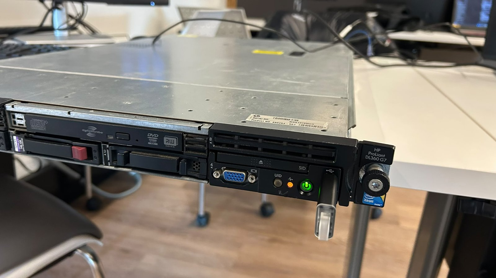

### Caractéristiques relevées

| Élément | Valeur observée |
|---|---|
| Modèle | HP ProLiant DL360 G7 |
| BIOS | HP P68 du 05/05/2011 |
| Processeurs | 2 × Intel Xeon E5540 @ 2,53 GHz (8 cœurs au total, Hyperthreading activé = 16 processeurs logiques) |
| Mémoire vive | 64 Go, mode **Advanced ECC** |
| Gestion à distance | iLO 3 |
| Contrôleur de disques | HP Smart Array (pilote `hpsa`) |
| Disque dur (HDD) | Volume logique RAID 5 de 273,4 Go (3 disques SAS de 146 Go) – `/dev/sda` |
| Disque SSD NVMe | SK hynix PC811 de 1 To – `/dev/nvme0n1` |
| Cartes réseau | 4 ports Broadcom NetXtreme II (pilote `bnx2`) |
| Alimentations | 2 blocs de 460 W |

>  **Advanced ECC** (Error Correcting Code) : la mémoire d'un serveur sait **détecter et corriger elle-même** certaines erreurs. C'est indispensable pour une machine qui tourne jour et nuit et qui héberge des machines virtuelles.

---

## 2 bis. Préparation de la clé USB d'installation

Avant d'aller au serveur, il faut préparer une **clé USB d'installation** :

1. Télécharger l'image **ISO de Proxmox VE 9.2** sur le site officiel (proxmox.com).
2. Copier cette image sur une clé USB avec un logiciel prévu pour ça (par exemple **Rufus** ou **balenaEtcher**). Un simple copier-coller du fichier ne suffit pas : la clé doit devenir **démarrable**.
3. Brancher la clé sur le port USB à l'avant du serveur.

Tout le contenu de la clé USB est effacé pendant cette opération.

---

## 3. Démarrage du serveur (POST)

Au démarrage, le serveur fait d'abord une **calibration de l'alimentation et de la température**.

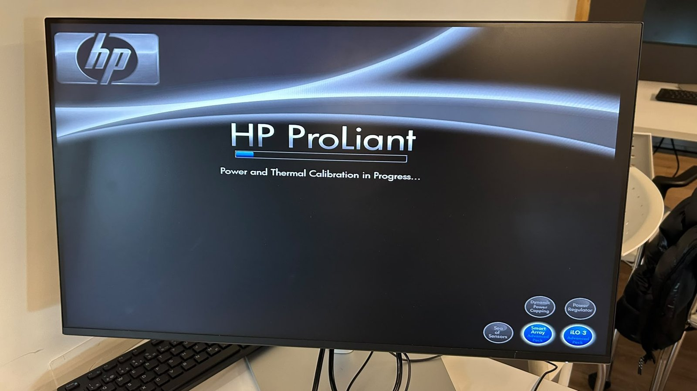

Ensuite, le POST affiche les informations principales du serveur : **64 Go de RAM** et **2 processeurs Xeon E5540** détectés.

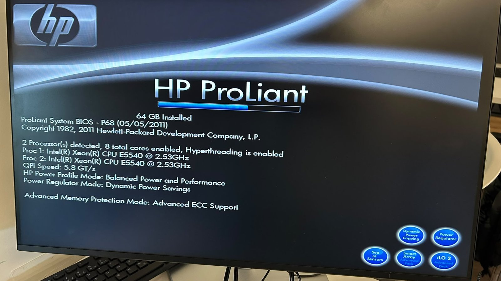

Le POST affiche aussi le message **1615 – Power Supply Failure or Power Supply Unplugged in Bay 1**. L'alimentation de la baie 1 n'était pas branchée. Ce n'est qu'un **avertissement** : le serveur fonctionne avec la deuxième alimentation, puisqu'elles sont redondantes. La température ambiante est de 19 °C.

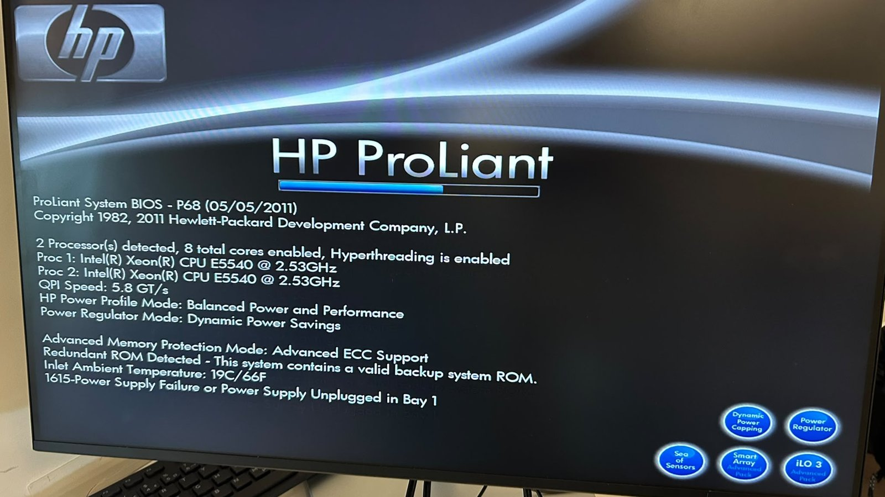

---

## 4. Démarrage sur la clé USB

### 4.1 Le menu Boot Override (touche F11)

Pendant le POST, la touche **F11** ouvre le menu **Default Boot Override Options**. Il permet de choisir sur quoi le serveur démarre, **pour ce démarrage seulement**, sans modifier l'ordre de démarrage habituel.

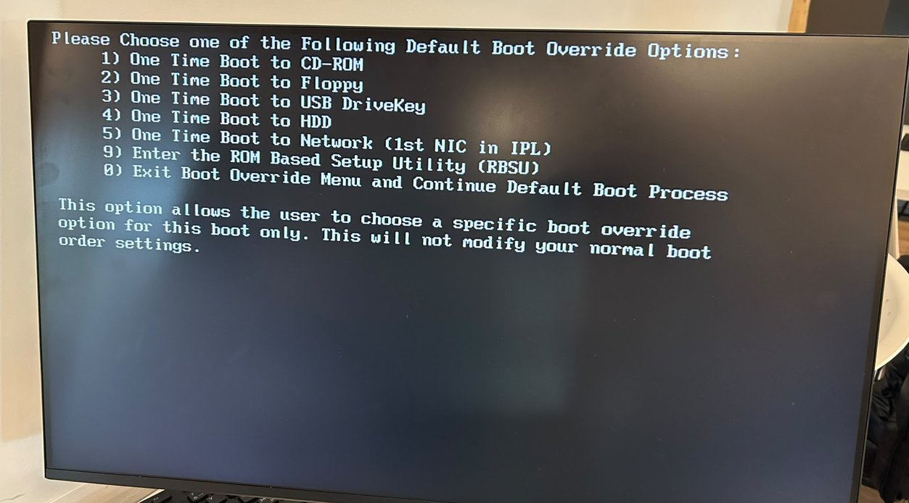

- **Option 3 – One Time Boot to USB DriveKey** : démarrer sur la **clé USB**, pour lancer l'installateur Proxmox.
- **Option 4 – One Time Boot to HDD** : démarrer sur le **disque dur**. Nous l'utiliserons plus tard (voir la section 6).

### 4.2 Le menu de l'installateur Proxmox

Le serveur démarre sur la clé USB et affiche le menu de **Proxmox VE 9.2**. Nous avons choisi **Install Proxmox VE (Graphical)**.

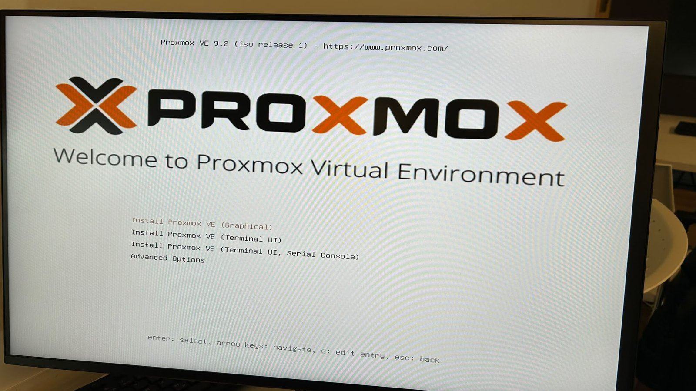

### 4.3 Ajout de l'option `nomodeset` dans GRUB

Sur ces anciens serveurs, la carte graphique intégrée est très vieille. Sans précaution, **l'écran peut rester noir** pendant l'installation. Pour éviter ça :

1. Dans le menu, sélectionner **Install Proxmox VE (Graphical)**, puis appuyer sur la touche **`e`** pour modifier la ligne de démarrage.
2. À la fin de la ligne qui commence par `linux`, ajouter **`nomodeset`**.
3. Appuyer sur **Ctrl + X** (ou **F10**) pour démarrer.

>  **`nomodeset`** demande à Linux de ne pas changer lui-même le mode d'affichage de la carte graphique. L'écran reste alors en mode simple et compatible.

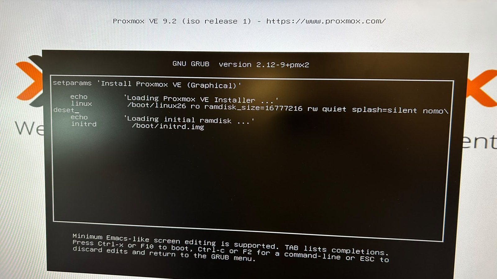

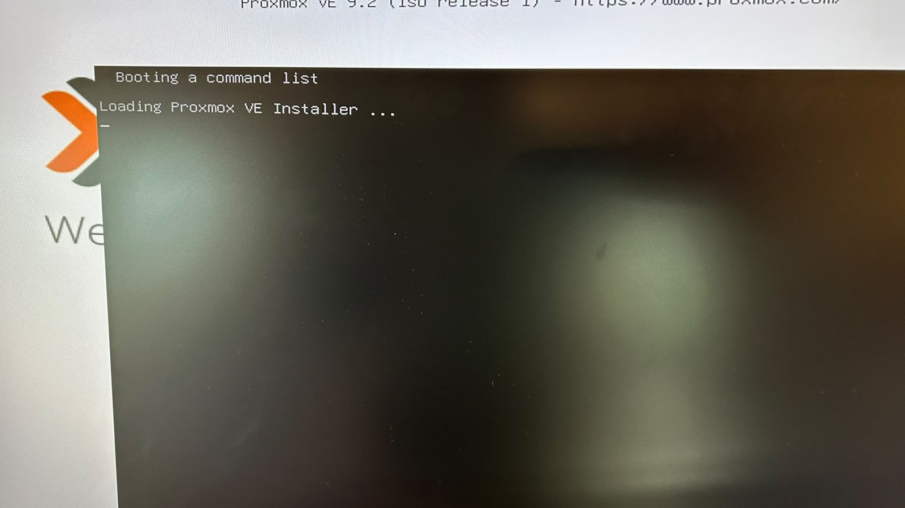

### 4.4 Chargement de l'installateur

L'installateur charge les pilotes du matériel. Les messages `shpchp not found` et `could not insert 'radeonfb'` ne sont **pas graves** : ce sont des pilotes inutiles pour ce serveur. L'installateur cherche ensuite l'image ISO. Il essaie d'abord plusieurs fois **`/dev/sr0`**, le **lecteur DVD** du serveur, qui est vide. Il passe ensuite à **`/dev/sdb`**, la clé USB, où il trouve enfin l'image de Proxmox.

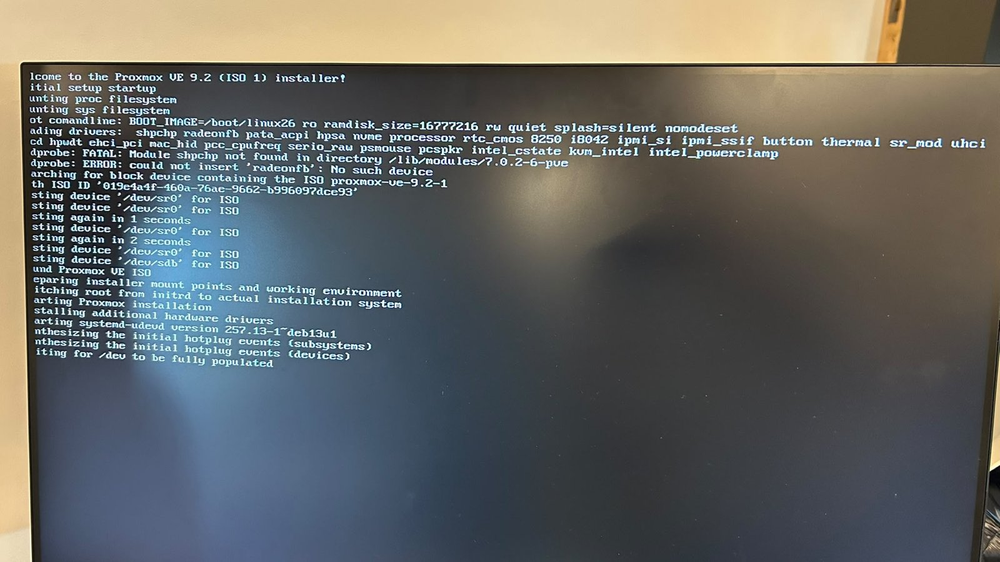

Il essaie ensuite d'obtenir une adresse IP par **DHCP** sur les 4 cartes réseau, et reçoit une réponse (**DHCPOFFERS received**).

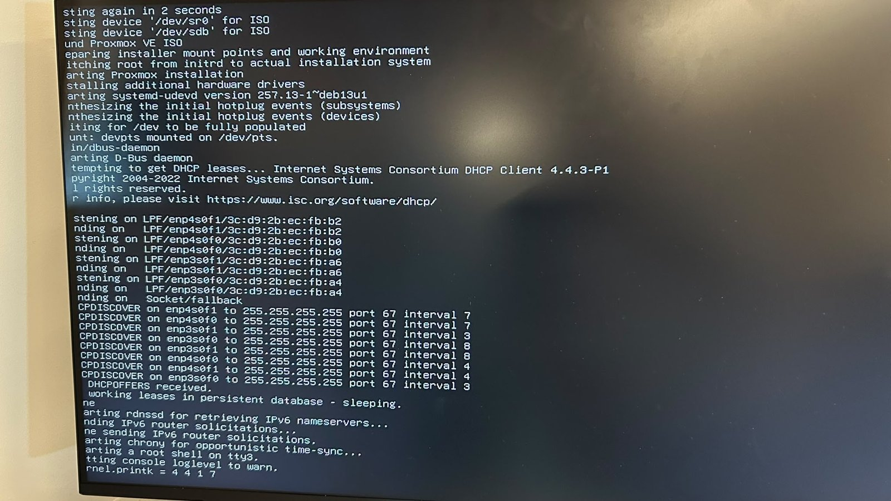

---

## 5. L'assistant d'installation

### 5.1 Contrat de licence (EULA)

On lit le contrat de licence, puis on clique sur **I agree**.

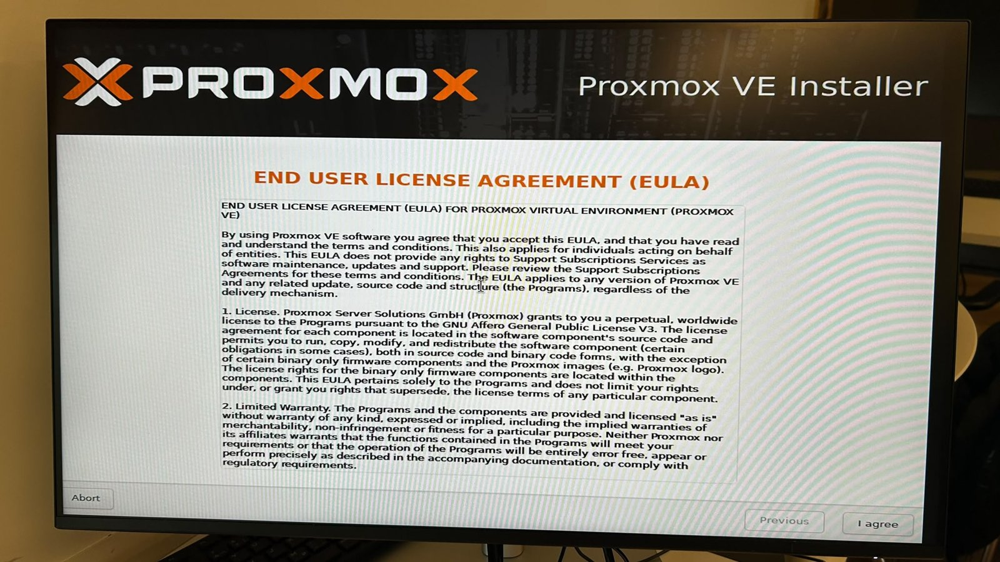

### 5.2 Choix du disque d'installation

**C'est l'étape la plus importante du laboratoire.**

Par défaut, l'installateur propose le disque **SSD NVMe** (`/dev/nvme0n1`, 1 To).

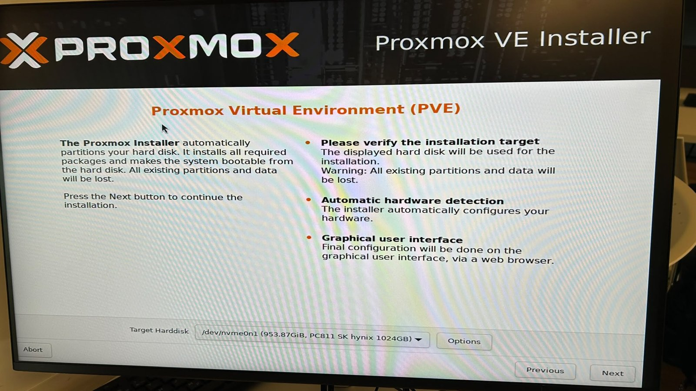

**Problème rencontré :** lors d'une **première installation**, nous avons installé Proxmox sur ce SSD NVMe. L'installation s'est bien terminée, mais **le serveur n'arrivait pas à démarrer** dessus.

**Pourquoi :** le BIOS du DL360 G7 date de **2011**. À cette époque, les serveurs **ne savaient pas démarrer sur un disque NVMe**. Le serveur peut lire le SSD une fois Linux lancé, mais pas démarrer dessus.

**Solution :** nous avons recommencé l'installation en choisissant, dans la liste **Target Harddisk**, le **disque dur (HDD)** : **`/dev/sda` (273,40 Gio, LOGICAL VOLUME)**. C'est le volume **RAID 5** formé par les 3 disques SAS de 146 Go et géré par le contrôleur Smart Array.

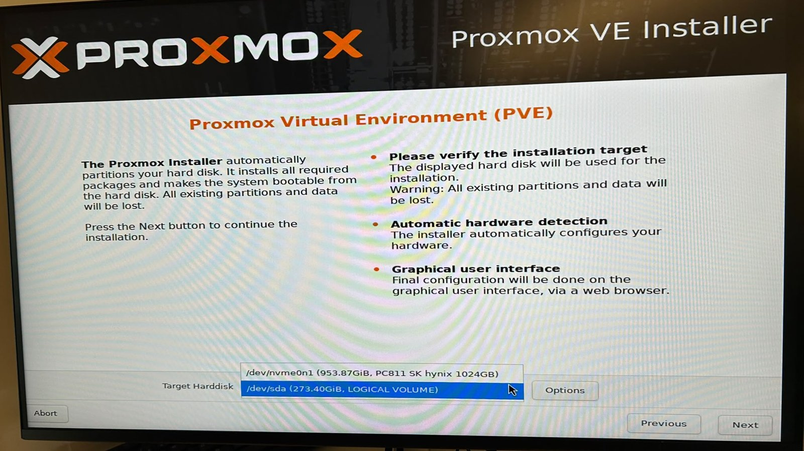

> Le **RAID 5** répartit les données et une information de contrôle (parité) sur les 3 disques. Si un disque tombe en panne, aucune donnée n'est perdue. On obtient l'espace de 2 disques sur 3, soit environ 273 Go.

### 5.3 Pays, fuseau horaire et clavier

Nous avons choisi : **Canada**, fuseau horaire **America/Toronto** et clavier **en-us** (visibles dans le résumé, à la section 5.6).

### 5.4 Mot de passe root et adresse courriel

On choisit le mot de passe de l'administrateur **root** : au moins 8 caractères, avec des lettres, des chiffres et des symboles. On entre aussi une adresse courriel, qui recevra les alertes du serveur (sauvegardes échouées, etc.).

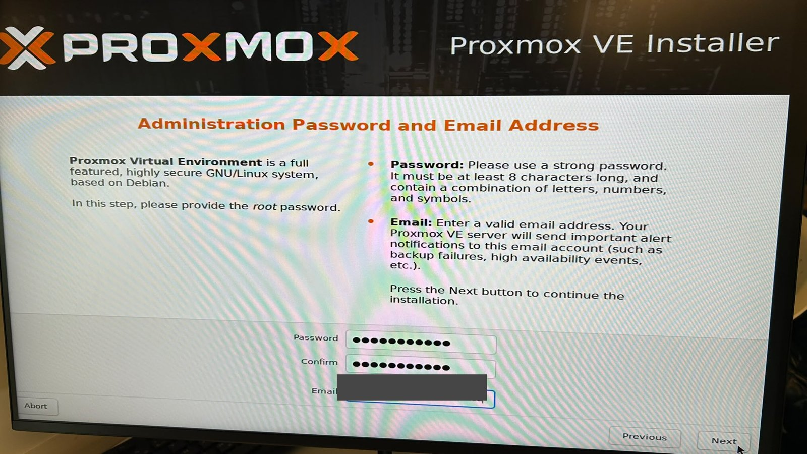

*(L'adresse courriel a été masquée sur la photo.)*

### 5.5 Configuration du réseau

| Paramètre | Valeur | Rôle |
|---|---|---|
| Management Interface | `nic0` (bnx2) | Carte réseau utilisée pour gérer Proxmox |
| Hostname (FQDN) | `server237.labinfo.local` | Nom complet du serveur |
| IP Address (CIDR) | `10.7.236.237/23` | Adresse IP fixe du serveur et son masque (/23 = 255.255.254.0) |
| Gateway | `10.7.237.1` | Passerelle (routeur) pour sortir du réseau local |
| DNS Server | `8.8.8.8` | Serveur DNS (celui de Google) pour traduire les noms en adresses IP |

>  Nous avons **choisi nous-mêmes une adresse IP fixe**, au lieu de garder celle donnée par le DHCP. Un serveur doit toujours garder la même adresse, sinon on ne le retrouve plus sur le réseau.
>
> La case **Pin network interface names** est cochée : elle « fige » les noms des cartes réseau (`nic0`, `nic1`…). Ainsi, ils ne changent pas après une mise à jour ou un redémarrage, et la configuration réseau ne se casse pas.

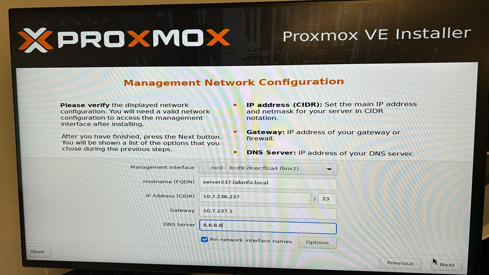

### 5.6 Résumé avant l'installation

Le résumé permet de vérifier tous les choix avant de lancer l'installation : système de fichiers **ext4**, disque **/dev/sda**, Canada, America/Toronto, en-us, nic0, server237, 10.7.236.237/23, passerelle 10.7.237.1 et DNS 8.8.8.8. On laisse cochée la case **Automatically reboot after successful installation** (redémarrage automatique à la fin), puis on clique sur **Install**.

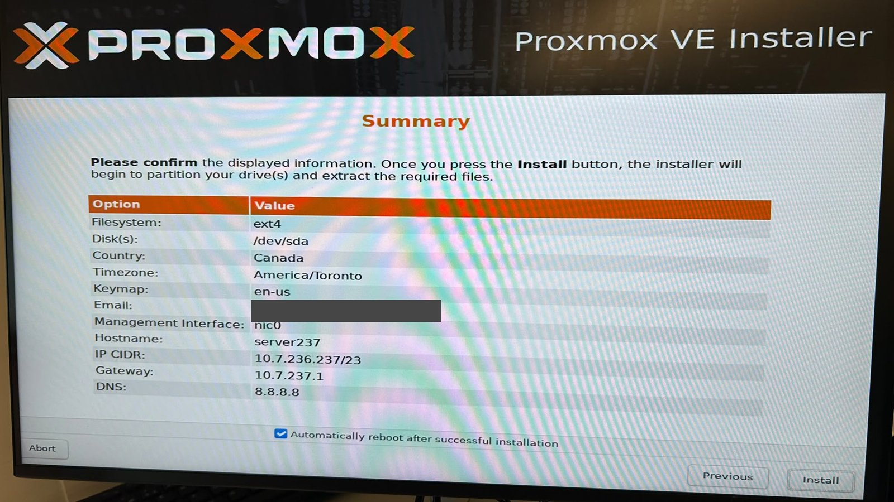

### 5.7 Installation en cours

L'installateur commence par **créer les partitions** sur le disque.

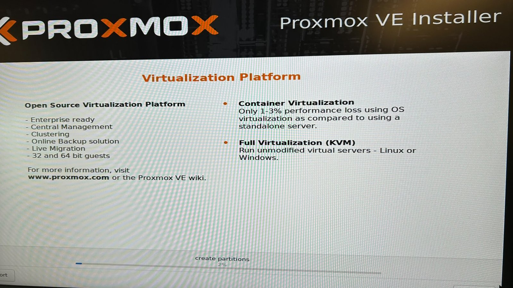

Pendant l'installation, ce message apparaît :

> *Detected existing 'pve' Volume Group(s)! Do you want to rename VG backed by PV '/dev/nvme0n1p3' to 'pve-OLD-810787F6' or cancel the installation?*

L'installateur a retrouvé **notre première installation** de Proxmox sur le SSD NVMe. Pour éviter un conflit entre deux systèmes portant le même nom (`pve`), il propose de **renommer l'ancienne** en `pve-OLD-810787F6`. Nous avons cliqué sur **OK**.

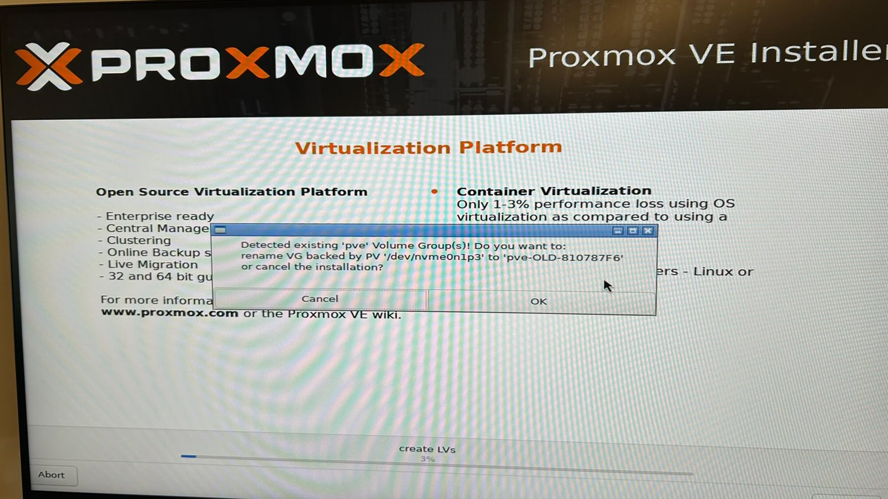

L'installation continue ensuite avec la création des volumes logiques (LVM), puis l'extraction des paquets.

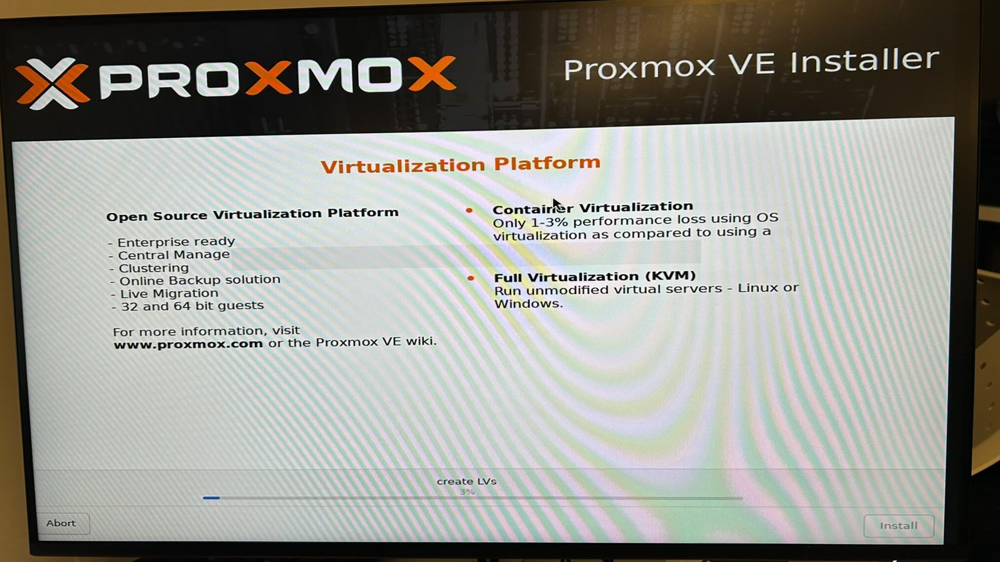

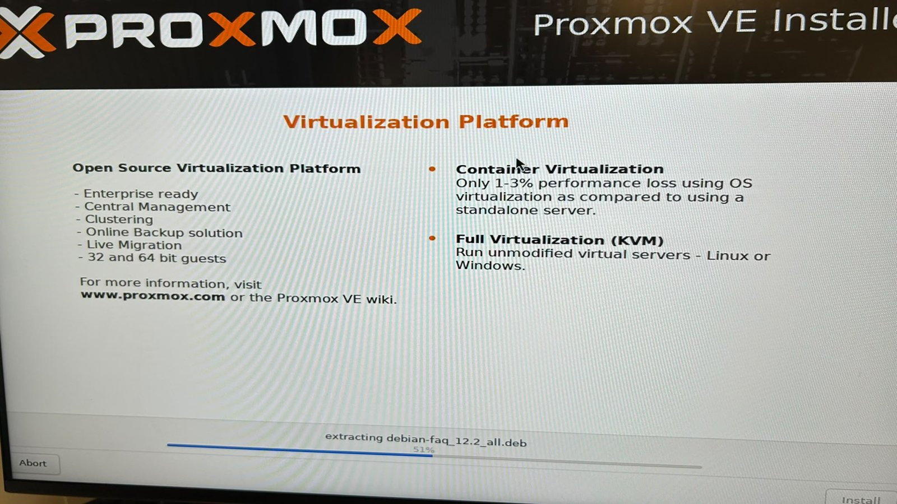

Ensuite, l'installateur configure le système et installe le **chargeur de démarrage (GRUB)** sur le disque, puis le serveur **redémarre automatiquement**.

> Il faut **retirer la clé USB** au redémarrage, sinon le serveur risque de relancer l'installateur.

---

## 6. Premier démarrage de Proxmox

Au redémarrage, nous avons utilisé à nouveau le menu **F11 (Boot Override)**, cette fois avec l'option **4 – One Time Boot to HDD**, pour démarrer sur le disque dur où Proxmox est installé (voir la photo de la section 4.1).

Proxmox démarre et affiche l'écran de connexion. Il indique aussi l'adresse de l'**interface web** : **https://10.7.236.237:8006/**.

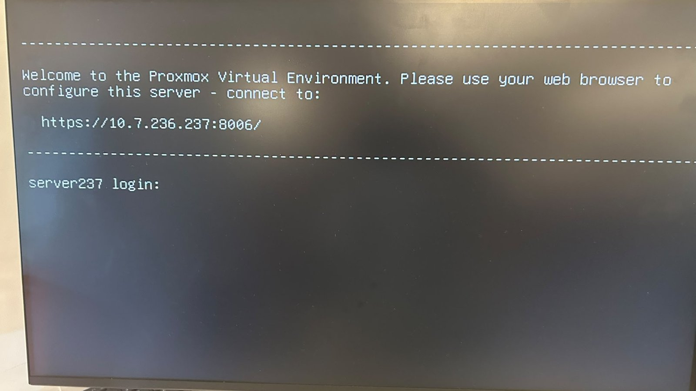

On se connecte avec l'utilisateur **root** et le mot de passe choisi pendant l'installation.

> Ce même compte sert à se connecter à l'**interface web** (https://10.7.236.237:8006). Sur la page de connexion, on choisit le domaine (realm) **Linux PAM standard authentication**, c'est-à-dire les comptes Linux du serveur. Le navigateur affiche un avertissement de sécurité, car le certificat est créé par le serveur lui-même : on peut l'accepter.

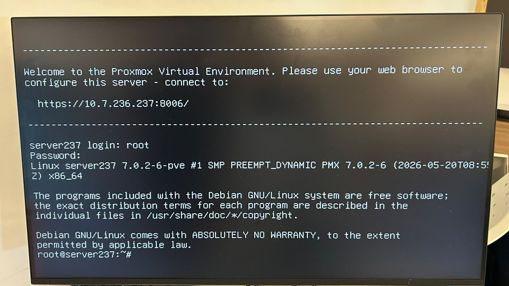

---

## 7. Vérifications dans le terminal

Une fois connectés, nous avons utilisé plusieurs commandes pour vérifier que tout fonctionne.

### 7.1 `cat /proc/cmdline` – les options de démarrage

Cette commande affiche les options avec lesquelles Linux a démarré. On voit que **`nomodeset`** est bien présent.

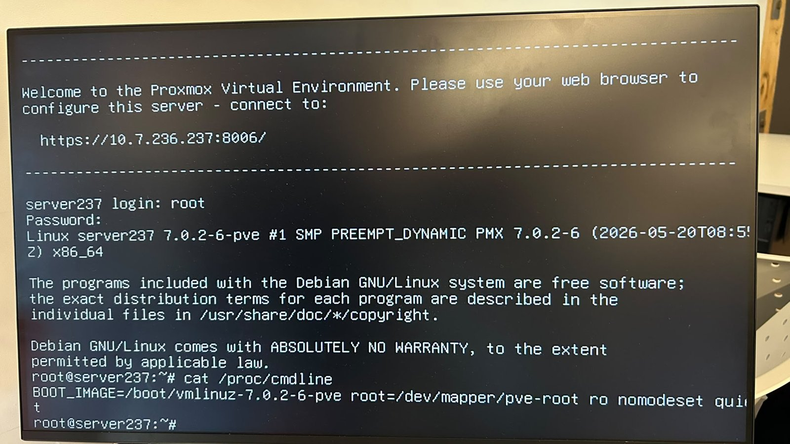

> **Erreurs rencontrées :**
> - `nolapic` et `noapic` ont donné **command not found**. Ce ne sont **pas des commandes** : ce sont des **options de démarrage**, qui se mettent dans GRUB comme `nomodeset`.
> - `cat/proc/cmdline` a donné **No such file or directory** parce qu'il **manquait un espace** entre `cat` et `/proc/cmdline`.

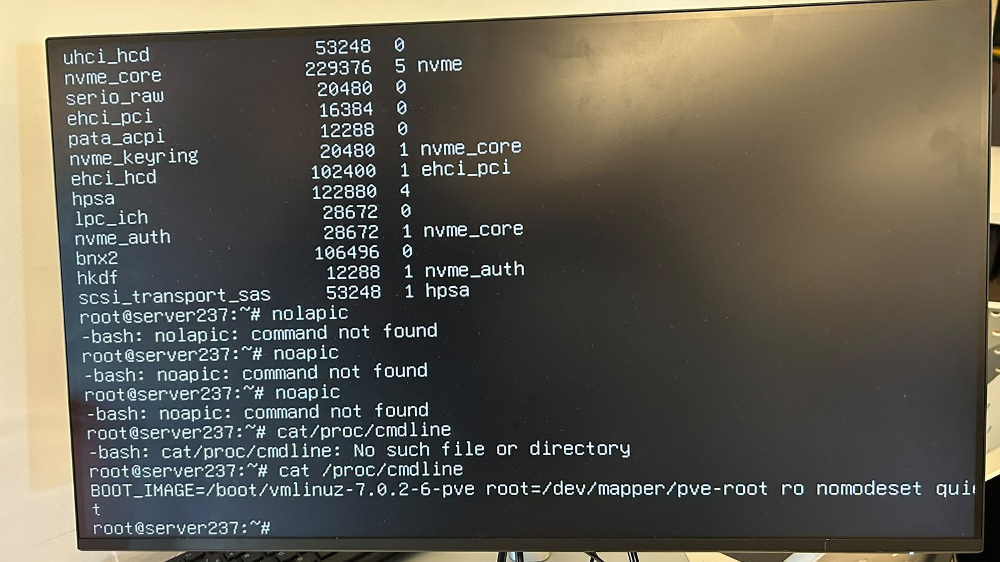

### 7.2 `lsblk` – les disques

`lsblk` affiche les disques et leurs partitions :

- **`sda` (273,4 Go)**, le RAID 5, contient Proxmox : `pve-swap` (8 Go, mémoire d'échange), `pve-root` (78 Go, le système, monté sur `/`) et `pve-data` (166,6 Go, l'espace pour les machines virtuelles).
- **`nvme0n1` (953,9 Go)** contient encore l'**ancienne installation**, renommée `pve--OLD--810787F6`.

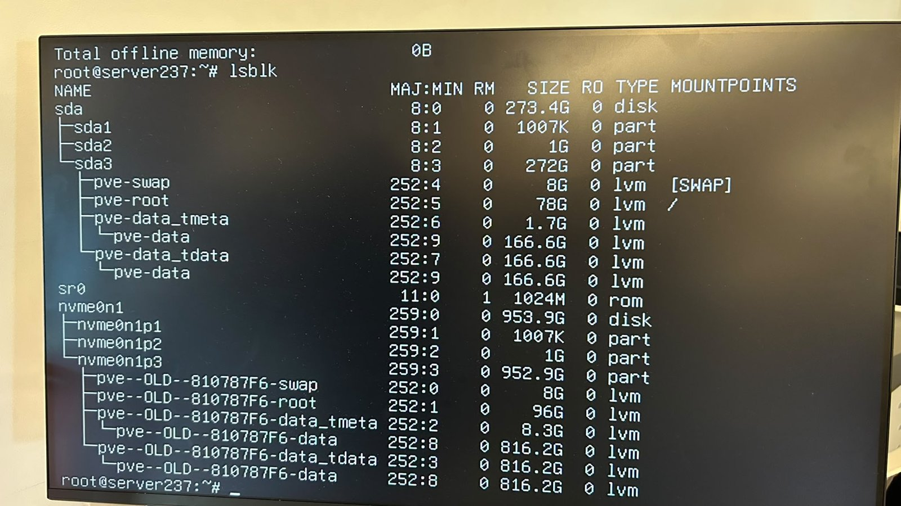

### 7.3 `lsmem` – la mémoire

`lsmem` confirme que toute la mémoire est **en ligne** (online). La commande affiche 66 G, parce qu'elle compte la mémoire par blocs de 2 Go. Le POST indiquait 64 Go installés.

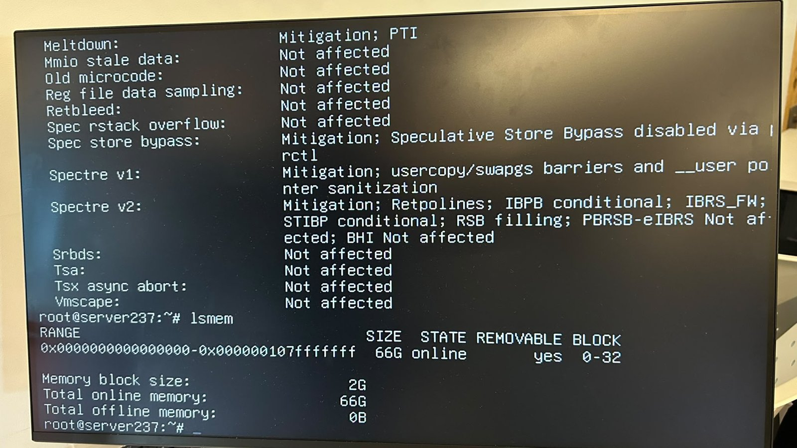

### 7.4 `lscpu` et `nproc` – le processeur

`lscpu` donne les détails du processeur, et la liste des **protections contre les failles de sécurité** connues (Spectre, Meltdown…).

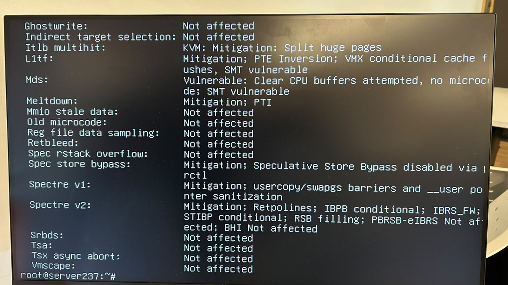

`nproc` affiche **16**, le nombre de processeurs logiques : 2 processeurs × 4 cœurs × 2 (Hyperthreading).

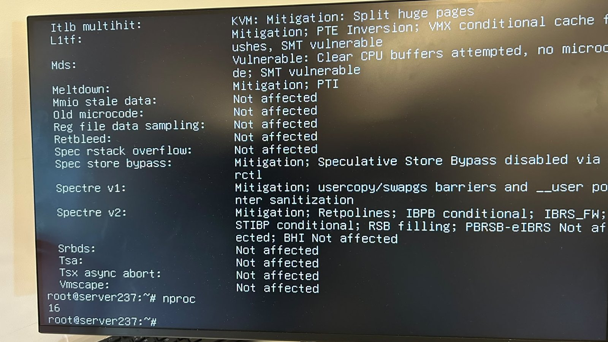

### 7.5 `cat /proc/interrupts` – les interruptions

Cette commande affiche les **interruptions** du processeur, c'est-à-dire les signaux envoyés par le matériel au processeur. Le compteur des erreurs matérielles (**Machine check exceptions**) est à **0**.

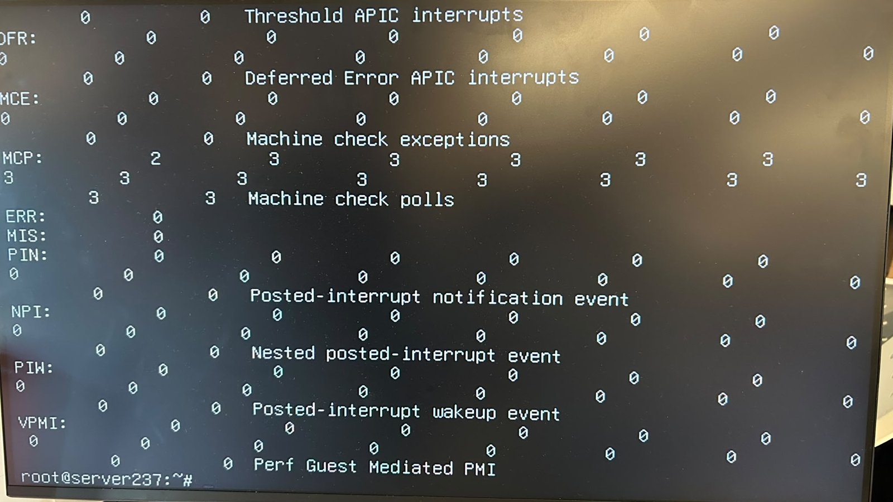

### 7.6 `lsmod` – les pilotes chargés

`lsmod` liste les modules (pilotes) chargés par Linux. On y retrouve :
- **`hpsa`** : le pilote du contrôleur RAID HP Smart Array ;
- **`nvme`** : le pilote du SSD NVMe ;
- **`bnx2`** : le pilote des cartes réseau Broadcom ;
- **`dm_thin_pool`** : utilisé par Proxmox pour l'espace de stockage des machines virtuelles.

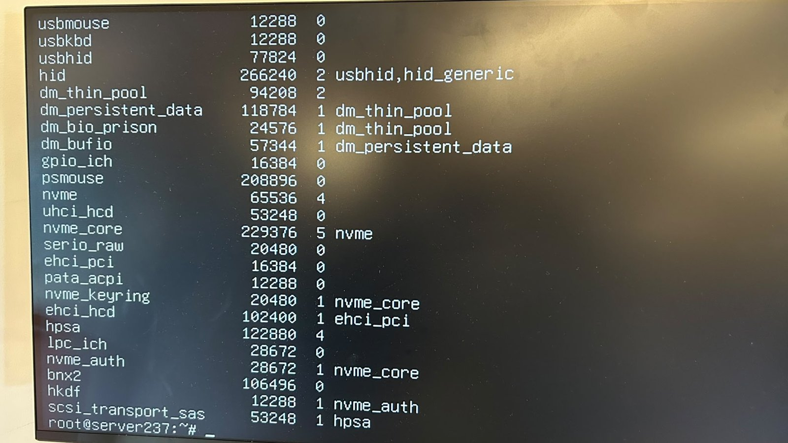

### 7.7 `lspci` – le matériel

`lspci` liste les composants branchés sur la carte mère. On y voit par exemple les contrôleurs mémoire intégrés des processeurs **Intel Xeon 5500**.

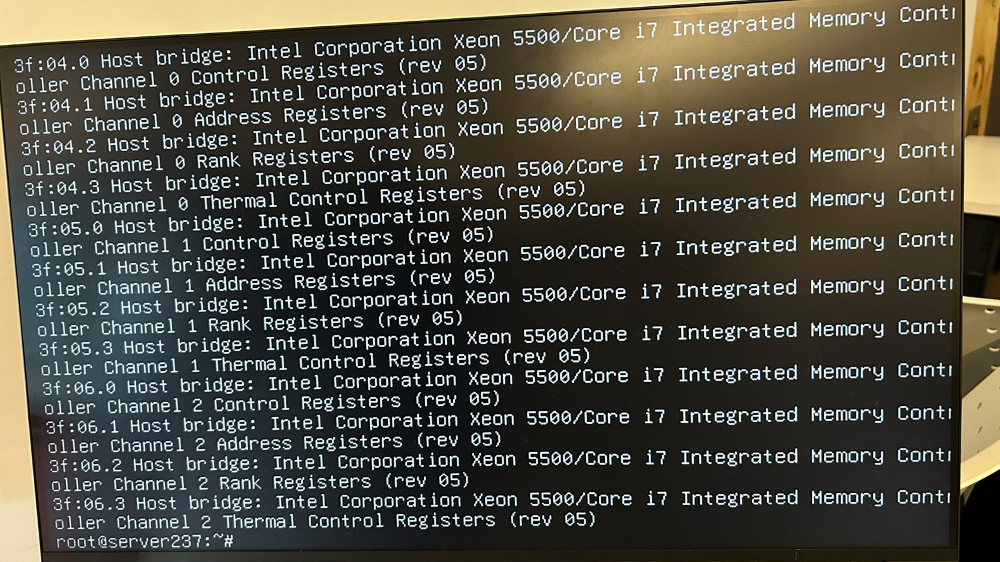

---

## 8. Vérification du réseau

### 8.1 Adresse IP et premiers tests (`ip a` et `ping`)

La commande `ip a` montre que l'adresse **10.7.236.237/23** est bien configurée sur **`vmbr0`**. C'est le **pont réseau** (bridge) créé par Proxmox : il permettra aux machines virtuelles d'utiliser la carte réseau physique.

- `ping 10.7.237.1` (la passerelle) :  **ça marche**.
- `ping -c 4 8.8.8.8` (Internet) : au premier essai, **Destination Host Unreachable**.

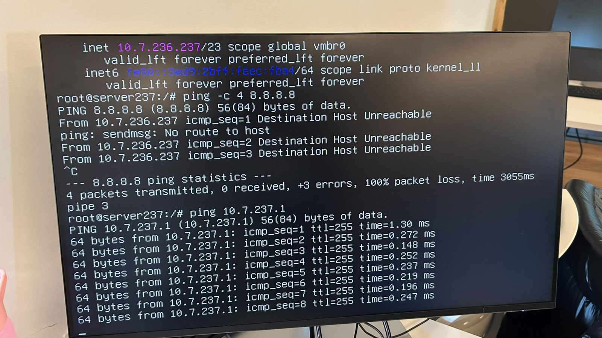

### 8.2 Accès à Internet

Plus tard, le même test fonctionne : **4 paquets envoyés, 4 reçus, 0 % de perte**. Le serveur a bien accès à Internet.

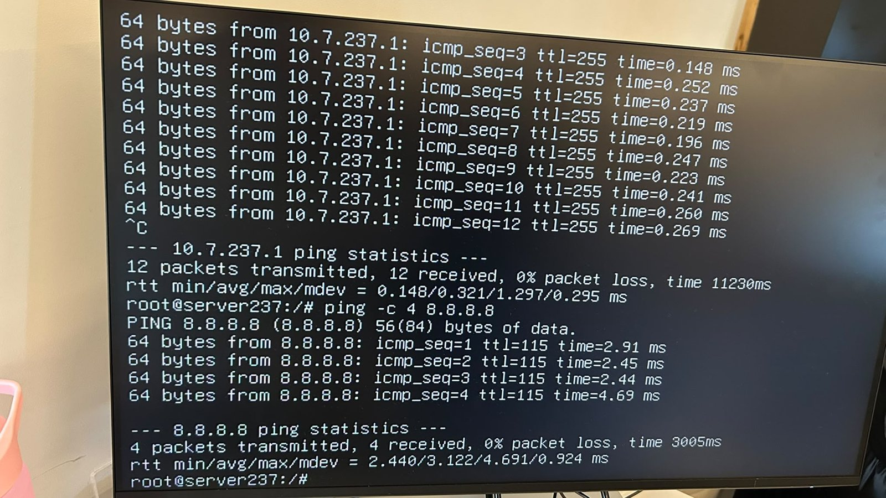

### 8.3 Connexion à distance en SSH

Depuis un ordinateur portable Windows, nous nous sommes connectés au serveur avec la commande :

```
ssh root@10.7.236.237
```

- Les premiers essais ont donné **Connection timed out** (délai dépassé).
- Un essai sur la mauvaise adresse (`10.7.236.240`, un autre serveur) a donné **Permission denied**.
- Enfin, la connexion a **réussi**. À la première connexion, on répond **yes** pour accepter l'empreinte (fingerprint) du serveur.

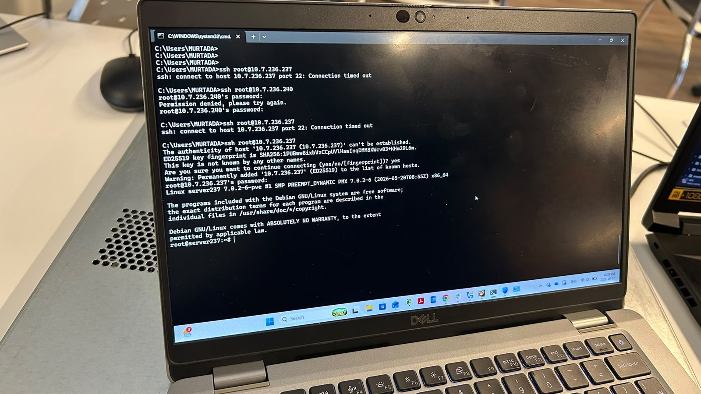

---

## 9. Remise du serveur dans la baie

Une fois l'installation terminée et vérifiée, nous avons **remis le serveur à sa place dans la baie (rack)**, rebranché les câbles réseau et les deux alimentations, puis **rallumé le serveur**. À l'arrière, on voit les 2 blocs d'alimentation de 460 W, les ports réseau et le port **iLO**.

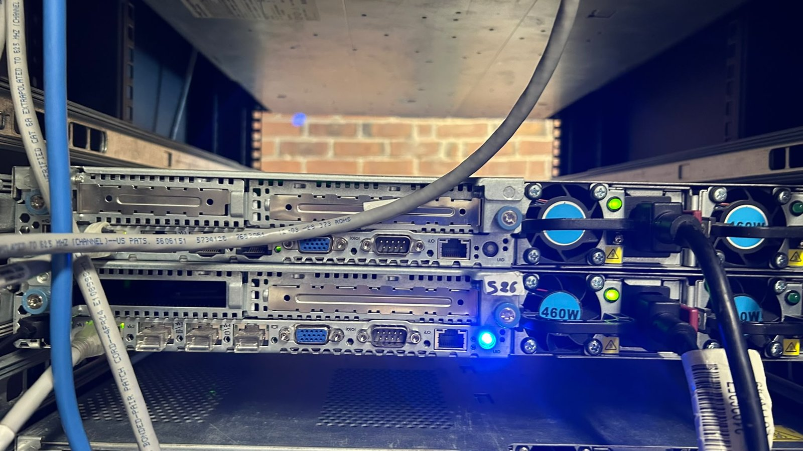

Le serveur redémarre normalement et l'on peut se connecter à Proxmox depuis la console de la baie.

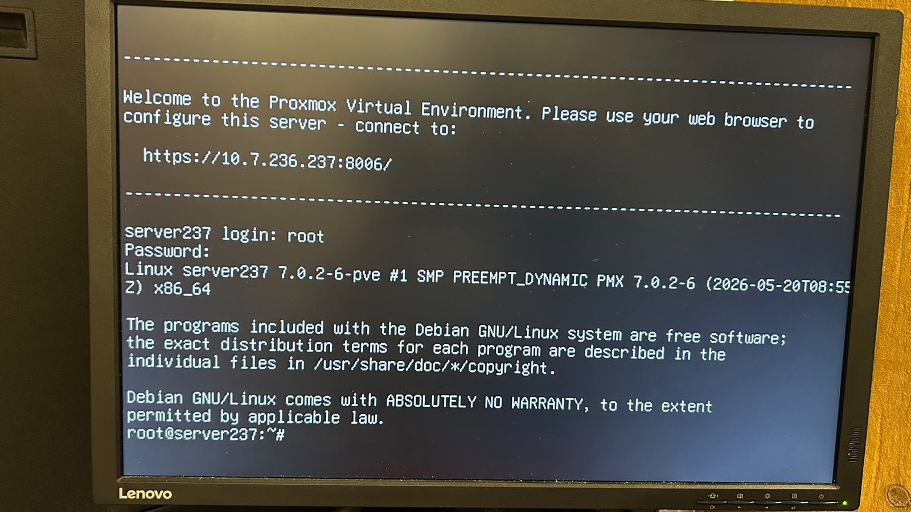

---

## 10. Conclusion

Nous avons installé **Proxmox VE 9.2** sur un serveur **HP ProLiant DL360 G7**. Le serveur est configuré sur le réseau du laboratoire, joignable à l'adresse **10.7.236.237**, accessible en **SSH** et par l'**interface web** (port 8006). Il est maintenant prêt à héberger des machines virtuelles.

### Problèmes rencontrés et solutions

| Problème | Cause | Solution |
|---|---|---|
| Écran noir possible pendant l'installation | Carte graphique trop ancienne | Ajout de `nomodeset` dans GRUB |
| Le serveur ne démarrait pas après l'installation sur le SSD NVMe | Le BIOS de 2011 ne sait pas démarrer sur un NVMe | Réinstallation sur le HDD (RAID 5, `/dev/sda`) |
| Message « existing 'pve' Volume Group » | Restes de la première installation sur le NVMe | Renommage en `pve-OLD-810787F6` (OK) |
| `noapic` : command not found | Option de démarrage tapée comme une commande | Ces options se mettent dans GRUB |
| Ping vers 8.8.8.8 échoue au début | Pas d'accès à Internet au premier test | Le test a réussi plus tard (0 % de perte) |
| SSH : Connection timed out | Connexion impossible lors des premiers essais | La connexion a réussi par la suite |

### Leçons apprises

- Sur un vieux serveur, **vérifier que le BIOS peut démarrer sur le disque choisi** avant d'installer.
- Bien **choisir le disque cible** dans l'installateur : tout le contenu du disque est effacé.
- Le menu **F11 (Boot Override)** permet de démarrer une seule fois sur la clé USB ou sur le disque dur.
- **`nomodeset`** règle les problèmes d'affichage sur le matériel ancien.
- Bien faire la différence entre une **commande Linux** et une **option de démarrage**.
- Toujours **tester le réseau** (passerelle, Internet, SSH) après l'installation.
