# INF1085 — Proxmox

## 300150470

Rapport d'installation de Proxmox VE sur un serveur physique HP ProLiant, réalisé en groupe en classe.

## 1. Le serveur au démarrage

Au démarrage, le BIOS affiche ses informations matérielles, ce qui confirme que le matériel est prêt pour l'installation.

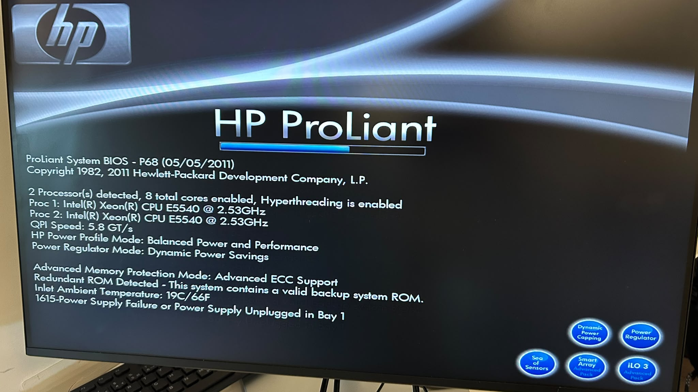
*Figure 1 : BIOS HP ProLiant, version P68 (05/05/2011).*

- 2 processeurs détectés, 8 cœurs au total, Hyperthreading activé
- Proc 1 et Proc 2 : Intel Xeon CPU E5540 @ 2.53 GHz, QPI 5.8 GT/s
- Protection mémoire : Advanced ECC Support
- Un message est affiché au POST : « 1615-Power Supply Failure or Power Supply Unplugged in Bay 1 ». L'installation a quand même continué normalement par la suite.

## 2. Lancement de l'installateur

Le menu Proxmox VE 9.2 apparaît, avec l'installation graphique proposée en premier.

*Figure 2 : Menu « Welcome to Proxmox Virtual Environment », Proxmox VE 9.2.*

Comme en classe, l'option graphique a été modifiée dans GRUB avec `nomodeset` avant de lancer l'installation.

*Figure 3 : Ligne de démarrage GRUB avec `nomodeset` ajouté.*

L'installateur charge ensuite ses pilotes et détecte les interfaces réseau. Il tente d'obtenir une adresse par DHCP.

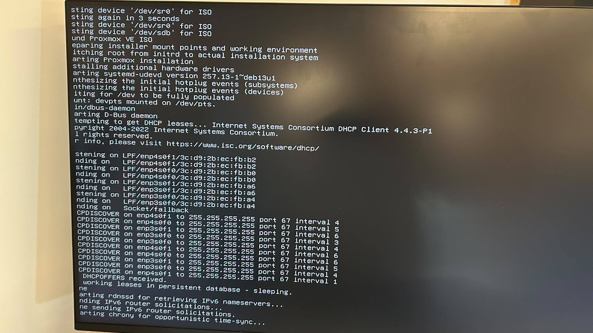
*Figure 4 : Chargement de l'installateur, détection des interfaces réseau.*

## 3. Choix du disque

L'installateur détecte deux disques. C'est `/dev/sda` qui a été choisi pour installer Proxmox, comme le confirme le résumé plus bas. Toutes les données de ce disque sont effacées par l'installation.

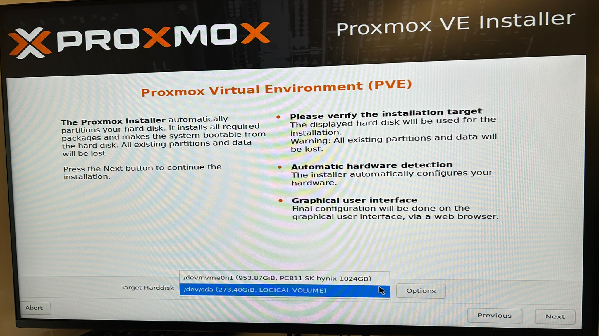
*Figure 5 : Disque cible sélectionné : /dev/sda (273.40 GiB, LOGICAL VOLUME). L'autre disque visible est un NVMe de 953.87 GiB.*

## 4. Mot de passe et configuration réseau

Un mot de passe root a été défini dans l'installateur, avec l'adresse courriel du groupe pour les alertes système (visible sur la capture, mot de passe masqué).

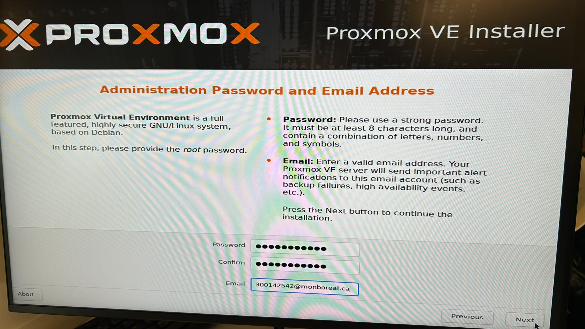
*Figure 6 : Étape « Administration Password and Email Address ».*

La configuration réseau entrée ensuite :

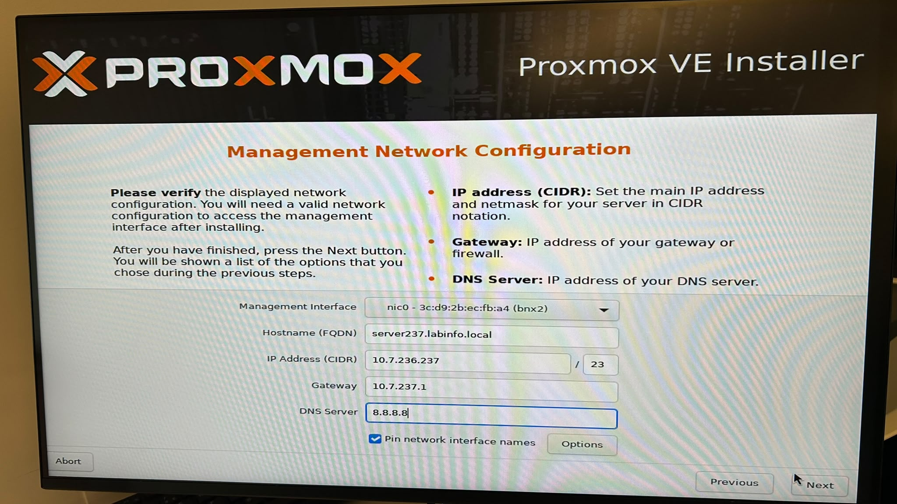
*Figure 7 : Configuration réseau de gestion.*

- Interface de gestion : nic0, MAC 3c:d9:2b:ec:fb:a4
- Hostname (FQDN) : server237.labinfo.local
- IP : 10.7.236.237/23
- Passerelle : 10.7.237.1
- DNS : 8.8.8.8

## 5. Résumé et installation

Le résumé confirme tous les choix avant de lancer la copie des fichiers.

*Figure 8 : Résumé avant installation : système de fichiers ext4, disque /dev/sda, Canada, fuseau America/Toronto, clavier en-us, hostname server237, IP 10.7.236.237/23.*

L'installation copie ensuite les paquets, ici à 51 % au moment de la photo.

*Figure 9 : Installation en cours, extraction des paquets Debian.*

## 6. Vérifications après installation

Après le redémarrage, le serveur affiche son adresse d'accès web et la connexion root fonctionne.

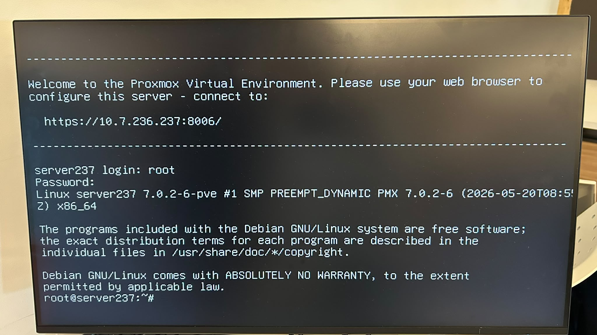
*Figure 10 : Console après installation : accès web https://10.7.236.237:8006/, login root, noyau Linux server237 7.0.2-6-pve.*

### Processeurs

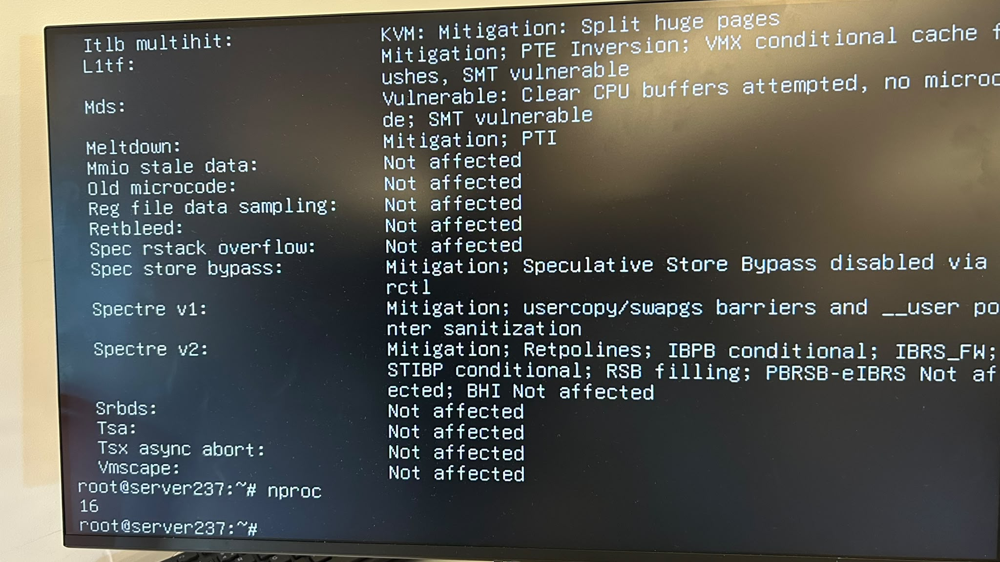
*Figure 11 : Sortie des vérifications CPU, avec `nproc` = 16 processeurs logiques. Les protections contre les failles CPU (Spectre, Meltdown, etc.) sont indiquées comme actives ou non affectées.*

### Stockage

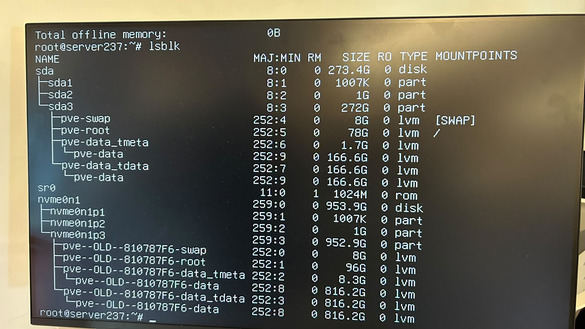
*Figure 12 : Sortie de `lsblk`.*

- `sda` (273.4 G) : la nouvelle installation, avec `pve-root` 78 G monté sur `/`, `pve-swap` 8 G et `pve-data` 166.6 G
- `nvme0n1` (953.9 G) : une ancienne installation, reconnaissable aux volumes `pve--OLD--…`

### Compteurs d'erreurs

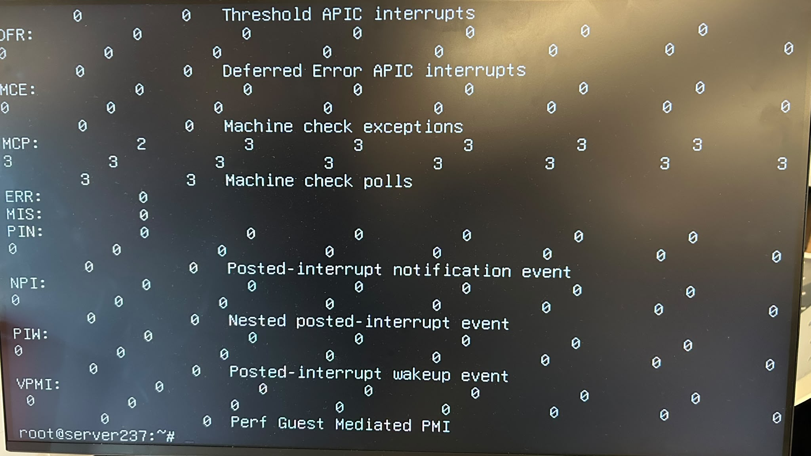
*Figure 13 : Compteurs d'interruptions et d'erreurs matérielles, presque tous à zéro, ce qui indique un fonctionnement stable.*

### Réseau

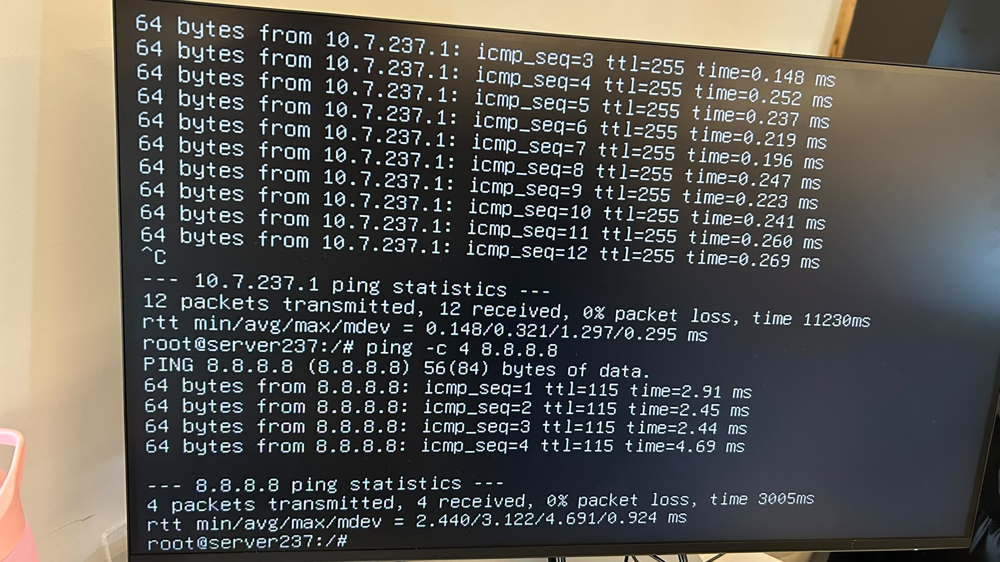
*Figure 14 : Tests ping depuis le serveur.*

- Passerelle 10.7.237.1 : 12 paquets envoyés, 12 reçus, 0 % de perte
- 8.8.8.8 : 4 paquets envoyés, 4 reçus, 0 % de perte

Le serveur est donc bien connecté au réseau du laboratoire et à Internet.

### Accès à distance

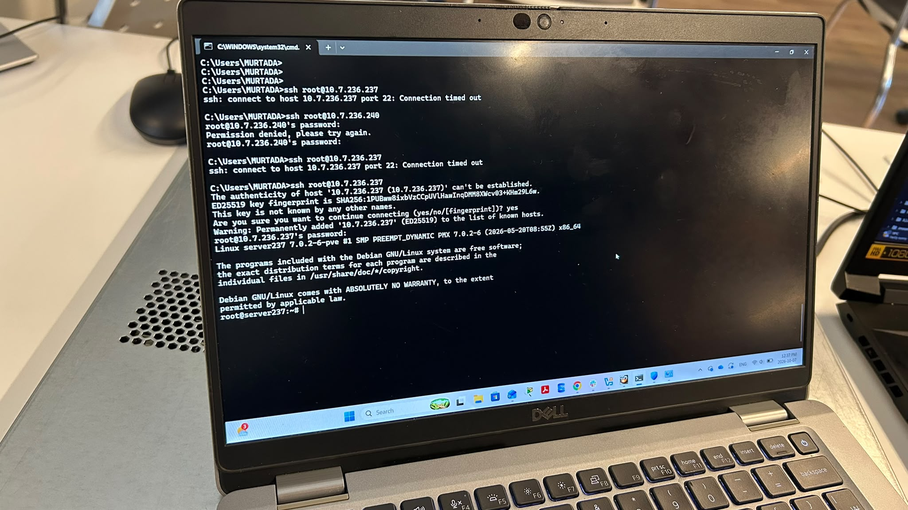
*Figure 15 : Connexion SSH `root@10.7.236.237` depuis un poste Windows du groupe, réussie après plusieurs essais (délais de connexion et une tentative vers une autre adresse avant).*

## 7. Résultats

| Élément | Résultat |
|---|---|
| Serveur | HP ProLiant, BIOS P68, 2 x Xeon E5540 @ 2.53 GHz |
| Hyperviseur | Proxmox VE 9.2 installé sur /dev/sda, ext4 |
| Hostname | server237.labinfo.local |
| IP de gestion | 10.7.236.237/23, passerelle 10.7.237.1, DNS 8.8.8.8 |
| Accès web | https://10.7.236.237:8006/ |
| Processeurs logiques | 16 (`nproc`) |
| Stockage | sda 273.4 G (nouvelle installation), NVMe avec ancienne installation |
| Réseau | Ping passerelle et Internet à 0 % de perte |
| SSH | Connexion root réussie depuis Windows |

## 8. Conclusion

Proxmox VE est installé et opérationnel sur le serveur : démarrage, disque, réseau, accès web et SSH ont tous été vérifiés. Le serveur est prêt à héberger des machines virtuelles pour les prochains travaux.

