# 🖥️ Installation de Proxmox VE 9 sur HP ProLiant DL360 G7

| Champ | Valeur |
|-------|--------|
| Nom | Arnauld Tchumno |
| Numéro étudiant | 300151483 |
| Serveur | `server237` - [10.7.236.237](https://10.7.236.237:8006) |
| Version | Proxmox VE **9.2** (ISO release 1), noyau `7.0.2-6-pve` |
| Date | 7 octobre 2026 |

## 🌐 Paramètres réseau du laboratoire

| Paramètre | Valeur |
|-----------|--------|
| Réseau | `10.7.236.0/23` |
| Adresse du serveur | `10.7.236.237/23` |
| Passerelle | `10.7.237.1` |
| DNS | `8.8.8.8` |

---

## Étape 1 - Préparer la clé USB

Écrire l'ISO Proxmox VE 9.2 sur une clé USB :

- **Windows** : Rufus ou balenaEtcher (mode **DD**)
- **Linux** : `sudo dd if=proxmox-ve_9.2-1.iso of=/dev/sdX bs=4M status=progress && sync`

## Étape 2 - Démarrer sur la clé

Au POST, appuyer sur **F11**, puis choisir **3) One Time Boot to USB DriveKey** (voir [1.Diagnostics, figure 5](../../1.Diagnostics/300151483/README.md)).

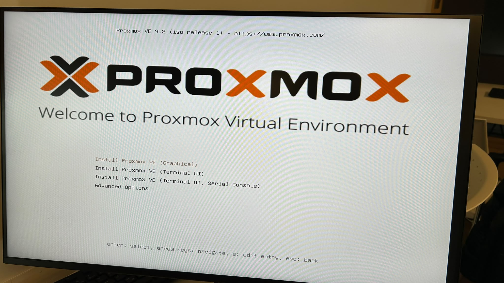

*Figure 1 : Menu « Welcome to Proxmox Virtual Environment ». Ne **pas** appuyer sur Entrée tout de suite.*

## Étape 3 - Ajouter `nomodeset` dans GRUB

Sur **Install Proxmox VE (Graphical)**, appuyer sur **`e`**, puis ajouter `nomodeset` à la fin de la ligne `linux` :

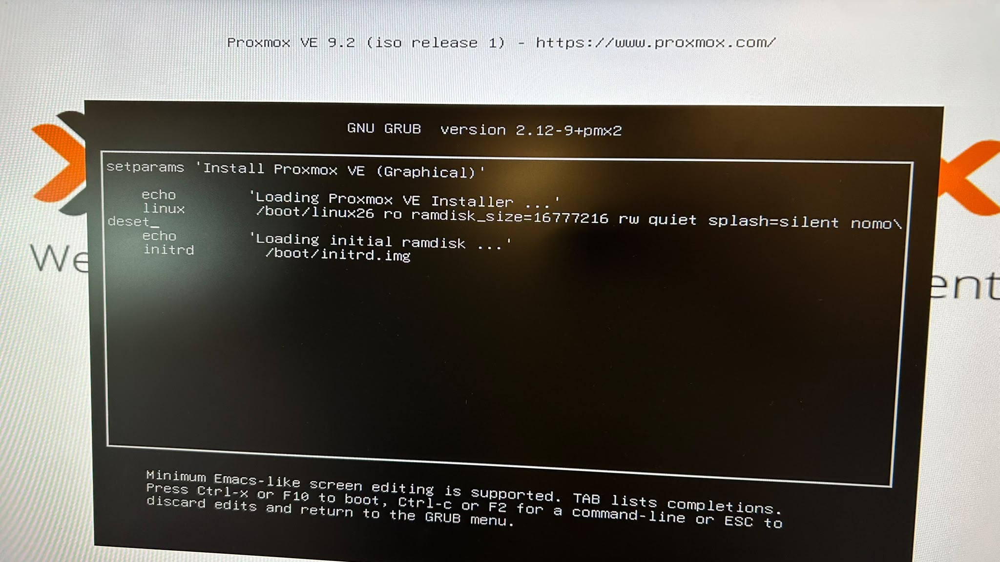

*Figure 2 : Édition dans GNU GRUB 2.12. La ligne devient `linux /boot/linux26 ro ramdisk_size=16777216 rw quiet splash=silent nomodeset`. On démarre ensuite avec **Ctrl + X** ou **F10**.*

| Paramètre | Rôle | Pourquoi |
|-----------|------|----------|
| `nomodeset` | Empêche le noyau d'utiliser le *Kernel Mode Setting* (KMS) | La puce vidéo du ProLiant est mal gérée par KMS : sans ce paramètre, l'écran reste noir |
| `acpi=off` | Désactive l'ACPI | ❌ À éviter : Linux ne verrait alors qu'**un seul CPU**, car la topologie SMP/APIC est décrite par l'ACPI |

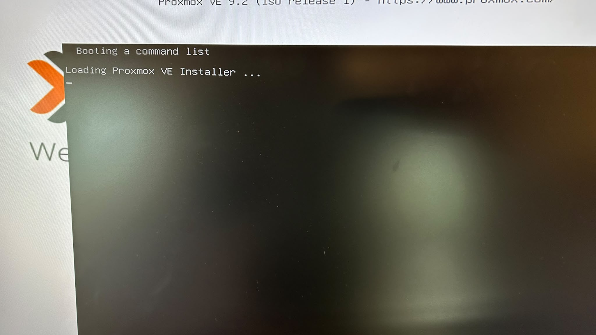

*Figure 3 : « Loading Proxmox VE Installer… ». Le noyau démarre.*

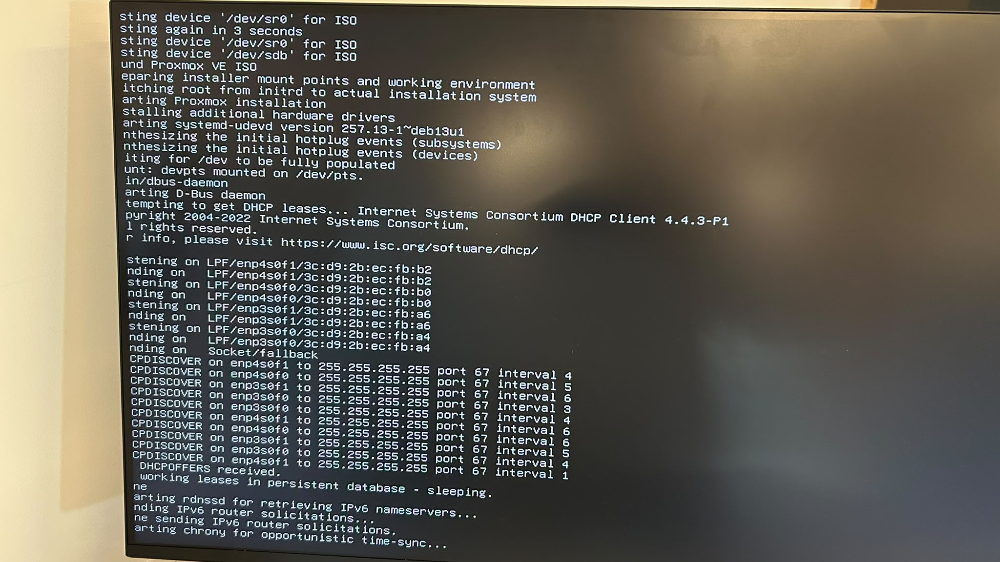

*Figure 4 : Recherche de l'ISO sur `/dev/sr0` puis `/dev/sdb` (la clé USB), détection du matériel, puis requêtes DHCP sur les 4 cartes réseau (`enp3s0f0`, `enp3s0f1`, `enp4s0f0`, `enp4s0f1`).*

## Étape 4 - Assistant d'installation

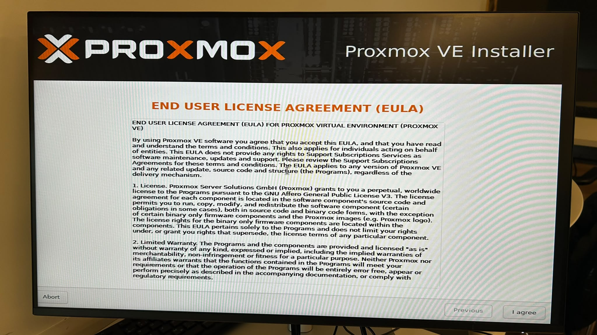

*Figure 5 : Acceptation de la licence (EULA), avec **I agree**.*

### Choix du disque

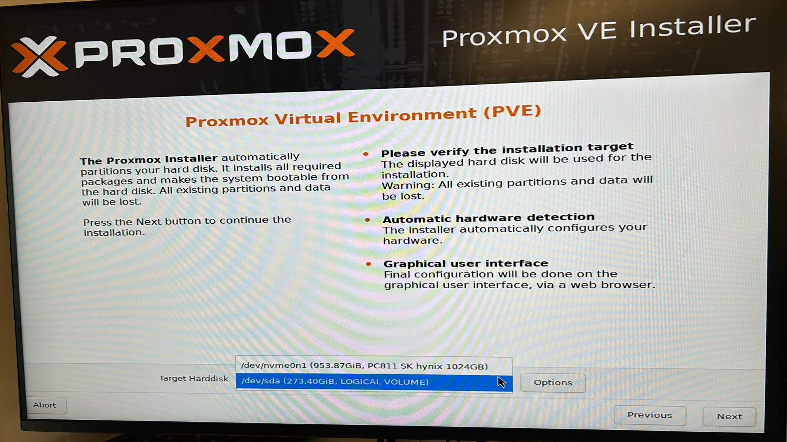

*Figure 6 : Deux disques sont proposés. On choisit **`/dev/sda (273.40GiB, LOGICAL VOLUME)`**, le volume RAID 5 créé dans [1.Diagnostics](../../1.Diagnostics/300151483/README.md). Le SSD NVMe `/dev/nvme0n1` (953,87 GiB) reste libre pour le stockage des VM.*

### Mot de passe et courriel

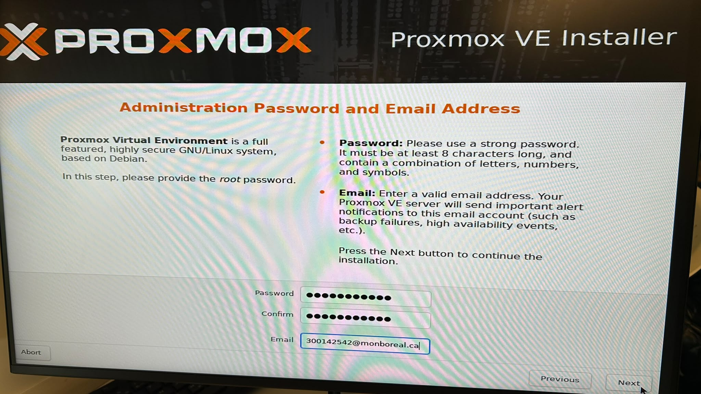

*Figure 7 : Mot de passe `root` (au moins 8 caractères) et adresse courriel pour les alertes.*

### Réseau

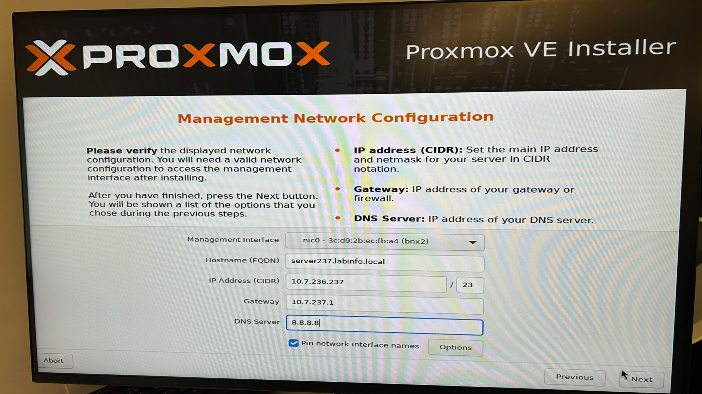

*Figure 8 : Management Network Configuration, avec l'interface `nic0`, le nom d'hôte `server237.labinfo.local`, l'IP `10.7.236.237/23`, la passerelle `10.7.237.1` et le DNS `8.8.8.8`.*

### Résumé

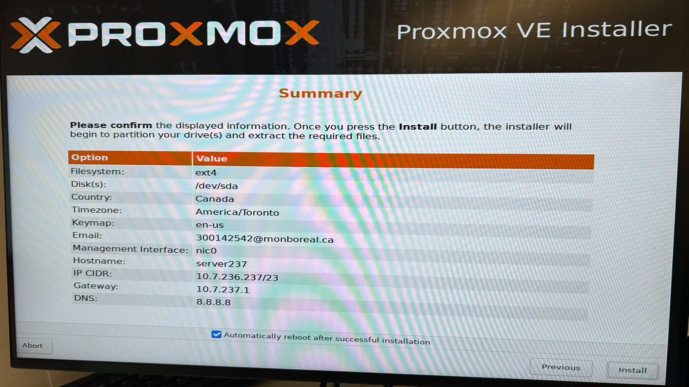

*Figure 9 : Résumé avant l'installation.*

| Option | Valeur |
|--------|--------|
| Filesystem | ext4 |
| Disk | `/dev/sda` |
| Country / Timezone | Canada / America/Toronto |
| Keymap | en-us |
| Management Interface | nic0 |
| Hostname | server237 |
| IP CIDR | 10.7.236.237/23 |
| Gateway / DNS | 10.7.237.1 / 8.8.8.8 |

## Étape 5 - Installation

### ⚠️ Problème rencontré : ancien groupe de volumes `pve`

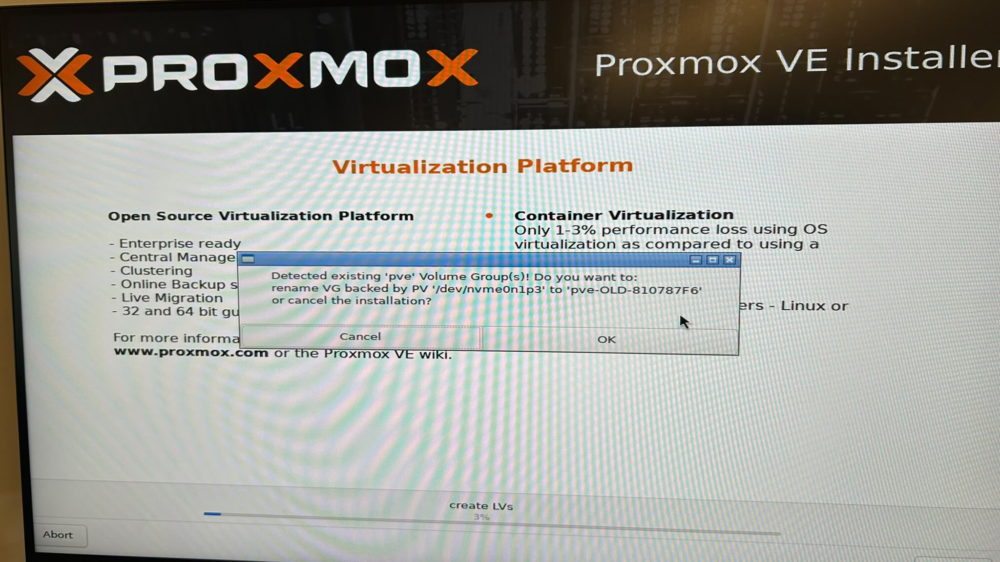

*Figure 10 : « Detected existing 'pve' Volume Group(s)! Do you want to rename VG backed by PV '/dev/nvme0n1p3' to 'pve-OLD-810787F6' or cancel the installation? »*

**Cause** : une ancienne installation de Proxmox était présente sur le SSD NVMe. Deux groupes de volumes LVM portant le même nom `pve` entreraient en conflit au démarrage.
**Solution** : **OK**. L'ancien VG est renommé `pve-OLD-810787F6` et l'installation continue sur `/dev/sda` sans perdre les données du NVMe.

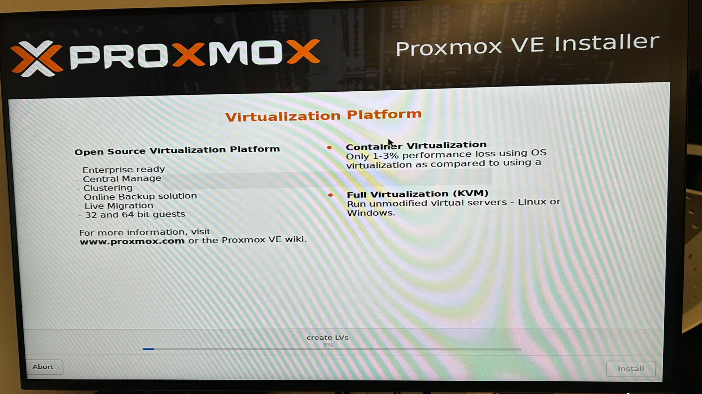

*Figure 11 : Création des volumes logiques (`create LVs`), puis extraction des paquets.*

## Étape 6 - Premier démarrage

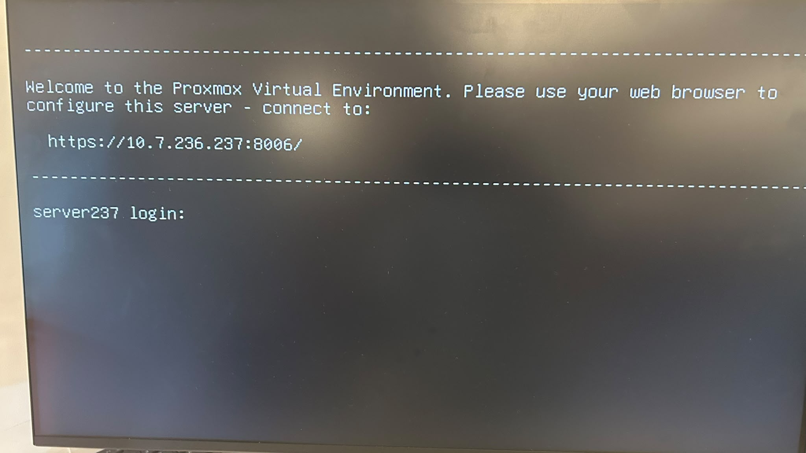

*Figure 12 : « Welcome to the Proxmox Virtual Environment. Please use your web browser to configure this server - connect to: https://10.7.236.237:8006/ ».*

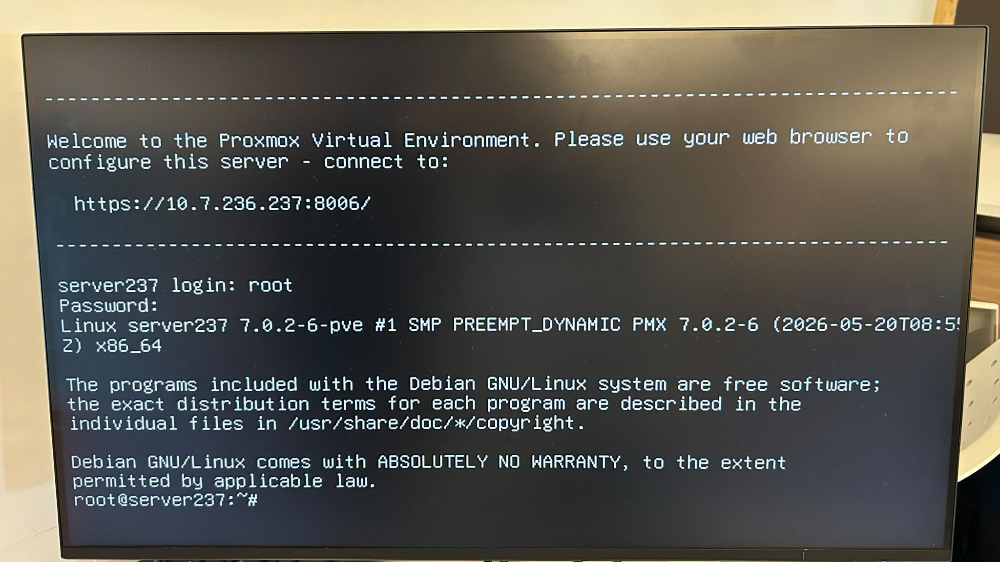

*Figure 13 : Connexion locale en `root` sur `server237`, avec le noyau `Linux 7.0.2-6-pve #1 SMP PREEMPT_DYNAMIC x86_64`.*

---

## 🧪 Étape 7 - Tests et vérifications

### Test 1 - Paramètres réellement passés au noyau

```bash
cat /proc/cmdline
```

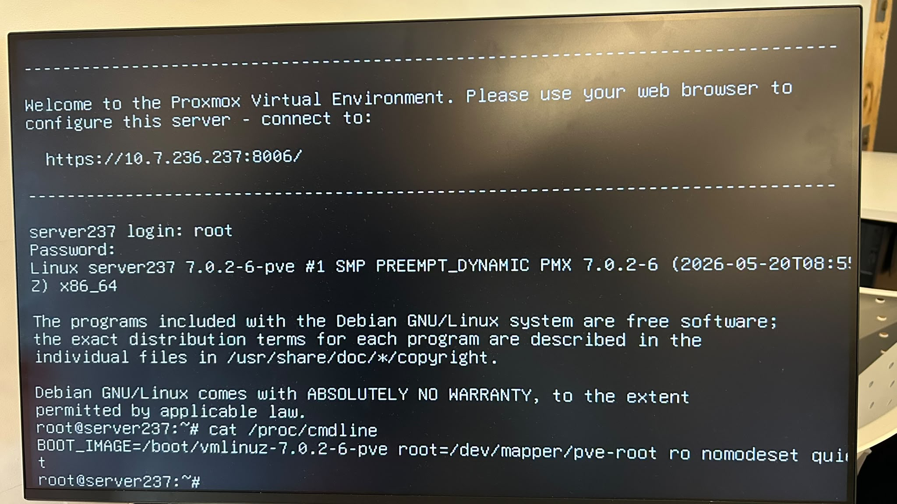

*Figure 14 : `BOOT_IMAGE=/boot/vmlinuz-7.0.2-6-pve root=/dev/mapper/pve-root ro nomodeset quiet`*

✅ `nomodeset` est bien **conservé** après l'installation.
✅ Il n'y a **pas** de `acpi=off`.
✅ La racine est sur le volume LVM `pve-root`.

### Test 2 - Nombre de processeurs logiques

```bash
lscpu
nproc
```

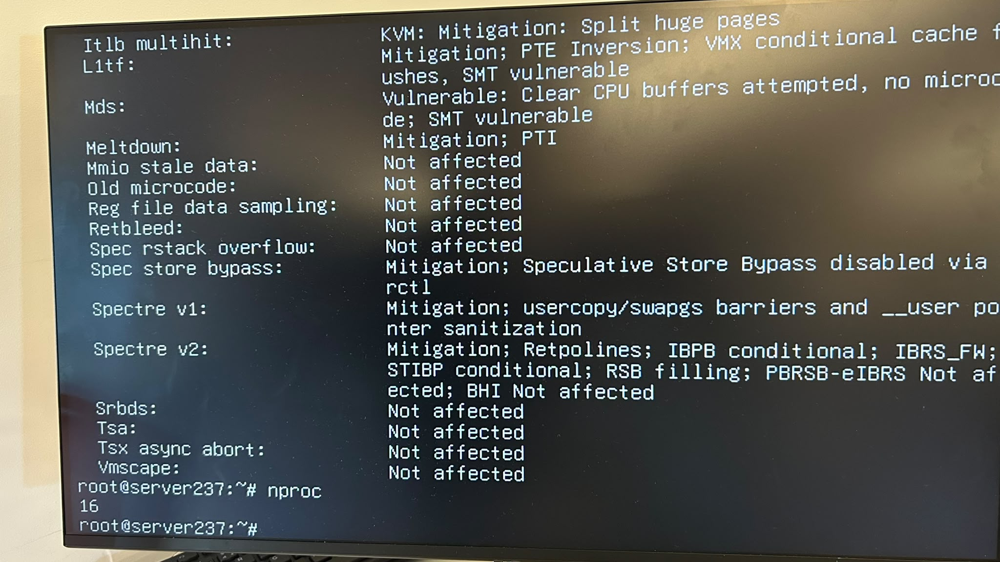

*Figure 15 : `nproc` renvoie **16**.*

✅ 2 sockets × 4 cœurs × 2 threads = **16**. Les deux Xeon E5540 et l'Hyperthreading sont actifs : le SMP fonctionne.

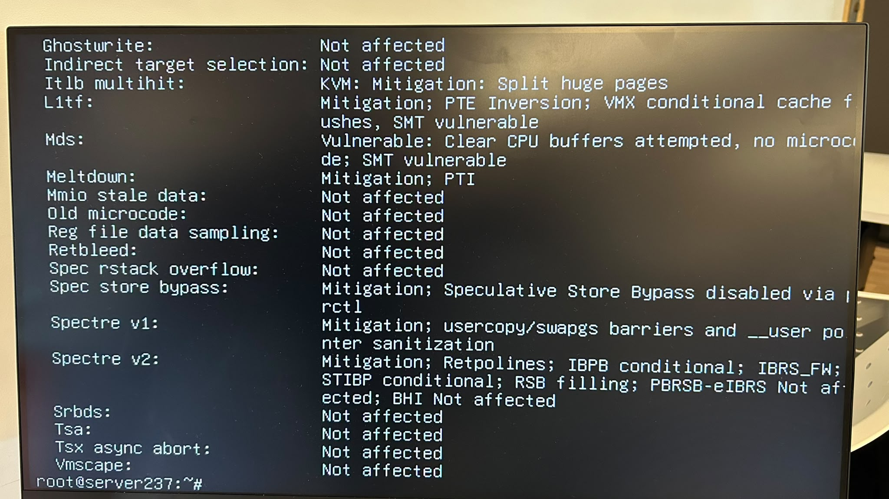

*Figure 16 : Fin de la sortie de `lscpu`, section *Vulnerabilities*. Le noyau applique des protections (PTI pour Meltdown, Retpolines pour Spectre v2…). Ces Xeon de 2009 sont marqués `Vulnerable` pour MDS, avec `SMT vulnerable`.*

### Test 3 - Système

```bash
cat /etc/os-release
uname -m
```

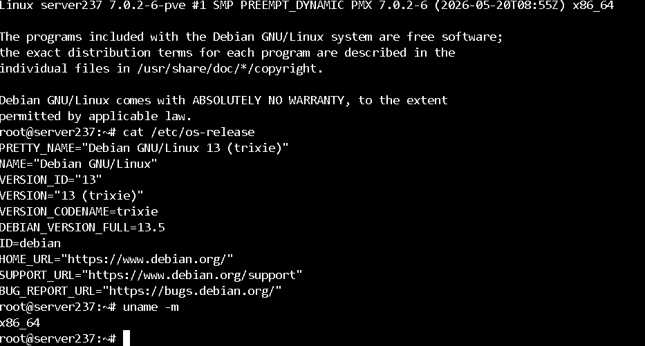

*Figure 17 : **Debian GNU/Linux 13 (trixie)** 13.5, architecture `x86_64`.*

### Test 4 - Interface Web

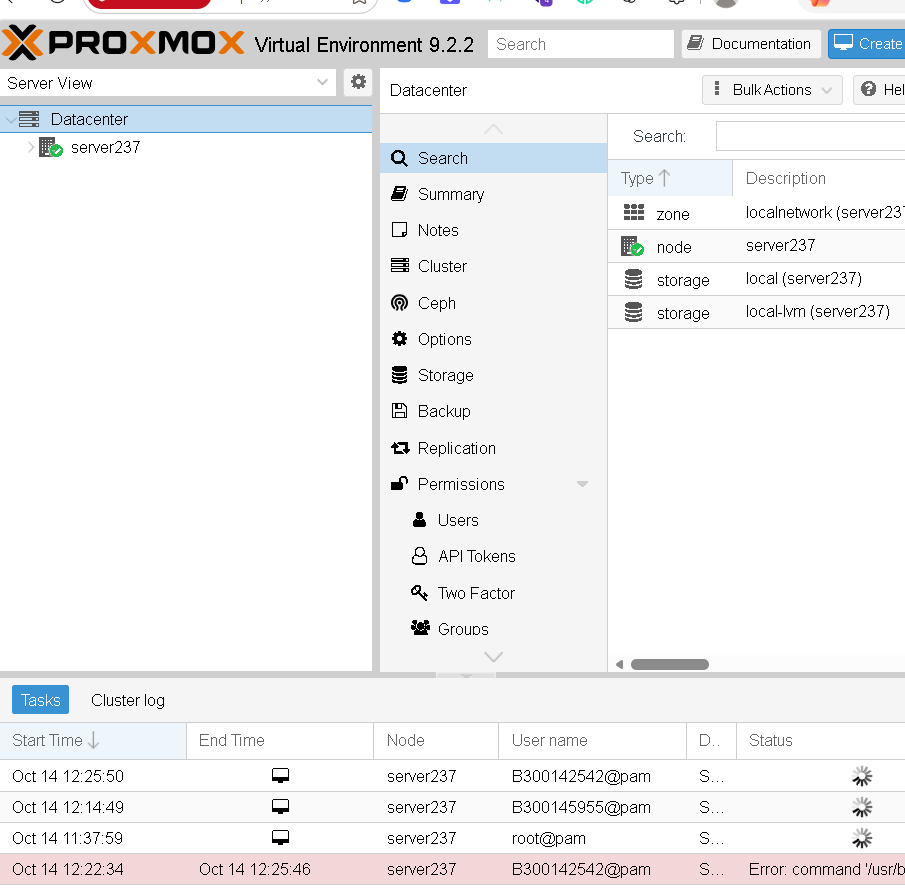

*Figure 18 : Proxmox VE 9.2.2 accessible à `https://10.7.236.237:8006`. Le nœud `server237` est en ligne ✅, avec le stockage `local` et `local-lvm`.*

### Autres commandes de vérification

| Commande | Vérification |
|----------|-------------|
| `lsmem` / `free -h` | 64 Go détectés |
| `lsblk` | `sda` (RAID 5) et `nvme0n1` |
| `lspci` | Contrôleur Smart Array, cartes réseau, NVMe |
| `lsmod` | Modules `hpsa`, `kvm_intel`, `nvme` |
| `cat /proc/interrupts` | Interruptions réparties sur les 16 CPU |

---

## ❌ Dépannage : un seul CPU détecté

1. `cat /proc/cmdline` : si `acpi=off` y apparaît, le retirer de `GRUB_CMDLINE_LINUX_DEFAULT` dans `/etc/default/grub`.
2. `update-grub && reboot`
3. Revérifier avec `nproc`. Le résultat attendu est **16**.

## 📚 Concepts

| Terme | Définition |
|-------|-----------|
| **ACPI** | Interface entre le firmware et l'OS : décrit le matériel (CPU, alimentation, interruptions) |
| **APIC / LAPIC** | Contrôleur d'interruptions. Chaque cœur logique a son Local APIC |
| **SMP** | *Symmetric Multi-Processing* : Linux utilise plusieurs CPU en même temps |
| **KMS** | *Kernel Mode Setting* : le noyau configure lui-même l'affichage |
| **LVM / VG** | Gestion de volumes logiques. Proxmox crée le VG `pve` avec `root`, `swap` et `data` |
| **KVM / QEMU** | Moteur de virtualisation utilisé par Proxmox pour les VM |

## ✅ Conclusion

Proxmox VE 9.2 est installé sur le volume RAID 5 (`/dev/sda`) du HP DL360 G7. Le conflit avec l'ancien VG `pve` du NVMe a été résolu en le renommant. Les tests confirment que `nomodeset` est actif, que les **16 processeurs logiques** sont disponibles et que l'interface Web répond sur `https://10.7.236.237:8006`. Le serveur est prêt pour les machines virtuelles (voir [3.VMs](../../3.VMs/300151483/README.md)).
