# Installation et vérification de Proxmox VE 9 sur HP ProLiant DL360 G7

**Étudiant :** Walid Dahmane  
**Numéro étudiant :** 300151589  
**Cours :** INF1085 – Virtualisation  
**Établissement :** Collège Boréal  
**Serveur :** HP ProLiant DL360 G7 – server238

---

## 1. Introduction

Dans le cadre du cours INF1085, nous avons réalisé un laboratoire portant sur l'installation, la configuration et la vérification de Proxmox Virtual Environment (VE) 9 sur un serveur HP ProLiant DL360 G7.

Proxmox VE est une plateforme de virtualisation basée sur Linux qui permet de créer, de configurer et de gérer plusieurs machines virtuelles à partir d'une interface Web.

Ce laboratoire avait pour objectifs de :

- Installer Proxmox VE 9 sur un serveur physique.
- Comprendre les problèmes de compatibilité entre les anciens serveurs et les noyaux Linux modernes.
- Découvrir les paramètres de démarrage comme `nomodeset`.
- Vérifier la détection des processeurs et de la mémoire.
- Examiner les disques, les périphériques PCI et les modules Linux.
- Vérifier le fonctionnement du réseau et des interruptions matérielles.

---

## 2. Installation de Proxmox VE 9

### 2.1 Préparation et démarrage de l'installation

L'installation de Proxmox VE 9 nécessite une image ISO et un support USB amorçable.

Les étapes générales sont les suivantes :

1. Télécharger l'image ISO de Proxmox VE 9.
2. Préparer une clé USB amorçable avec Rufus.
3. Connecter la clé USB au serveur HP ProLiant DL360 G7.
4. Démarrer le serveur et sélectionner le périphérique USB.
5. Accéder au menu d'installation de Proxmox VE.

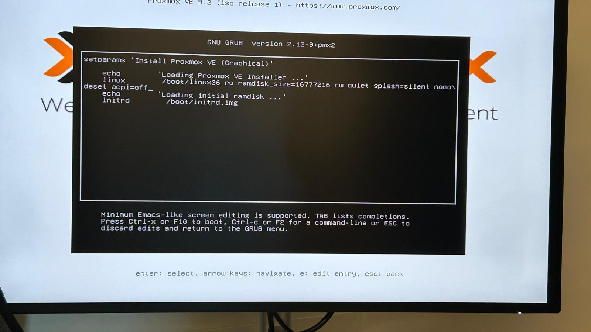

*Figure 1 : Première capture de l'installation de Proxmox VE 9.*

### 2.2 Paramètres de démarrage

Le serveur HP ProLiant DL360 G7 possède une architecture matérielle ancienne. Certains composants peuvent présenter des problèmes de compatibilité avec un noyau Linux moderne.

Le paramètre suivant peut être utilisé lors du démarrage :

```bash
nomodeset
```

Ce paramètre désactive le Kernel Mode Setting (KMS) et peut permettre de contourner certains problèmes d'affichage, notamment les écrans noirs pendant l'installation.

Le paramètre `acpi=off` peut également être utilisé dans certains cas de dépannage, mais il désactive ACPI et peut perturber la gestion des processeurs et du matériel.

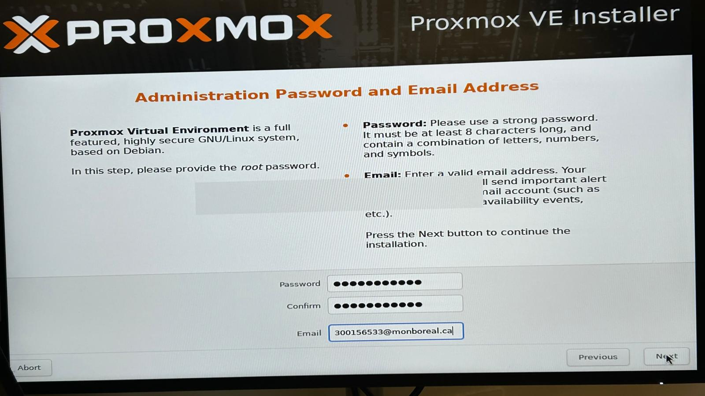

*Figure 2 : Deuxième capture de l'installation de Proxmox VE 9.*

### 2.3 Configuration et finalisation

L'installation comprend notamment :

- Le choix du disque système.
- La configuration du compte administrateur `root`.
- La configuration des paramètres réseau.
- La sélection du nom d'hôte.
- La finalisation de l'installation et le redémarrage.

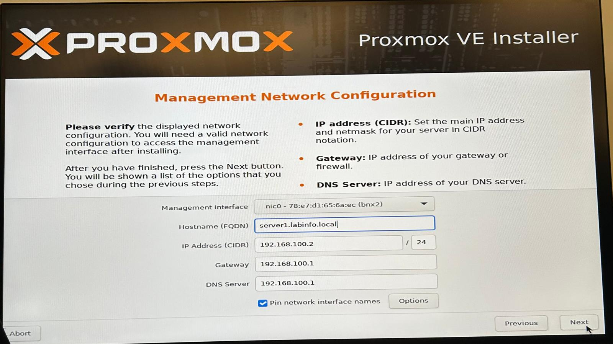

*Figure 3 : Troisième capture de l'installation de Proxmox VE 9.*

---

## 3. Vérification de l'environnement Linux

Après l'installation, nous avons accédé au Shell du serveur Proxmox pour effectuer les vérifications nécessaires.

Les commandes utilisées comprennent :

```bash
ls -la
cat /proc/cmdline
```

La commande `ls -la` affiche les fichiers, les dossiers et leurs permissions.

La commande `cat /proc/cmdline` permet de vérifier les paramètres réellement transmis au noyau Linux pendant le démarrage.

Cette vérification est particulièrement importante pour déterminer si des paramètres comme `nomodeset` ou `acpi=off` sont actifs.

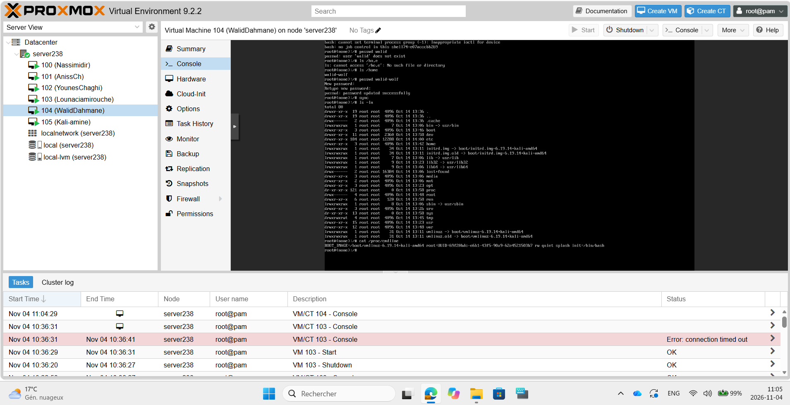

*Figure 4 : Vérification de l'environnement Linux et des paramètres de démarrage.*

---

## 4. Vérification des processeurs

La commande utilisée est :

```bash
lscpu
```

Elle affiche les caractéristiques du processeur, notamment son architecture, son modèle, sa fréquence, le nombre de cœurs et le nombre de processeurs logiques.

### Résultats observés

| Caractéristique | Résultat |
|---|---|
| Modèle | Intel Xeon E5620 |
| Fréquence | 2,40 GHz |
| Architecture | x86_64 |
| Nombre de sockets | 2 |
| Cœurs par socket | 4 |
| Threads par cœur | 2 |
| Total de cœurs physiques | 8 |
| Total de processeurs logiques | 16 |

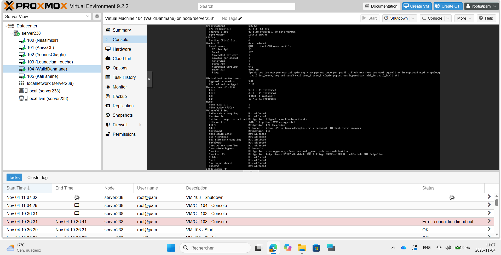

*Figure 5 : Vérification des processeurs Intel Xeon à l'aide de la commande lscpu.*

La commande `nproc` a également permis de confirmer que 16 processeurs logiques étaient disponibles.

Cette vérification est importante pour s'assurer que le serveur peut utiliser ses ressources de calcul pour exécuter plusieurs machines virtuelles.

---

## 5. Vérification de la mémoire RAM

La commande utilisée est :

```bash
lsmem
```

Cette commande affiche les blocs de mémoire détectés par le noyau Linux ainsi que leur état.

Le serveur affiche environ 66 Go de mémoire en ligne et aucune mémoire hors ligne.

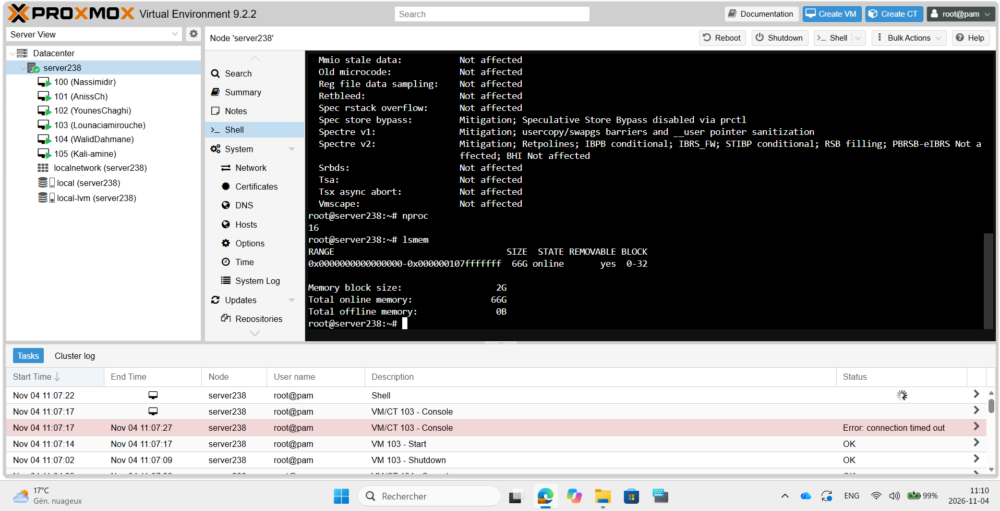

*Figure 6 : Vérification de la mémoire RAM détectée par Linux.*

La détection de la mémoire est essentielle pour la virtualisation, car chaque machine virtuelle nécessite une quantité de RAM pour fonctionner correctement.

---

## 6. Vérification des disques

La commande utilisée est :

```bash
lsblk
```

Cette commande permet d'afficher les disques physiques, les partitions et les volumes logiques.

### Résultats observés

| Élément | Taille approximative |
|---|---|
| Disque principal `sda` | 273,4 Go |
| Volume `pve-root` | 78,1 Go |
| Swap | 8 Go |
| Stockage `pve-data` | 166,9 Go |

Le stockage du serveur permet d'héberger le système Proxmox ainsi que les disques virtuels des machines virtuelles.

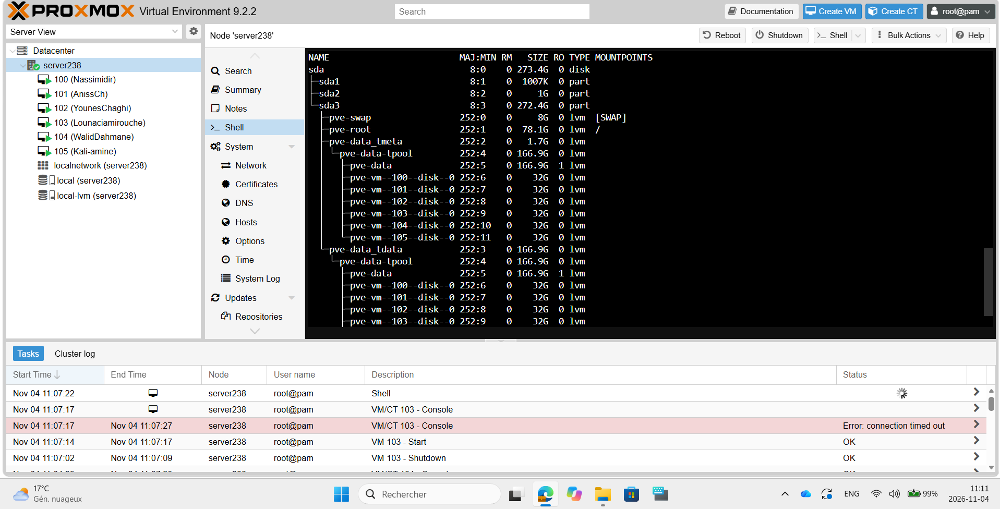

*Figure 7 : Affichage des disques et des partitions du serveur avec lsblk.*

---

## 7. Vérification des périphériques PCI

La commande utilisée est :

```bash
lspci
```

Cette commande affiche les périphériques connectés au bus PCI du serveur.

Elle permet notamment d'identifier les contrôleurs réseau, les contrôleurs de stockage et les composants de la plateforme Intel Xeon.

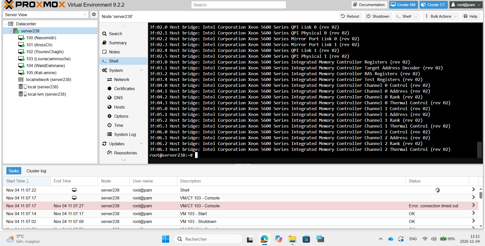

*Figure 8 : Vérification des périphériques PCI reconnus par Linux.*

Cette vérification permet de confirmer que le noyau Linux détecte les composants matériels du serveur.

---

## 8. Vérification des modules Linux

La commande utilisée est :

```bash
lsmod
```

Cette commande affiche les modules actuellement chargés dans le noyau Linux.

Les modules permettent au système d'exploitation de prendre en charge différentes fonctionnalités matérielles et logicielles.

Parmi les modules observés figurent notamment :

- `tcp_diag` : diagnostic des connexions TCP.
- `veth` : gestion des interfaces réseau virtuelles.
- `ip_tables` : prise en charge des tables de filtrage réseau.
- `bonding` : regroupement d'interfaces réseau.

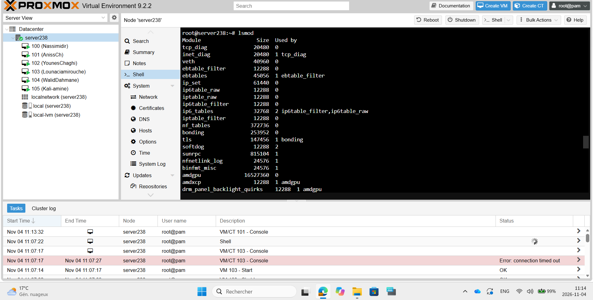

*Figure 9 : Affichage des modules du noyau Linux avec lsmod.*

---

## 9. Vérification de la configuration réseau

La commande utilisée est :

```bash
ip a
```

Cette commande permet d'afficher les interfaces réseau, leurs adresses IP et leur état.

### Configuration observée

| Paramètre | Valeur |
|---|---|
| Nom du serveur | server238 |
| Interface virtuelle | vmbr0 |
| Adresse IPv4 observée | 10.7.236.235/23 |
| Réseau du laboratoire | 10.7.236.0/23 |
| Passerelle prévue | 10.7.237.1 |
| DNS prévu | 8.8.8.8 |

L'interface `vmbr0` est un pont réseau Linux utilisé par Proxmox pour permettre la communication entre les machines virtuelles et le réseau physique.

L'adresse IP observée diffère de l'adresse `10.7.236.238` indiquée pour ce serveur dans les consignes du laboratoire. Cette différence devra être vérifiée.

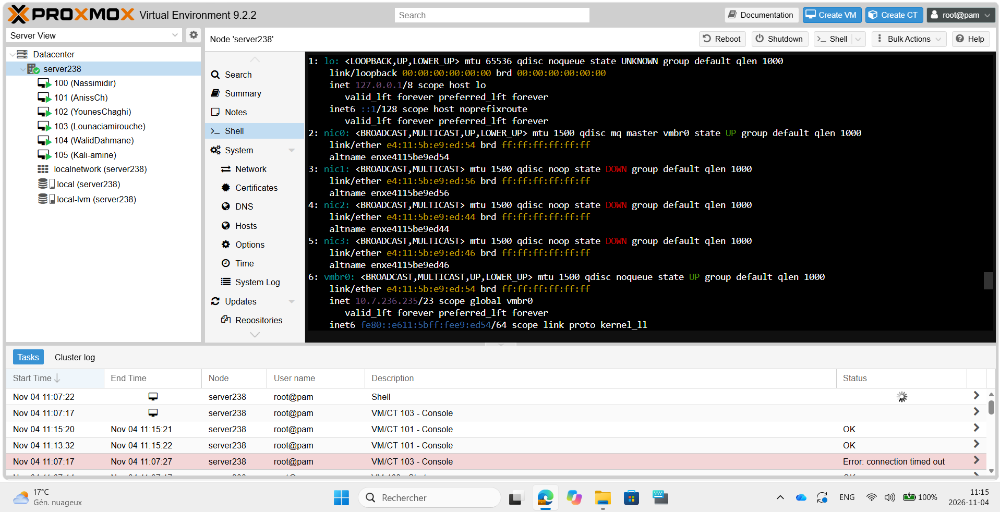

*Figure 10 : Vérification des interfaces réseau et de l'adresse IP avec ip a.*

---

## 10. Vérification des interruptions matérielles

La commande utilisée est :

```bash
cat /proc/interrupts
```

Cette commande affiche les interruptions matérielles prises en charge par les processeurs.

Les interruptions permettent aux périphériques de signaler au processeur qu'un événement nécessite son attention.

### ACPI et APIC

**ACPI (Advanced Configuration and Power Interface)** permet au système d'exploitation de gérer l'énergie et d'obtenir des informations sur la configuration matérielle.

**APIC (Advanced Programmable Interrupt Controller)** permet de gérer et de distribuer les interruptions entre les processeurs.

Le paramètre `nolapic` peut empêcher le fonctionnement normal du multiprocessing et limiter Linux à un seul processeur logique.

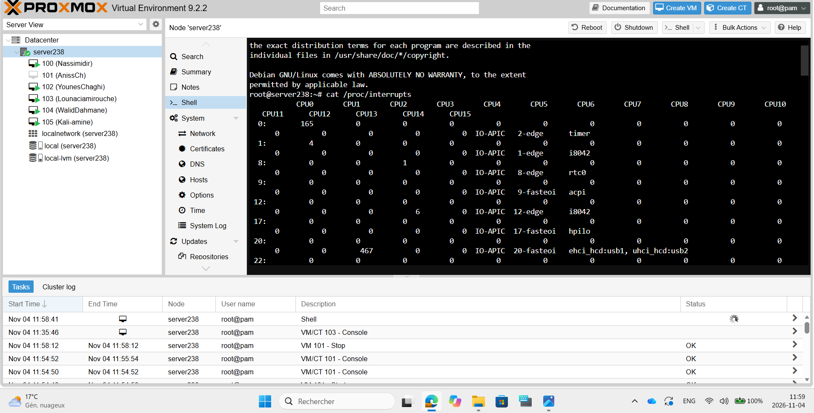

*Figure 11 : Vérification des interruptions matérielles avec cat /proc/interrupts.*

---

## 11. Bilan du laboratoire

Les vérifications effectuées sur le serveur `server238` ont permis de constater que :

- Le système Proxmox est accessible.
- Les deux processeurs Intel Xeon E5620 sont détectés.
- Les 16 processeurs logiques sont disponibles.
- La mémoire RAM est reconnue par Linux.
- Les disques et les volumes logiques sont visibles.
- Les périphériques PCI sont détectés.
- Les modules Linux nécessaires au fonctionnement du système sont chargés.
- Les interfaces réseau sont présentes.
- Les informations sur les interruptions matérielles sont accessibles.

Ces vérifications confirment que les principales ressources matérielles du serveur sont reconnues par le système Linux.

---

## 12. Conclusion

Ce laboratoire m'a permis de mieux comprendre l'installation et l'administration de Proxmox VE 9 sur un serveur physique HP ProLiant DL360 G7.

J'ai appris à utiliser les commandes Linux pour vérifier les processeurs, la mémoire, les disques, les périphériques PCI, les modules du noyau et la configuration réseau.

J'ai également compris l'importance des paramètres de démarrage et le rôle d'ACPI et d'APIC dans le fonctionnement du matériel.

Cette activité m'a permis de développer mes compétences en administration Linux, en diagnostic matériel et en virtualisation, qui seront utiles dans les prochains laboratoires du cours INF1085.
