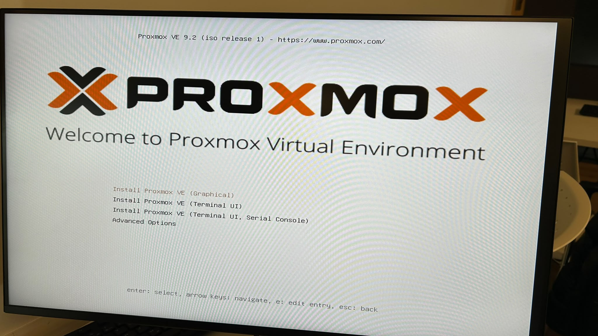
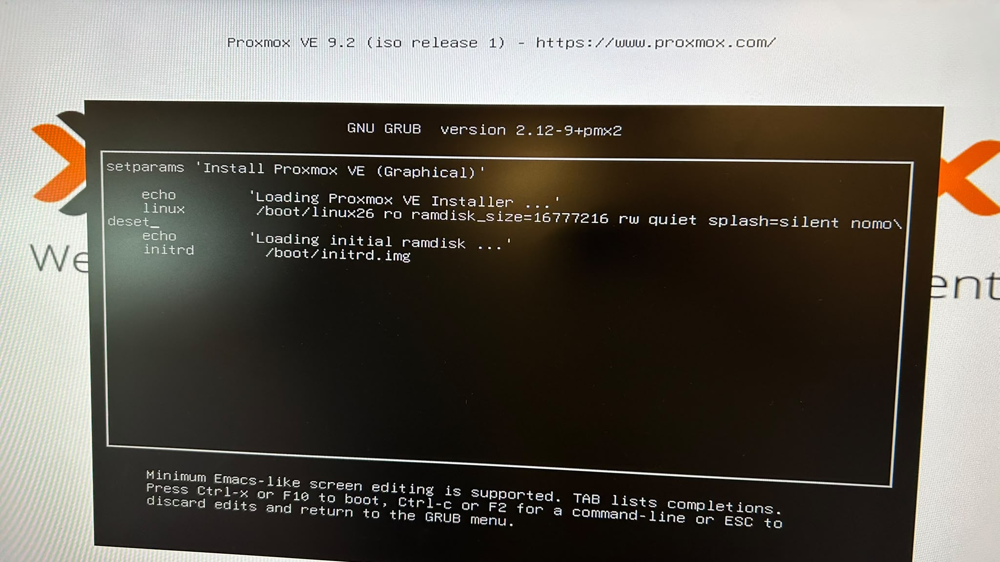
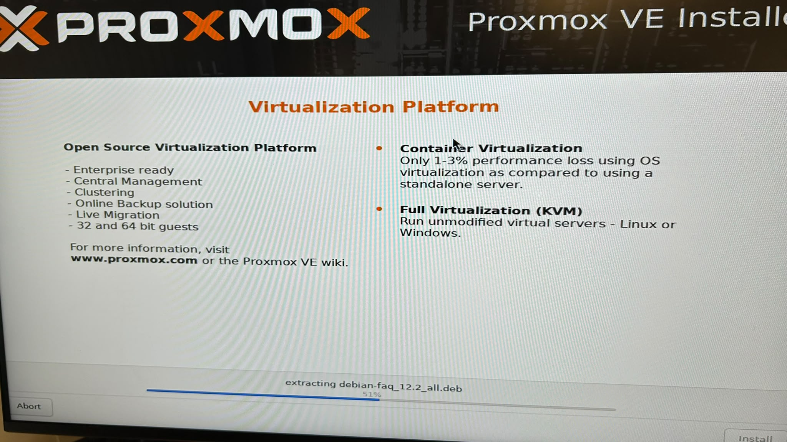
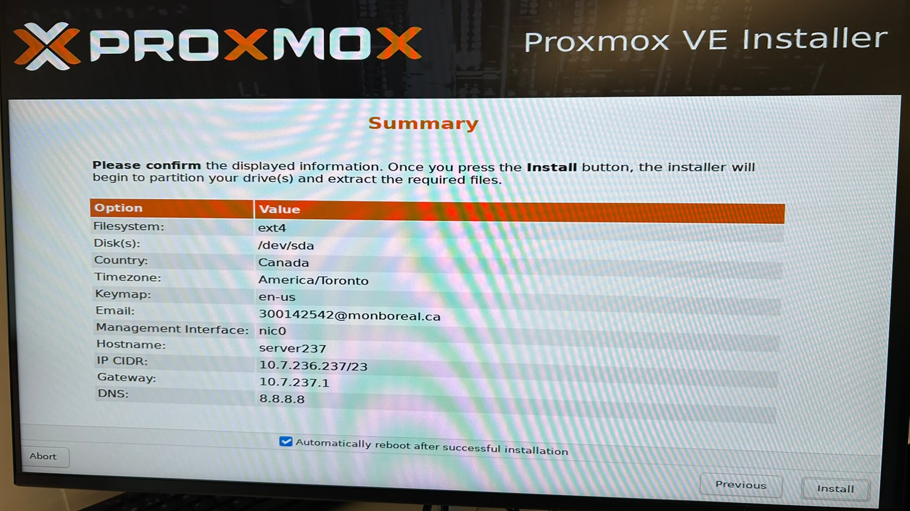
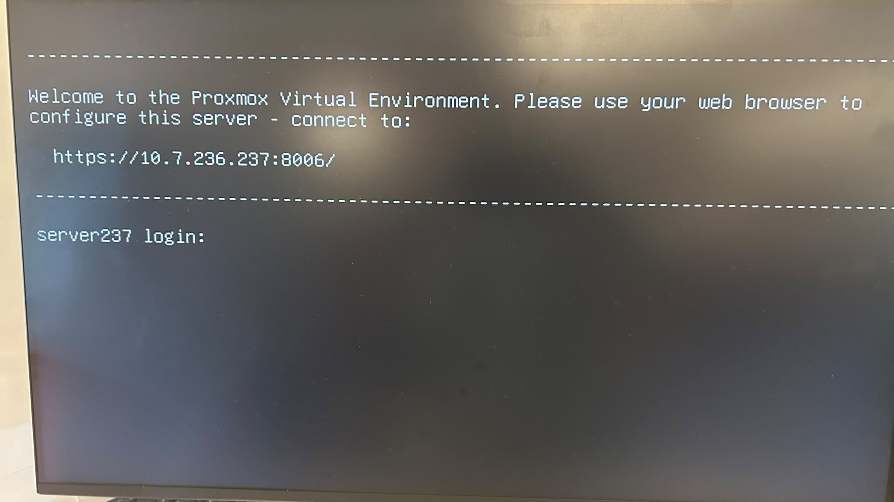

# INF1085 – Administration Linux

## Rapport de mise en place et d'installation de Proxmox VE — Serveur HP ProLiant DL360 G7 (server237)

**Par :** Amirouche Lounaci

## 1. Présentation

Ce laboratoire avait pour but de transformer un serveur physique en plateforme de virtualisation, en y installant Proxmox VE. Le serveur utilisé est un HP ProLiant DL360 G7, nommé server237.

Les grandes étapes suivies ont été : le démarrage sur la clé USB d'installation, l'ajustement du démarrage, la création du compte administrateur, la configuration du réseau, le choix du disque, l'installation, puis la validation de la connexion réseau.

## 2. Démarrage de l'installation

Le serveur a été démarré à partir d'une clé USB contenant l'image ISO de Proxmox VE 9.2. Le menu d'accueil de l'installateur propose plusieurs choix, dont l'installation graphique.

Avant de lancer l'installation, la ligne de démarrage a été modifiée dans GRUB : le paramètre `nomodeset` a été ajouté. Ce réglage est nécessaire pour que l'installateur démarre correctement sur ce modèle de serveur. Le démarrage a ensuite été lancé avec Ctrl+X.

La licence d'utilisation (EULA) a ensuite été acceptée pour passer à la configuration.

## 3. Création du mot de passe administrateur

L'installateur demande ensuite de définir le mot de passe du compte administrateur root, ainsi qu'une adresse courriel. Le mot de passe doit compter au moins 8 caractères et mélanger lettres, chiffres et symboles. L'adresse courriel sert à recevoir les notifications importantes du serveur, comme les échecs de sauvegarde.

## 4. Configuration du réseau

L'étape suivante est la configuration du réseau de gestion du serveur. Les paramètres saisis ont été :

- Interface de gestion : nic0 (bnx2)
- Nom d'hôte : server237.labinfo.local
- Adresse IP : 10.7.236.237/23
- Passerelle : 10.7.237.1
- Serveur DNS : 8.8.8.8

## 5. Installation de Proxmox VE

Le disque choisi comme cible de l'installation est /dev/sda, un volume logique de 273,40 Gio. Pendant cette étape, l'installateur a détecté un ancien groupe de volumes `pve` sur le disque NVMe et l'a renommé `pve-OLD-810787F6` pour ne pas l'écraser.

L'installation a ensuite créé les partitions et les volumes logiques, puis extrait les paquets du système.

Avant de lancer l'installation définitive, l'écran de résumé permet de vérifier tous les choix : système de fichiers ext4, disque /dev/sda, pays Canada, fuseau horaire America/Toronto, clavier en-us, interface nic0, nom d'hôte server237 et paramètres réseau. L'option de redémarrage automatique après l'installation a été laissée activée.

Les principales étapes de l'installation ont donc été :

- démarrage de l'installateur
- acceptation de la licence
- création du mot de passe administrateur
- configuration du réseau
- sélection du disque
- installation de Proxmox VE
- redémarrage du serveur

## 6. Connexion au serveur

Une fois l'installation terminée, le serveur a redémarré. La console affiche alors le message de bienvenue de Proxmox VE avec l'adresse de l'interface web à utiliser depuis un navigateur.

L'interface web est accessible à l'adresse : https://10.7.236.237:8006/

Cette interface permet d'administrer le serveur à distance : créer des machines virtuelles, surveiller les ressources et gérer le stockage.

## 7. Résultat

La validation du réseau a été faite avec la commande ping. Le test vers la passerelle (10.7.237.1) a donné 12 paquets transmis et 12 reçus, sans aucune perte. Le test vers Internet (8.8.8.8) a donné 4 paquets transmis et 4 reçus, sans aucune perte non plus.

| Élément | Résultat |
|---|---|
| Serveur | HP ProLiant DL360 G7 (server237) |
| Système installé | Proxmox VE 9.2 |
| Disque d'installation | /dev/sda (273,40 Gio) |
| Système de fichiers | ext4 |
| Nom d'hôte | server237.labinfo.local |
| Adresse IP | 10.7.236.237/23 |
| Passerelle | 10.7.237.1 |
| Serveur DNS | 8.8.8.8 |
| Interface web | https://10.7.236.237:8006/ |
| Validation réseau | Passerelle et Internet joignables, 0 % de perte |

## 8. Conclusion

Ce laboratoire a permis d'apprendre les principales étapes de la mise en place d'un serveur de virtualisation : démarrer sur la clé USB, ajuster le démarrage, créer le compte administrateur, configurer le réseau, installer le système, puis valider le résultat. L'installation de Proxmox VE s'est terminée correctement. Le serveur est maintenant fonctionnel, accessible sur le réseau, et prêt à accueillir des machines virtuelles.

