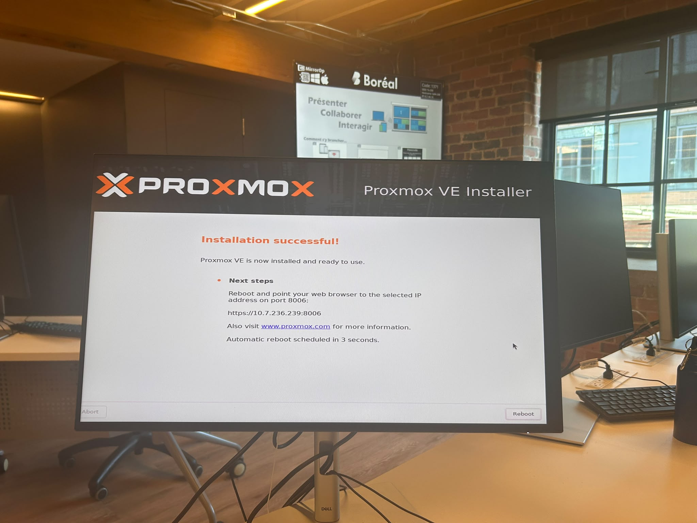
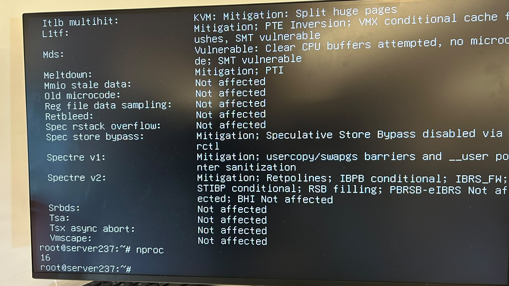

# Installation de Proxmox VE 9

Le laboratoire utilise un HP ProLiant DL360 G7. Préparer une clé USB à partir de l’ISO, démarrer sur la clé depuis le menu F11 et lancer l’installation sur le disque attribué. Configurer le nom d’hôte, le réseau et le compte selon les paramètres du groupe. Si l’installateur affiche un écran noir, tester `nomodeset` sur la ligne du noyau au démarrage.

## Vérifications après redémarrage

```bash
pveversion
cat /proc/cmdline
lscpu
nproc
lsblk
ip -br address
```

## Questions de réflexion

1. `nomodeset` désactive la configuration graphique avancée du noyau au démarrage pour permettre l’utilisation d’un mode vidéo simple.
2. Un BIOS ancien peut exposer des tables ACPI incompatibles ou incomplètes. `acpi=off` peut aider à isoler ce problème, avec des effets possibles sur la gestion de l’énergie et la détection de matériel.
3. ACPI décrit le matériel et les fonctions d’énergie. APIC gère la distribution des interruptions aux processeurs.
4. `nolapic` désactive le contrôleur local des interruptions. Selon la plateforme, cela peut empêcher l’activation de plusieurs processeurs logiques.
5. `cat /proc/cmdline` affiche les paramètres réellement utilisés par le noyau.


## Bilan après redémarrage

Le rapport source documente l’installation de Proxmox VE 9.2 et 16 processeurs logiques détectés par `nproc`. Le rapport indique également que le paramètre `nomodeset` était actif au démarrage.





[README source](https://github.com/CollegeBoreal/INF1085-201-26A-04/tree/main/2.Proxmox/300153932)
