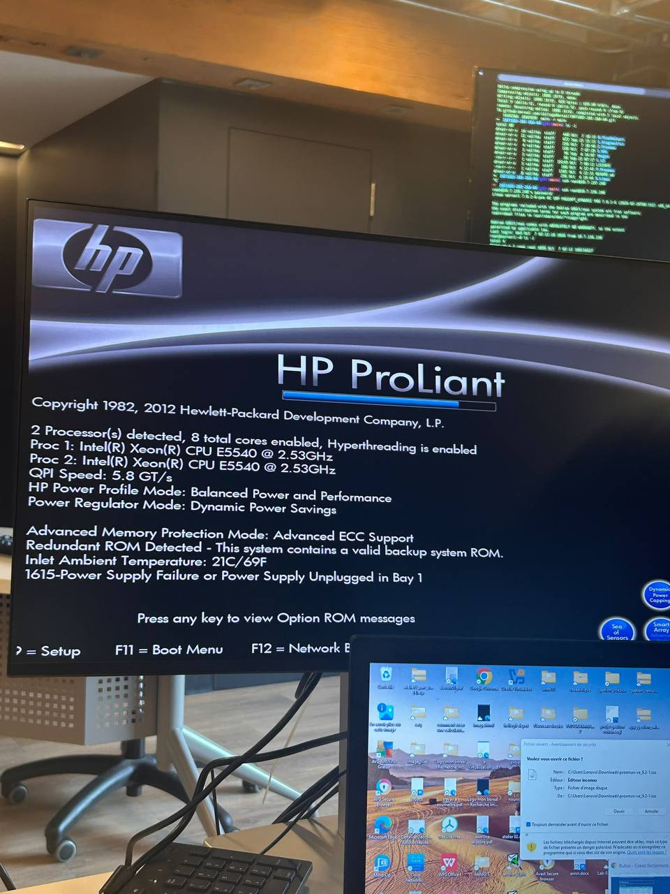
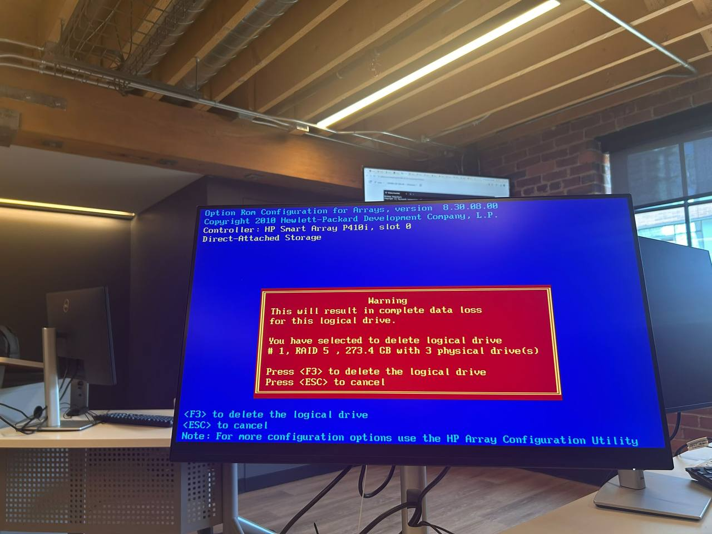
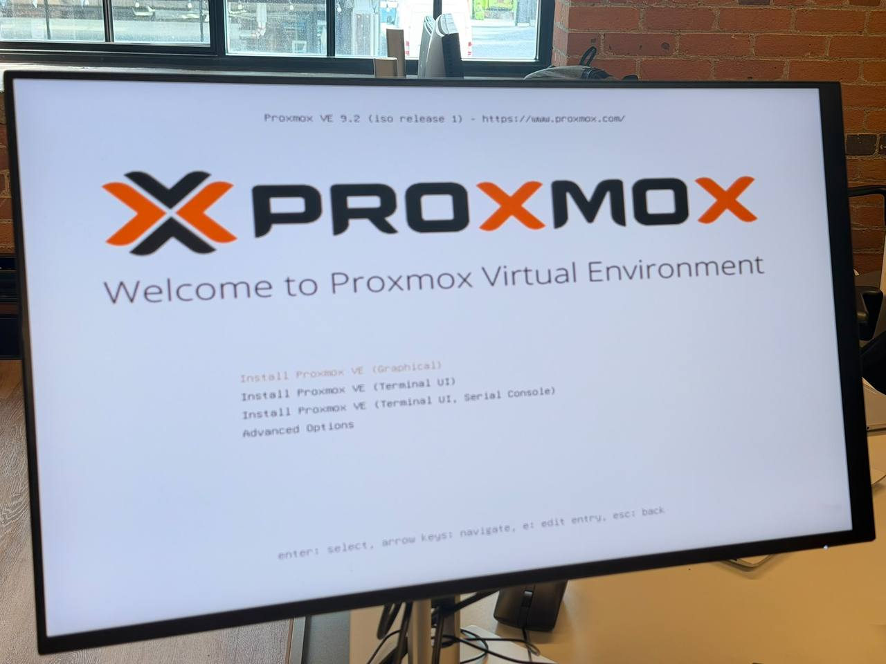
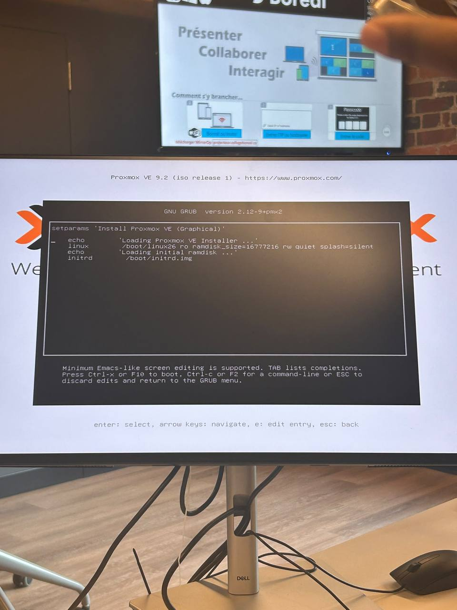
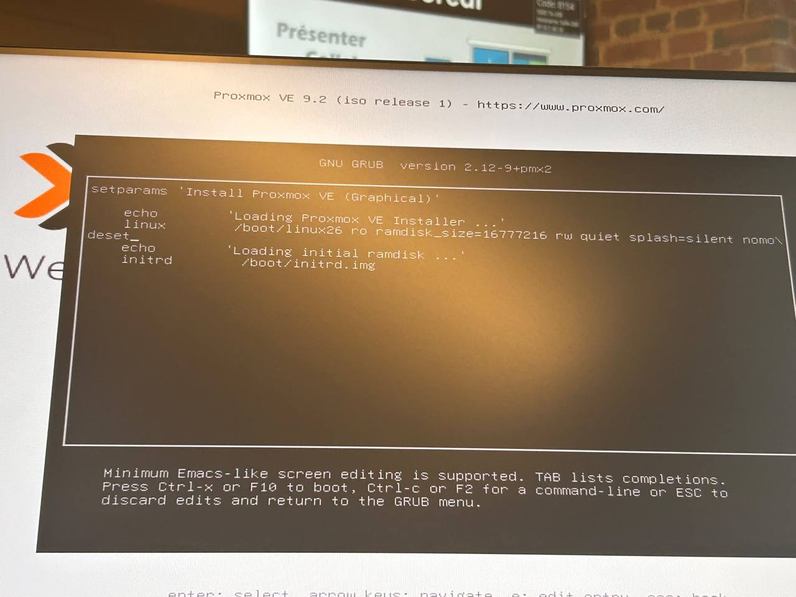
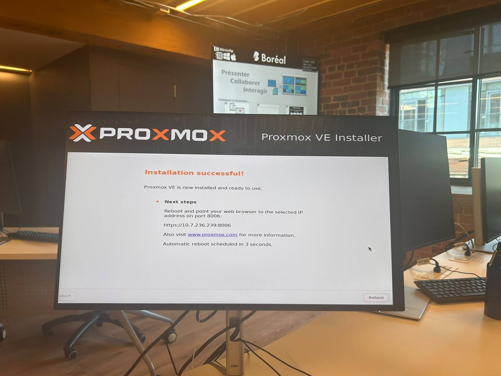

# Atelier pratique : Installation de Proxmox VE sur un serveur physique

| Champ | Information |
| --- | --- |
| Étudiant | Karim Bamba |
| Matricule | 300153972 |
| Programme | Techniques des systèmes informatiques – Collège Boréal |
| Cours | INF1085 – Administration Linux |

---

## 1. Présentation de l'atelier

Dans le cadre du cours INF1085 – Administration Linux, j'ai installé **Proxmox VE 9.2** sur le serveur physique HP ProLiant DL360 G7 préparé lors de l'atelier précédent (RAID 5).

L'objectif était de préparer une clé USB d'installation, de démarrer le serveur à partir de cette clé, puis d'installer Proxmox VE sur le volume RAID.

## 2. Matériel utilisé

- Un serveur physique HP ProLiant DL360 G7 (2 × Xeon E5540, volume RAID 5)
- Un écran, un clavier et une souris
- Une clé USB
- Un ordinateur Windows
- Le fichier ISO de Proxmox VE 9.2 (`proxmox-ve_9.2-1.iso`)
- Le logiciel Rufus pour créer la clé USB bootable

## 3. Préparation de la clé USB

J'ai téléchargé le fichier ISO de Proxmox VE, puis j'ai utilisé **Rufus** pour créer une clé USB bootable.

Cette étape rend la clé utilisable pour démarrer le serveur et lancer l'installateur.

## 4. Démarrage du serveur

J'ai branché la clé USB au serveur et j'ai allumé la machine. Pendant le POST, le serveur affiche :

- **2 Processor(s) detected, 8 total cores enabled**, Hyperthreading activé ;
- Proc 1 et Proc 2 : Intel Xeon E5540 @ 2.53 GHz ;
- **Advanced ECC Support** pour la mémoire ;
- le message **1615 – Power Supply Failure or Power Supply Unplugged in Bay 1** : un des deux blocs d'alimentation n'était pas branché. Le serveur démarre quand même grâce à l'alimentation redondante de la baie 2.



J'ai dû essayer plusieurs options de démarrage avant de trouver la bonne méthode :

- **F8** : premier essai pour accéder aux options de démarrage.
- **F12** : démarrage réseau (PXE), ce qui n'était pas ce que je cherchais.
- **F11** : menu de démarrage (*Boot Menu*).
- J'ai sélectionné **« One Time Boot to USB DriveKey »** pour démarrer une seule fois sur la clé USB.

## 5. Vérification du volume RAID

Avant l'installation, j'ai ouvert l'utilitaire du contrôleur **HP Smart Array P410i**. Le volume logique #1 (RAID 5, 273,4 Go, 3 disques) de l'atelier précédent était présent. L'écran d'avertissement rappelle que la suppression d'un volume efface toutes ses données.



## 6. Menu d'installation de Proxmox

Le menu de démarrage de **Proxmox VE 9.2 (iso release 1)** est apparu. J'ai choisi **« Install Proxmox VE (Graphical) »**.



Avec la touche **e**, on peut modifier l'entrée GRUB avant le démarrage, par exemple pour ajouter une option à la ligne `linux` (comme `nomodeset` quand l'affichage graphique pose problème). On démarre ensuite avec **Ctrl-x** ou **F10**.





## 7. Installation

L'installateur graphique demande d'abord d'accepter la licence (EULA). Proxmox VE est distribué sous licence libre **GNU AGPL v3**.


J'ai ensuite choisi le disque cible, le pays, le fuseau horaire, le mot de passe `root` et la configuration réseau du serveur.

L'installation s'est terminée avec le message **« Installation successful! »**. Le serveur redémarre automatiquement, et l'interface web est accessible à l'adresse **https://10.7.236.239:8006**.



## 8. Vérification après l'installation

Je me suis connecté au serveur en SSH (`ssh root@10.7.236.239`) et j'ai lancé les commandes de vérification demandées. Le serveur tourne avec **pve-manager 9.2.2** et le noyau **7.0.2-6-pve**.

### Paramètres de démarrage

```bash
cat /proc/cmdline
```

```text
BOOT_IMAGE=/boot/vmlinuz-7.0.2-6-pve root=/dev/mapper/pve-root ro nomodeset quiet
```

Le paramètre `nomodeset` est bien présent. Je n'ai pas eu besoin de `acpi=off` : le serveur démarre correctement sans ce paramètre, et c'est mieux comme ça, parce que sans ACPI Linux ne voit souvent qu'un seul processeur.

### Processeurs

```bash
lscpu
nproc
```

```text
Model name:            Intel(R) Xeon(R) CPU           E5540  @ 2.53GHz
CPU(s):                16
Thread(s) per core:    2
Core(s) per socket:    4
Socket(s):             2
Virtualization:        VT-x
L3 cache:              16 MiB (2 instances)
NUMA node(s):          2
```

`nproc` affiche **16**. Les deux processeurs sont détectés : 2 sockets × 4 cœurs × 2 threads (Hyperthreading) = 16 CPU. La virtualisation **VT-x** est disponible, ce qui est nécessaire pour faire tourner des VM avec KVM.

### Mémoire

```bash
lsmem
free -h
```

```text
Total online memory:   66G
Mem:  total 62Gi   used 8.1Gi   available 54Gi
Swap: 8.0Gi
```

`lsmem` compte 66G (en blocs de 2G) et `free` affiche 62 Gi utilisables. Ça correspond aux 64 Go de RAM du serveur.

### Disques

```bash
lsblk
```

```text
sda        273.4G  disk   (volume RAID 5 du Smart Array)
├─sda2       1G    part
└─sda3     272.4G  part
  ├─pve-swap   8G    lvm  [SWAP]
  ├─pve-root  78.1G  lvm  /
  └─pve-data 166.9G  lvm  (stockage des VM)
nvme0n1    953.9G  disk   (SSD NVMe, groupe LVM nvme-vg)
```

Le système est installé sur le volume RAID 5 (`sda`). Proxmox a créé un groupe LVM `pve` avec la racine, le swap et un espace `data` pour les disques des VM. Le disque NVMe de 953,9 G est aussi visible ; il contient déjà des disques de VM d'autres étudiants.

### Cartes PCI

```bash
lspci
```

Les cartes principales que j'ai trouvées :

```text
01:03.0 VGA compatible controller: AMD/ATI ES1000
02:00.0 System peripheral: Hewlett-Packard Company Integrated Lights-Out (iLO)
03:00.0 Ethernet controller: Broadcom NetXtreme II BCM5709 Gigabit Ethernet (×4 ports)
05:00.0 RAID bus controller: Hewlett-Packard Company Smart Array G6 controllers
06:00.0 Non-Volatile memory controller: SK hynix PC811 NVMe Solid State Drive
```

La carte graphique ATI ES1000 est très ancienne : c'est pour elle qu'on ajoute `nomodeset`. Le contrôleur Smart Array (P410i) gère le RAID 5, et les 4 ports réseau Broadcom sont détectés.

### Modules du noyau

```bash
lsmod
```

La commande liste les modules chargés, par exemple `bonding`, `nf_tables`, `ebtables` et `veth`, qui servent au réseau des VM et au pare-feu de Proxmox.

## 9. Difficultés rencontrées

| Difficulté | Cause | Solution |
| --- | --- | --- |
| Démarrage sur le réseau au lieu de la clé USB | Mauvaise touche (F12 = démarrage réseau PXE) | Utiliser le *Boot Menu* et « One Time Boot to USB DriveKey » |
| Mauvais support de stockage sélectionné au premier essai | Plusieurs supports visibles (clé USB, volume RAID) | Bien vérifier le disque cible avant de continuer : le disque choisi est entièrement effacé |
| Message 1615 au POST | Bloc d'alimentation de la baie 1 débranché | Brancher les deux alimentations pour garder la redondance |

## 10. Ce que j'ai appris

- Créer une clé USB bootable avec Rufus.
- Accéder au menu de démarrage d'un serveur HP et faire la différence entre démarrage USB et réseau (PXE).
- Lire les messages du POST (processeurs, mémoire ECC, alimentation).
- Modifier une entrée GRUB avant le démarrage.
- Vérifier le support de stockage avant d'installer un système.
- Vérifier le matériel détecté par Linux avec `lscpu`, `lsmem`, `lsblk` et `lspci`.

## 11. Conclusion

Proxmox VE 9.2 est installé sur le serveur HP ProLiant DL360 G7, sur le volume RAID 5. Le serveur est administrable par l'interface web à l'adresse `https://10.7.236.239:8006` et par SSH (`ssh root@10.7.236.239`).

La prochaine étape est la création de machines virtuelles (atelier 3.VMs) et la création de comptes administrateurs individuels (atelier 4.Root).
