# Laboratoire : Installation et Configuration de Proxmox VE 9.2 sur HP ProLiant DL360 G7

**Cours :** INF1085 – Administration Linux  
**Établissement :** Collège Boréal  
**Étudiante :** Patricia Nguemedzi  
**Date :** 9 novembre 2026

---

## 📌 1. Description et Objectifs du Projet

Ce laboratoire porte sur le téléchargement, la préparation du support d'installation, l'installation et la configuration de **Proxmox VE 9.2** sur un serveur physique **HP ProLiant DL360 G7**.

L'objectif principal est de déployer une plateforme de virtualisation sur un serveur matériel de génération ancienne (*legacy*), tout en tenant compte des particularités de son architecture matérielle.

Ce travail permet notamment de :

- Préparer une clé USB bootable contenant l'image ISO de Proxmox VE 9.2.
- Démarrer le serveur à partir du support USB.
- Adapter les paramètres de démarrage du noyau Linux à l'aide de `nomodeset`.
- Identifier et corriger une erreur de sélection du disque lors de la première tentative d'installation.
- Installer Proxmox VE sur le volume logique RAID 5 préparé au préalable.
- Configurer les paramètres réseau et administratifs du serveur.
- Vérifier le bon fonctionnement du système et la connectivité réseau.

---

## 💾 2. Téléchargement de l'Image ISO et Préparation de la Clé USB Bootable

Avant de commencer l'installation, nous avons téléchargé l'image ISO officielle de **Proxmox VE 9.2** sur un ordinateur.

Une fois le téléchargement terminé, nous avons utilisé cette image ISO pour créer une clé USB bootable à l'aide de l'outil de préparation approprié (RUFUS).

Cette clé USB constitue le support d'installation qui permet de démarrer le serveur HP ProLiant DL360 G7 et de lancer l'installation de Proxmox VE 9.2.

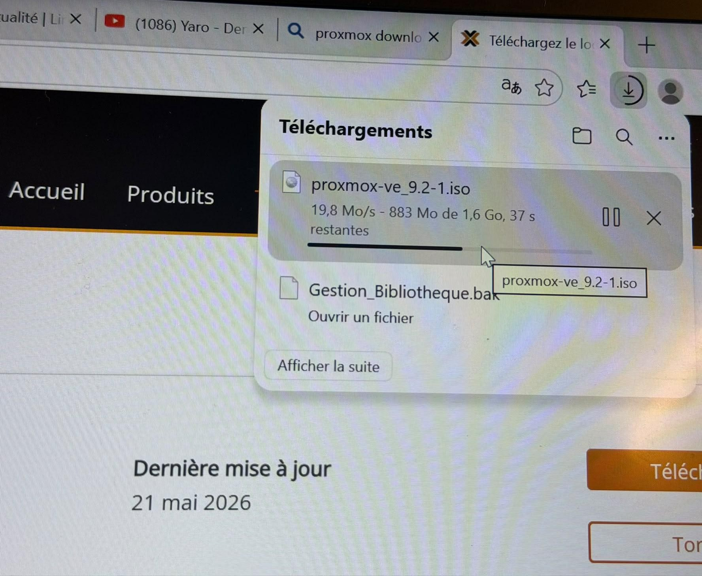

*Figure 1 – Téléchargement de l'image ISO de Proxmox VE 9.2 sur un ordinateur.*

---

## 🛠️ 3. Présentation du Matériel et Configuration RAID 5

### 3.1 – Présentation du serveur physique

Le serveur utilisé pour ce laboratoire est un **HP ProLiant DL360 G7**, un serveur physique de génération ancienne destiné aux environnements professionnels.

Ses principales caractéristiques matérielles sont les suivantes :

- **Modèle :** HP ProLiant DL360 G7
- **Processeurs :** 2 × Intel Xeon E5540 @ 2.53 GHz
- **Cœurs physiques :** 8 au total
- **Processeurs logiques :** 16 avec Hyper-Threading
- **Mémoire RAM :** 64 Go ECC Registered
- **Contrôleur de stockage :** Contrôleur RAID HP
- **Support d'installation :** Clé USB bootable

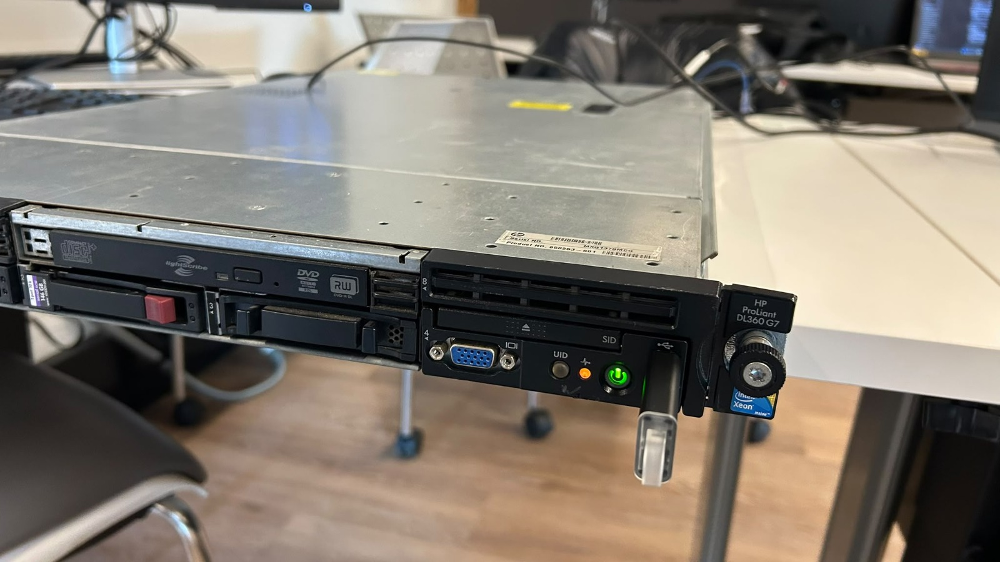

*Figure 2 – Serveur physique HP ProLiant DL360 G7 utilisé pour le laboratoire.*

### 3.2 – Préparation du stockage RAID 5

Avant l'installation de Proxmox VE, nous avons procédé à la configuration du stockage RAID 5 à l'aide du contrôleur RAID du serveur.

Cette configuration permet de regrouper plusieurs disques physiques en un volume logique unique, qui sera ensuite présenté au système d'exploitation comme un périphérique de stockage.

Le volume logique RAID 5 préparé pour accueillir Proxmox VE sera identifié pendant l'installation sous le nom :

- **Périphérique :** `/dev/sda`
- **Capacité :** 273.40 GiB
- **Type :** LOGICAL VOLUME
- **Configuration :** RAID 5

Ce volume logique sera le disque cible à sélectionner lors de l'installation de Proxmox VE.

---

## 🖥️ 4. Démarrage du Serveur et Initialisation du BIOS

### 4.1 – Mise sous tension et initialisation matérielle

Lors de la mise sous tension du serveur, le système effectue le test POST (*Power-On Self-Test*). Cette étape permet au BIOS de vérifier et d'initialiser les composants matériels.

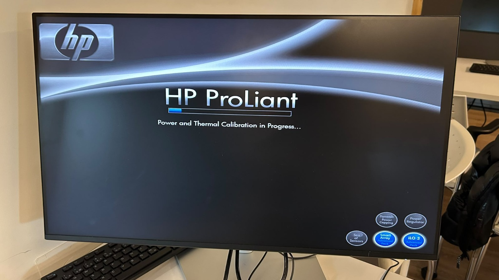

*Figure 3 – Initialisation du serveur HP ProLiant et calibration de l'alimentation et du système thermique.*

### 4.2 – Détection des processeurs et des ressources matérielles

Le BIOS identifie la configuration matérielle suivante :

- **System BIOS :** P68 (05/05/2011)
- **Sockets de processeurs :** 2 × Intel Xeon E5540 @ 2.53 GHz
- **Cœurs physiques activés :** 8 au total
- **Technologie :** Hyper-Threading activé
- **Mode mémoire :** Advanced ECC Support

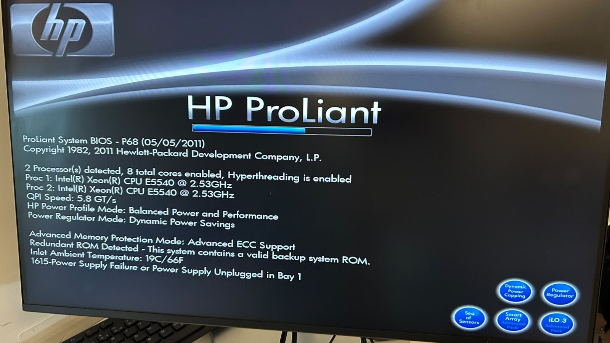

*Figure 4 – Détection des deux processeurs Intel Xeon E5540 au niveau du BIOS.*

---

## 🚀 5. Amorçage de Proxmox VE 9.2 et Modification des Paramètres GRUB

### 5.1 – Sélection de la clé USB d'installation

Au démarrage du serveur, nous avons utilisé la touche **F11** pour accéder au menu d'amorçage (*Default Boot Override Options*).

Dans ce menu, nous avons sélectionné le périphérique USB correspondant à notre clé d'installation.

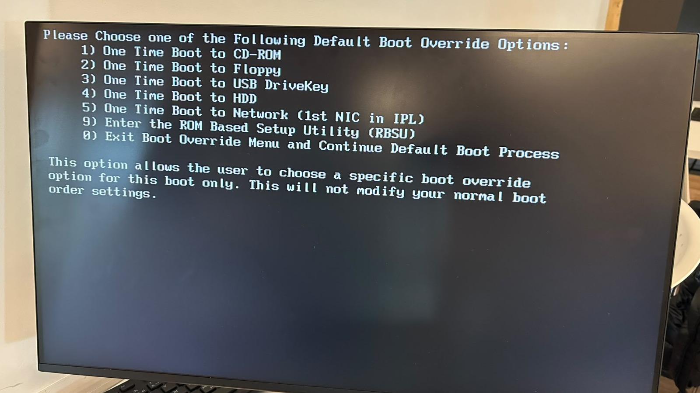

*Figure 5 – Menu de sélection du périphérique de démarrage à l'aide de la touche F11.*

### 5.2 – Accès au menu de démarrage Proxmox VE

Après la sélection de la clé USB, le menu de démarrage de l'installateur Proxmox VE 9.2 apparaît à l'écran.

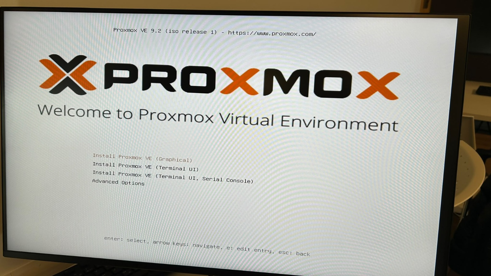

*Figure 6 – Menu de démarrage de l'installateur Proxmox VE 9.2.*

### 5.3 – Modification de la ligne de commande du noyau avec `nomodeset`

Sur l'écran d'accueil de l'installateur Proxmox VE 9.2, nous avons appuyé sur la touche **`e`** afin de modifier les paramètres de démarrage GRUB.

Nous avons ajouté le paramètre **`nomodeset`** à la fin de la ligne commençant par `linux` :

```text
linux /boot/linux26 ro ramdisk_size=16777216 rw quiet splash=silent nomodeset
```

Nous avons ensuite lancé le démarrage avec **Ctrl + X** ou **F10**.

**Explication technique :**

Le serveur HP ProLiant DL360 G7 utilise une puce graphique intégrée ATI ES1000. Certains anciens composants graphiques peuvent présenter des incompatibilités avec les mécanismes modernes d'initialisation graphique du noyau Linux, notamment le KMS (*Kernel Mode Setting*).

Le paramètre `nomodeset` désactive le réglage automatique du mode graphique par le noyau afin de favoriser un démarrage avec un affichage de base.

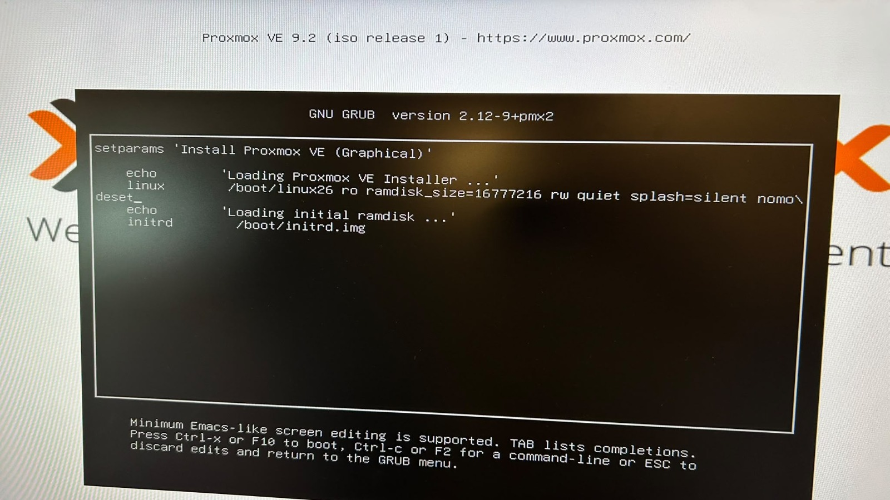

*Figure 7 – Modification de la ligne de commande GRUB avec l'ajout du paramètre `nomodeset`.*

### 5.4 – Séquence de démarrage de l'environnement d'installation

Après la modification des paramètres GRUB, le noyau Linux commence son initialisation et prépare l'environnement d'installation de Proxmox VE 9.2.

Plusieurs opérations sont visibles dans la console :

- Chargement des pilotes matériels du noyau Linux.
- Initialisation des périphériques et des composants du serveur.
- Recherche et détection de l'image ISO de Proxmox VE.
- Préparation de l'environnement d'installation.
- Démarrage des services système, notamment D-Bus.
- Détection des interfaces réseau Ethernet.
- Tentatives d'obtention d'une adresse IP à l'aide du protocole DHCP.

Les messages `DHCPDISCOVER` indiquent que le système tente de découvrir un serveur DHCP afin d'obtenir une configuration réseau automatiquement.

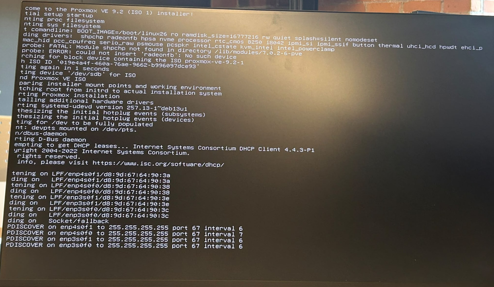

*Figure 8 – Séquence de démarrage de l'environnement d'installation Proxmox VE 9.2, avec initialisation des pilotes matériels et détection des interfaces réseau.*

---

## ⚠️ 6. Première Tentative d'Installation : Sélection Incorrecte du Disque Cible

### 6.1 – Sélection du disque présélectionné par l'installateur

Lors de la première tentative d'installation, nous sommes arrivés à l'étape de sélection du disque de destination.

L'installateur avait automatiquement présélectionné le périphérique suivant :

- **Périphérique :** `/dev/nvme0n1`
- **Capacité :** 953.87 GiB
- **Modèle :** PC811 SK hynix 1024GB

Nous avons poursuivi la procédure sans modifier cette sélection.

Cependant, ce disque ne correspondait pas au volume logique RAID 5 que nous avions préparé pour accueillir Proxmox VE.

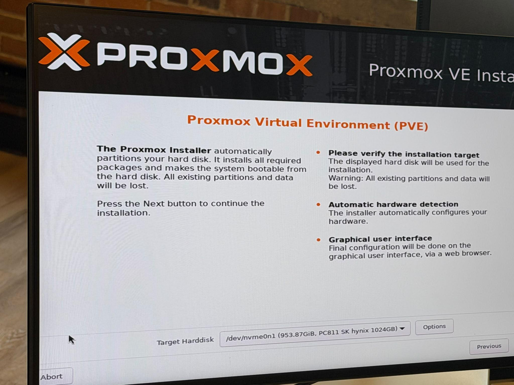

*Figure 9 – Écran de sélection du stockage lors de la première tentative, avec le disque NVMe présélectionné par l'installateur.*

### 6.2 – Échec de la première installation

À la suite de cette première tentative, le processus d'installation s'est interrompu avec le message d'erreur suivant :

```text
Installation failed! Proxmox VE could not be installed.

installation of package libblockfile-bin_1.17-2_amd64.deb failed
```

Cette erreur a marqué l'échec de la première tentative d'installation.

Le problème identifié dans notre procédure était la sélection du disque de destination : nous avions conservé le disque NVMe présélectionné au lieu de choisir le volume logique RAID 5 préparé pour le système.

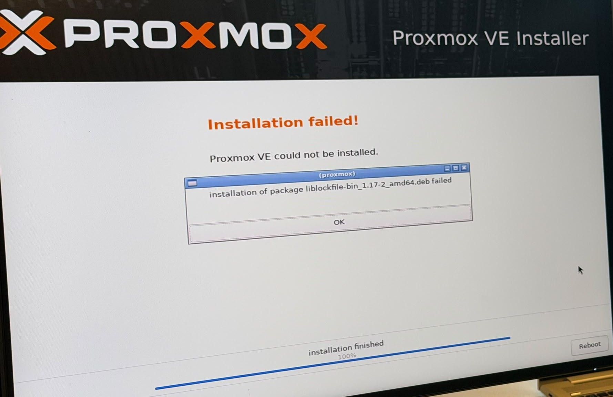

*Figure 10 – Message d'erreur affiché à la suite de l'échec de la première tentative d'installation.*

---

## 🔄 7. Deuxième Tentative : Correction de la Sélection du Disque RAID 5

Après l'échec de la première installation, nous avons repris la procédure depuis le début.

Cette fois, nous avons porté une attention particulière à l'étape de sélection du stockage afin de choisir explicitement le volume logique RAID 5.

### 7.1 – Validation du contrat de licence

Après avoir relancé l'installateur, nous avons accédé à l'écran de validation du contrat de licence utilisateur (*End User License Agreement – EULA*).

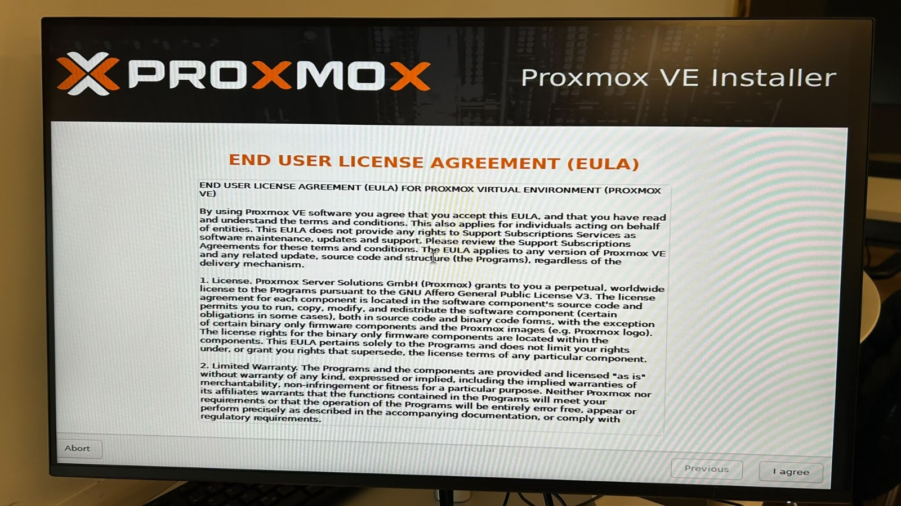

*Figure 11 – Écran de validation du contrat de licence utilisateur de Proxmox VE 9.2.*

### 7.2 – Sélection du volume logique RAID 5

Dans le menu déroulant de sélection du disque, nous avons cette fois choisi le bon périphérique :

- **Périphérique :** `/dev/sda`
- **Capacité :** 273.40 GiB
- **Type :** LOGICAL VOLUME
- **Configuration :** Volume logique RAID 5

Ce périphérique correspond au volume logique créé précédemment à l'aide du contrôleur RAID du serveur.

Il s'agit du disque destiné à recevoir l'installation de Proxmox VE 9.2.

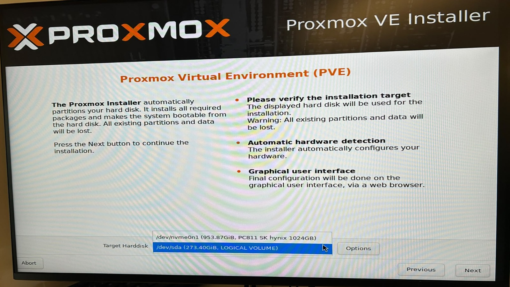

*Figure 12 – Sélection explicite du volume logique RAID 5 `/dev/sda` comme disque de destination.*

---

## ⚙️ 8. Configuration des Paramètres Administratifs et Réseau

Après avoir sélectionné le bon disque, nous avons poursuivi la configuration de l'installateur.

### 8.1 – Configuration des identifiants administratifs

Nous avons renseigné les informations nécessaires à l'administration du serveur, notamment le mot de passe du compte `root` et l'adresse courriel de l'administrateur.

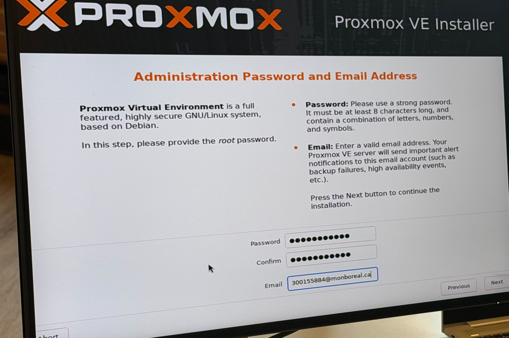

*Figure 13 – Saisie du mot de passe administrateur root et de l'adresse courriel.*

### 8.2 – Configuration réseau

Nous avons ensuite configuré les paramètres réseau du serveur afin de lui attribuer une adresse IP statique et de permettre son administration sur le réseau local.

Les paramètres renseignés sont les suivants :

| Paramètre | Valeur |
|---|---|
| Interface réseau | nic0 (bnx2) |
| Adresse MAC | d8:9d:67:64:90:3c |
| Nom d'hôte (FQDN) | server239.labinfo.local |
| Adresse IP | 10.7.236.239/23 |
| Passerelle | 10.7.237.1 |
| Serveur DNS | 8.8.8.8 |
| Courriel administrateur | 300155884@monboreal.ca |

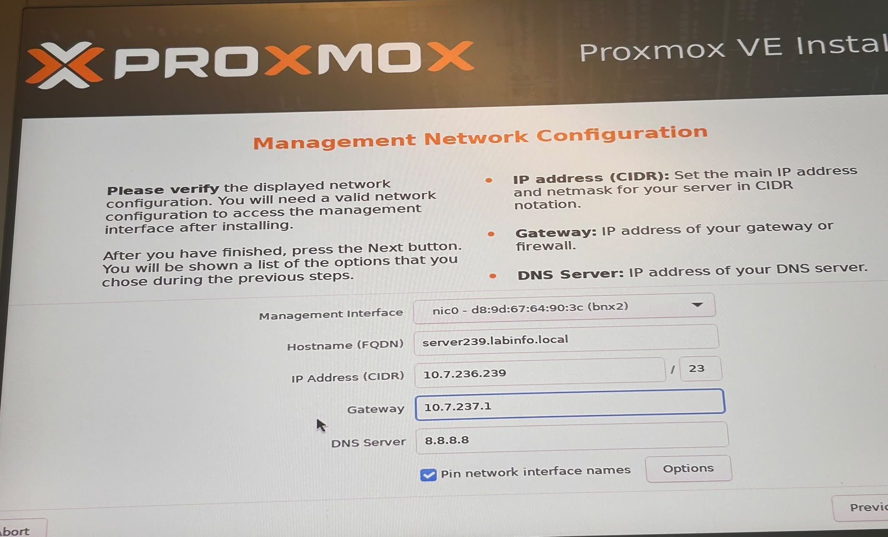

*Figure 14 – Configuration de l'adresse IP statique, de la passerelle, du DNS et du nom d'hôte du serveur.*

### 8.3 – Vérification du résumé de l'installation

Avant de lancer l'installation définitive, nous avons vérifié le résumé des paramètres configurés.

Cette étape permet de confirmer les informations relatives au disque cible, au réseau et aux paramètres administratifs avant leur application.

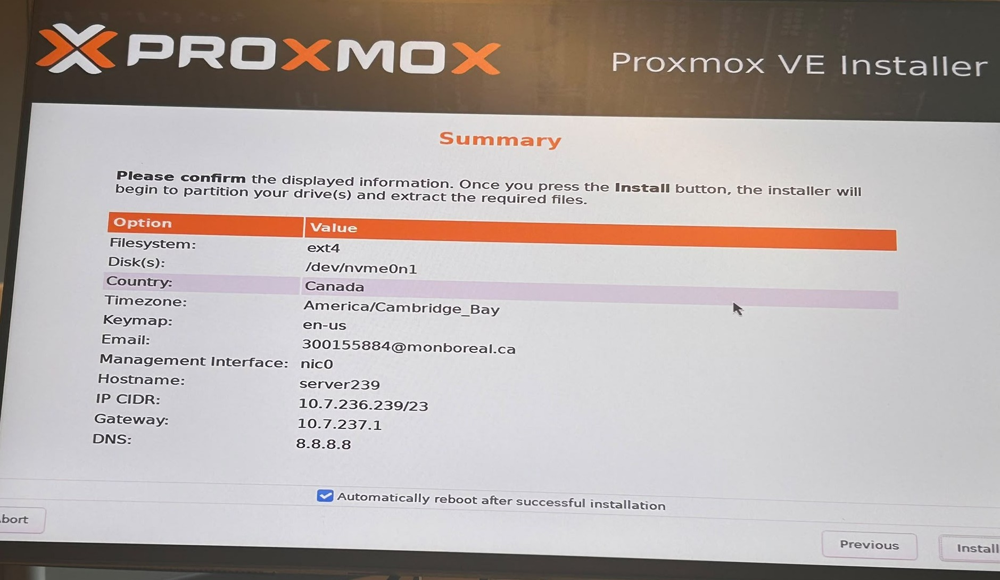

*Figure 15 – Résumé des paramètres de configuration avant le lancement de l'installation.*

---

## ✅ 9. Installation et Déploiement Réussi de Proxmox VE 9.2

Après la validation des paramètres, nous avons lancé l'installation sur le volume logique RAID 5 sélectionné.

Le programme a procédé à l'extraction et à l'installation des différents paquets nécessaires au fonctionnement de la plateforme de virtualisation.

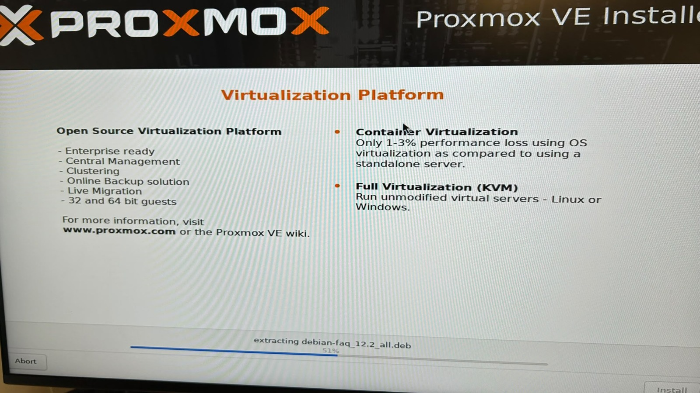

*Figure 16 – Progression de l'installation et de l'extraction des paquets de Proxmox VE 9.2.*

À la fin du processus, l'installateur a affiché le message confirmant la réussite de l'installation.

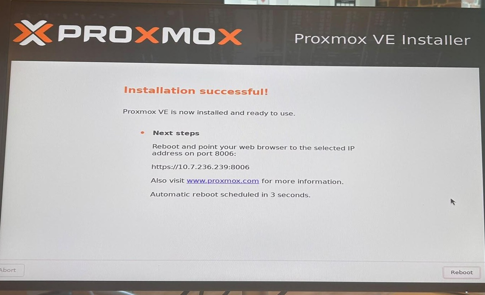

*Figure 17 – Confirmation de la réussite de l'installation de Proxmox VE 9.2 et affichage de l'URL d'accès à l'interface Web.*

---

## 📊 10. Vérifications en Console et Connectivité Réseau

### 10.1 – Connexion au serveur après le redémarrage

Après la fin de l'installation, nous avons redémarré le serveur.

Le système affiche alors l'écran de connexion en console TTY1 ainsi que l'adresse permettant d'accéder à l'interface Web de Proxmox VE.

**URL de gestion :**

https://10.7.236.239:8006/

La connexion au serveur a été effectuée avec le compte administrateur `root`.

Version du noyau observée :

```text
Linux server239 7.0.2-6-pve #1 SMP PREEMPT_DYNAMIC PMX 7.0.2-6 x86_64
```

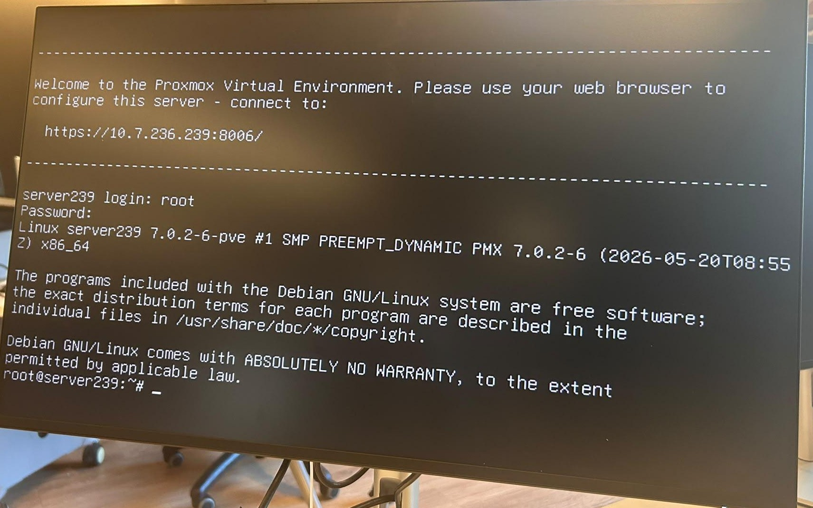

*Figure 18 – Écran de connexion TTY1 après le redémarrage du serveur Proxmox VE 9.2.*

### 10.2 – Test de connectivité réseau (Ping)

Afin de vérifier la communication entre le serveur et la passerelle réseau, nous avons effectué un test de connectivité à l'aide de la commande `ping`.

Commande exécutée :

```bash
root@server239:~# ping 10.7.237.1
```

Résultat obtenu :

```text
PING 10.7.237.1 (10.7.237.1) 56(84) bytes of data.

64 bytes from 10.7.237.1: icmp_seq=1 ttl=255 time=0.386 ms
64 bytes from 10.7.237.1: icmp_seq=2 ttl=255 time=0.235 ms
```

Les réponses reçues confirment que le serveur communique correctement avec sa passerelle réseau.

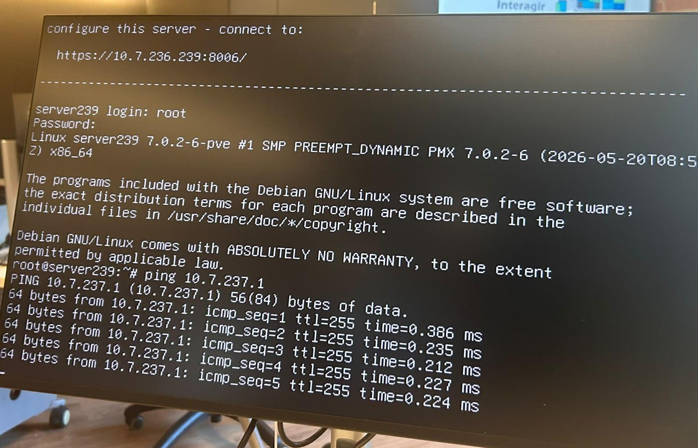

*Figure 19 – Exécution de la commande ping et validation de la connectivité réseau avec la passerelle 10.7.237.1.*

---

## 📝 11. Conclusion

Ce laboratoire nous a permis de réaliser l'installation et la configuration de Proxmox VE 9.2 sur un serveur physique HP ProLiant DL360 G7.

Nous avons notamment appris à préparer un support USB bootable, à démarrer un serveur à partir d'un périphérique externe, à adapter les paramètres de démarrage du noyau Linux et à configurer un environnement de virtualisation.

La première tentative d'installation nous a également permis d'identifier l'importance de vérifier attentivement le disque de destination avant de lancer une installation. En effet, le disque NVMe `/dev/nvme0n1` avait été présélectionné par l'installateur, alors que le volume logique RAID 5 `/dev/sda` était le périphérique prévu pour accueillir le système.

Après avoir corrigé cette sélection, nous avons réussi à installer Proxmox VE 9.2 et à configurer les paramètres réseau du serveur.

Enfin, les vérifications effectuées après le redémarrage, notamment la connexion en console et le test de connectivité avec la commande `ping`, ont permis de confirmer le bon fonctionnement de l'installation et de la communication réseau.

Ce laboratoire nous a ainsi permis de mettre en pratique des notions importantes en administration Linux, en gestion du stockage RAID, en configuration réseau et en déploiement d'une plateforme de virtualisation.
