# Installation et validation de Proxmox VE – HP ProLiant DL360 G7

Ibrahim Hamdan Alhamed · Matricule 300157287 · INF1085 – Administration Linux · Collège Boréal

## 1. Contexte et objectif

Le laboratoire consiste à installer Proxmox VE sur un serveur HP ProLiant ancien, puis à vérifier son démarrage, son stockage et sa communication réseau. Les consignes évoquent des difficultés de compatibilité avec le BIOS et l’affichage. Les captures montrent l’utilisation de nomodeset pour lancer l’installateur ; le symptôme initial exact n’a pas encore été précisé.

Les essais portant le nom server1 sont présentés ensemble. La capture server237 est conservée séparément : l’étudiant pense qu’il s’agit du même serveur reconfiguré, mais ne le confirme pas avec certitude.

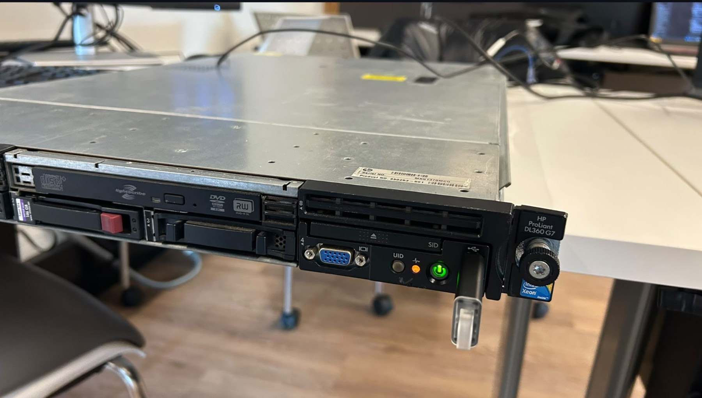

*Figure 1 — Identification du serveur : étiquette HP ProLiant DL360 G7.*

## 2. Contrôle du démarrage matériel

Le BIOS P68, daté à l’écran du 05/05/2011, détecte deux Intel Xeon E5540 à 2,53 GHz, huit cœurs au total et l’Hyperthreading activé. Il affiche également le mode Advanced ECC Support.

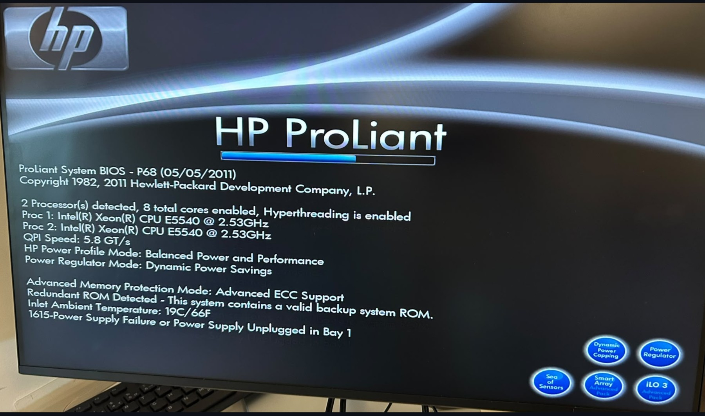

*Figure 2 — POST : deux Xeon E5540 et huit cœurs détectés par le BIOS.*

L’avertissement 1615 concerne cette fois l’alimentation en baie 1 : défaillance ou débranchement. Sa cause n’est pas établie pour ce G7. La cause confirmée pour le précédent laboratoire sur G6 ne peut pas être reprise automatiquement.

## 3. Lancement de l’installation et paramètres de démarrage

Le menu de démarrage ponctuel permet de choisir un support USB, un disque ou un autre périphérique. Le menu Proxmox VE 9.2 apparaît ensuite. La présence de ce menu confirme le chargement du support d’installation.

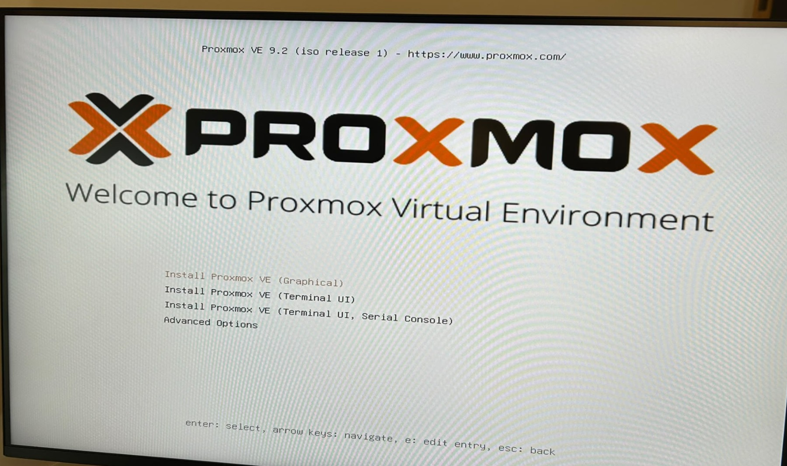

*Figure 3 — Menu d’installation de Proxmox VE 9.2.*

Dans GRUB, la touche e permet de modifier l’entrée sélectionnée. La capture montre nomodeset ajouté à la ligne linux. Ce paramètre évite les changements de mode graphique effectués par les pilotes du noyau [1, 2]. La modification de cette entrée concerne ce démarrage ; elle ne prouve pas un réglage permanent.

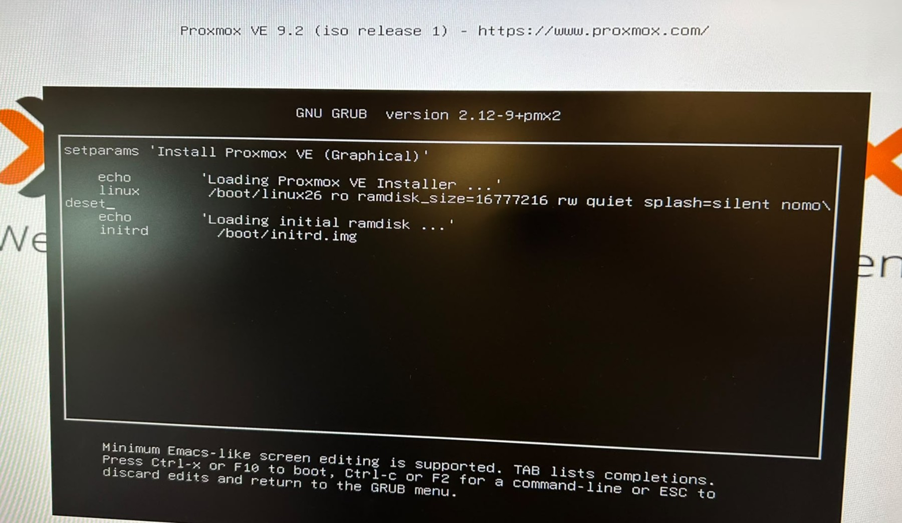

*Figure 4 — Modification de l’entrée GRUB avec nomodeset.*

L’étudiant pense avoir aussi utilisé acpi=off, conformément au contexte du cours. Cette option n’est pas visible sur la capture GRUB retenue. Son utilisation effective et sa persistance restent à vérifier avec cat /proc/cmdline après démarrage. Aucun usage de nolapic n’est établi.

## 4. Installation sur le stockage

L’assistant graphique a été ouvert. L’écran de choix du disque présente /dev/sda, volume logique de 273,40 Gio, ainsi qu’un NVMe de 953,87 Gio. Le relevé lsblk après installation confirme que la racine du système étudié se trouve sur les volumes LVM de sda.

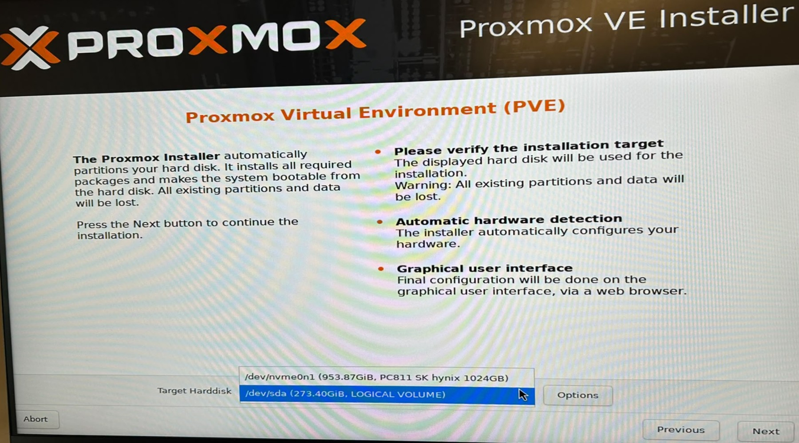

*Figure 5 — Disques proposés par l’installateur ; volume logique /dev/sda de 273,40 Gio.*

Pendant un essai, l’installateur détecte un ancien groupe de volumes nommé pve sur /dev/nvme0n1p3 et propose de le renommer. La capture documente ce conflit de nom ; elle ne montre pas le bouton finalement choisi.

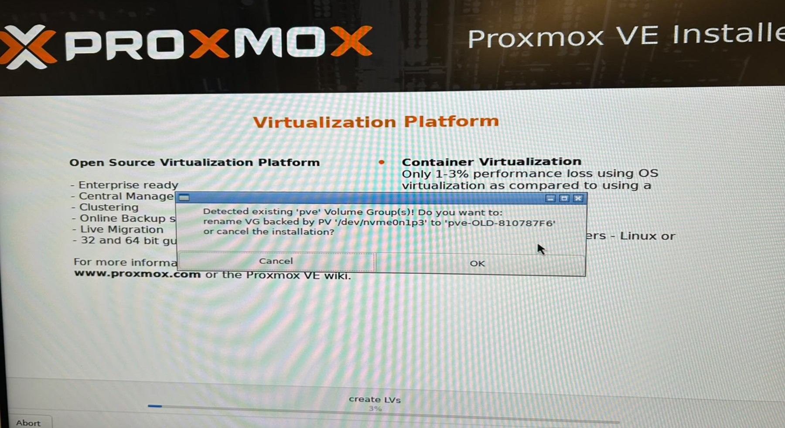

*Figure 6 — Détection d’un groupe LVM pve existant sur le NVMe.*

Le mot de passe root et une adresse de notification ont été renseignés dans l’assistant. Le mot de passe n’est pas reproduit dans le rapport. Une capture de progression montre ensuite l’extraction des paquets à 51 %.

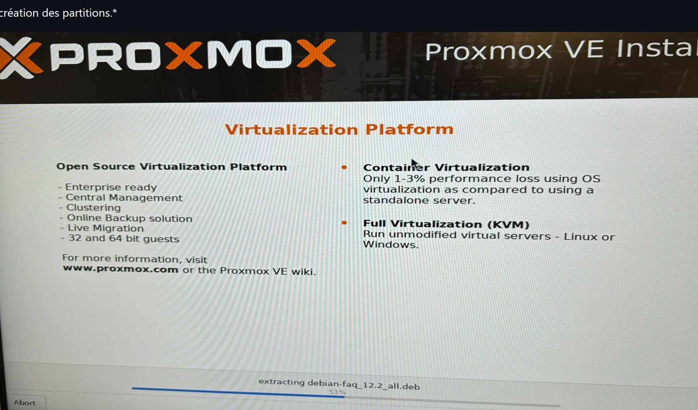

*Figure 7 — Installation en cours : extraction des paquets.*

## 5. Configuration initiale et premier démarrage

| Paramètre | Valeur affichée |
| --- | --- |
| Nom complet | server1.labinfo.local |
| Interface de gestion | nic0, pilote bnx2 |
| Adresse initiale | 192.168.100.2/24 |
| Passerelle initiale | 192.168.100.1 |
| DNS initial | 192.168.100.1 |

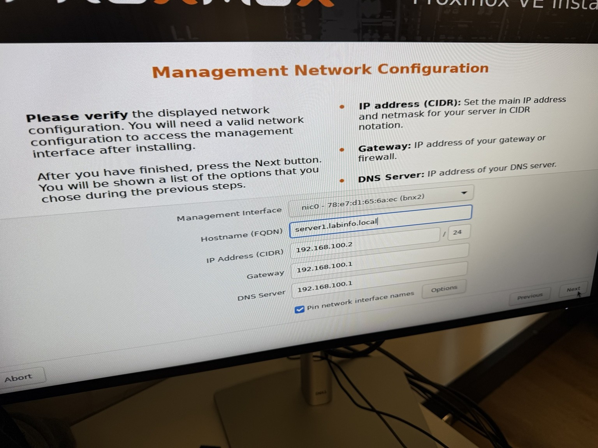

*Figure 8 — Paramètres du réseau de gestion saisis pendant l’installation.*

Après installation, la console affiche l’adresse https://192.168.100.2:8006/ et accepte une connexion root. Le noyau affiché est 7.0.2-6-pve, en architecture x86_64. Cette capture confirme le démarrage du système installé et l’accès local à la console ; elle ne montre pas une connexion réussie au navigateur.

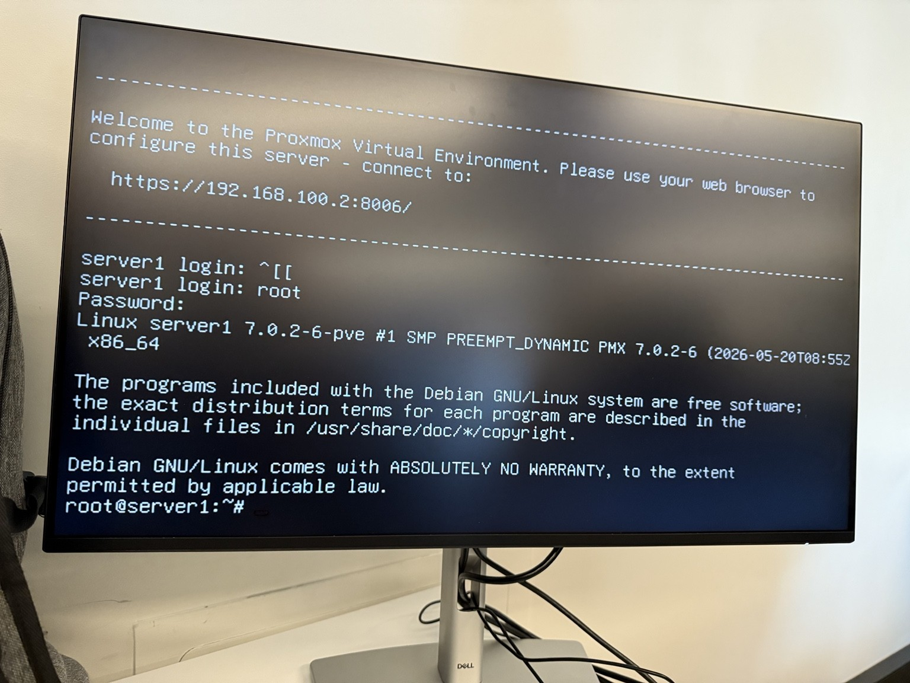

*Figure 9 — Console server1 : connexion root après installation.*

## 6. Vérification des ressources

La commande lscpu | grep CPU affiche CPU(s): 4 et la liste 0-3. Il s’agit de quatre processeurs logiques visibles dans cet essai, et non de quatre sockets. Le BIOS précédent annonçait huit cœurs et l’Hyperthreading activé. L’objectif de retrouver toutes les ressources sous Linux n’est donc pas démontré. Une modification de configuration, les options de démarrage ou des réglages BIOS peuvent être examinés ; aucune cause n’est confirmée.

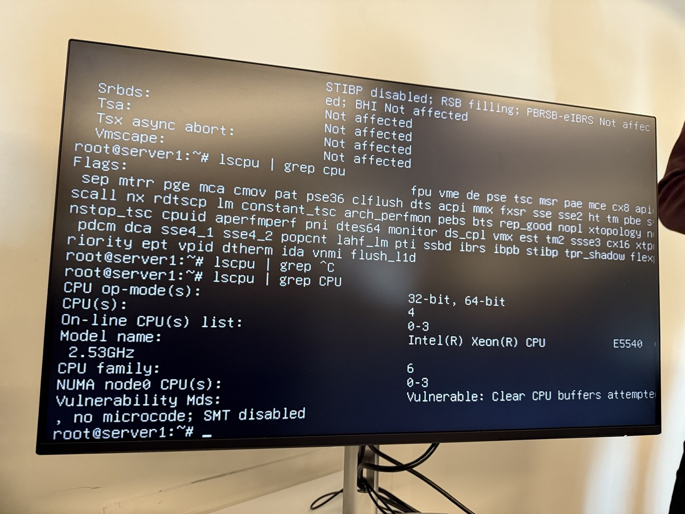

*Figure 10 — Contrôle CPU sous Linux : quatre processeurs logiques en ligne.*

Le relevé mémoire affiche 66G en ligne. Ce nombre décrit la mémoire présentée par cet outil ; il ne remplace pas une mesure de mémoire utilisable avec free -h. Le stockage est vérifié avec lsblk :

| Élément | Valeur affichée |
| --- | --- |
| sda | 273,4G |
| pve-root, monté sur / | 78,1G |
| pve-swap | 8G |
| pve-data, stockage LVM thin | 166,9G |
| sdb, périphérique amovible | 7,5G |

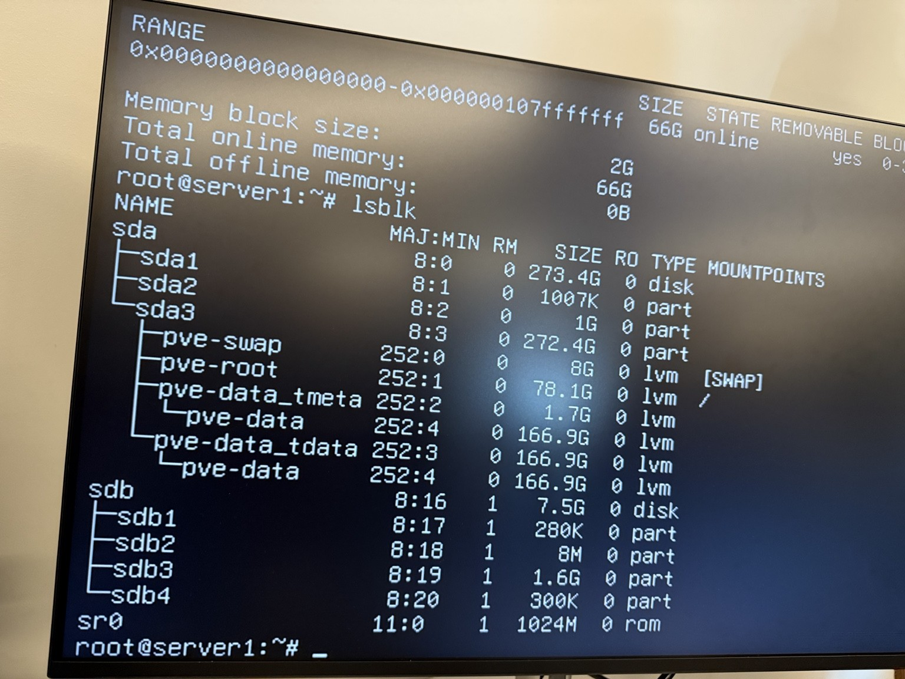

*Figure 11 — Relevé mémoire et arborescence du stockage LVM sur sda.*

## 7. Dépannage réseau et validation

Un relevé ip a montre nic0 rattachée au bridge vmbr0. Les deux portent NO-CARRIER et l’état DOWN : aucun lien physique n’est détecté à cet instant. Le bridge affiche 10.10.237.35/23 sur cette photo, alors que les pings suivants affichent une source 10.7.237.35. Ces valeurs correspondent à des relevés différents ; le changement exact n’est pas documenté.

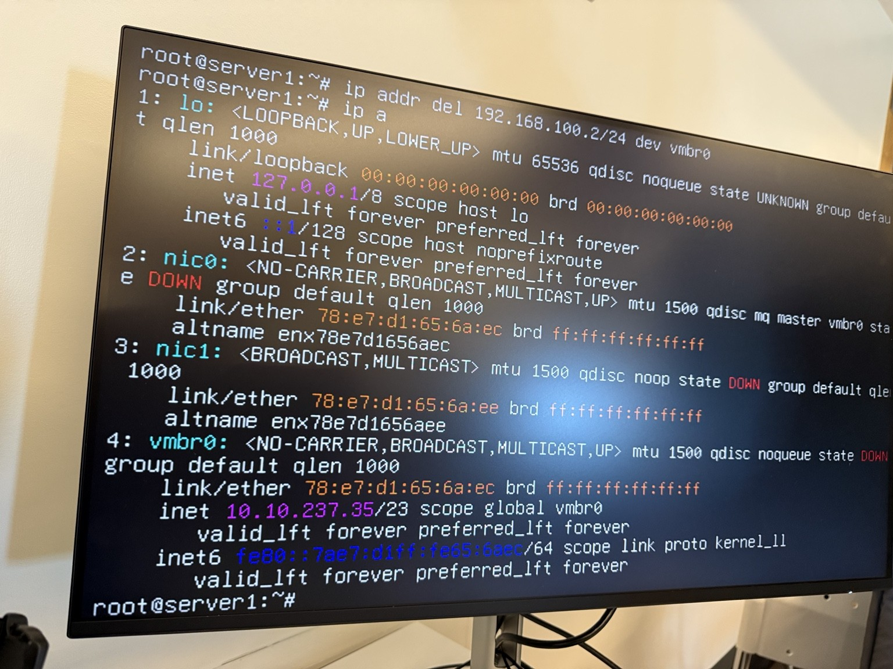

*Figure 12 — Interface nic0 et bridge vmbr0 sans lien détecté.*

Les premiers tests vers 10.7.237.1 échouent avec Destination Host Unreachable et 100 % de perte. Les photos ne permettent pas de préciser si le rétablissement a nécessité un changement de câble, de port ou de configuration.

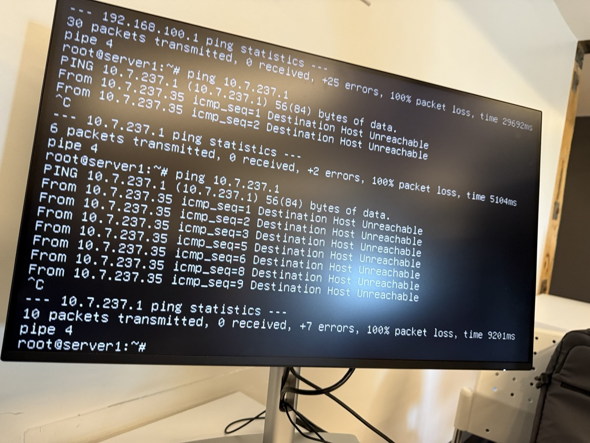

*Figure 13 — Premier contrôle : échec du ping vers 10.7.237.1.*

Le test ultérieur vers la même adresse réussit : 15 paquets transmis, 15 reçus, 0 % de perte et un temps moyen de 0,266 ms. La communication avec 10.7.237.1 est donc validée pour cet essai. L’accès à Internet, le DNS et l’interface web ne sont pas testés sur cette capture.

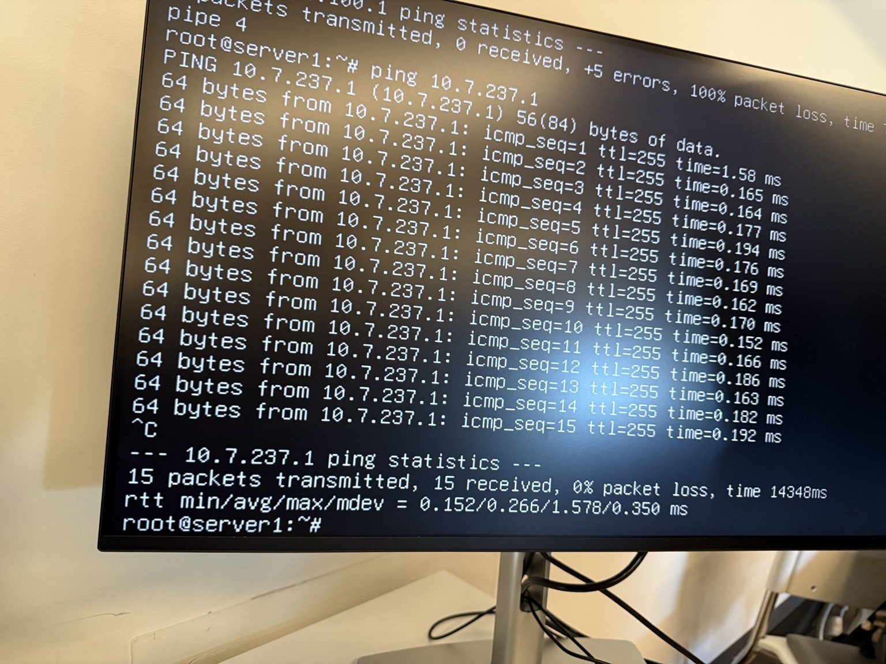

*Figure 14 — Validation réseau : 15 réponses sur 15 vers 10.7.237.1.*

## 8. Relevé distinct : server237

Une autre console affiche server237 et https://10.7.236.237:8006/. Cette adresse est documentée comme un relevé supplémentaire. Le lien exact avec server1 et la chronologie de reconfiguration restent à confirmer.

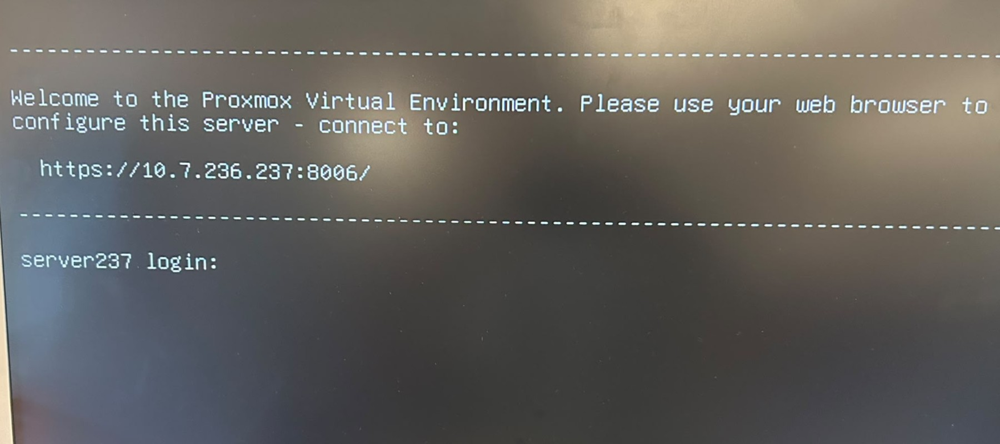

*Figure 15 — Console server237 : adresse de gestion annoncée après démarrage.*

## 9. Questions de réflexion

### 1. À quoi sert nomodeset ?

Il désactive le changement de mode graphique par les pilotes du noyau. Il peut aider à contourner un blocage d’affichage au démarrage [1, 2].

### 2. Pourquoi un ancien BIOS peut-il nécessiter acpi=off ?

Des tables ACPI incompatibles ou erronées peuvent gêner le démarrage. acpi=off désactive ACPI pour un essai de diagnostic ; ce contournement peut aussi retirer des fonctions utiles [2].

### 3. Quelle différence entre ACPI et APIC ?

ACPI est une interface de description et de gestion du matériel et de l’énergie. APIC désigne les contrôleurs d’interruptions utilisés notamment sur les systèmes multiprocesseurs.

### 4. Pourquoi nolapic peut-il réduire le nombre de processeurs visibles ?

Lorsqu’il est applicable, il désactive l’APIC local, impliqué dans les interruptions entre processeurs. Cela peut limiter le fonctionnement multiprocesseur ; l’effet dépend de l’architecture et du noyau. Ce paramètre n’est pas prouvé dans nos essais [2].

### 5. Quelle commande affiche les paramètres transmis au noyau ?

```text
cat /proc/cmdline
```

Elle affiche la ligne de commande du noyau en cours. Un paramètre présent n’est pas nécessairement reconnu ou appliqué par le noyau [2, 3].

## 10. Bilan du laboratoire

L’installation a permis d’atteindre la console Proxmox, de se connecter en root et de vérifier le stockage système sur sda. Le dernier ping valide une communication sans perte vers 10.7.237.1. Le dépannage a donc progressé jusqu’au démarrage du système et à une communication réseau réussie.

La validation reste partielle : le nombre de processeurs visibles sous Linux diffère du POST, les paramètres permanents ne sont pas prouvés et l’accès web n’est pas illustré. Les vérifications complémentaires à réaliser concernent le lien entre server1 et server237, les options de démarrage réellement actives et l’action exacte ayant rétabli le réseau.


