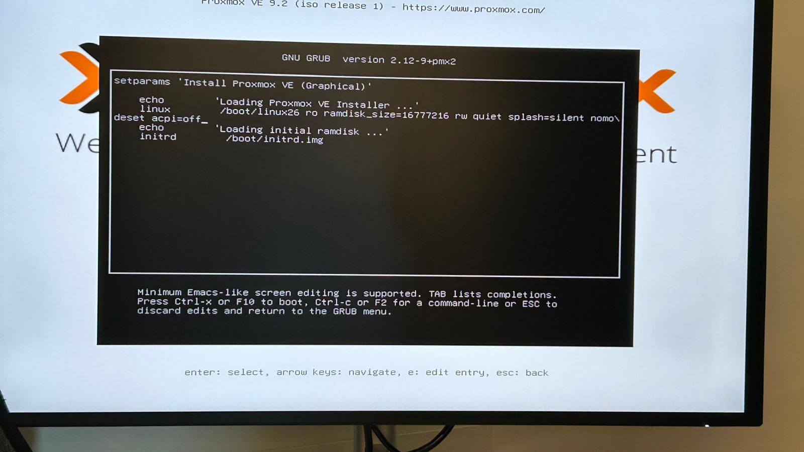
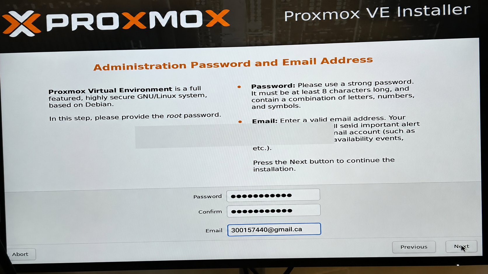
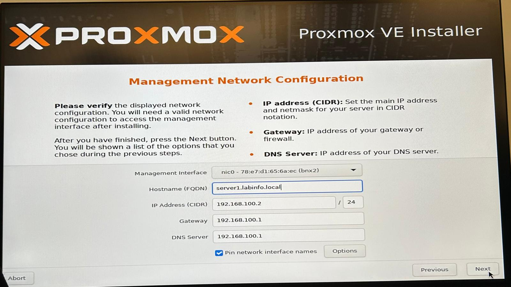

# Installation et configuration de Proxmox VE 9.2

**Matricule :** 300157440  
**Cours :** INF1085

## 1. Objectif

Préparer l'installation de Proxmox VE afin de disposer d'un environnement de virtualisation permettant de créer et administrer des machines virtuelles.

## 2. Démarrage de l'installateur

Le menu GRUB permet de lancer l'installation graphique de Proxmox VE 9.2. La capture montre les paramètres de démarrage, notamment `nomodeset` et `acpi=off`.

## 3. Configuration du compte administrateur

L'installateur demande de définir le mot de passe du compte root, de le confirmer et de renseigner une adresse électronique pour les notifications administratives.

## 4. Configuration du réseau

Les paramètres affichés dans l'installateur sont les suivants :

| Paramètre | Valeur |
|---|---|
| Interface réseau | nic0 (bnx2) |
| Nom d'hôte (FQDN) | server1.labinfo.local |
| Adresse IPv4 | 192.168.100.2/24 |
| Passerelle | 192.168.100.1 |
| Serveur DNS | 192.168.100.1 |

## 5. Résultat et conclusion

Les captures documentent le démarrage de l'installateur et les étapes de configuration administrative et réseau. La fin de l'installation, le redémarrage du serveur et l'accès à l'interface Web restent à confirmer par une vérification supplémentaire.
