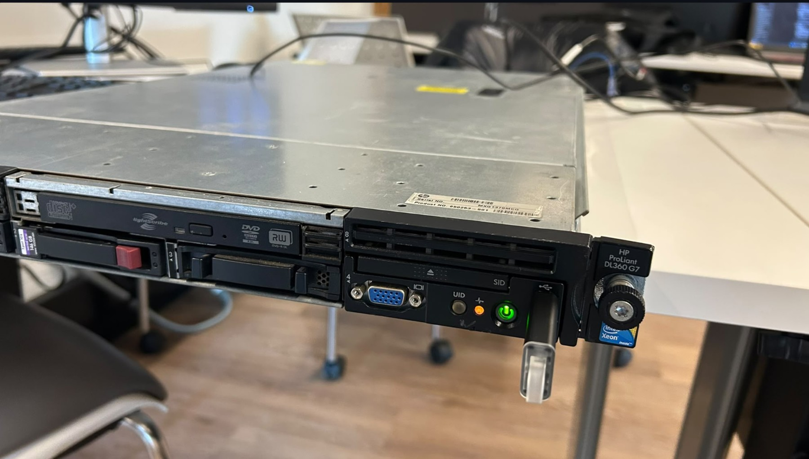
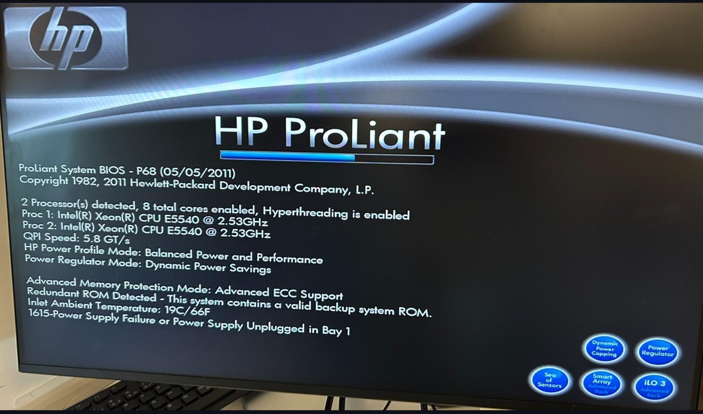
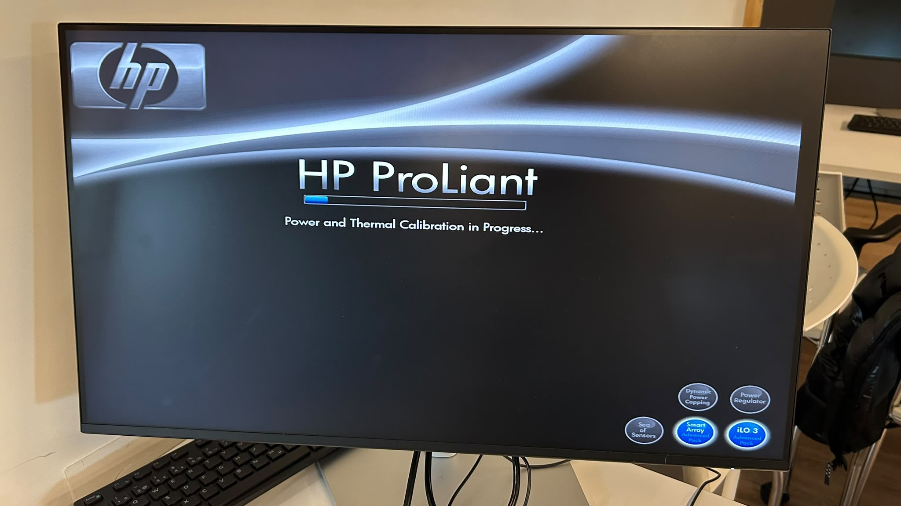
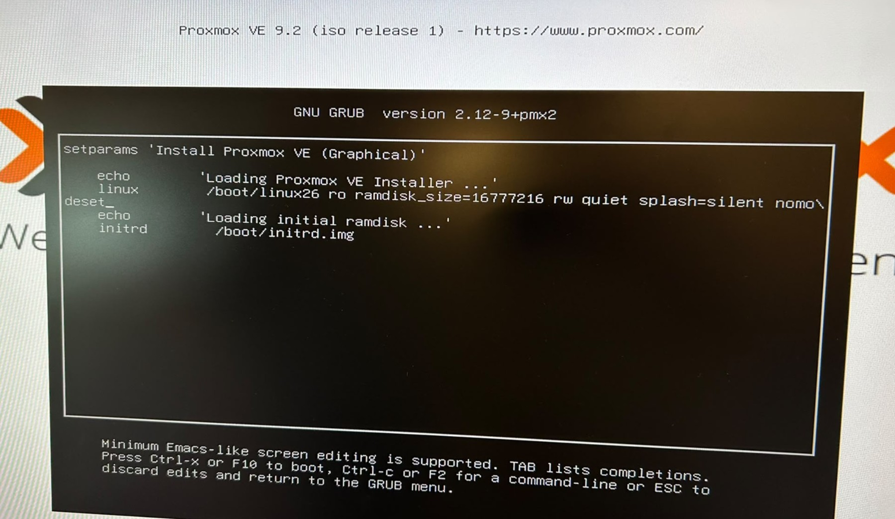
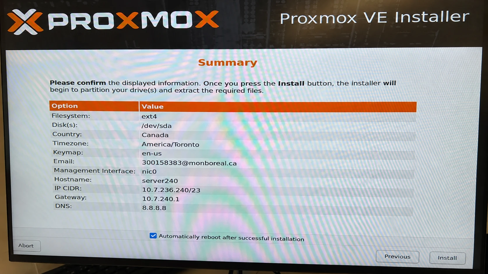
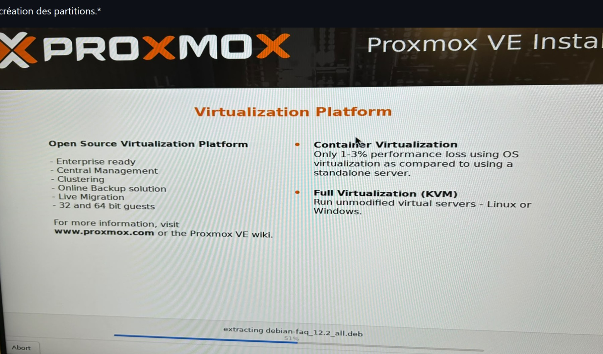
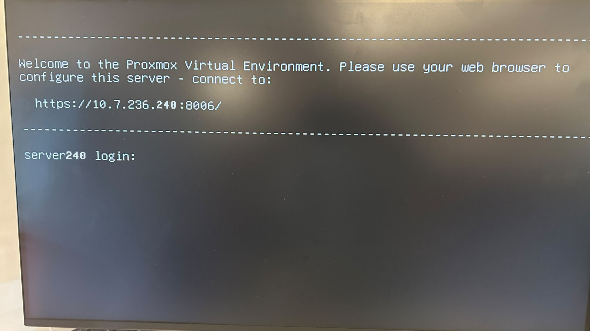
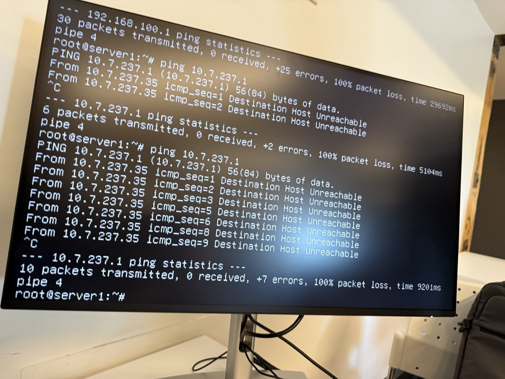

# Installation de Proxmox VE 9 — HP ProLiant DL360 G7

| | |
|---|---|
| **Cours** | INF1085-201-26A-04 — 2. Proxmox |
| **Étudiante** | Salma Baali (300158383) — groupe 2-31 |
| **Serveur** | HP ProLiant DL360 G7 — S/N USE044N2AL (S20) — IP 10.7.236.240 |
| **Logiciel** | Proxmox VE 9.2 |

> Travail d'équipe : les photos sont celles du groupe (certaines montrent `server1` ou `server237`).

## 1. Objectif

Installer Proxmox VE 9 sur un ancien serveur, utiliser les paramètres de démarrage (`nomodeset`, `acpi=off`) et vérifier la détection des processeurs.

## 2. Matériel

| Élément | Valeur |
|---|---|
| BIOS | ProLiant System BIOS P68 (05/05/2011) |
| Processeurs | 2 × Intel Xeon E5540 @ 2,53 GHz (8 cœurs, Hyperthreading) |
| Mémoire | 64 Go, Advanced ECC |
| Réseau du labo | `10.7.236.0/23`, passerelle `10.7.237.1`, DNS `8.8.8.8` |



*Figure 1 — Étiquette du serveur.*

## 3. Préparation et démarrage

**Clé USB :** ISO Proxmox VE 9 avec **Rufus** (Windows) ou `sudo dd if=proxmox-ve_9.iso of=/dev/sdX bs=4M status=progress` (Linux).



*Figure 2 — POST : deux Xeon E5540, huit cœurs.*



*Figure 3 — Calibration de l'alimentation et du système thermique.*

**F11** ouvre le menu de démarrage : option 3, **One Time Boot to USB DriveKey** (pour ce démarrage seulement).


*Figure 4 — Default Boot Override Options.*

## 4. Menu Proxmox et paramètres du noyau


*Figure 5 — Menu d'installation de Proxmox VE 9.2.*

**Install Proxmox VE** → touche **e** → ajouter `nomodeset` à la ligne `linux` → **Ctrl+X** ou **F10**.



*Figure 6 — `nomodeset` ajouté dans GRUB.*

| Paramètre | Rôle | Pourquoi sur le G7 |
|---|---|---|
| `nomodeset` | Vidéo minimale, sans KMS | Contrôleur graphique très ancien : risque d'écran noir |
| `acpi=off` | Désactive ACPI | Tables ACPI d'un vieux BIOS mal gérées par le noyau |

À éviter : `nolapic` et `noapic` (un seul processeur visible).

## 5. Installation


*Figure 7 — Licence (EULA) : **I agree**.*

Disque : volume logique **`/dev/sda` (273,40 Gio)** ; le NVMe de 953,87 Gio n'est pas retenu. Il sera effacé.


*Figure 8 — Choix du disque `/dev/sda`.*

Un ancien groupe LVM `pve` (sur `/dev/nvme0n1p3`) est détecté ; l'installateur propose de le renommer.


*Figure 9 — Groupe LVM `pve` existant.*

Mot de passe `root` (non reproduit) et courriel `300158383@monboreal.ca`.


*Figure 10 — Mot de passe `root` et courriel.*

| Réseau de gestion | Valeur |
|---|---|
| Nom complet | server1.labinfo.local |
| Interface | nic0 (bnx2), **Pin network interface names** coché |
| Adresse / passerelle / DNS initiaux | 192.168.100.2/24 — 192.168.100.1 |


*Figure 11 — Réseau de gestion.*

Résumé : **ext4**, `/dev/sda`, **Canada**, **America/Toronto**, clavier **en-us**, `nic0`, DNS `8.8.8.8`, redémarrage automatique.



*Figure 12 — Écran « Summary » avant **Install**.*

> La passerelle affichée (`10.7.240.1`) diffère de celle du labo (`10.7.237.1`) ; écart non expliqué.



*Figure 13 — Extraction des paquets (51 %).*

## 6. Premier démarrage et comptes


*Figure 14 — Console `server1` : `root@server1:~#`, noyau `7.0.2-6-pve`.*


*Figure 15 — Console `server237` (relevé séparé).*



*Figure 16 — Fin d'installation : `server240`, `https://10.7.236.240:8006/`.*

**Compte `root`** : tous les droits ; mot de passe non reproduit. Interface Web sur le port **8006**.

**Compte personnel `B300158383@pam`** (`@pam` = comptes Linux du serveur) :

```bash
useradd -m -s /bin/bash B300158383
passwd B300158383
pveum user add B300158383@pam
pveum acl modify / --users B300158383@pam --roles PVEAdmin
pveum user list
```

Connexion Web : identifiant `B300158383`, realm **Linux PAM**.

**VM et SSH :** *Create VM* (Debian, 1 vCPU, 2 Gio, 32 Gio), puis `ssh <utilisateur>@<IP de la VM>` ; clé publique du professeur dans `~/.ssh/authorized_keys`.

> Procédure ; captures de la VM et du SSH à ajouter.

## 7. Vérifications

```bash
cat /proc/cmdline
lscpu
nproc
cat /sys/devices/system/cpu/online
lsmem
lsblk
lspci
lsmod
```

Attendu pour 2 × E5540 : `CPU(s): 16`, 2 sockets, 4 cœurs, 2 threads, plage `0-15`.
**Observé : `CPU(s): 4` (`0-3`)** alors que le POST annonçait 8 cœurs : objectif non démontré, cause non confirmée.


*Figure 17 — Quatre processeurs logiques.*

| `lsblk` | Valeur |
|---|---|
| sda | 273,4 G |
| pve-root (`/`) | 78,1 G |
| pve-swap | 8 G |
| pve-data (LVM thin) | 166,9 G |
| sdb (clé USB) | 7,5 G |


*Figure 18 — Mémoire et stockage LVM sur `sda`.*

| Vérification | Attendu | Observé |
|---|---|---|
| `/proc/cmdline` | contient `nomodeset` | non capturé |
| `lscpu` / `nproc` | 16 | `CPU(s): 4` / non capturé |
| `lsblk` | système sur `sda` | `sda` 273,4 G |
| Réseau | ping sans perte | 15/15 |
| Interface Web | port 8006 | adresse affichée ; accès non illustré |

**Pour expliquer l'écart CPU :** `/proc/cmdline` (pas de `nolapic`/`noapic`), `/sys/devices/system/cpu/online`, `/proc/interrupts`, réglages BIOS.

## 8. Dépannage réseau

`nic0` et `vmbr0` sont en `NO-CARRIER` / `DOWN` : aucun lien physique.


*Figure 19 — Aucun lien détecté.*



*Figure 20 — Ping vers `10.7.237.1` : échec (100 % de perte).*

Ping ultérieur : **15 envoyés, 15 reçus, 0 % de perte**. La passerelle répond ; Internet, DNS et interface Web ne sont pas testés. La cause du rétablissement n'est pas documentée.


*Figure 21 — Ping réussi : 15/15.*

## 9. Concepts

| Terme | Rôle |
|---|---|
| **ACPI** | Le BIOS décrit le matériel et gère l'énergie |
| **APIC** | Distribue les interruptions entre processeurs |
| **LAPIC** | APIC de chaque CPU ; `nolapic` peut donner `SMP disabled` |
| **SMP** | Plusieurs processeurs ou cœurs en parallèle |

## 10. Questions de réflexion

1. **`nomodeset` ?** Affichage minimal : évite l'écran noir avec le vieux contrôleur graphique.
2. **`acpi=off` sur un ancien BIOS ?** Ses tables ACPI peuvent être incompatibles avec un noyau récent ; c'est un essai de diagnostic.
3. **ACPI et APIC ?** ACPI décrit le matériel et gère l'énergie ; APIC distribue les interruptions.
4. **`nolapic` réduit les CPU ?** Sans LAPIC, Linux ne démarre plus les autres processeurs. Non prouvé ici.
5. **Vérifier les paramètres du noyau ?** `cat /proc/cmdline`

## 11. Conclusion

**Bilan :** Proxmox VE 9.2 installé ; `root` et stockage LVM (`pve-root`, `pve-swap`, `pve-data`) vérifiés ; passerelle `10.7.237.1` joignable sans perte.

**Validation partielle :** 4 processeurs logiques vus au lieu de 8 cœurs ; `nomodeset` non prouvé par `/proc/cmdline` ; accès Web non illustré ; cause du rétablissement du réseau non documentée.

**Compétences :** démarrage USB (F11), GRUB (`nomodeset`), choix du disque et LVM, connexion `root`, vérifications `lscpu` / `nproc` / `lsblk` / `lspci` / `lsmod`, dépannage réseau (`ip a`, `ping`).
