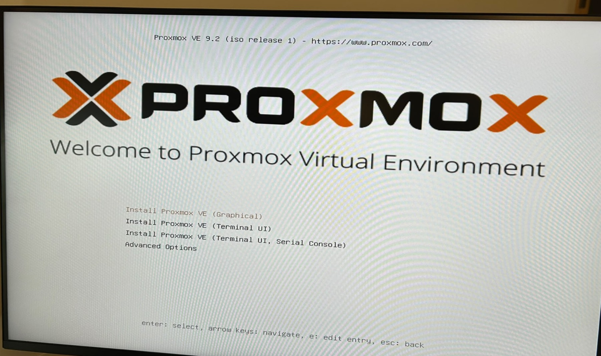
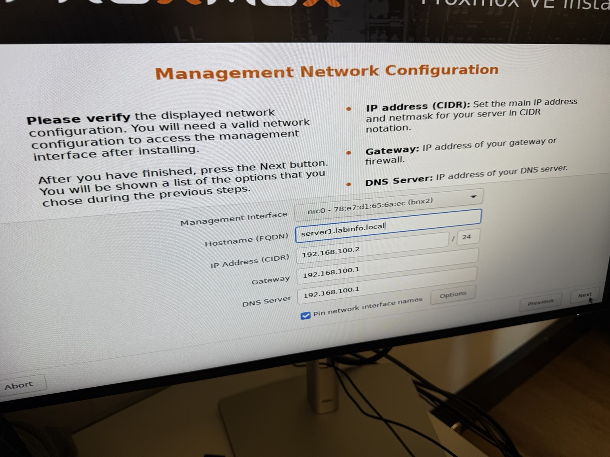
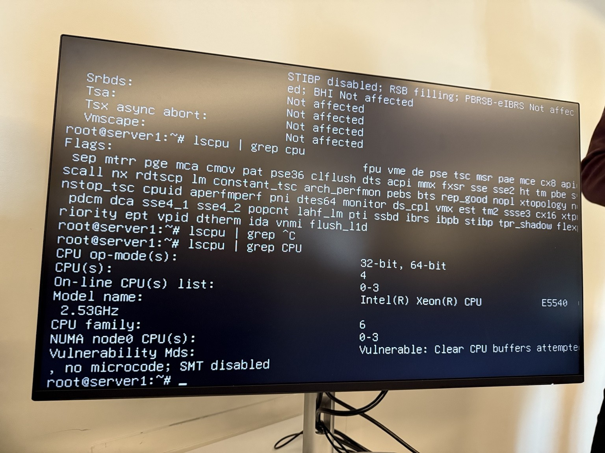

# Rapport d'installation de Proxmox VE 9 — HP ProLiant DL360 G7

| | |
|---|---|
| **Cours** | INF1085-201-26A-04 — 2. Proxmox |
| **Étudiante** | Salma Baali (300158383) |
| **Groupe** | 2-31 |
| **Serveur du groupe** | HP ProLiant DL360 G7 — S/N USE044N2AL — étiquette S20 |
| **Adresse IP attribuée** | 10.7.236.240 |
| **Logiciel** | Proxmox VE 9.2 |

> **Note :** ce laboratoire a été réalisé en équipe (groupe 2-31) et les photos sont celles du groupe. Certaines montrent des noms et des adresses (`server1`, `server237`) différents de ceux de notre serveur attribué : ils sont indiqués tels qu'ils apparaissent sur les photos.

---

## Table des matières

1. [Objectif](#1-objectif)
2. [Contexte](#2-contexte)
3. [Matériel](#3-matériel)
4. [Préparation de la clé USB](#4-préparation-de-la-clé-usb)
5. [Démarrage et POST](#5-démarrage-et-post)
6. [Menu Proxmox et paramètres du noyau](#6-menu-proxmox-et-paramètres-du-noyau)
7. [Installation sur le disque](#7-installation-sur-le-disque)
8. [Configuration réseau et premier démarrage](#8-configuration-réseau-et-premier-démarrage)
9. [Vérification des ressources](#9-vérification-des-ressources)
10. [Dépannage réseau](#10-dépannage-réseau)
11. [Concepts importants](#11-concepts-importants)
12. [Questions de réflexion](#12-questions-de-réflexion)
13. [Conclusion](#13-conclusion)

---

## 1. Objectif

- Installer **Proxmox VE 9** sur un HP ProLiant DL360 G7.
- Comprendre les problèmes de compatibilité entre un ancien serveur et un noyau Linux récent.
- Utiliser des paramètres de démarrage avancés (`nomodeset`, `acpi=off`).
- Comprendre ACPI et APIC.
- Vérifier que les processeurs sont bien détectés.

## 2. Contexte

Le DL360 G7 date d'environ 2009-2010. Il peut exécuter Proxmox VE 9, mais son matériel est beaucoup plus ancien que le noyau Linux de Proxmox. À l'installation, on peut observer :

- un écran noir ou un blocage du démarrage ;
- des erreurs liées aux tables ACPI ;
- une mauvaise détection des processeurs ;
- des erreurs PCI.

**Paramètres réseau du laboratoire :** réseau `10.7.236.0/23`, passerelle `10.7.237.1`, DNS `8.8.8.8`. Notre serveur (groupe 2-31) utilise l'adresse `10.7.236.240`.

## 3. Matériel

| Élément | Valeur |
|---|---|
| Modèle | HP ProLiant DL360 G7 |
| Numéro de série | USE044N2AL (étiquette S20) |
| BIOS | ProLiant System BIOS P68 (05/05/2011) |
| Processeurs | 2 × Intel Xeon E5540 @ 2,53 GHz |
| Cœurs | 8 cœurs, Hyperthreading activé |
| Mémoire | 64 Go, Advanced ECC Support |


*Figure 1 — Identification du serveur : étiquette HP ProLiant DL360 G7.*

## 4. Préparation de la clé USB

1. Télécharger l'image ISO de **Proxmox VE 9**.
2. Créer une clé USB bootable :
   - Windows : **Rufus** ou balenaEtcher ;
   - Linux : `sudo dd if=proxmox-ve_9.iso of=/dev/sdX bs=4M status=progress` (remplacer `/dev/sdX` par la clé).

## 5. Démarrage et POST

Au démarrage, le BIOS passe le POST et affiche deux **Intel Xeon E5540**, 8 cœurs au total, l'Hyperthreading activé et le mode Advanced ECC.


*Figure 2 — POST : deux Xeon E5540 et huit cœurs détectés par le BIOS.*

> Un avertissement **1615** (alimentation en baie 1 défaillante ou débranchée) peut apparaître. Sa cause n'est pas établie pour ce G7 : on ne peut pas reprendre telle quelle la cause trouvée sur le G6 au laboratoire précédent.

Avec **F11**, on ouvre le menu de démarrage (*Default Boot Override Options*) et on choisit **USB Drive** pour démarrer sur la clé. Ce choix ne vaut que pour ce démarrage.

## 6. Menu Proxmox et paramètres du noyau

Le menu d'installation de Proxmox VE 9.2 apparaît : cela confirme que le support d'installation est bien chargé.



*Figure 3 — Menu d'installation de Proxmox VE 9.2.*

Pour éviter les blocages d'affichage, on sélectionne **Install Proxmox VE**, on appuie sur **e**, on ajoute `nomodeset` à la fin de la ligne `linux`, puis on démarre avec **Ctrl+X** ou **F10**.


*Figure 4 — Modification de l'entrée GRUB : `nomodeset` ajouté à la ligne `linux`.*

| Paramètre | Rôle | Pourquoi sur le DL360 G7 |
|---|---|---|
| `nomodeset` | Empêche Linux d'initialiser les pilotes graphiques avancés (KMS), et utilise un mode vidéo minimal. | Le contrôleur graphique est très ancien : sans ce paramètre, risque d'écran noir ou de blocage. |
| `acpi=off` | Désactive ACPI (énergie, détection du matériel, tables processeurs, interruptions, PCI). | Un ancien BIOS peut fournir des tables ACPI mal gérées par un noyau récent. |

> **À ne pas utiliser :** `nolapic` et `noapic`, qui peuvent empêcher Linux d'utiliser plusieurs processeurs.

Sur la capture GRUB, seul `nomodeset` est visible. L'utilisation de `acpi=off` et sa persistance se vérifient avec `cat /proc/cmdline` après le démarrage (voir section 9). Aucun usage de `nolapic` n'est établi.

## 7. Installation sur le disque

Dans l'assistant graphique, on accepte la licence puis on choisit le disque. L'installateur propose un NVMe de 953,87 Gio et un volume logique `/dev/sda` de **273,40 Gio**. Le système a été installé sur `/dev/sda` (confirmé plus tard par `lsblk`).


*Figure 5 — Disques proposés ; volume logique `/dev/sda` de 273,40 Gio.*

Pendant l'installation, l'installateur détecte un ancien groupe de volumes LVM nommé `pve` sur `/dev/nvme0n1p3`, venant d'une installation précédente, et propose de le renommer pour éviter un conflit de nom.


*Figure 6 — Détection d'un groupe LVM `pve` existant sur le NVMe.*

Le mot de passe root et une adresse de notification sont aussi renseignés (le mot de passe n'est pas reproduit ici). La barre de progression montre ensuite l'extraction des paquets (51 %).


*Figure 7 — Installation en cours : extraction des paquets.*

## 8. Configuration réseau et premier démarrage

Paramètres de gestion vus pendant l'installation (photo du groupe) :

| Paramètre | Valeur affichée |
|---|---|
| Nom complet | server1.labinfo.local |
| Interface | nic0, pilote bnx2 |
| Adresse initiale | 192.168.100.2/24 |
| Passerelle initiale | 192.168.100.1 |
| DNS initial | 192.168.100.1 |

Ce sont des valeurs de départ. Le réseau final du laboratoire est `10.7.236.0/23` (passerelle `10.7.237.1`, DNS `8.8.8.8`), avec l'adresse `10.7.236.240` pour notre serveur.



*Figure 8 — Paramètres du réseau de gestion saisis pendant l'installation.*

Après le redémarrage, la console affiche l'adresse de l'interface web (port 8006) et accepte la connexion `root`. Le noyau affiché est `7.0.2-6-pve` (x86_64).


*Figure 9 — Console `server1` : connexion root après l'installation.*

Une autre console du groupe affiche `server237` et `https://10.7.236.237:8006/`. Ce relevé est conservé séparément : le lien exact avec `server1` n'est pas confirmé.


*Figure 10 — Console `server237` : adresse de gestion annoncée après le démarrage.*

## 9. Vérification des ressources

### Paramètres du noyau

```bash
cat /proc/cmdline
```

Cette commande donne les paramètres réellement transmis au noyau. Un paramètre présent n'est pas forcément appliqué.

### Processeurs

```bash
lscpu
nproc
cat /sys/devices/system/cpu/online
```

Pour 2 × E5540, on attend `CPU(s): 16`, `Socket(s): 2`, `Core(s) per socket: 4`, `Thread(s) per core: 2` et `0-15`.

Dans l'essai du groupe, `lscpu | grep CPU` affiche **`CPU(s): 4`** (liste `0-3`). Le POST annonçait pourtant 8 cœurs. L'objectif « retrouver tous les processeurs sous Linux » n'est donc **pas démontré** par cette capture. Pistes à examiner : options de démarrage, réglages du BIOS, configuration modifiée. Aucune cause n'est confirmée.



*Figure 11 — Contrôle CPU sous Linux : quatre processeurs logiques en ligne.*

### Remarques utiles

- Attention à l'espace : `cat /proc/cmdline` fonctionne, mais `cat/proc/cmdline` donne une erreur.
- `nolapic` et `noapic` ne sont **pas des commandes** : ce sont des paramètres du noyau. On vérifie qu'ils ne sont pas utilisés en les cherchant dans la sortie de `cat /proc/cmdline`.
- Si Linux voit moins de CPU que le POST, `cat /proc/interrupts` permet de voir les interruptions par CPU, et `lscpu` donne le nombre de sockets et de cœurs.
- `lspci` liste les ponts et contrôleurs de la carte mère (Intel Xeon 5500) et `lsmod` les modules chargés, par exemple `nvme`, `hpsa` (pilote du contrôleur Smart Array) et `dm_thin_pool` (LVM-thin). Ces deux commandes servent à vérifier que le matériel est reconnu.

### Mémoire et stockage

`lsmem` affiche 66G en ligne. Cette valeur décrit la mémoire présentée par l'outil ; `free -h` mesure la mémoire utilisable.

| Élément (`lsblk`) | Valeur |
|---|---|
| sda | 273,4 G |
| pve-root (monté sur `/`) | 78,1 G |
| pve-swap | 8 G |
| pve-data (LVM thin) | 166,9 G |
| sdb (clé USB, amovible) | 7,5 G |


*Figure 12 — Relevé mémoire et arborescence du stockage LVM sur `sda`.*

## 10. Dépannage réseau

`ip a` montre `nic0` rattachée au bridge `vmbr0`, tous deux en `NO-CARRIER` / `DOWN` : aucun lien physique n'est détecté à cet instant. Les adresses affichées sur les photos (10.10.237.35/23 puis 10.7.237.35) viennent de relevés différents ; le changement n'est pas documenté.


*Figure 13 — `nic0` et `vmbr0` sans lien détecté.*

Le premier ping vers la passerelle `10.7.237.1` échoue (*Destination Host Unreachable*, 100 % de perte).


*Figure 14 — Premier contrôle : échec du ping vers 10.7.237.1.*

Un ping ultérieur vers la même adresse réussit : **15 paquets envoyés, 15 reçus, 0 % de perte**, temps moyen 0,266 ms. La communication avec la passerelle est donc validée. L'accès à Internet, le DNS et l'interface web ne sont pas testés sur cette capture.


*Figure 15 — Validation réseau : 15 réponses sur 15 vers 10.7.237.1.*

Les photos ne précisent pas ce qui a rétabli le lien (câble, port ou configuration). Pour dépanner : vérifier le câble et le port du commutateur, `ip a`, la passerelle, puis refaire `ping 10.7.237.1`.

## 11. Concepts importants

| Terme | Signification | Rôle |
|---|---|---|
| **ACPI** | Advanced Configuration and Power Interface | Le BIOS décrit le matériel et gère l'énergie pour Linux. |
| **APIC** | Advanced Programmable Interrupt Controller | Distribue les interruptions entre les processeurs. |
| **LAPIC** | Local APIC | APIC propre à chaque processeur. Le désactiver (`nolapic`) peut donner `smpboot: SMP disabled` : un seul processeur logique. |
| **SMP** | Symmetric Multiprocessing | Utilisation simultanée de plusieurs processeurs ou cœurs. |

## 12. Questions de réflexion

**1. À quoi sert `nomodeset` ?**
Il empêche le noyau de changer de mode graphique avec ses pilotes (KMS) et force un affichage minimal. Il évite l'écran noir ou le blocage avec le vieux contrôleur graphique du G7.

**2. Pourquoi un ancien BIOS peut-il nécessiter `acpi=off` ?**
Ses tables ACPI peuvent être incomplètes ou incompatibles avec un noyau récent et provoquer des erreurs ou des blocages. `acpi=off` sert d'essai de diagnostic, mais retire aussi des fonctions utiles (énergie, détection de matériel).

**3. Quelle est la différence entre ACPI et APIC ?**
ACPI décrit le matériel et gère l'énergie. APIC gère la distribution des interruptions entre les processeurs.

**4. Pourquoi `nolapic` peut-il réduire le nombre de processeurs visibles ?**
Le LAPIC permet de démarrer chaque processeur et de lui envoyer des interruptions. Sans lui, Linux perd le multiprocesseur (`smpboot: SMP disabled`). Dans notre essai, ce paramètre n'est pas prouvé.

**5. Quelle commande permet de vérifier les paramètres utilisés au démarrage du noyau ?**
`cat /proc/cmdline`

## 13. Conclusion

L'installation a permis d'atteindre la console Proxmox VE 9.2, de se connecter en `root` et de vérifier le stockage système sur `sda` (LVM : `pve-root`, `pve-swap`, `pve-data`). Le dernier ping valide la communication avec la passerelle `10.7.237.1` sans perte.

La validation reste **partielle** :

- Linux voit 4 processeurs logiques alors que le POST annonçait 8 cœurs ;
- les paramètres permanents (`nomodeset`, `acpi=off`) ne sont pas prouvés par une capture de `/proc/cmdline` ;
- l'accès à l'interface web n'est pas illustré ;
- la cause du rétablissement du réseau n'est pas documentée.

Ce laboratoire a permis de pratiquer l'installation de Proxmox VE sur un ancien serveur, l'usage des paramètres de démarrage, et le dépannage réseau de base.
