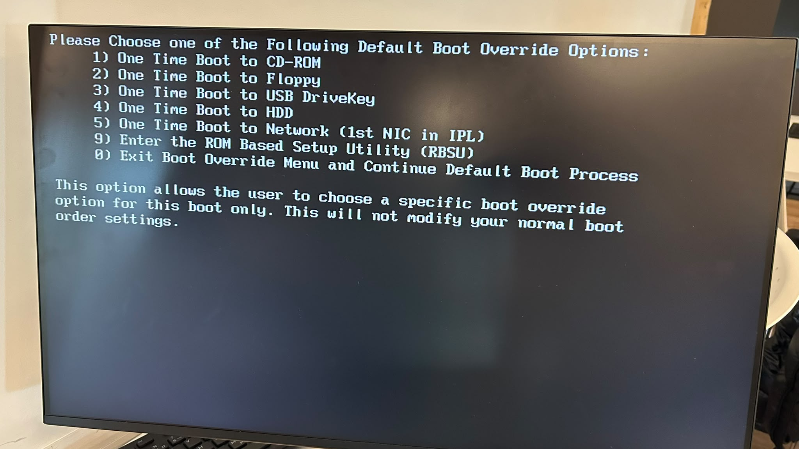
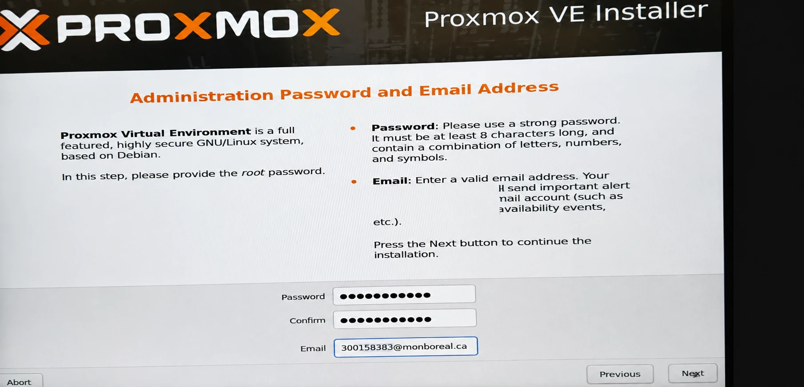
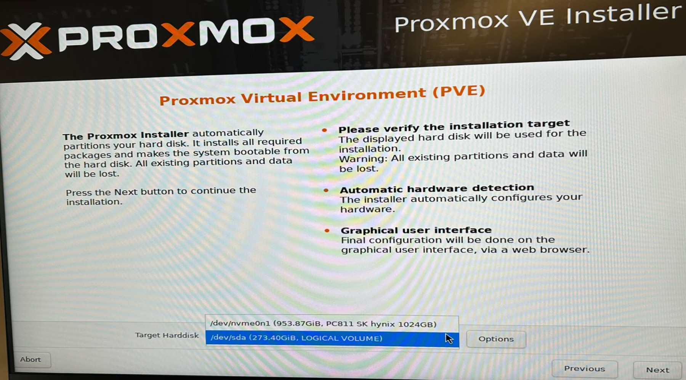
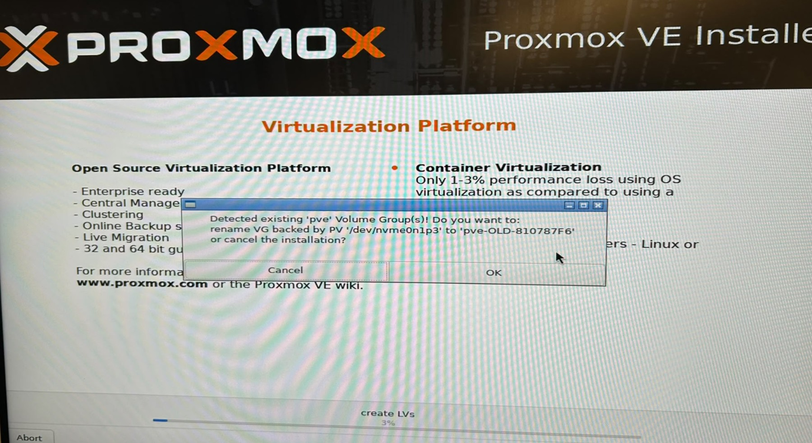
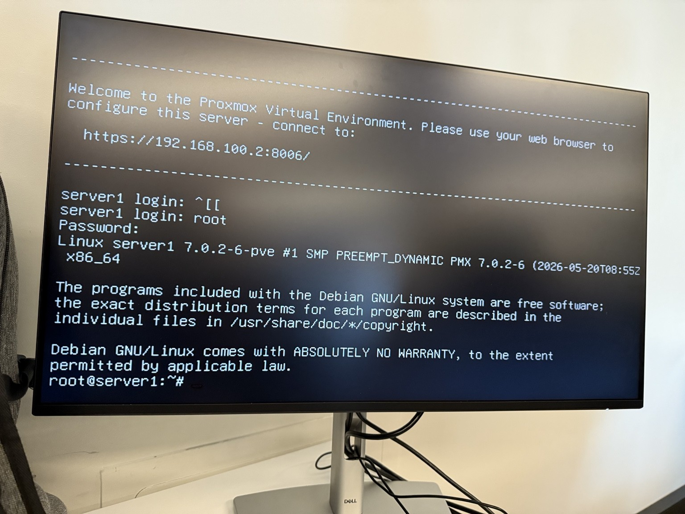
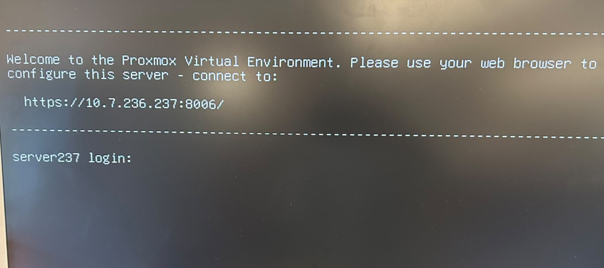
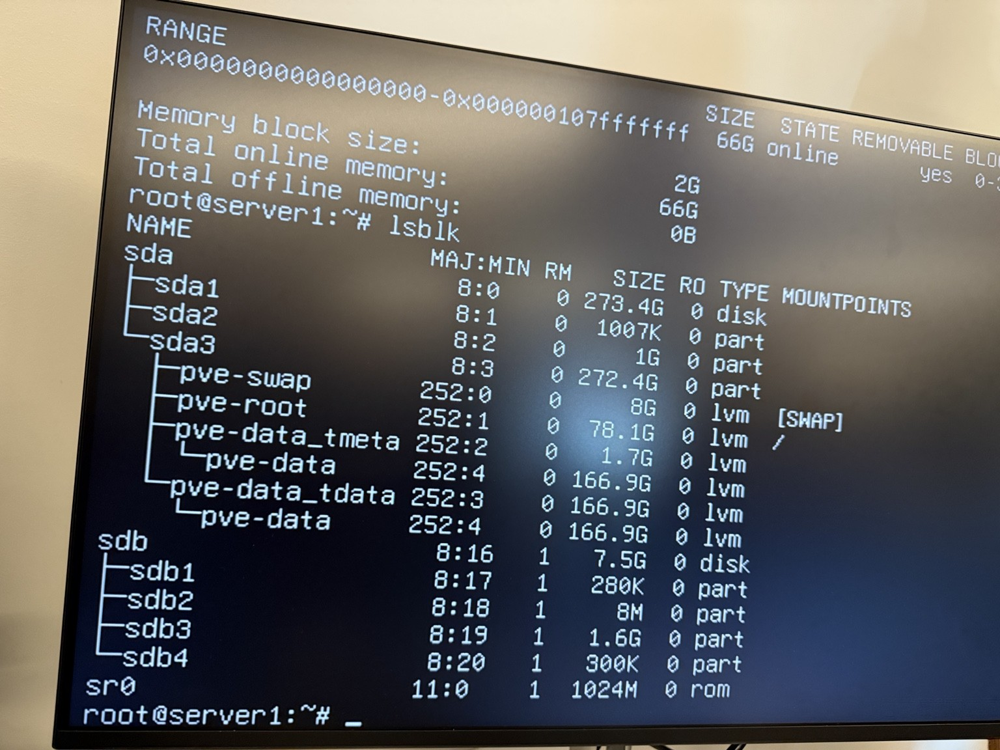
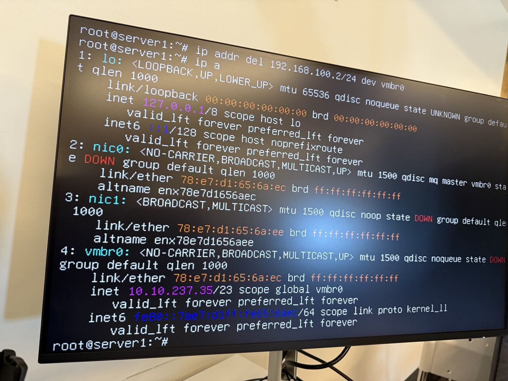
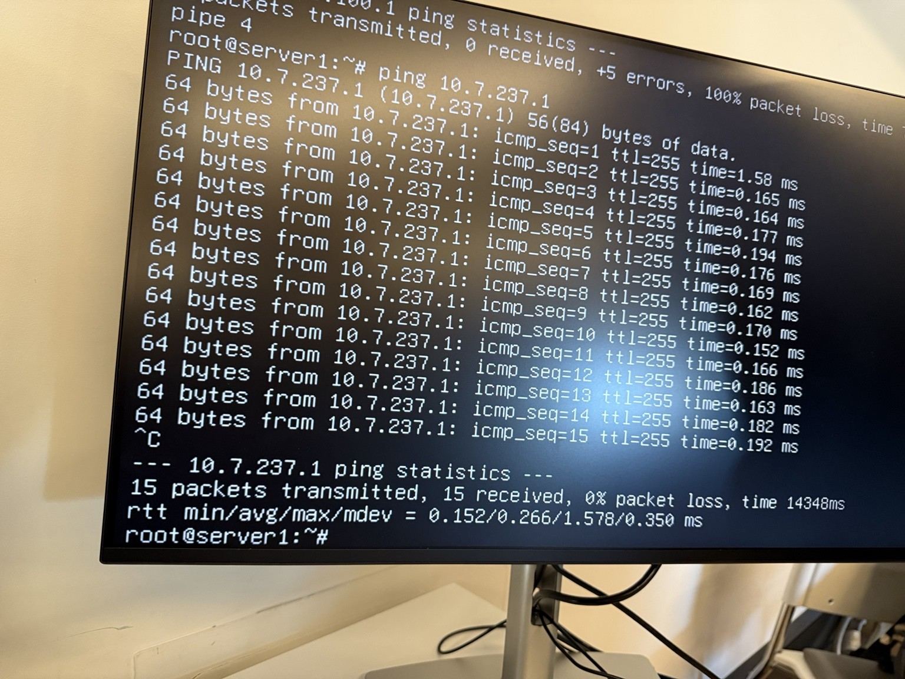

# Rapport d'installation de Proxmox VE 9 — HP ProLiant DL360 G7

| | |
|---|---|
| **Cours** | INF1085-201-26A-04 — 2. Proxmox |
| **Étudiante** | Salma Baali (300158383) |
| **Groupe** | 2-31 |
| **Serveur du groupe** | HP ProLiant DL360 G7 — S/N USE044N2AL — étiquette S20 |
| **Adresse IP attribuée** | 10.7.236.240 |
| **Logiciel** | Proxmox VE 9.2 |

> **Note :** ce laboratoire a été réalisé en équipe (groupe 2-31) et les photos sont celles du groupe. Certaines montrent des noms et des adresses (`server1`, `server237`) différents de ceux de notre serveur attribué : ils sont indiqués tels qu'ils apparaissent sur les photos.

---

## Table des matières

1. [Objectif](#1-objectif)
2. [Contexte](#2-contexte)
3. [Matériel](#3-matériel)
4. [Préparation de la clé USB](#4-préparation-de-la-clé-usb)
5. [Démarrage et POST](#5-démarrage-et-post)
6. [Menu Proxmox et paramètres du noyau](#6-menu-proxmox-et-paramètres-du-noyau)
7. [Installation sur le disque](#7-installation-sur-le-disque)
8. [Configuration réseau et premier démarrage](#8-configuration-réseau-et-premier-démarrage)
9. [Vérification des ressources](#9-vérification-des-ressources)
10. [Dépannage réseau](#10-dépannage-réseau)
11. [Concepts importants](#11-concepts-importants)
12. [Questions de réflexion](#12-questions-de-réflexion)
13. [Conclusion](#13-conclusion)

---

## 1. Objectif

- Installer **Proxmox VE 9** sur un HP ProLiant DL360 G7.
- Comprendre les problèmes de compatibilité entre un ancien serveur et un noyau Linux récent.
- Utiliser des paramètres de démarrage avancés (`nomodeset`, `acpi=off`).
- Comprendre ACPI et APIC.
- Vérifier que les processeurs sont bien détectés.

## 2. Contexte

Le DL360 G7 date d'environ 2009-2010. Il peut exécuter Proxmox VE 9, mais son matériel est beaucoup plus ancien que le noyau Linux de Proxmox. À l'installation, on peut observer :

- un écran noir ou un blocage du démarrage ;
- des erreurs liées aux tables ACPI ;
- une mauvaise détection des processeurs ;
- des erreurs PCI.

**Paramètres réseau du laboratoire :** réseau `10.7.236.0/23`, passerelle `10.7.237.1`, DNS `8.8.8.8`. Notre serveur (groupe 2-31) utilise l'adresse `10.7.236.240`.

## 3. Matériel

| Élément | Valeur |
|---|---|
| Modèle | HP ProLiant DL360 G7 |
| Numéro de série | USE044N2AL (étiquette S20) |
| BIOS | ProLiant System BIOS P68 (05/05/2011) |
| Processeurs | 2 × Intel Xeon E5540 @ 2,53 GHz |
| Cœurs | 8 cœurs, Hyperthreading activé |
| Mémoire | 64 Go, Advanced ECC Support |


*Figure 1 — Identification du serveur : étiquette HP ProLiant DL360 G7.*

## 4. Préparation de la clé USB

1. Télécharger l'image ISO de **Proxmox VE 9**.
2. Créer une clé USB bootable :
   - Windows : **Rufus** ou balenaEtcher ;
   - Linux : `sudo dd if=proxmox-ve_9.iso of=/dev/sdX bs=4M status=progress` (remplacer `/dev/sdX` par la clé).

## 5. Démarrage et POST

Au démarrage, le BIOS passe le POST et affiche deux **Intel Xeon E5540**, 8 cœurs au total, l'Hyperthreading activé et le mode Advanced ECC.


*Figure 2 — POST : deux Xeon E5540 et huit cœurs détectés par le BIOS.*


*Figure 2 bis — Écran HP ProLiant au démarrage : « Power and Thermal Calibration in Progress ».*

> Un avertissement **1615** (alimentation en baie 1 défaillante ou débranchée) peut apparaître. Sa cause n'est pas établie pour ce G7 : on ne peut pas reprendre telle quelle la cause trouvée sur le G6 au laboratoire précédent.

Avec **F11**, on ouvre le menu de démarrage (*Default Boot Override Options*) et on choisit **USB Drive** pour démarrer sur la clé. Ce choix ne vaut que pour ce démarrage.



*Figure 2 ter — Menu « Default Boot Override Options » : l'option 3, **One Time Boot to USB DriveKey**, démarre sur la clé USB sans modifier l'ordre normal de démarrage.*

## 6. Menu Proxmox et paramètres du noyau

Le menu d'installation de Proxmox VE 9.2 apparaît : cela confirme que le support d'installation est bien chargé.


*Figure 3 — Menu d'installation de Proxmox VE 9.2.*

Pour éviter les blocages d'affichage, on sélectionne **Install Proxmox VE**, on appuie sur **e**, on ajoute `nomodeset` à la fin de la ligne `linux`, puis on démarre avec **Ctrl+X** ou **F10**.


*Figure 4 — Modification de l'entrée GRUB : `nomodeset` ajouté à la ligne `linux`.*

| Paramètre | Rôle | Pourquoi sur le DL360 G7 |
|---|---|---|
| `nomodeset` | Empêche Linux d'initialiser les pilotes graphiques avancés (KMS), et utilise un mode vidéo minimal. | Le contrôleur graphique est très ancien : sans ce paramètre, risque d'écran noir ou de blocage. |
| `acpi=off` | Désactive ACPI (énergie, détection du matériel, tables processeurs, interruptions, PCI). | Un ancien BIOS peut fournir des tables ACPI mal gérées par un noyau récent. |

> **À ne pas utiliser :** `nolapic` et `noapic`, qui peuvent empêcher Linux d'utiliser plusieurs processeurs.

Sur la capture GRUB, seul `nomodeset` est visible. L'utilisation de `acpi=off` et sa persistance se vérifient avec `cat /proc/cmdline` après le démarrage (voir section 9). Aucun usage de `nolapic` n'est établi.

## 7. Installation sur le disque

Déroulement de l'assistant d'installation graphique :

| Étape | Action |
|---|---|
| 1 | Choisir **Install Proxmox VE** (avec `nomodeset`, voir section 6) |
| 2 | Accepter le contrat de licence (**I agree**) |
| 3 | Choisir le disque cible (**Target Harddisk**) |
| 4 | Régler le pays, le fuseau horaire et le clavier |
| 5 | Définir le mot de passe **root** et l'adresse courriel de notification |
| 6 | Configurer le réseau de gestion (interface, nom d'hôte, adresse IP, passerelle, DNS) |
| 7 | Vérifier le résumé, puis cliquer sur **Install** |
| 8 | Attendre la fin de l'installation et le redémarrage |

L'installateur prévient que les partitions et les données du disque choisi seront **effacées** : il faut donc bien vérifier le disque cible avant de continuer.

Pendant le chargement, l'installateur cherche ses fichiers : il examine d'abord le lecteur `/dev/sr0`, puis trouve le support Proxmox sur `/dev/sdb` (la clé USB). Les interfaces réseau sont détectées et des offres DHCP sont reçues, ce qui montre qu'un serveur DHCP répond à cette étape (cela ne confirme pas à lui seul l'accès à Internet).


*Figure 5 bis — Contrat de licence (EULA) : on clique sur **I agree** pour poursuivre.*

À l'étape **Administration Password and Email Address**, on définit le mot de passe du compte `root` (saisi deux fois, d'au moins 8 caractères avec lettres, chiffres et symboles) et l'adresse courriel qui recevra les alertes du serveur. Ici, le courriel est `300158383@monboreal.ca` ; le mot de passe n'est pas reproduit dans ce rapport.



*Figure 5 ter — Définition du mot de passe `root` et de l'adresse courriel de notification.*

Au résumé, avant de cliquer sur **Install**, l'installateur affiche les choix retenus : système de fichiers **ext4**, disque `/dev/sda`, pays **Canada**, fuseau **America/Toronto**, clavier **en-us**, interface de gestion `nic0` et DNS `8.8.8.8`. L'option **Automatically reboot after successful installation** est cochée.


*Figure 5 quater — Écran « Summary » avant de cliquer sur **Install** : le courriel de notification est `300158383@monboreal.ca`.*

> **Remarque :** la passerelle affichée sur cette photo (`10.7.240.1`) n'est pas celle du réseau du laboratoire (`10.7.237.1`). Le nom d'hôte (`server240`) et l'adresse (`10.7.236.240/23`) correspondent en revanche à l'adresse attribuée au groupe. Cet écart n'est pas expliqué par les captures disponibles.

Dans l'assistant graphique, on accepte la licence puis on choisit le disque. L'installateur propose un NVMe de 953,87 Gio et un volume logique `/dev/sda` de **273,40 Gio**. Le système a été installé sur `/dev/sda` (confirmé plus tard par `lsblk`).



*Figure 5 — Disques proposés ; volume logique `/dev/sda` de 273,40 Gio.*

Pendant l'installation, l'installateur détecte un ancien groupe de volumes LVM nommé `pve` sur `/dev/nvme0n1p3`, venant d'une installation précédente, et propose de le renommer pour éviter un conflit de nom.



*Figure 6 — Détection d'un groupe LVM `pve` existant sur le NVMe.*

Le mot de passe root et une adresse de notification sont aussi renseignés (le mot de passe n'est pas reproduit ici). La barre de progression montre ensuite l'extraction des paquets (51 %).


*Figure 7 — Installation en cours : extraction des paquets.*

## 8. Configuration réseau et premier démarrage

Paramètres de gestion vus pendant l'installation (photo du groupe) :

| Paramètre | Valeur affichée |
|---|---|
| Nom complet | server1.labinfo.local |
| Interface | nic0, pilote bnx2 |
| Adresse initiale | 192.168.100.2/24 |
| Passerelle initiale | 192.168.100.1 |
| DNS initial | 192.168.100.1 |

Ce sont des valeurs de départ. Le réseau final du laboratoire est `10.7.236.0/23` (passerelle `10.7.237.1`, DNS `8.8.8.8`), avec l'adresse `10.7.236.240` pour notre serveur.


*Figure 8 — Paramètres du réseau de gestion saisis pendant l'installation.*

Après le redémarrage, la console affiche l'adresse de l'interface web (port 8006) et accepte la connexion `root`. Le noyau affiché est `7.0.2-6-pve` (x86_64).



*Figure 9 — Console `server1` : connexion root après l'installation.*

### 8.1 Compte utilisé et accès

La capture de la console montre le compte avec lequel on administre le serveur :

| Élément | Valeur observée |
|---|---|
| Compte | **root** (administrateur du système) |
| Invite de commande | `root@server1:~#` |
| Nom d'hôte | `server1` (nom complet `server1.labinfo.local`) |
| Système | Debian GNU/Linux, noyau `7.0.2-6-pve` (x86_64) |
| Interface Web | adresse de gestion sur le port **8006** (`https://<adresse>:8006/`) |
| Interface réseau | `nic0`, pilote `bnx2`, option **Pin network interface names** cochée |

Le compte `root` a tous les droits sur le serveur. Il sert à l'installation et à l'administration initiale ; pour un usage courant, on crée ensuite des comptes personnels avec des droits limités. Le mot de passe n'est pas reproduit dans ce rapport.

L'option **Pin network interface names** fixe le nom des interfaces réseau (par exemple `nic0`), pour qu'il ne change pas après un redémarrage ou l'ajout d'une carte.


Une autre console du groupe affiche `server237` et `https://10.7.236.237:8006/`. Ce relevé est conservé séparément : le lien exact avec `server1` n'est pas confirmé.



*Figure 10 — Console `server237` : adresse de gestion annoncée après le démarrage.*


*Figure 10 bis — Console en fin d'installation : `server240` et l'adresse de gestion `https://10.7.236.240:8006/`, qui est l'adresse attribuée à notre groupe.*

### 8.2 Compte personnel `B300158383@pam`

En plus du compte `root`, chaque étudiant dispose d'un **compte personnel** pour utiliser Proxmox sans employer l'administrateur. Le nom suit le modèle `B<numéro étudiant>@pam` : ici **`B300158383@pam`**. Le suffixe `@pam` indique que l'authentification passe par les comptes Linux du serveur (*Linux PAM*).

**Création du compte (en root sur le serveur) :**

```bash
useradd -m -s /bin/bash B300158383
passwd B300158383
pveum user add B300158383@pam
pveum acl modify / --users B300158383@pam --roles PVEAdmin
```

| Commande | Rôle |
|---|---|
| `useradd -m -s /bin/bash B300158383` | Crée l'utilisateur Linux et son dossier personnel |
| `passwd B300158383` | Définit son mot de passe (non reproduit dans ce rapport) |
| `pveum user add B300158383@pam` | Déclare l'utilisateur dans Proxmox (realm PAM) |
| `pveum acl modify / --users … --roles PVEAdmin` | Lui donne les droits d'administration de Proxmox |

**Vérification :**

```bash
pveum user list
```

L'interface Web (`https://<adresse du serveur>:8006/`) accepte ensuite la connexion avec l'identifiant `B300158383`, le realm **Linux PAM** et le mot de passe du compte.

**Machine virtuelle personnelle et accès SSH :**

1. Dans l'interface Web : **Create VM**, avec une image Debian, 1 vCPU, 2 Gio de mémoire et un disque de 32 Gio.
2. Installer Debian dans la VM, puis noter l'adresse IP de la VM (`ip a`, interface `ens18`).
3. Se connecter depuis Windows :

```powershell
ssh <utilisateur>@<adresse IP de la VM>
```

4. Pour autoriser le professeur, ajouter sa clé publique dans `~/.ssh/authorized_keys` de la VM.

> **Note :** cette section décrit la procédure de création du compte personnel. Les captures de la VM et du SSH sont à ajouter avec mes propres captures.

## 9. Vérification des ressources

### Paramètres du noyau

```bash
cat /proc/cmdline
```

Cette commande donne les paramètres réellement transmis au noyau. Un paramètre présent n'est pas forcément appliqué.

### Processeurs

```bash
lscpu
nproc
cat /sys/devices/system/cpu/online
```

Pour 2 × E5540, on attend `CPU(s): 16`, `Socket(s): 2`, `Core(s) per socket: 4`, `Thread(s) per core: 2` et `0-15`.

Dans l'essai du groupe, `lscpu | grep CPU` affiche **`CPU(s): 4`** (liste `0-3`). Le POST annonçait pourtant 8 cœurs. L'objectif « retrouver tous les processeurs sous Linux » n'est donc **pas démontré** par cette capture. Pistes à examiner : options de démarrage, réglages du BIOS, configuration modifiée. Aucune cause n'est confirmée.


*Figure 11 — Contrôle CPU sous Linux : quatre processeurs logiques en ligne.*

### Remarques utiles

- Attention à l'espace : `cat /proc/cmdline` fonctionne, mais `cat/proc/cmdline` donne une erreur.
- `nolapic` et `noapic` ne sont **pas des commandes** : ce sont des paramètres du noyau. On vérifie qu'ils ne sont pas utilisés en les cherchant dans la sortie de `cat /proc/cmdline`.
- Si Linux voit moins de CPU que le POST, `cat /proc/interrupts` permet de voir les interruptions par CPU, et `lscpu` donne le nombre de sockets et de cœurs.
- `lspci` liste les ponts et contrôleurs de la carte mère (Intel Xeon 5500) et `lsmod` les modules chargés, par exemple `nvme`, `hpsa` (pilote du contrôleur Smart Array) et `dm_thin_pool` (LVM-thin). Ces deux commandes servent à vérifier que le matériel est reconnu.

### Mémoire et stockage

`lsmem` affiche 66G en ligne. Cette valeur décrit la mémoire présentée par l'outil ; `free -h` mesure la mémoire utilisable.

| Élément (`lsblk`) | Valeur |
|---|---|
| sda | 273,4 G |
| pve-root (monté sur `/`) | 78,1 G |
| pve-swap | 8 G |
| pve-data (LVM thin) | 166,9 G |
| sdb (clé USB, amovible) | 7,5 G |



*Figure 12 — Relevé mémoire et arborescence du stockage LVM sur `sda`.*

### Vérification finale : attendu et observé

Le laboratoire demande de lancer `cat /proc/cmdline`, `lscpu`, `nproc`, `lsblk` et `ip a`. Voici le résultat attendu pour 2 × E5540, comparé à ce que montrent nos captures :

| Vérification | Résultat attendu | Observé sur nos captures |
|---|---|---|
| Version du noyau | noyau `pve` récent | `7.0.2-6-pve` (x86_64) |
| `cat /proc/cmdline` | contient `nomodeset` | `nomodeset` visible dans GRUB ; `/proc/cmdline` non capturé |
| `lscpu` | 16 CPU, 2 sockets, 4 cœurs, 2 threads | `CPU(s): 4` (liste `0-3`) |
| `nproc` | 16 | non capturé |
| `lsblk` | volume système sur `sda` | `sda` 273,4 G, `pve-root` 78,1 G |
| `ip a` | interface `nic0` reliée à `vmbr0` | `nic0` et `vmbr0` présents, sans lien à cet instant |
| Réseau | ping vers la passerelle sans perte | 15 paquets reçus sur 15 |
| Interface Web | accessible sur le port 8006 | adresse affichée ; accès non illustré |

**Écart à expliquer :** Linux voit 4 processeurs logiques alors que le POST annonçait 8 cœurs. D'après le dépannage du laboratoire, on vérifie dans l'ordre :

1. `cat /proc/cmdline` : absence de `nolapic` et de `noapic` ;
2. `cat /sys/devices/system/cpu/online` : plage attendue `0-15` ;
3. `cat /proc/interrupts` : répartition des interruptions sur les CPU ;
4. les réglages du BIOS (processeurs et Hyperthreading).

Tant que ces vérifications ne sont pas faites, la cause de l'écart reste inconnue.

## 10. Dépannage réseau

`ip a` montre `nic0` rattachée au bridge `vmbr0`, tous deux en `NO-CARRIER` / `DOWN` : aucun lien physique n'est détecté à cet instant. Les adresses affichées sur les photos (10.10.237.35/23 puis 10.7.237.35) viennent de relevés différents ; le changement n'est pas documenté.



*Figure 13 — `nic0` et `vmbr0` sans lien détecté.*

Le premier ping vers la passerelle `10.7.237.1` échoue (*Destination Host Unreachable*, 100 % de perte).


*Figure 14 — Premier contrôle : échec du ping vers 10.7.237.1.*

Un ping ultérieur vers la même adresse réussit : **15 paquets envoyés, 15 reçus, 0 % de perte**, temps moyen 0,266 ms. La communication avec la passerelle est donc validée. L'accès à Internet, le DNS et l'interface web ne sont pas testés sur cette capture.



*Figure 15 — Validation réseau : 15 réponses sur 15 vers 10.7.237.1.*

Les photos ne précisent pas ce qui a rétabli le lien (câble, port ou configuration). Pour dépanner : vérifier le câble et le port du commutateur, `ip a`, la passerelle, puis refaire `ping 10.7.237.1`.

## 11. Concepts importants

| Terme | Signification | Rôle |
|---|---|---|
| **ACPI** | Advanced Configuration and Power Interface | Le BIOS décrit le matériel et gère l'énergie pour Linux. |
| **APIC** | Advanced Programmable Interrupt Controller | Distribue les interruptions entre les processeurs. |
| **LAPIC** | Local APIC | APIC propre à chaque processeur. Le désactiver (`nolapic`) peut donner `smpboot: SMP disabled` : un seul processeur logique. |
| **SMP** | Symmetric Multiprocessing | Utilisation simultanée de plusieurs processeurs ou cœurs. |

## 12. Questions de réflexion

**1. À quoi sert `nomodeset` ?**
Il empêche le noyau de changer de mode graphique avec ses pilotes (KMS) et force un affichage minimal. Il évite l'écran noir ou le blocage avec le vieux contrôleur graphique du G7.

**2. Pourquoi un ancien BIOS peut-il nécessiter `acpi=off` ?**
Ses tables ACPI peuvent être incomplètes ou incompatibles avec un noyau récent et provoquer des erreurs ou des blocages. `acpi=off` sert d'essai de diagnostic, mais retire aussi des fonctions utiles (énergie, détection de matériel).

**3. Quelle est la différence entre ACPI et APIC ?**
ACPI décrit le matériel et gère l'énergie. APIC gère la distribution des interruptions entre les processeurs.

**4. Pourquoi `nolapic` peut-il réduire le nombre de processeurs visibles ?**
Le LAPIC permet de démarrer chaque processeur et de lui envoyer des interruptions. Sans lui, Linux perd le multiprocesseur (`smpboot: SMP disabled`). Dans notre essai, ce paramètre n'est pas prouvé.

**5. Quelle commande permet de vérifier les paramètres utilisés au démarrage du noyau ?**
`cat /proc/cmdline`

## 13. Conclusion

### 13.1 Bilan du laboratoire

| Étape | Résultat |
|---|---|
| Matériel identifié | HP ProLiant DL360 G7, 2 × Xeon E5540, 64 Go |
| POST | Deux processeurs et huit cœurs détectés par le BIOS |
| Démarrage sur la clé USB | Réussi (F11, USB Drive) |
| Paramètre de démarrage | `nomodeset` ajouté dans GRUB |
| Disque d'installation | Volume logique `/dev/sda` (273,40 Gio) |
| Ancien groupe LVM `pve` | Détecté, renommage proposé par l'installateur |
| Installation | Terminée, extraction des paquets observée |
| Connexion | Compte `root` sur `server1` |
| Stockage vérifié | LVM `pve-root`, `pve-swap`, `pve-data` sur `sda` |
| Réseau | Ping vers la passerelle réussi (15/15, 0 % de perte) |
| Processeurs sous Linux | 4 logiques observés : à expliquer (voir section 9) |
| Interface Web | Adresse affichée ; accès non illustré |

### 13.2 Compétences développées

- Utiliser le menu de démarrage du serveur (F11) et démarrer sur une clé USB.
- Modifier temporairement les paramètres du noyau dans GRUB (`nomodeset`).
- Choisir le disque cible et comprendre le rôle de LVM.
- Se connecter avec le compte administrateur et lire l'invite `root@server1`.
- Vérifier le matériel avec `cat /proc/cmdline`, `lscpu`, `nproc`, `lsmem`, `lsblk`, `lspci`, `lsmod`.
- Dépanner un réseau de base avec `ip a` et `ping`.
- Documenter une installation avec des captures et des tableaux.

### 13.3 Conclusion générale

L'installation a permis d'atteindre la console Proxmox VE 9.2, de se connecter en `root` et de vérifier le stockage système sur `sda` (LVM : `pve-root`, `pve-swap`, `pve-data`). Le dernier ping valide la communication avec la passerelle `10.7.237.1` sans perte.

La validation reste **partielle** :

- Linux voit 4 processeurs logiques alors que le POST annonçait 8 cœurs ;
- les paramètres permanents (`nomodeset`, `acpi=off`) ne sont pas prouvés par une capture de `/proc/cmdline` ;
- l'accès à l'interface web n'est pas illustré ;
- la cause du rétablissement du réseau n'est pas documentée.

Ce laboratoire a permis de pratiquer l'installation de Proxmox VE sur un ancien serveur, l'usage des paramètres de démarrage, et le dépannage réseau de base.
