# Déploiement et administration d’une VM Linux Mint avec Proxmox VE 9

> **Projet INF1085 — Laboratoire de virtualisation et d’administration Linux**  
> Prenom et Nom : **Ndiogou DIOUM**		
> Matricule : **300142636**		
> Machine virtuelle : **101 — B300142636**  
> Système invité : **Linux Mint 22.3 Cinnamon (Zena)**
> État : **installation, réseau, SSH et QEMU Guest Agent validés**

## 1. Objectif

Créer une machine virtuelle Linux à l’aide de l’interface en ligne de commande (CLI) de **Proxmox VE 9**, installer Linux Mint Cinnamon, configurer une adresse IPv4 statique, permettre l’administration distante par SSH depuis Windows, installer les outils de base et intégrer **QEMU Guest Agent**.

Ce document décrit **la configuration réellement réalisée**, qui diffère des valeurs initiales de l’énoncé INF1085 (1 vCPU, 2 Go de RAM et 20 Go de disque).

## 2. Environnement technique

| Élément | Configuration constatée |
|---|---|
| Hôte | Proxmox VE 9, `server237` |
| ID de VM | `101` |
| Nom Proxmox | `B300142636` |
| Nom d’hôte Linux | `murtada-nmd` |
| Utilisateur Linux | `ndiogoudioum` |
| Distribution | Linux Mint 22.3 Cinnamon (Zena), base Ubuntu Noble |
| CPU | 4 vCPU, modèle `host` |
| Mémoire | 4148 Mo (environ 4 Go) |
| Disque | 30 Go, `scsi0` sur `nvme-storage` |
| Contrôleur | `virtio-scsi-pci` |
| Réseau | VirtIO, bridge `vmbr0`, interface Linux `ens18` |
| IPv4 statique | `10.7.236.203/23` |
| Passerelle | `10.7.237.1` |
| DNS configurés | `10.7.237.1`, `1.1.1.1` |
| ISO | `local:iso/linuxmint-22.3-cinnamon-64bit.iso` |
| Noyau final observé | `7.0.0-43-generic` |

**Important :** les commandes `qm` et `pvesm` s’exécutent sur **l’hôte Proxmox** avec les permissions nécessaires. Les commandes `apt`, `nmcli` et `systemctl` ci-dessous s’exécutent **dans Linux Mint**.

## 3. Création de la machine virtuelle (sur Proxmox)

### 3.1 Vérification des ressources disponibles

```bash
pvesm status
pvesm list local | grep iso
qm list
```

Le stockage `nvme-storage` est utilisé pour le disque virtuel. L’ISO Linux Mint a été attachée depuis le stockage `local` ; elle n’apparaissait pas dans la première liste d’ISO capturée, mais son attachement est confirmé par `qm config 101`.

### 3.2 Création de la VM

```bash
qm create 101 \
    --name B300142636 \
    --memory 4148 \
    --cores 4 \
    --cpu host \
    --net0 virtio,bridge=vmbr0
```

| Option | Fonction |
|---|---|
| `101` | Identifiant unique de la VM |
| `--name B300142636` | Nom de la VM dans Proxmox |
| `--memory 4148` | Mémoire allouée en Mo |
| `--cores 4` | Quatre cœurs virtuels |
| `--cpu host` | Expose le modèle CPU de l’hôte |
| `--net0 virtio,bridge=vmbr0` | Carte VirtIO connectée au bridge `vmbr0` |

### 3.3 Création du disque et contrôleur

```bash
qm set 101 --scsi0 nvme-storage:30
qm set 101 --scsihw virtio-scsi-pci
```

Le disque `scsi0` contient le système Linux. **La taille confirmée est de 30 Go**, et non les 20 ou 40 Go mentionnés dans certains brouillons.

### 3.4 Attachement de l’ISO et ordre de démarrage

```bash
qm set 101 --ide2 local:iso/linuxmint-22.3-cinnamon-64bit.iso,media=cdrom
qm set 101 --boot 'order=ide2;scsi0'
qm config 101
```

- `ide2` : lecteur CD/DVD virtuel contenant l’installateur Linux Mint.
- `scsi0` : disque virtuel de 30 Go recevant l’installation.
- `order=ide2;scsi0` : démarrage prioritaire sur l’ISO pendant l’installation.

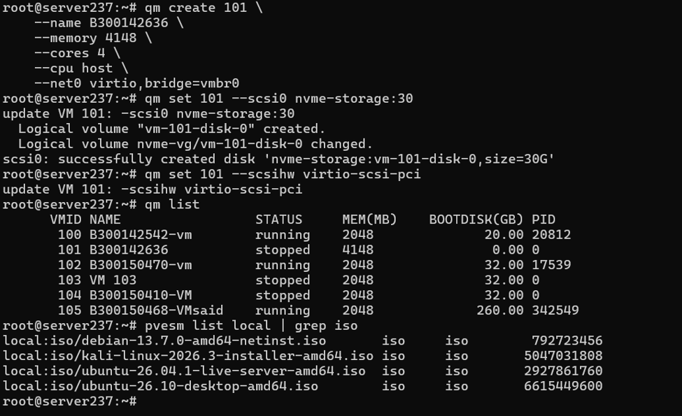

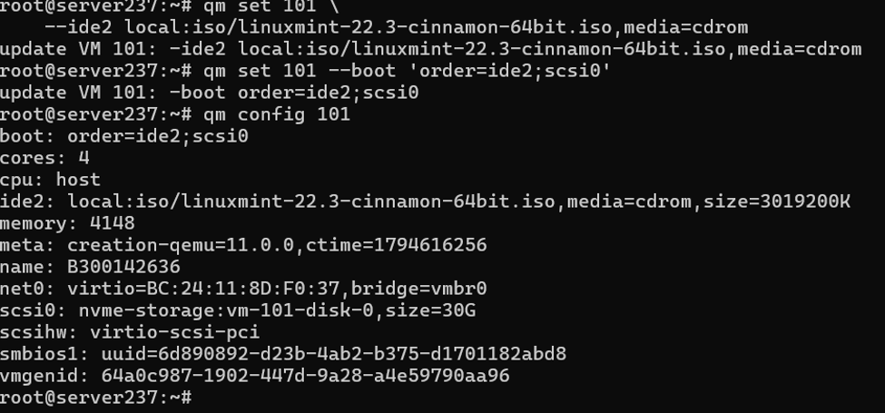

## 4. Installation de Linux Mint

Sur l’hôte Proxmox :

```bash
qm start 101
qm status 101
```

Dans **Proxmox → VM 101 → Console**, démarrer sur **Start Linux Mint**, puis lancer **Install Linux Mint** dans l’environnement Live. L’installation initiale de Linux Mint Cinnamon a été effectuée à l’aide de son **assistant graphique** ; la création de la VM et les configurations suivantes ont été réalisées en CLI.

Paramètres de compte relevés :

| Champ | Valeur |
|---|---|
| Nom de l’ordinateur | `murtada-nmd` |
| Identifiant | `ndiogoudioum` |
| Connexion | Mot de passe demandé |
| Connexion automatique | Désactivée |
| Chiffrement du dossier personnel | Non coché |

Après le message **Installation Complete**, redémarrer. Lorsque la VM est **arrêtée**, détacher l’ISO et définir le disque comme périphérique de démarrage :

```bash
qm set 101 --delete ide2
qm set 101 --boot 'order=scsi0'
qm start 101
```

> Ne pas exécuter `qm start 101` si la VM est déjà en cours d’exécution. Les captures confirment le premier démarrage sur le système installé, mais ne montrent pas séparément toutes les commandes de retrait de l’ISO.

Dans Linux Mint :

```bash
whoami
hostname
```

Résultats observés : utilisateur `ndiogoudioum`, nom d’hôte `murtada-nmd`.

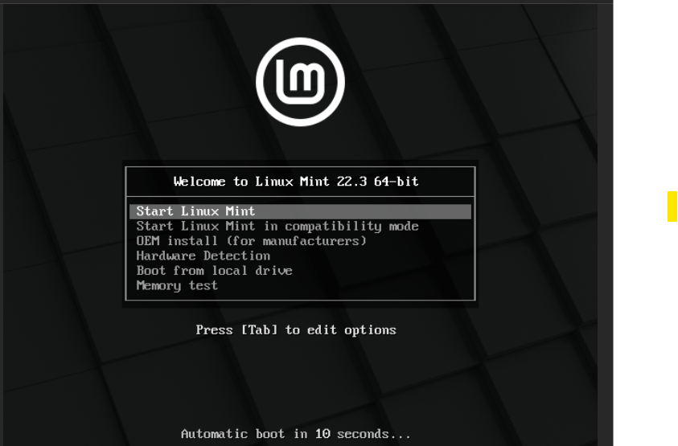

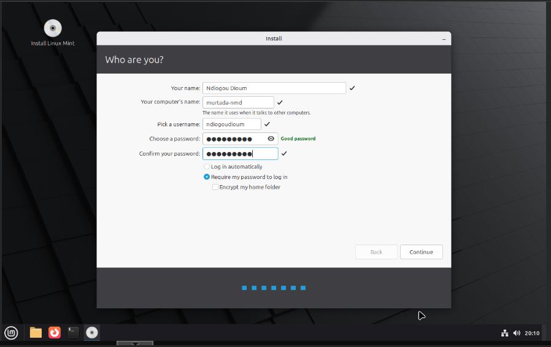

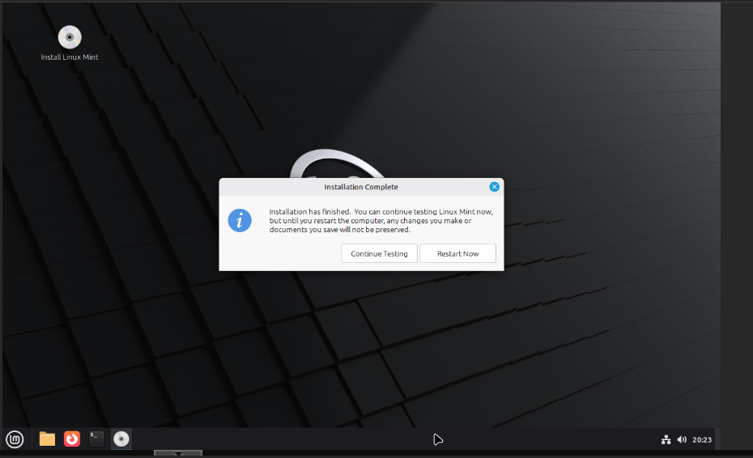

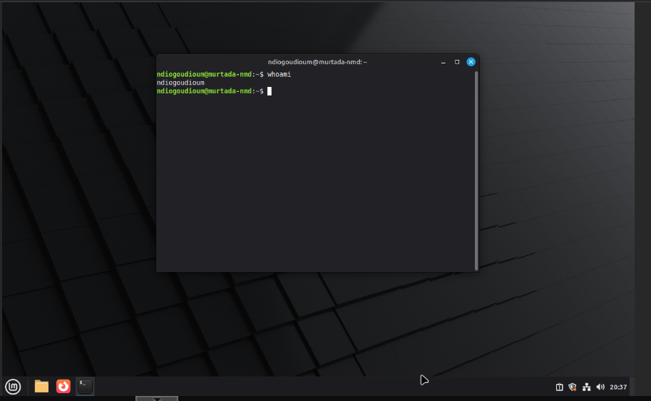

## 5. Configuration IPv4 statique

### 5.1 Vérification de la configuration initiale

```bash
ifconfig
ip -br addr
ip route
nmcli device status
nmcli connection show
```

Configuration initiale constatée : `ens18`, `10.7.237.58/23` (DHCP), passerelle `10.7.237.1`, connexion NetworkManager **`Wired connection 1`**.

### 5.2 Attribution de l’adresse statique

> L’adresse `10.7.236.203` doit être autorisée/réservée dans le réseau du laboratoire afin d’éviter un conflit IP.

```bash
sudo nmcli connection modify "Wired connection 1" ipv4.method manual ipv4.addresses 10.7.236.203/23 ipv4.gateway 10.7.237.1 ipv4.dns "10.7.237.1 1.1.1.1"
sudo nmcli connection up "Wired connection 1"
```

**Remarque :** les DNS indiqués sont les valeurs configurées pendant le TP ; leur pertinence dépend de la configuration du réseau du laboratoire.

### 5.3 Vérification de l’adresse et des communications

```bash
ip -br addr show ens18
ip route
ping -c 4 10.7.237.1
ping -c 4 8.8.8.8
```

Résultats observés :

- Interface `ens18` : `UP`, IPv4 `10.7.236.203/23`.
- Ping de la passerelle `10.7.237.1` : **4/4 réponses, 0 % de perte**.
- Ping de `8.8.8.8` : **4/4 réponses, 0 % de perte**.
- L’adresse est toujours présente après le redémarrage final.

La résolution DNS par nom de domaine n’a pas été explicitement démontrée par les captures finales.

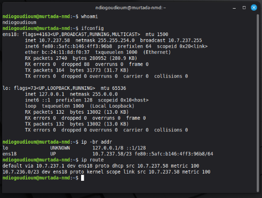

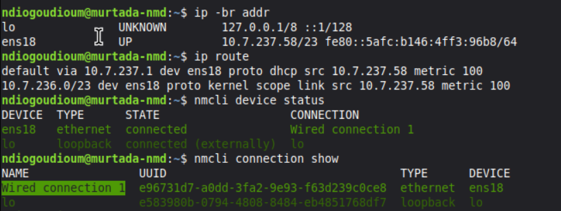

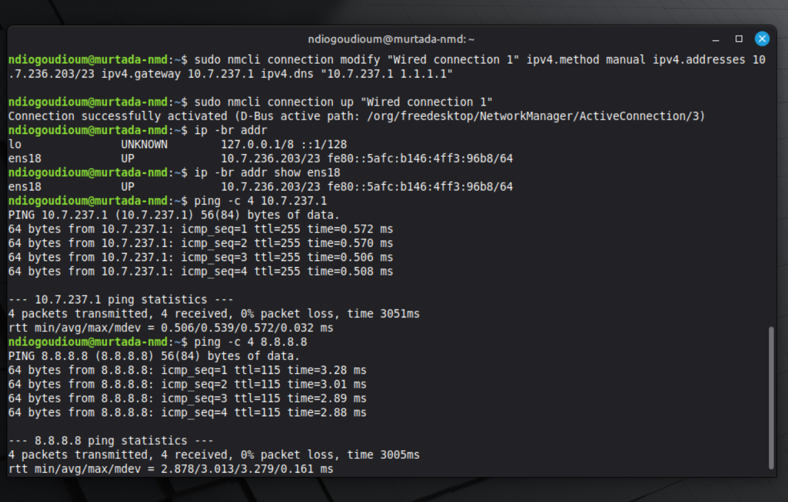

## 6. Installation et test SSH

### 6.1 Côté Linux Mint

```bash
sudo apt update
sudo apt install openssh-server -y
sudo systemctl enable --now ssh
sudo systemctl status ssh
sudo ss -tlnp | grep ':22'
```

Observations : `ssh.service` est **enabled** et **active (running)** ; `sshd` écoute sur TCP 22 en IPv4 et IPv6.

### 6.2 Côté Windows

Dans CMD ou PowerShell :

```powershell
ssh ndiogoudioum@10.7.236.203
```

Après résolution du problème de clé d’hôte décrit plus bas, la connexion distante a réussi et affiché :

```text
ndiogoudioum@murtada-nmd:~$
```

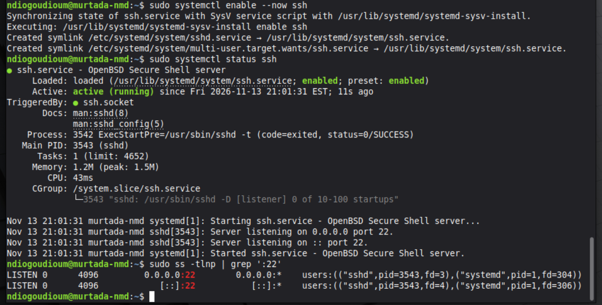

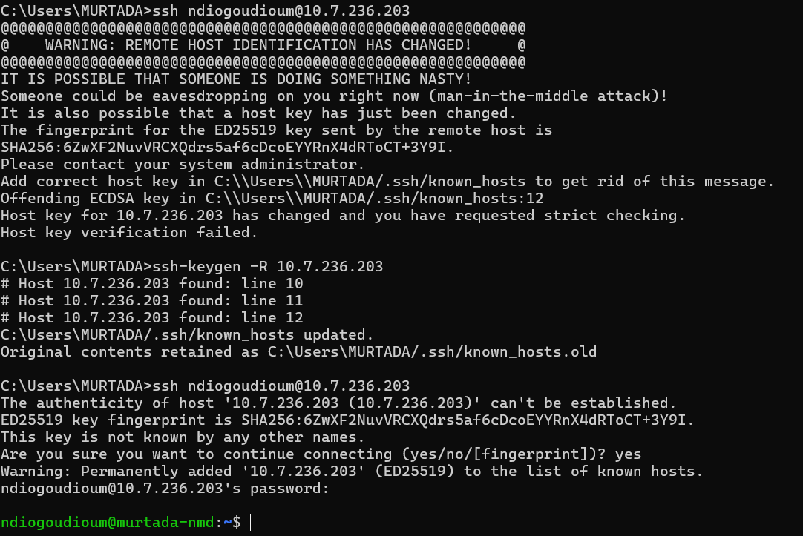

## 7. Vérification des ressources et mises à jour

```bash
hostnamectl
cat /etc/os-release
uname -r
free -h
lscpu
lsblk
df -h
```

Observations : Linux Mint 22.3 (Zena), virtualisation KVM/QEMU, **4 vCPU**, environ **3,9 Gio de RAM visibles**, disque `/dev/sda` de **30 Go**, partition racine `/dev/sda3` de 29,5 Go. Lors du contrôle, la partition racine affichait environ **11 Go utilisés et 17 Go disponibles**.

Mises à jour et installation des outils :

```bash
sudo apt update
sudo apt upgrade -y
sudo apt install -y curl wget git vim nano htop tree net-tools dnsutils traceroute tcpdump nmap
```

Versions vérifiées : **Git 2.43.0**, **htop 3.3.0**, **Nmap 7.94SVN**. La mise à jour a préparé le noyau `7.0.0-43-generic`, confirmé après redémarrage.

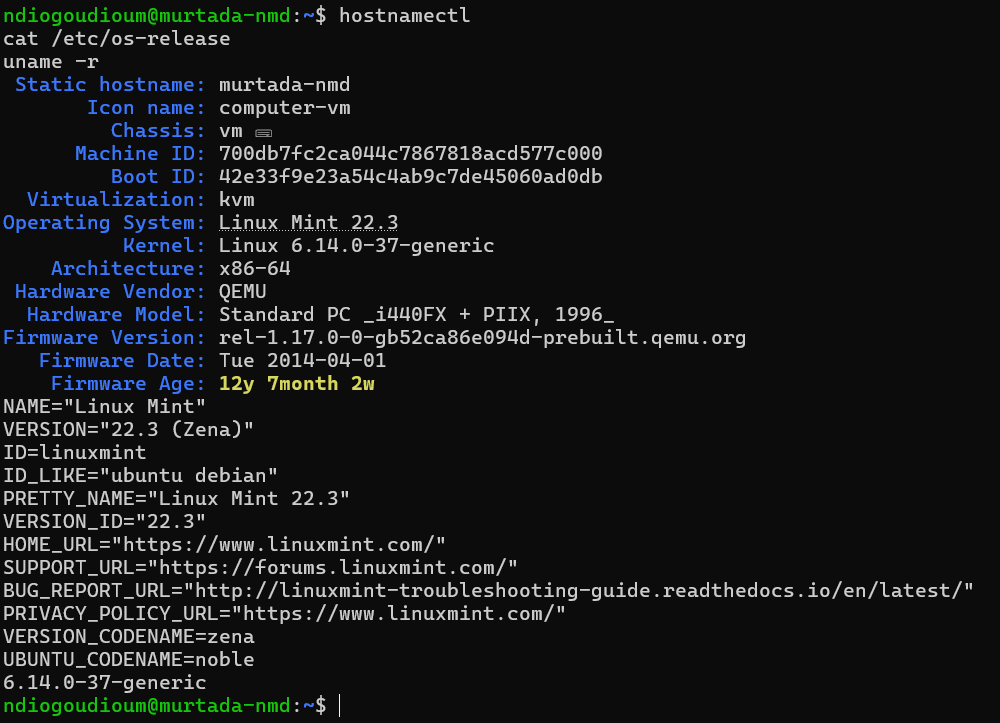

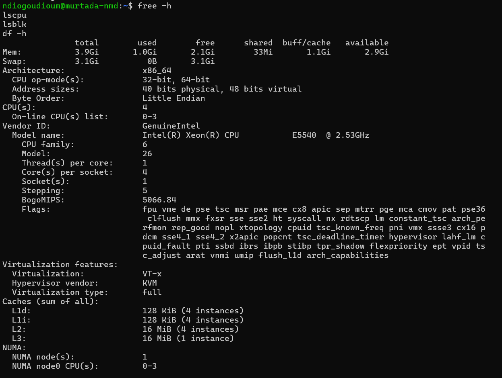

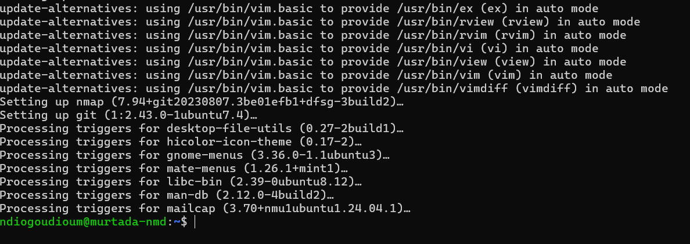

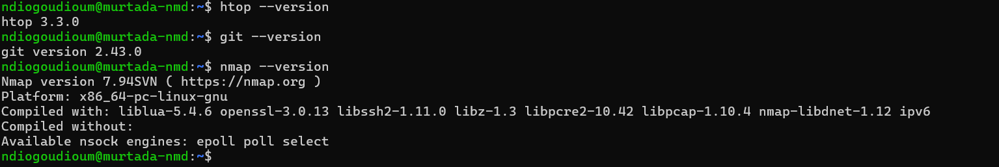

## 8. QEMU Guest Agent

QEMU Guest Agent permet à Proxmox de dialoguer avec le système invité, notamment pour obtenir des informations réseau et faciliter certaines opérations de gestion.

**Dans Linux Mint :**

```bash
sudo apt install qemu-guest-agent -y
sudo systemctl start qemu-guest-agent
systemctl status qemu-guest-agent
```

Le premier essai d’activation/démarrage a échoué à cause d’une dépendance. Après activation du canal côté Proxmox et relance, le service était **active (running)**.

**Sur l’hôte Proxmox :**

```bash
qm set 101 --agent enabled=1
qm config 101 | grep agent
qm agent 101 ping
qm agent 101 network-get-interfaces
```

Résultats constatés :

```text
agent: enabled=1
```

`qm agent 101 ping` s’est terminé sans erreur. La commande `network-get-interfaces` a retourné une adresse IPv4 `10.7.236.203` avec le préfixe `23`.

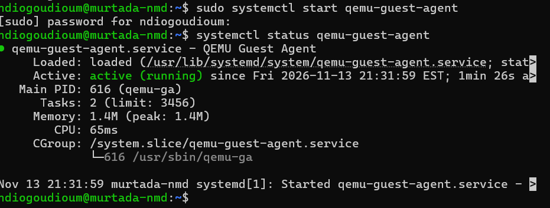

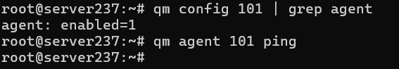

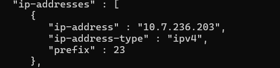

## 9. Problèmes rencontrés et solutions

| Problème | Cause identifiée ou probable | Solution utilisée |
|---|---|---|
| `qm: command not found` | Commande exécutée dans un environnement sans `qm` accessible | Se connecter au nœud Proxmox en tant qu’administrateur ; les captures ultérieures confirment `root@server237` |
| Erreur `nmcli` : paramètre `1` invalide | Les deux DNS n’étaient pas regroupés dans une même chaîne entre guillemets | Utiliser `ipv4.dns "10.7.237.1 1.1.1.1"` |
| `REMOTE HOST IDENTIFICATION HAS CHANGED!` | Une ancienne VM utilisant `10.7.236.203` avait été supprimée ; Windows conservait son ancienne clé SSH | Vérifier l’empreinte de la nouvelle VM, puis `ssh-keygen -R 10.7.236.203` sur Windows et reconnecter |
| `A dependency job for qemu-guest-agent.service failed` | Canal QEMU Guest Agent non disponible ou non activé lors du premier démarrage (cause probable) | Activer l’agent dans Proxmox, arrêter/redémarrer la VM puis démarrer le service |

Pour vérifier indépendamment une empreinte SSH depuis la console Linux Mint :

```bash
sudo ssh-keygen -lf /etc/ssh/ssh_host_ed25519_key.pub
```

**Attention :** supprimer une ancienne clé de `known_hosts` n’est approprié qu’après avoir vérifié que le changement de machine est légitime. La capture montre que la nouvelle clé a été acceptée ; la comparaison indépendante de son empreinte n’a pas été documentée.

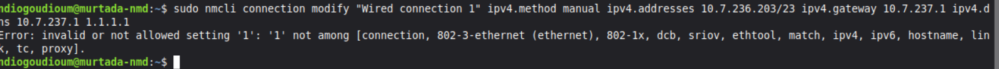

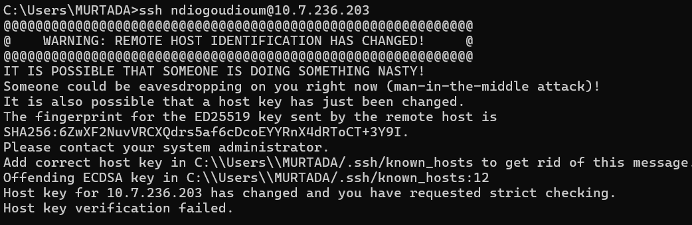

## 10. Validation finale

Commandes exécutées dans Linux Mint :

```bash
uname -r
ip -br addr
systemctl is-active ssh qemu-guest-agent
```

Résultats relevés :

```text
7.0.0-43-generic
ens18  UP  10.7.236.203/23
active
active
```

Les résultats attestent du noyau mis à jour, de la présence de l’adresse IP statique et de l’activité des services SSH et QEMU Guest Agent. La connexion SSH depuis Windows et la communication de l’agent avec Proxmox ont également été vérifiées. La configuration de la clé SSH publique du professeur est documentée à la section 11 ; son test de connexion reste à confirmer.

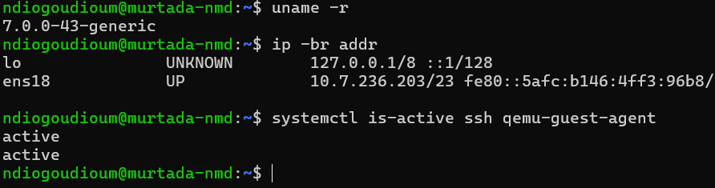

## 11. Autoriser l’accès SSH du professeur par clé publique RSA

**Objectif :** permettre au professeur de s’authentifier sur la VM avec sa propre clé privée, sans connaître le mot de passe du compte Linux. L’accès réseau au laboratoire reste nécessaire.

### 11.1 Préparer le compte Linux Mint

Dans la VM, connecté en tant que `ndiogoudioum` :

```bash
mkdir -p ~/.ssh
chmod 700 ~/.ssh
nano ~/.ssh/authorized_keys
```

Coller **uniquement la clé publique fournie par le professeur**, sur une seule ligne commençant par `ssh-rsa`. Ne jamais demander ni copier sa clé privée. Si le fichier existe déjà, conserver ses autres entrées. Enregistrer puis exécuter :

```bash
chmod 600 ~/.ssh/authorized_keys
chmod 700 ~/.ssh
ls -ld ~/.ssh
ls -l ~/.ssh/authorized_keys
sudo sshd -T | grep pubkeyauthentication
```

**Résultats constatés :** dossier `.ssh` en mode `700`, fichier `authorized_keys` en mode `600`, propriétaire `ndiogoudioum` et `pubkeyauthentication yes`.

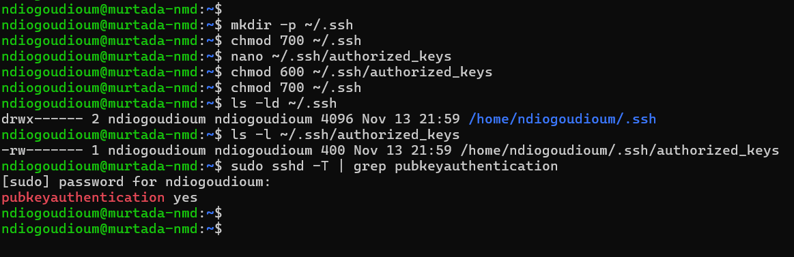

### 11.2 Vérifier la présence et le format de la clé

```bash
grep -c '^ssh-rsa ' ~/.ssh/authorized_keys
ssh-keygen -lf ~/.ssh/authorized_keys
ls -ld /home/ndiogoudioum
```

**Résultats constatés :** une entrée `ssh-rsa`, une clé **RSA de 2048 bits** reconnue par `ssh-keygen` et un dossier personnel en mode `755` appartenant à `ndiogoudioum`. L’empreinte complète et la clé publique ne sont pas reproduites dans cette documentation.

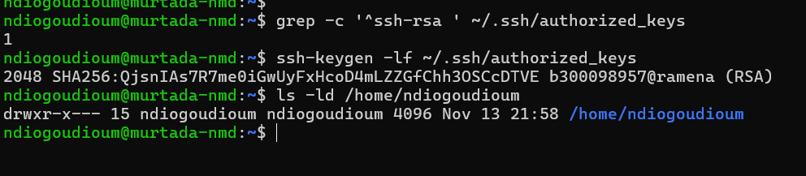

### 11.3 Test d’accès à effectuer par le professeur

Depuis un poste ayant accès au réseau du laboratoire, le professeur peut tester :

```bash
ssh -i /chemin/vers/sa_cle_privee ndiogoudioum@10.7.236.203
```

En cas de difficulté, consulter les journaux sur la VM :

```bash
sudo journalctl -u ssh -f
```

**État de validation :** la clé publique est installée et reconnue par OpenSSH côté VM ; **une connexion réussie depuis le poste du professeur n’a pas encore été confirmée**. Une clé `ssh-rsa` peut nécessiter un client compatible avec les signatures RSA/SHA-2. Ne pas affaiblir la configuration SSH pour activer les anciennes signatures RSA/SHA-1.

**Sécurité :** la clé autorise l’accès au compte personnel `ndiogoudioum` avec les droits de ce compte. Pour limiter les privilèges, un compte distinct réservé au professeur est préférable si le laboratoire l’autorise. Ne pas publier la clé publique complète, les clés privées ou les mots de passe dans GitHub.

## 12. Conclusion

Ce projet a permis de déployer et d’administrer une machine virtuelle Linux Mint 22.3 Cinnamon sous Proxmox VE 9. La configuration réseau statique, l’accès distant SSH, l’installation d’outils d’administration et l’intégration de QEMU Guest Agent ont été validés par des commandes et des captures d’écran. L’ajout de la clé publique RSA du professeur a également préparé un accès distant par clé. Les difficultés rencontrées ont renforcé les compétences de diagnostic et de résolution de problèmes en environnement virtualisé.

---

### Organisation du dépôt

```text
Proxmox-Linux-Mint-Lab/
├── README.md
└── screenshots/
    ├── 01-creation-vm.png
    ├── 02-configuration-proxmox.png
    ├── ...
    ├── 25-validation-finale.png
    ├── 26-cle-professeur-permissions.png
    └── 27-cle-professeur-verification.png
```

**Sécurité :** ne jamais publier de mots de passe, de clés privées SSH ou de jetons d’accès. Les adresses `10.7.x.x` sont des adresses privées de laboratoire ; vérifier les règles de confidentialité de l’établissement avant de publier les captures.
