# Rapport 1 – Création d'une machine virtuelle directement sur le NVMe (Proxmox VE)

> **Cours :** INF1085-201 – Administration Linux
> **Étudiante :** Ariane Maeva Diffo – 300145955
> **Hyperviseur :** Proxmox VE 9.2.2 sur le serveur physique **server237** (HP ProLiant DL360 G7)
> **Machine virtuelle :** VM **107 – B300145955-vm**, sous **Ubuntu Server 26.04.1 LTS**
> **Emplacement du disque de la VM :** ✅ **directement sur le SSD NVMe** (stockage Proxmox **nvme-storage**)

> ### ✅ Ma machine virtuelle a été créée directement sur le NVMe
> Le disque virtuel de ma VM (**scsi0, 64 Go**) est stocké sur le stockage **nvme-storage**, qui correspond au **SSD NVMe de 1 To** du serveur (`/dev/nvme0n1`). Il n'est **pas** sur le RAID 5 (HDD) où Proxmox est installé.
>
> **Preuves dans ce rapport :**
> 1. Onglet **Disks** : *Storage = nvme-storage* (section 4.4) ;
> 2. Onglet **Confirm** : la ligne *scsi0 = nvme-storage:64* (section 4.8) ;
> 3. Dans la VM, `lsblk` affiche bien le disque **sda de 64G** (section 7.3).

---

## 1. Objectif

Créer une **machine virtuelle (VM)** sur le serveur Proxmox du laboratoire, **directement sur le SSD NVMe** (stockage **nvme-storage**), puis y installer **Ubuntu Server** et vérifier qu'elle fonctionne : matériel détecté, réseau et accès SSH.

>  **Une machine virtuelle**, c'est un ordinateur « simulé » par logiciel. Elle a son propre processeur, sa mémoire, son disque et sa carte réseau, mais tout cela est pris sur les ressources du vrai serveur. Plusieurs VM peuvent tourner en même temps sur un seul serveur physique : dans notre classe, chaque étudiant a la sienne sur **server237**.

---

## 2. Où sera stockée la VM ?

Le serveur **server237** possède deux disques :

```
🖥️ server237 (serveur physique)
 ├── 💿 sda : RAID 5 de 273 Go (HDD)   → Proxmox est installé ici (stockages local et local-lvm)
 └── 💿 nvme0n1 : SSD NVMe de 1 To     → stockage « nvme-storage », pour les disques des VM
        └── 📦 Disque virtuel de ma VM (64 Go)
               └── 🐧 Ubuntu Server 26.04.1 LTS
```

Le stockage **nvme-storage** avait déjà été préparé pour toute la classe. Il ne fallait donc **surtout pas** effacer le NVMe, car les VM des autres étudiants s'y trouvent déjà. Pour placer ma VM sur le NVMe, il suffit de choisir **nvme-storage** au moment de créer son disque (section 4.4).

> Un **SSD NVMe** est beaucoup plus rapide que des disques durs mécaniques. C'est idéal pour les machines virtuelles. Le serveur ne peut pas *démarrer* sur ce disque (son BIOS date de 2011), mais il peut très bien l'utiliser pour **stocker** les VM.

---

## 3. L'image d'installation (ISO)

L'image d'installation d'Ubuntu était déjà disponible dans le stockage **local**, rubrique **ISO Images** : **ubuntu-26.04.1-live-server-amd64.iso** (2,73 Gio). Il n'a donc pas été nécessaire de la télécharger.

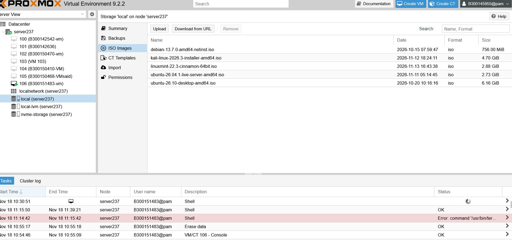

---

## 4. Création de la VM dans Proxmox

On clique sur le bouton bleu **Create VM**, en haut à droite. Un assistant s'ouvre, avec un onglet par catégorie de réglages.

### 4.1 General

| Réglage | Valeur | Explication |
|---|---|---|
| Node | server237 | Le serveur physique qui va héberger la VM |
| VM ID | **107** | Numéro unique de la VM, proposé automatiquement (les numéros 100 à 106 sont déjà pris par mes camarades) |
| Name | **B300145955-vm** | Nom de la VM, avec mon numéro d'étudiant pour la reconnaître facilement |

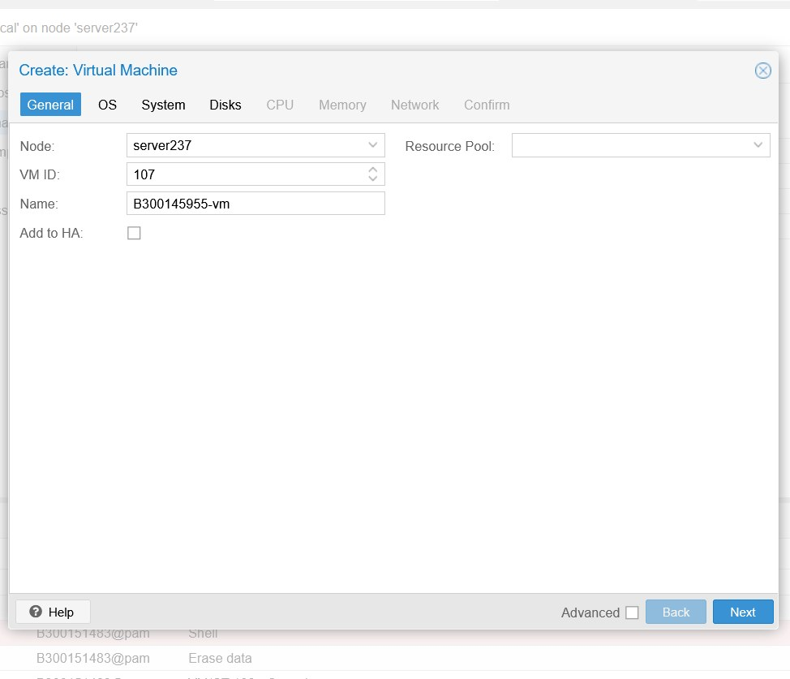

### 4.2 OS

| Réglage | Valeur |
|---|---|
| Use CD/DVD disc image file (iso) | Storage **local**, ISO **ubuntu-26.04.1-live-server-amd64.iso** |
| Guest OS – Type | **Linux** |
| Guest OS – Version | **7.x – 2.6 Kernel** (tout noyau Linux récent) |

L'ISO est « insérée » dans un **lecteur CD virtuel**. Au premier démarrage, la VM démarrera dessus, comme un ordinateur sur un DVD d'installation.

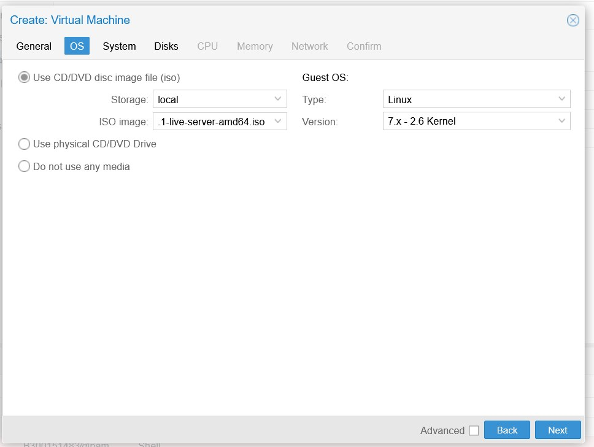

### 4.3 System

Les valeurs par défaut ont été conservées :

| Réglage | Valeur | Explication |
|---|---|---|
| Graphic card | Default | Carte graphique virtuelle simple, suffisante pour la console |
| Machine | Default (i440fx) | Modèle de carte mère virtuelle, très compatible |
| BIOS | Default (SeaBIOS) | BIOS classique (« legacy »), comme sur le serveur physique |
| SCSI Controller | VirtIO SCSI single | Contrôleur de disque **virtualisé**, plus rapide qu'un contrôleur simulé |

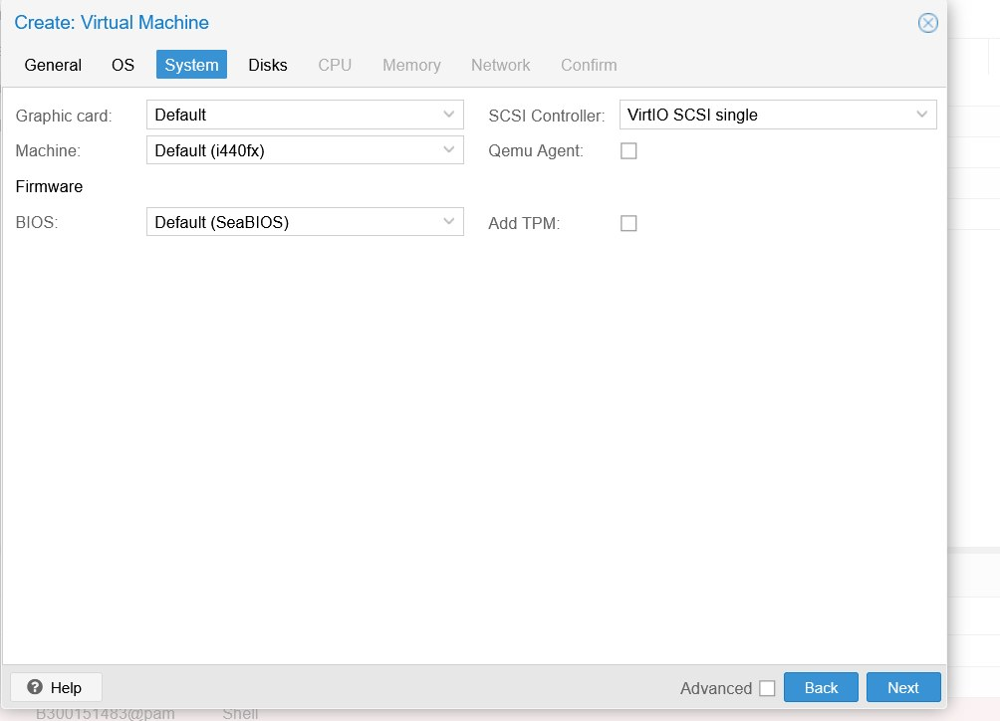

### 4.4 Disks 

| Réglage | Valeur | Explication |
|---|---|---|
| Bus/Device | SCSI 0 (**scsi0**) | Le disque est branché sur le contrôleur VirtIO SCSI |
| **Storage** | **nvme-storage** | ⬅️ **C'est ce choix qui crée la VM directement sur le SSD NVMe** et non sur le RAID 5 (HDD) |
| Disk size | **64 Gio** | Taille du disque virtuel |
| Format | Raw disk image (raw) | Format brut, le plus rapide |
| IO thread | ✅ | Les accès au disque ont leur propre processus, pour de meilleures performances |

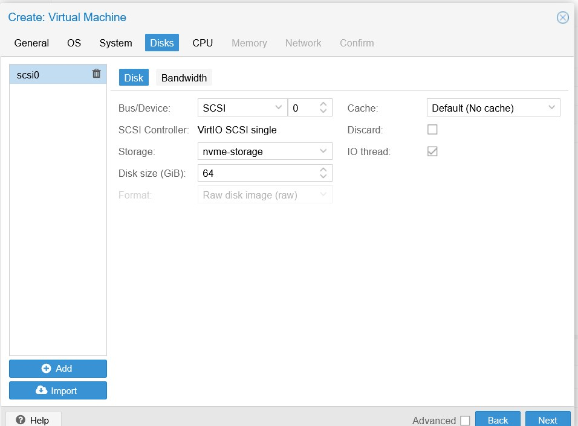

### 4.5 CPU

| Réglage | Valeur |
|---|---|
| Sockets | **2** |
| Cores | **2** |
| Total cores | **4** |
| Type | **host** |

>  **Sockets et cores :** un **socket** correspond à un processeur physique (une puce), et les **cores** sont les cœurs dans chaque processeur. Ici, 2 sockets × 2 cœurs = **4 cœurs** au total. Ce choix imite le vrai serveur, qui a lui aussi **2 processeurs** Xeon E5540.
>
> Le type **host** donne à la VM **toutes les capacités du vrai processeur** (jeux d'instructions, accélérations). C'est plus performant que le type générique, et ce sera utile pour le projet d'IA locale (Ollama) prévu plus tard.

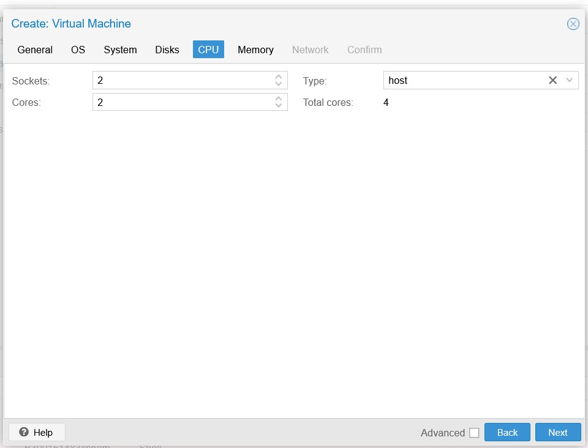

### 4.6 Memory

**8192 Mio**, soit **8 Go** de mémoire vive.

> Le serveur a environ 63 Go de RAM, à partager entre toutes les VM de la classe. 8 Go est un bon compromis : assez pour un serveur Ubuntu et un petit modèle d'IA, sans priver les autres étudiants.

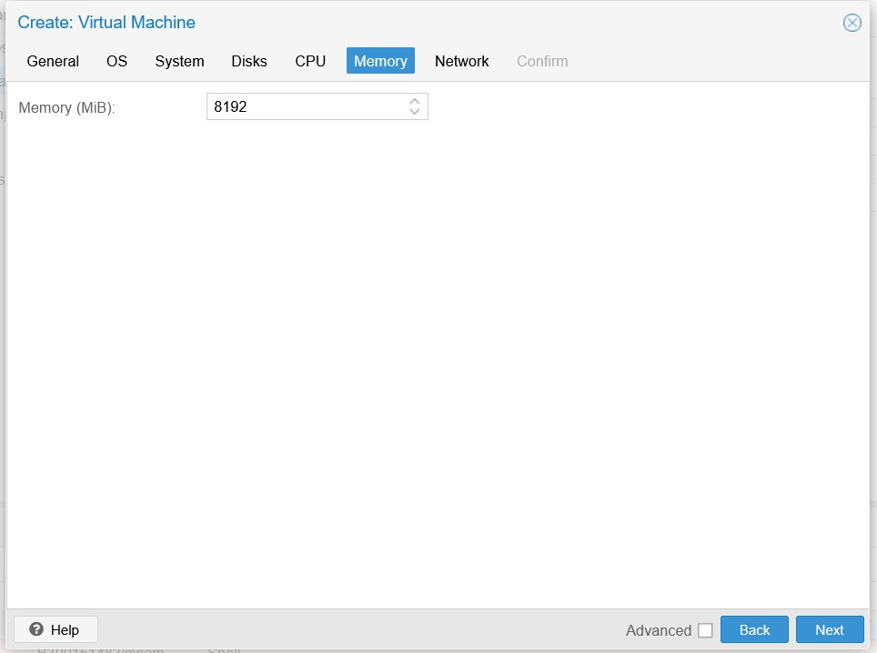

### 4.7 Network

| Réglage | Valeur | Explication |
|---|---|---|
| Bridge | **vmbr0** | Le **pont réseau** de Proxmox : il relie la carte réseau virtuelle de la VM à la vraie carte du serveur. La VM se retrouve ainsi sur le même réseau que les autres machines du labo |
| Model | VirtIO (paravirtualized) | Carte réseau virtualisée, la plus rapide |
| MAC address | auto | Adresse MAC générée automatiquement |
| Firewall | ✅ | Le pare-feu de Proxmox peut filtrer le trafic de la VM |

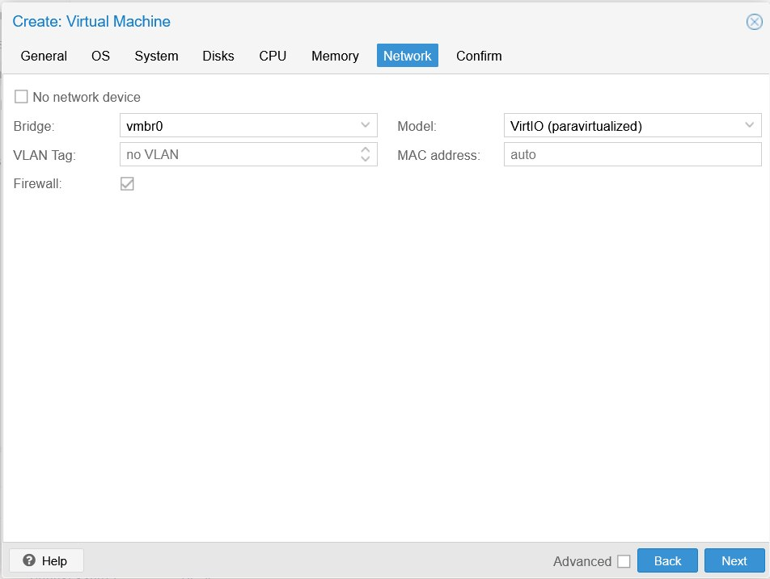

### 4.8 Confirm

Le résumé reprend tous les choix : `cores 2`, `sockets 2`, `cpu host`, `memory 8192`, `scsi0 nvme-storage:64`, `net0 virtio,bridge=vmbr0`, `ide2` = l'ISO Ubuntu. La case **Start after created** est cochée, pour démarrer la VM dès sa création. On clique sur **Finish**.

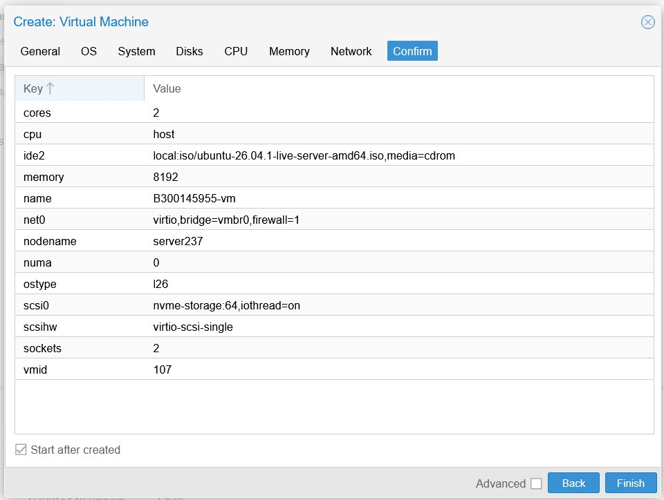

---

## 5. Installation d'Ubuntu Server

On sélectionne la VM **107 (B300145955-vm)** à gauche, puis on ouvre la **Console**. La console affiche l'écran de la VM, comme si un moniteur y était branché.

> **Petit problème rencontré :** au début, le clavier n'avait aucun effet dans la console. Il faut d'abord **cliquer à l'intérieur de l'écran noir** pour que la console « prenne le focus » du clavier.

### 5.1 Démarrage de l'installateur

La VM démarre sur l'ISO. Après un écran noir, le noyau Linux de l'installateur se charge (lignes « Begin… done »), puis les services démarrent un par un (lignes **[ OK ]** en vert), dont le réseau et **cloud-init**.

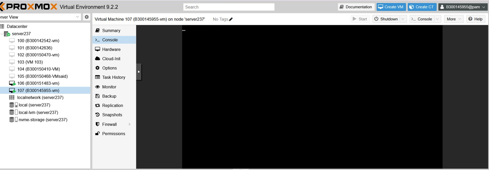

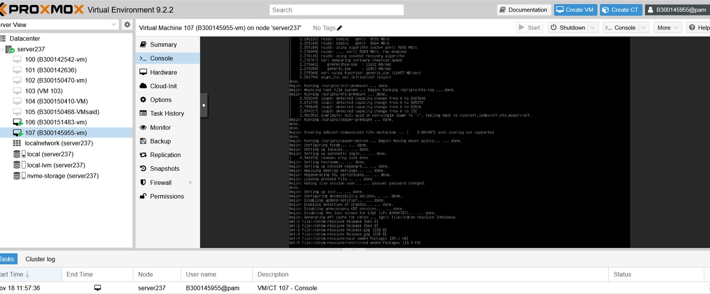

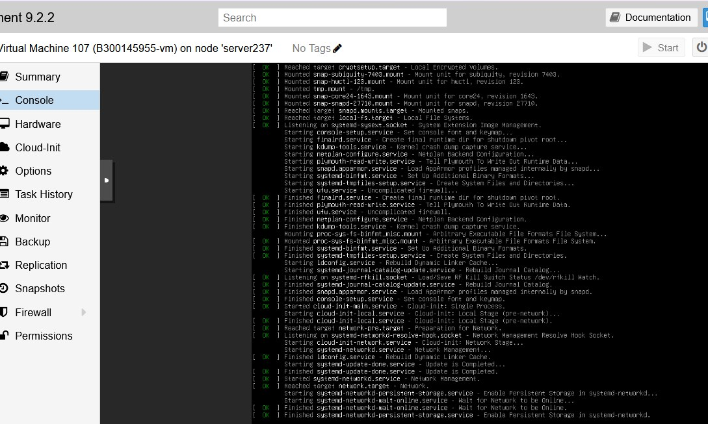

### 5.2 Langue

Choix de **English**. Les messages d'erreur seront en anglais, ce qui rend la recherche d'aide en ligne beaucoup plus facile. On se déplace avec les flèches ↑ ↓ et on valide avec **Entrée**.

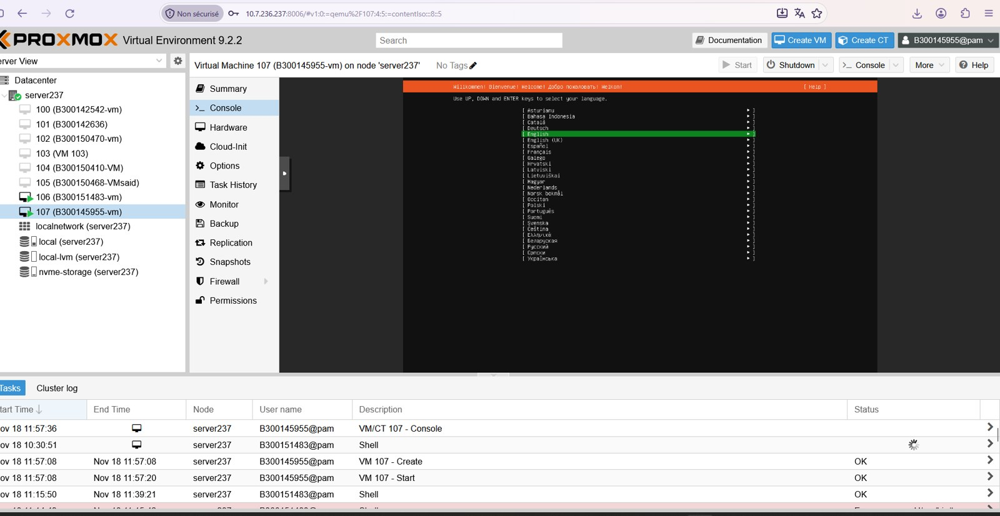

Les écrans suivants ont été validés avec les valeurs proposées : clavier **English (US)**, type d'installation **Ubuntu Server**, réseau automatique par **DHCP**, sans proxy, avec le miroir Ubuntu par défaut.

### 5.3 Stockage : Guided storage configuration

| Option | Choix | Explication |
|---|---|---|
| Use an entire disk | ✅ | Utiliser tout le disque virtuel **QEMU HARDDISK** de 64 Go |
| Set up this disk as an LVM group | ✅ | Organiser le disque avec **LVM** |
| Encrypt the LVM group with LUKS | ❌ | Pas de chiffrement, sinon un mot de passe serait demandé à chaque démarrage |

>  **LVM (Logical Volume Manager)** ajoute une couche souple entre le disque et les systèmes de fichiers. On peut ensuite **agrandir, réduire ou créer** des volumes sans repartitionner le disque.

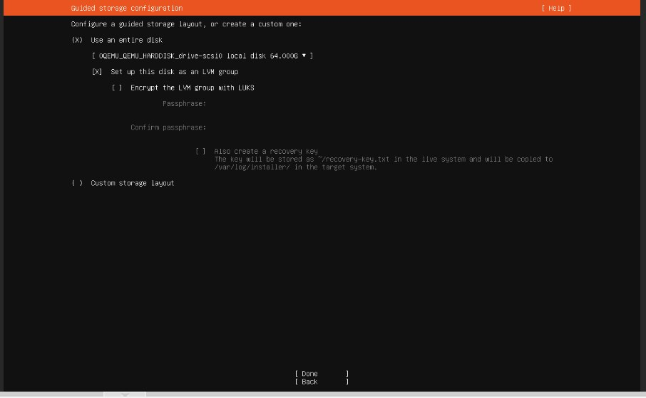

### 5.4 Stockage : le résumé

L'installateur affiche le découpage prévu du disque :

| Élément | Taille | Rôle |
|---|---|---|
| partition 1 | 1 Mo | *BIOS grub spacer* : petit espace nécessaire à GRUB avec un BIOS classique |
| partition 2 → **/boot** | 2 Go | Fichiers de démarrage (noyau Linux, GRUB), en ext4 |
| partition 3 → **ubuntu-vg** | 62 Go | Le **groupe de volumes LVM** |
| └─ **ubuntu-lv** → **/** | **31 Go** | Le système Ubuntu, en ext4 |
| └─ espace libre | **31 Go** | Laissé libre dans le groupe LVM |

> **Remarque :** Ubuntu n'utilise que **la moitié** du groupe LVM pour le système et garde **31 Go libres**. C'est volontaire : on pourra utiliser cet espace plus tard selon les besoins. Ce sera le sujet du prochain rapport, **Storage**.

On valide avec **Done**, puis on confirme l'effacement du disque (**Confirm destructive action → Continue**). Ce disque virtuel était neuf et vide, donc on ne perd aucune donnée.

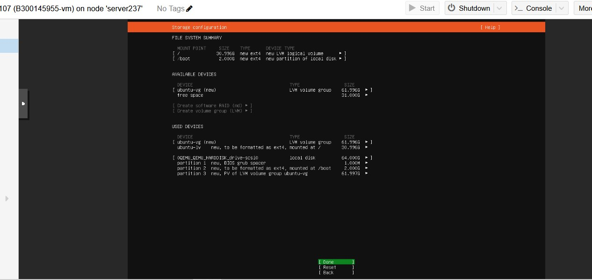

### 5.5 Profil

| Champ | Valeur |
|---|---|
| Your name | Ariane Maeva Diffo |
| Your servers name | **b300145955-vm** |
| Pick a username | **b300145955** |
| Password | (choisi et confirmé, il s'affiche en étoiles) |

Le nom du serveur et le nom d'utilisateur doivent être en **minuscules**, sans espace ni accent, et le nom d'utilisateur doit commencer par une **lettre**.

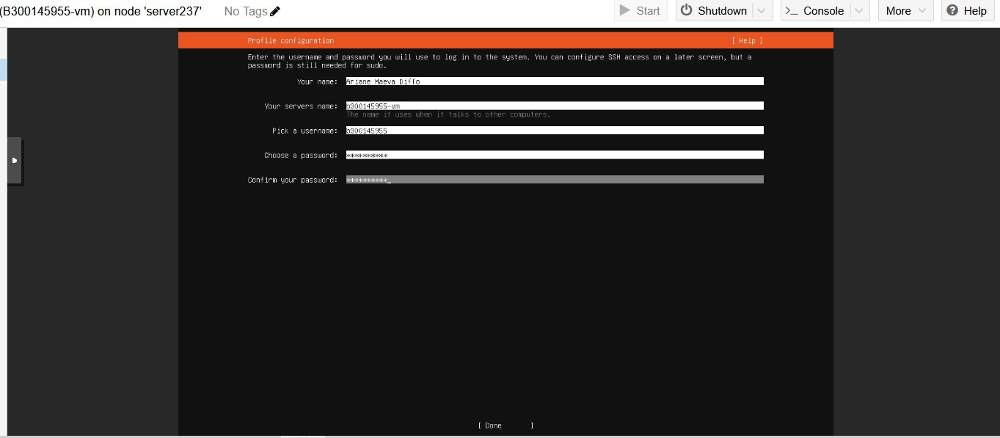

L'écran **Upgrade to Ubuntu Pro** a été passé (**Skip for now**).

### 5.6 SSH configuration

| Option | Choix | Explication |
|---|---|---|
| **Install OpenSSH server** | ✅ | Installe le serveur **SSH**, pour administrer la VM **à distance**. C'est indispensable, entre autres pour que le professeur puisse se connecter avec sa clé |
| Allow password authentication over SSH | ✅ | Autorise la connexion SSH avec un mot de passe |
| Import SSH key | (vide) | Cette option n'importe des clés que depuis GitHub ou Launchpad. La clé du professeur sera ajoutée **après l'installation** (rapport 2 – ROOT) |

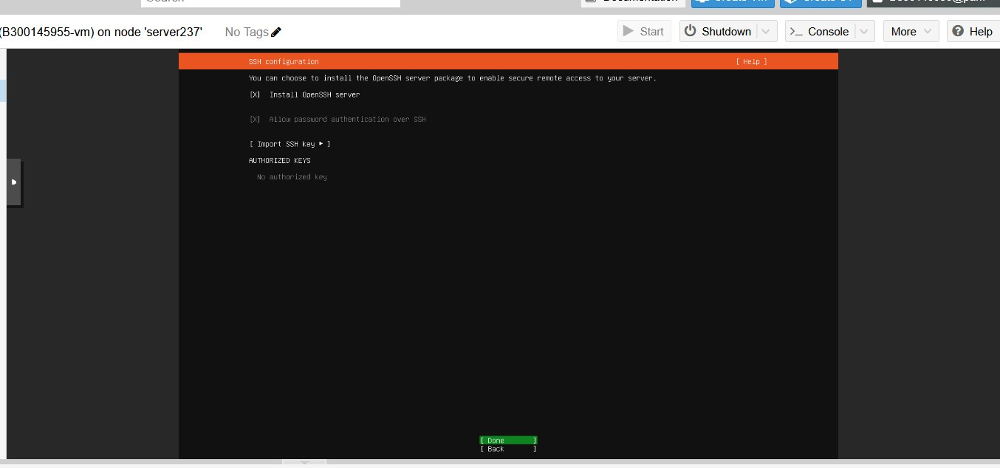

Sur l'écran **Featured server snaps**, aucun logiciel supplémentaire n'a été coché.

### 5.7 Installation

L'installateur travaille seul pendant une dizaine de minutes. On peut suivre ses étapes :

- **writing install sources to disk** : copie du système sur le disque ;
- **installing kernel** : installation du noyau Linux ;
- **setting up swap** : création de la mémoire d'échange ;
- **installing grub to target devices** : installation du chargeur de démarrage **GRUB** ;
- **installing openssh-server** : installation du serveur SSH ;
- **downloading and installing security updates** : mises à jour de sécurité.

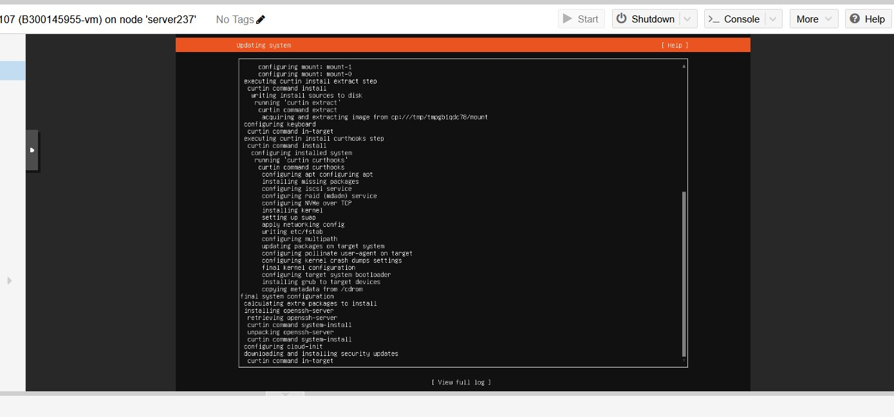

À la fin, le titre devient **Installation complete!** et le bouton **[ Reboot Now ]** apparaît.

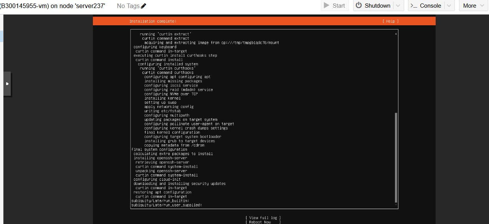

Au redémarrage, le message **« Please remove the installation medium, then press ENTER »** demande de retirer l'ISO. Dans une VM, il suffit d'appuyer sur **Entrée**.

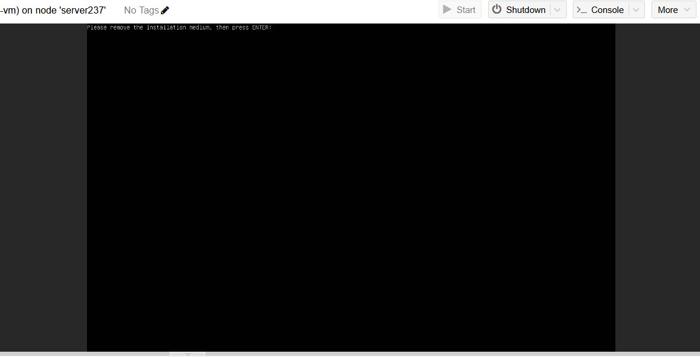

---

## 6. Premier démarrage

### 6.1 L'écran de connexion

Ubuntu démarre et affiche **Ubuntu 26.04.1 LTS b300145955-vm tty1**, puis l'invite **`b300145955-vm login:`**.

Les lignes au-dessus viennent de **cloud-init** : au premier démarrage, il crée les **clés SSH du serveur** (ECDSA, ED25519). Ce sont les « cartes d'identité » de la VM. Lors d'une connexion SSH, l'ordinateur client les vérifie pour être sûr de parler à la bonne machine.

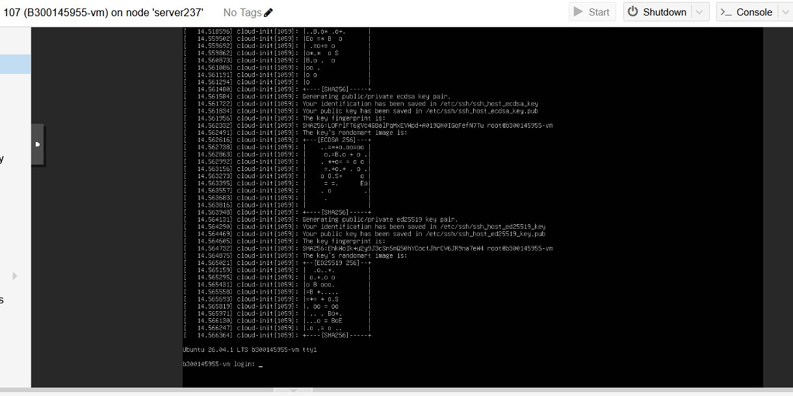

### 6.2 Connexion

On se connecte avec l'utilisateur **b300145955** et son mot de passe. 
Le message d'accueil donne déjà des informations utiles :
- **Welcome to Ubuntu 26.04.1 LTS (GNU/Linux 7.0.0-43-generic x86_64)** ;
- **Usage of / : 24.1 % of 30.34 GB** ;
- **Memory usage : 3 %** ;
- **IPv4 address for ens18 : 10.7.236.180** ;
- **46 updates can be applied immediately**, à installer plus tard avec `sudo apt upgrade`.

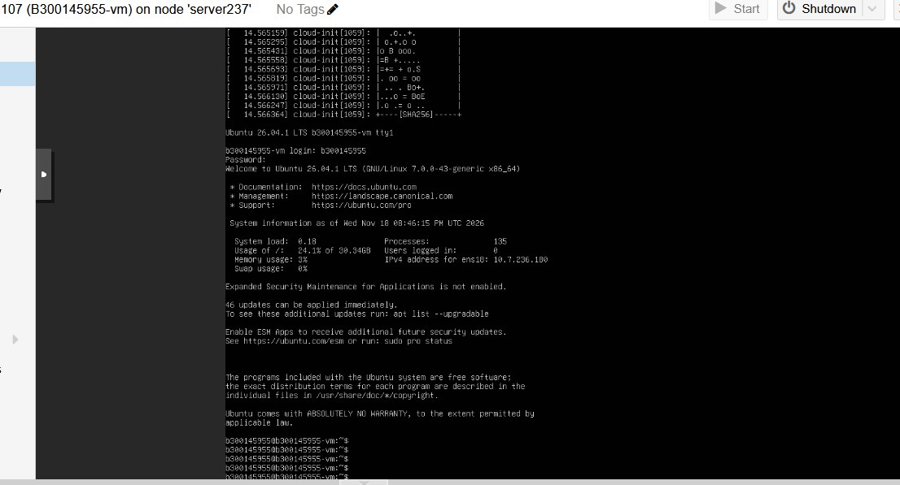

---

## 7. Vérifications

### 7.1 `hostnamectl` : l'identité de la machine

| Information | Valeur |
|---|---|
| Static hostname | **b300145955-vm** |
| Chassis | **vm** : Linux sait qu'il est une machine virtuelle |
| Virtualization | **kvm** : la technologie de virtualisation utilisée par Proxmox |
| Operating System | **Ubuntu 26.04.1 LTS** |
| Kernel | Linux 7.0.0-43-generic |
| Architecture | x86-64 |
| Hardware Vendor / Model | **QEMU**, Standard PC (i440FX + PIIX) : le « matériel » simulé par Proxmox |

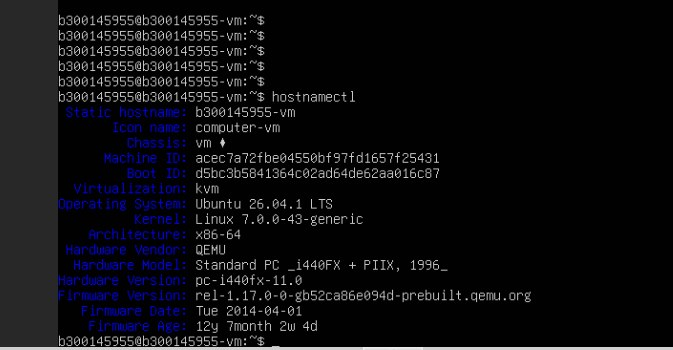

### 7.2 `ip a` : le réseau

| Interface | Adresse | Rôle |
|---|---|---|
| **lo** | 127.0.0.1/8 | Le *loopback* : la machine qui se parle à elle-même |
| **ens18** | **10.7.236.180/23** | La carte réseau VirtIO de la VM, reliée à **vmbr0**. Elle est **UP** (active) |

- **link/ether bc:24:11:f6:e8:42** : l'adresse **MAC** générée par Proxmox ;
- **dynamic** : l'adresse a été attribuée **automatiquement par le serveur DHCP** du laboratoire ;
- **/23** : la VM est sur le **même réseau** que le serveur Proxmox (10.7.236.237/23).

> Comme l'adresse est **dynamique**, elle pourrait changer après une longue période d'arrêt. Pour un serveur, il est préférable de configurer plus tard une **adresse IP fixe**.

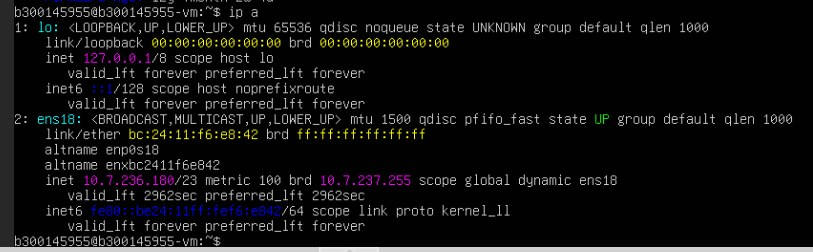

### 7.3 `nproc`, `free -h` et `lsblk` : processeur, mémoire et disque

- **`nproc` → 4** : la VM voit bien ses **4 cœurs** ✅
- **`free -h`** :
  - **Mem : 7,2 Gi** au total. On a attribué 8 Go, mais le noyau en réserve une petite partie. Seulement **455 Mi** sont utilisés, car Ubuntu Server n'a pas d'interface graphique ✅
  - **Swap : 4,0 Gi** : mémoire d'échange sur le disque, utilisée si la RAM est pleine.
- **`lsblk`** :

| Nom | Taille | Rôle |
|---|---|---|
| **sda** | **64G** | Le disque virtuel, stocké sur le NVMe ✅ |
| ├─ sda1 | 1M | BIOS grub spacer |
| ├─ sda2 | 2G | **/boot** |
| └─ sda3 | 62G | Partition LVM |
| &nbsp;&nbsp;&nbsp;└─ ubuntu--vg-ubuntu--lv | **31G** | **/** (le système) |
| **sr0** | 2,7G | Le lecteur CD virtuel, qui contient encore l'ISO |
| loop0 à loop2 | | Les paquets **snap** d'Ubuntu (core24, snapd…) |

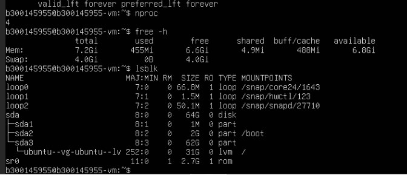

> **Pourquoi pas d'interface graphique ?** **Ubuntu Server** fonctionne uniquement **en ligne de commande**, sans bureau ni souris. C'est volontaire : le système reste léger (environ 450 Mo de RAM au lieu de 2 à 4 Go) et laisse presque toutes les ressources aux services. Un serveur se gère **à distance, en SSH**.

---

## 8. Nettoyage : retirer l'ISO

L'installation est terminée, donc l'ISO n'est plus utile. Dans Proxmox, on ouvre **Hardware**, puis **CD/DVD Drive**, on clique sur **Edit**, on choisit **Do not use any media**, puis on clique sur **OK**. Le lecteur CD virtuel est maintenant vide, et la VM démarrera toujours sur son disque.

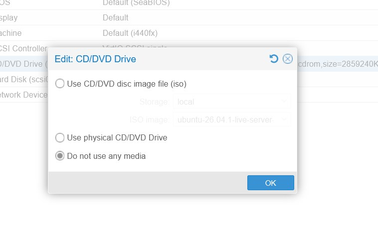

---

## 9. Résumé de la VM

| Élément | Valeur |
|---|---|
| VM | **107 – B300145955-vm** sur **server237** |
| Système | Ubuntu Server **26.04.1 LTS**, noyau 7.0.0-43 |
| Processeur | **4 cœurs** (2 sockets × 2 cores), type **host** |
| Mémoire | **8 Go** (7,2 Gi utilisables) + 4 Go de swap |
| Disque | **64 Go, créé directement sur le NVMe** (stockage **nvme-storage**), en LVM : 31 Go pour `/` et 31 Go libres |
| Réseau | **ens18**, **10.7.236.180/23** (DHCP), via le pont **vmbr0** |
| Accès | Console Proxmox et **SSH** (`ssh b300145955@10.7.236.180`) |

## 10. Problèmes rencontrés et leçons apprises

| Situation | Explication / solution |
|---|---|
| Le clavier ne réagissait pas dans la console | Il faut **cliquer dans l'écran noir** pour donner le focus à la console |
| Ne pas effacer le NVMe | Le stockage **nvme-storage** existait déjà et contient les VM des autres étudiants : il suffit de le **sélectionner** à l'onglet Disks |
| Pas d'interface graphique | C'est normal avec **Ubuntu Server** : tout se fait en ligne de commande ou en SSH |
| Rien ne s'affiche en tapant le mot de passe | C'est normal sous Linux, pour la sécurité |
| `/` ne fait que 31 Go sur 64 Go | Ubuntu laisse volontairement de l'espace libre dans LVM, à utiliser à l'étape **Storage** |
| Nombre de cœurs | Le réglage peut être **modifié après la création** (Hardware → Processors → Edit), avec un redémarrage de la VM |


