# Rapport d'Installation de Kali Linux

* **Étudiant(e)** : Mohand Said Saheb
* **Identifiant étudiant** : b300150468
* **Mot de passe de session** : Boreal123

---

## 1. Introduction

Ce rapport technique présente de manière structurée et détaillée la procédure complète d'installation de Kali Linux au sein d'un environnement virtualisé. L'objectif est de documenter chaque phase critique, depuis la configuration initiale de la machine virtuelle jusqu'au premier accès au bureau fonctionnel, en s'appuyant sur les captures d'écran réglementaires.

---

## 2. Prérequis et Téléchargement

Avant d'entamer l'installation, le téléchargement de l'image ISO officielle est indispensable. Vous pouvez récupérer l'installateur hors ligne (x86_64) directement via ce lien officiel : [https://cdimage.kali.org](https://cdimage.kali.org). Ce fichier servira de support de démarrage pour la machine virtuelle.

> 📸 **Capture : Téléchargement de l'ISO**  
> 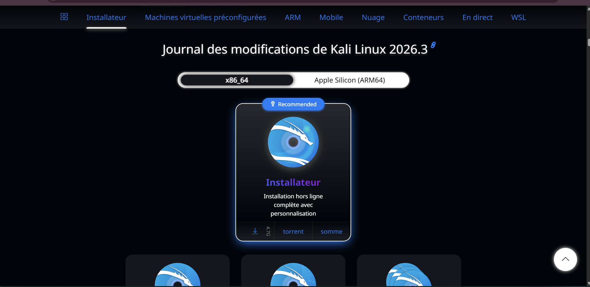

Pour éviter un transfert local, vous pouvez importer l'image ISO de Kali Linux directement dans Proxmox. Depuis l'interface, accédez au stockage "local" du nœud, sélectionnez "Images ISO", puis cliquez sur "Télécharger depuis une URL". Collez le lien officiel pour lancer le téléchargement directement sur le serveur.

> 📸 **Capture : Téléchargement dans Proxmox**  
> 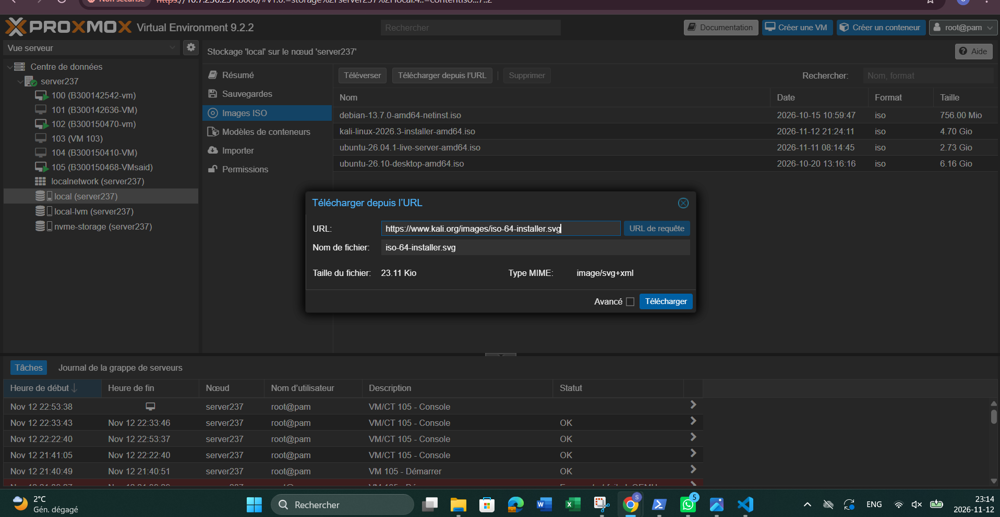

## 3. Configuration de la Machine Virtuelle

La première étape consiste à paramétrer la machine virtuelle (VM) en y intégrant les caractéristiques techniques requises (mémoire, processeur, contrôleurs de stockage) et en désignant l'image ISO de Kali Linux comme support de démarrage prioritaire.

> 📸 **Capture : Configuration de la VM**  
> 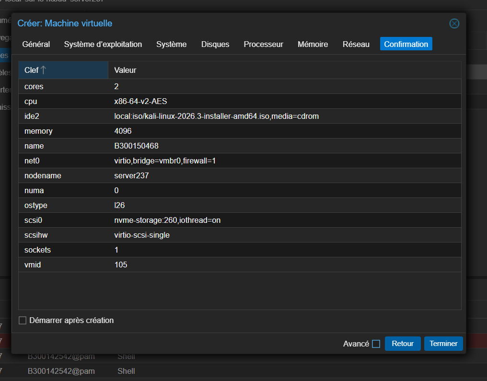

---

## 4. Processus d'Installation

### Chargement des composants initiaux
Après le démarrage sur l'image d'installation, l'installateur amorce le chargement des différents modules et pilotes nécessaires à la poursuite du processus.

> 📸 **Capture : Chargement des composants**  
> 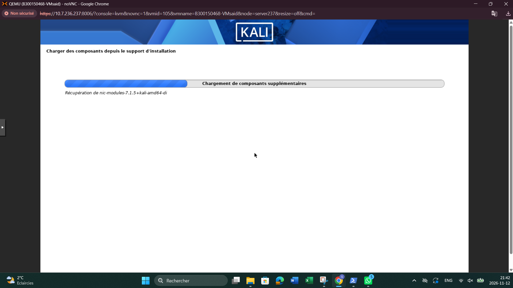

### Partitionnement des disques
Cette étape cruciale permet de définir l'architecture de stockage. L'option de partitionnement guidé sélectionnée consiste à regrouper l'ensemble des répertoires du système au sein d'une seule et unique partition principale, simplifiant ainsi la gestion de l'espace disque.

> 📸 **Capture : Partitionnement**  
> 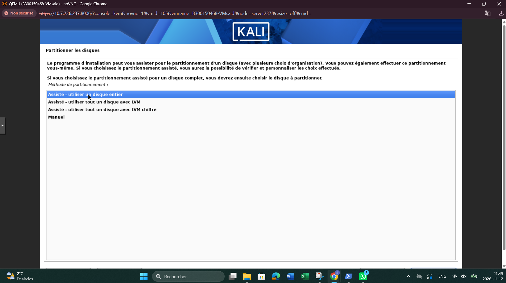

Un récapitulatif complet des modifications à apporter au disque virtuel est affiché afin de valider la structure des partitions créées avant l'écriture effective.

> 📸 **Capture : Résumé des partitions**  
> 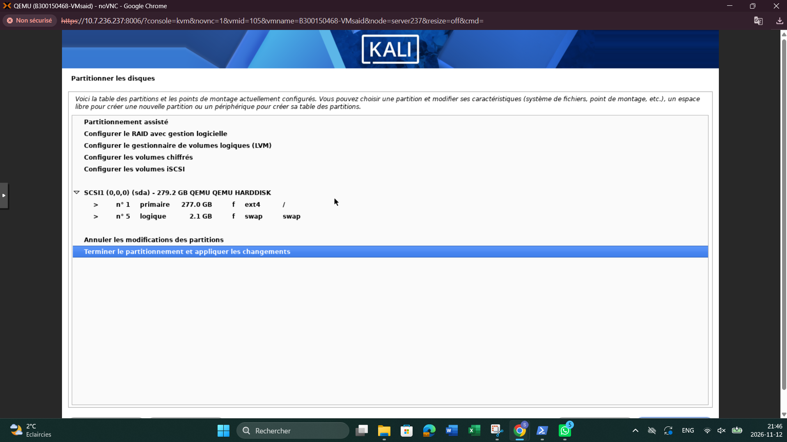

L'installateur demande ensuite une confirmation explicite pour autoriser l'écriture des tables de partitions et formater le disque dur virtuel.

> 📸 **Capture : Confirmation**  
> 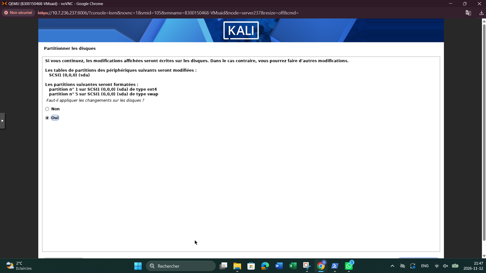

Une fois le disque préparé, le système procède à l'installation proprement dite des paquets constituant le système d'exploitation de base.

> 📸 **Capture : Installation du système de base**  
> 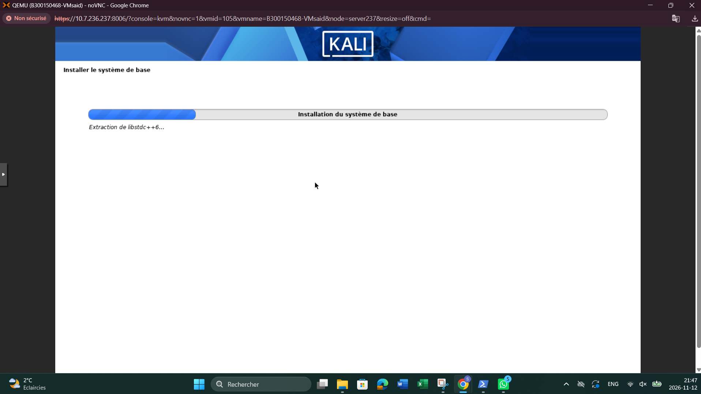

### Sélection des logiciels et de l'environnement de bureau
Cette phase permet de personnaliser l'installation en choisissant l'environnement de bureau (Desktop Environment) de prédilection ainsi que les collections d'outils et de métapaquets de sécurité indispensables aux travaux pratiques.

> 📸 **Capture : Sélection des logiciels**  
> 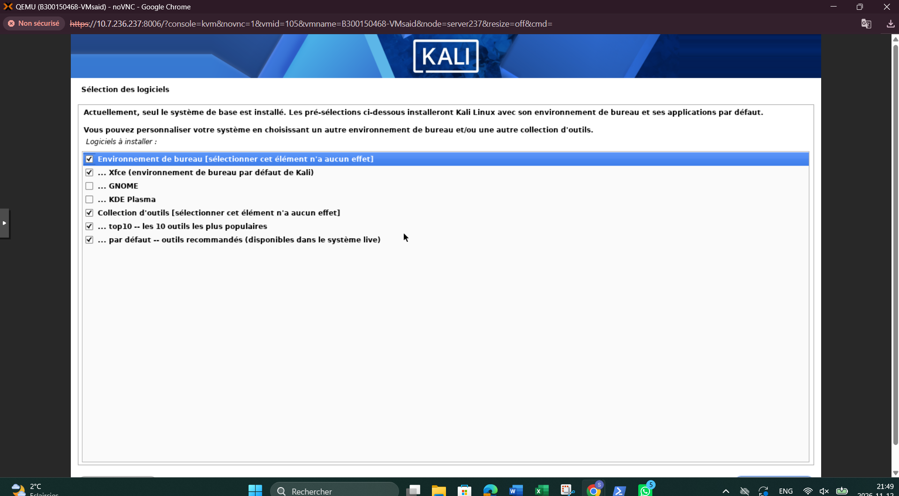

### Installation du chargeur de démarrage (GRUB)
Pour garantir le démarrage autonome du système d'exploitation, l'installateur configure et installe le chargeur de démarrage GRUB sur le secteur d'amorçage principal du disque virtuel (`/dev/sda`).

> 📸 **Capture : Installation de GRUB**  
> 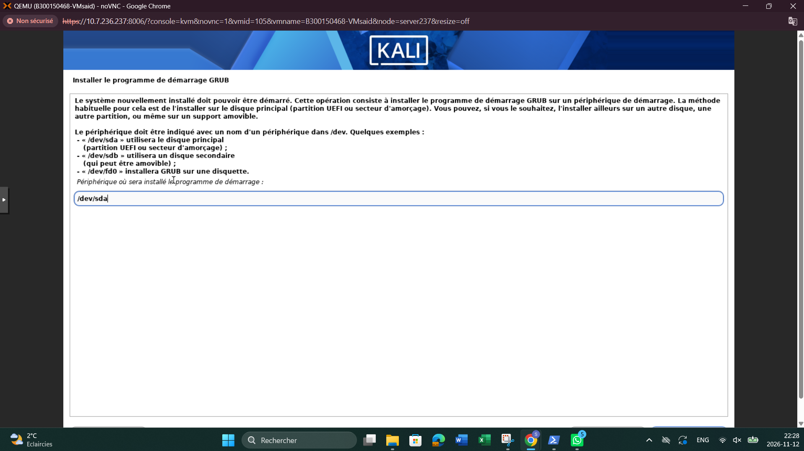

---

## 5. Finalisation et Bureau Kali Linux

Une fois l'installation achevée avec succès, la machine virtuelle redémarre automatiquement. L'écran de connexion s'affiche, permettant d'accéder au bureau graphique de Kali Linux et de valider le bon fonctionnement de l'environnement.

> 📸 **Capture : Bureau Kali Linux**  
> 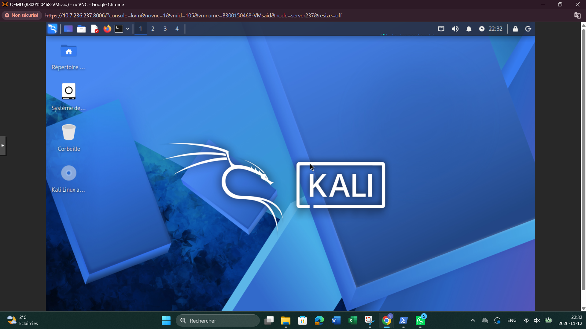