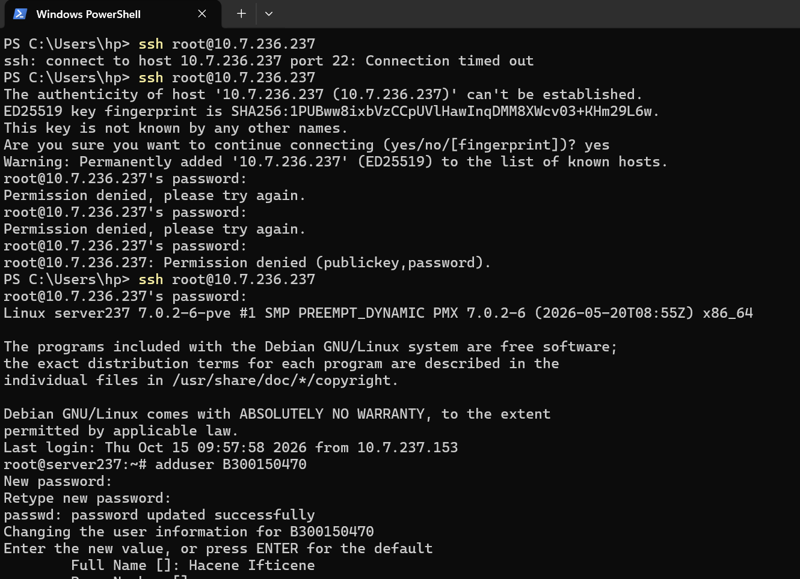
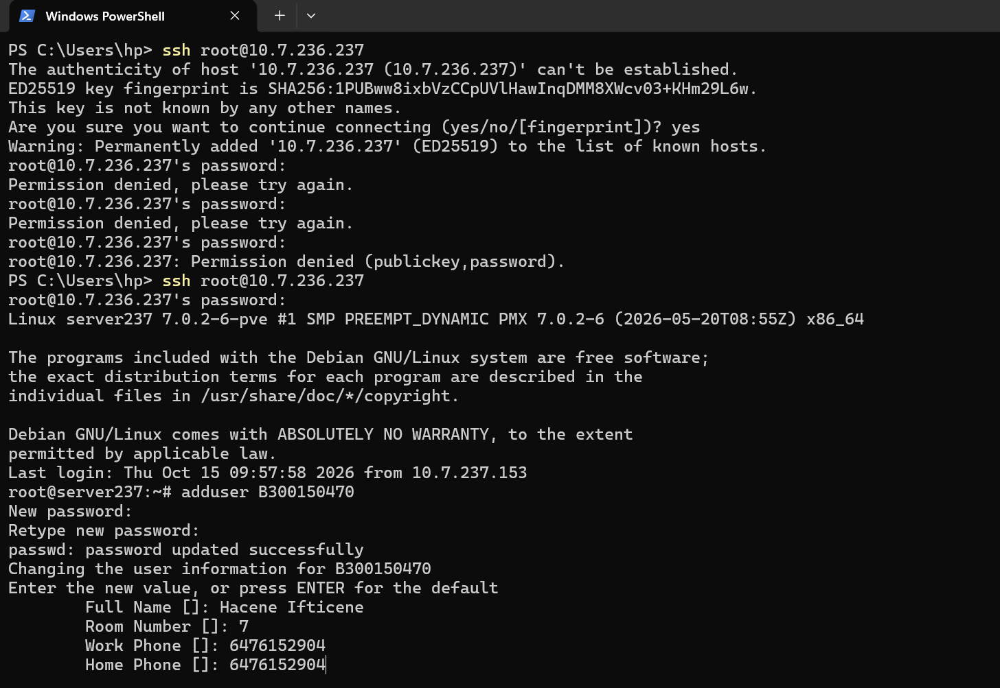
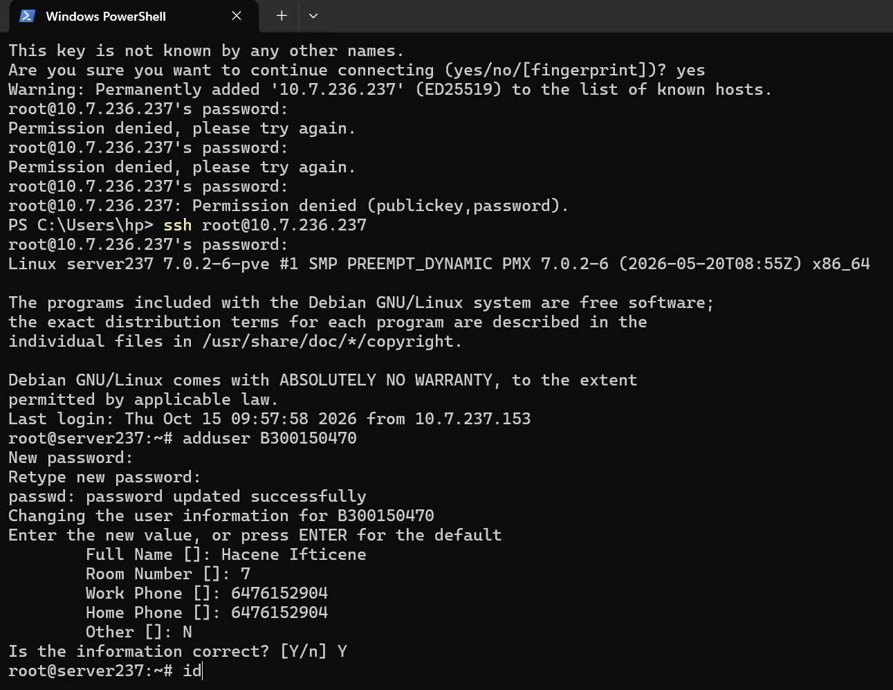
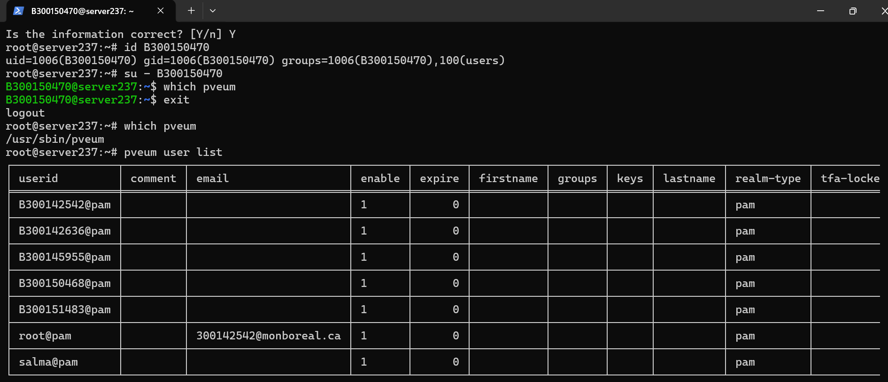
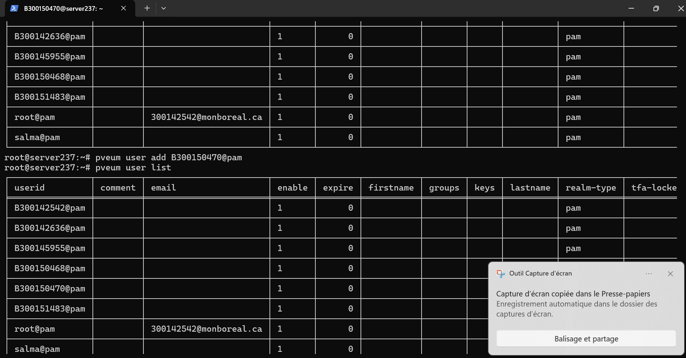
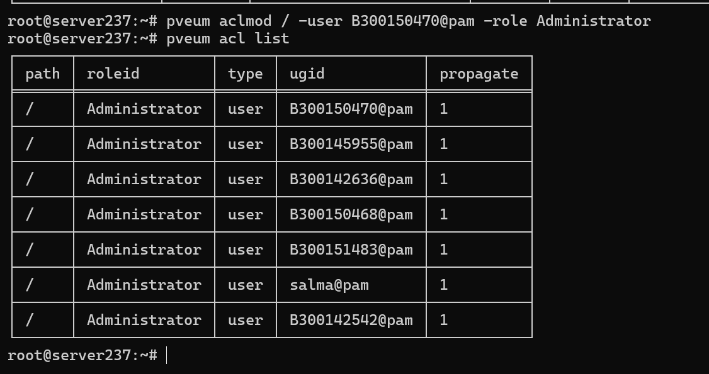
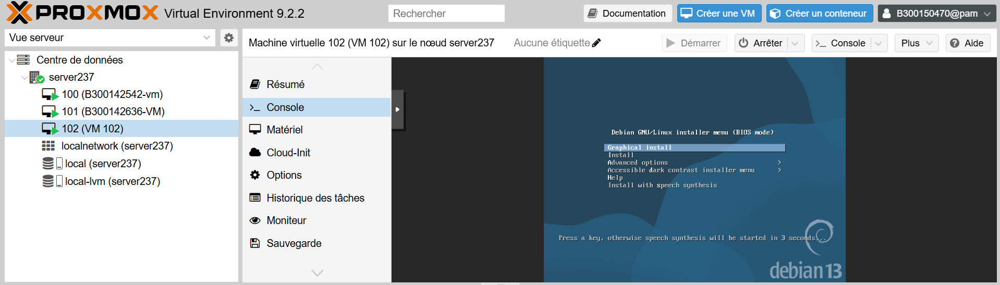
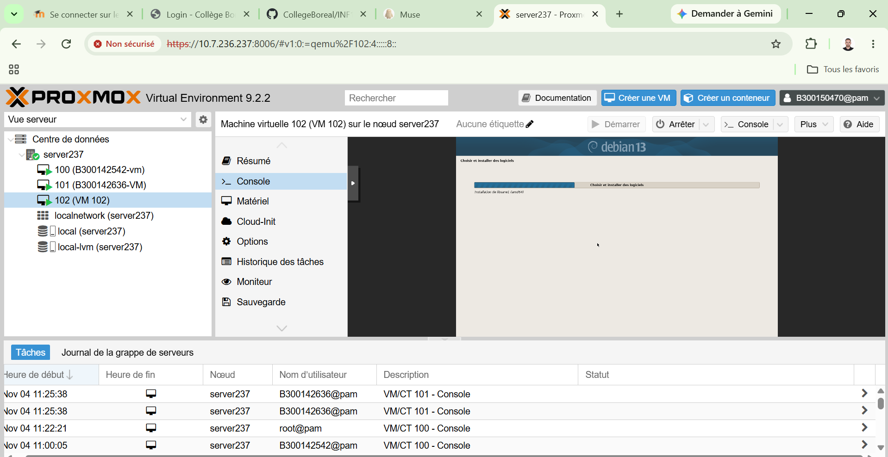
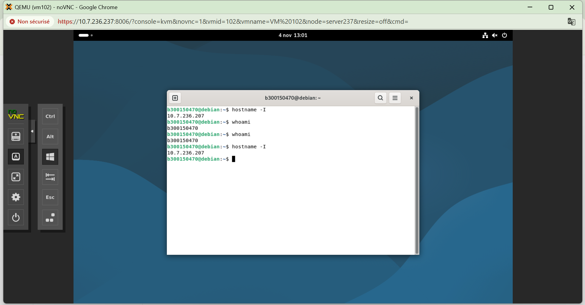
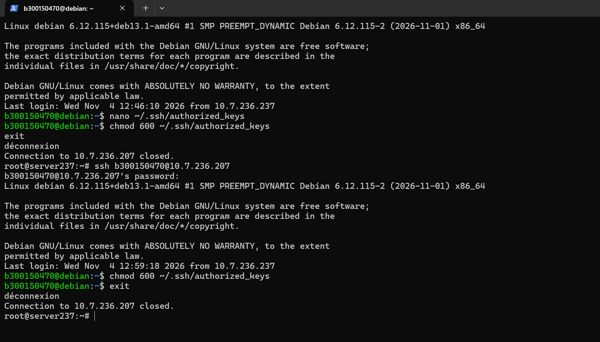

<div align="center">

# 🐧 3.VMs — Ma VM Debian sur Proxmox


</div>

---

## ✨ Introduction

> Ce projet consiste à créer une machine virtuelle Debian 13 sur le serveur Proxmox server237, puis à la préparer pour un accès SSH, avec une adresse fixe et la clé du professeur.

📛 **Nom du projet :** 3.VMs — Création d'une machine virtuelle Debian

👤 **Nom et prénom :** Ifticene Hacene

🎓 **Numéro étudiant :** 300150470

📚 **Cours :** INF1085 — Administration Linux

👥 **Groupe :** 1

🏙️ ubuntu@10.7.236.207


---

## 📸 Explication des images

### 🔐 1. Connexion et création du compte

#### Capture 1 — Connexion SSH



*Connexion SSH à server237, compte B300150470 créé avec adduser.*

#### Capture 2 — Informations du compte



*Informations du compte pendant adduser.*

#### Capture 3 — Confirmation



*Compte confirmé avec Y.*

#### Capture 4 — Vérification



*Vérification avec id, B300150470@pam absent de la liste.*

#### Capture 5 — Ajout Proxmox



*Compte Proxmox ajouté, il apparaît dans la liste.*

#### Capture 6 — Rôle Administrator



*Rôle Administrator donné au compte.*

---

### 🖥️ 2. VM et installation

#### Capture 7 — Menu Debian



*Menu d'installation Debian, Graphical install.*

#### Capture 8 — Logiciels



*Installation des logiciels en cours.*

Debian 13 installée en français, compte `b300150470`, disque sda 32,6 Go `/` + 1,8 Go swap, serveur SSH coché, GRUB sur `/dev/sda`.

---

### 🌐 3. Réseau et clé du prof

#### Capture 9 — Adresse fixe



*IP 10.7.236.207 vérifiée, compte b300150470.*

```bash
ssh b300150470@10.7.236.207
```

#### Capture 10 — Clé du prof



*Clé du prof ajoutée dans authorized_keys, droits 600, SSH réussi.*

---

## ✅ Conclusion

> La VM 102 fonctionne : Debian 13 est installée, l'adresse fixe `10.7.236.207` est vérifiée, et la clé du professeur est ajoutée.


<div align="center">

*INF1085 • Collège Boréal • 2026-11-04*

</div>
