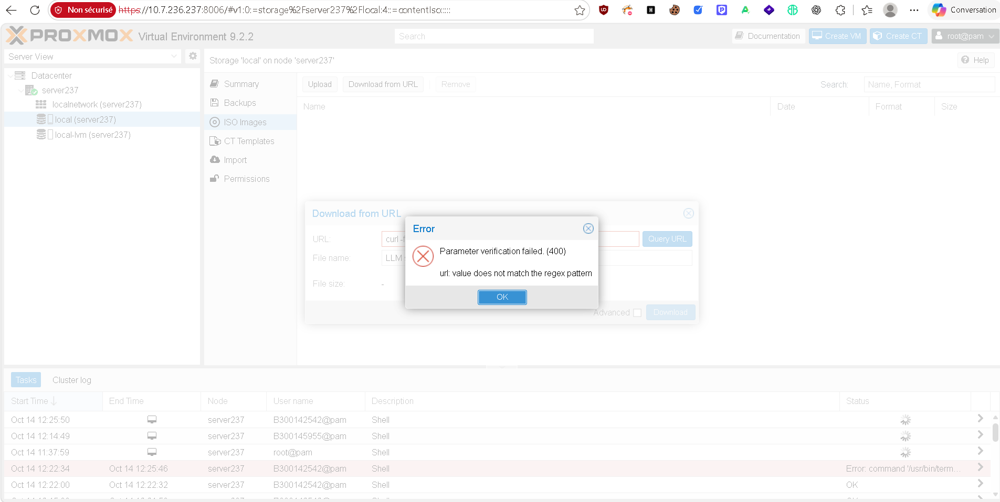
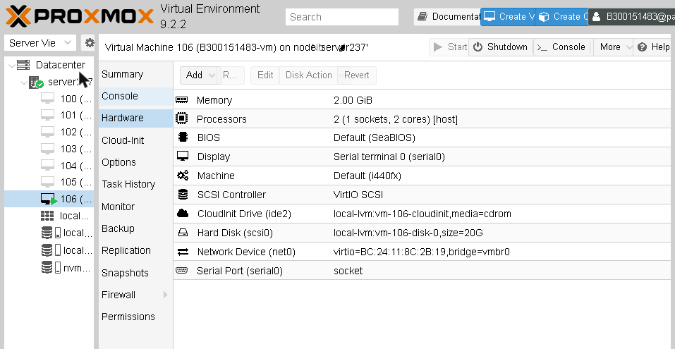
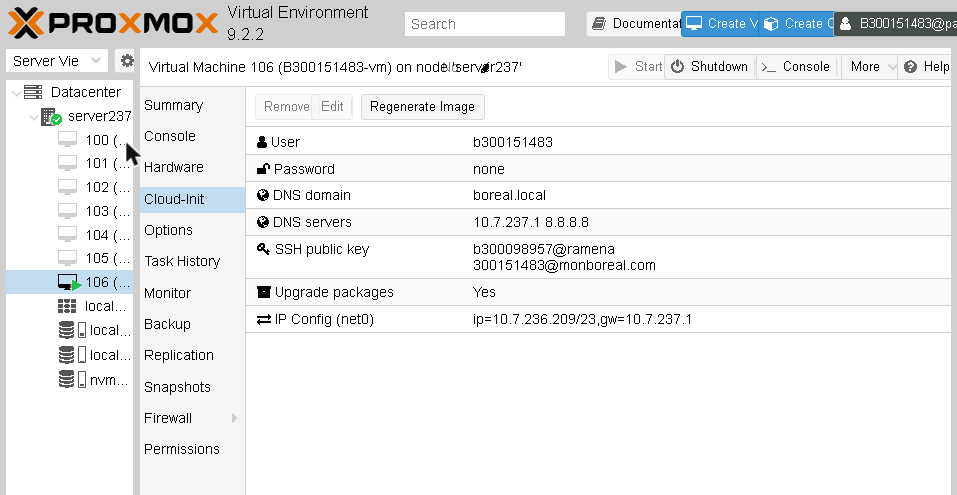
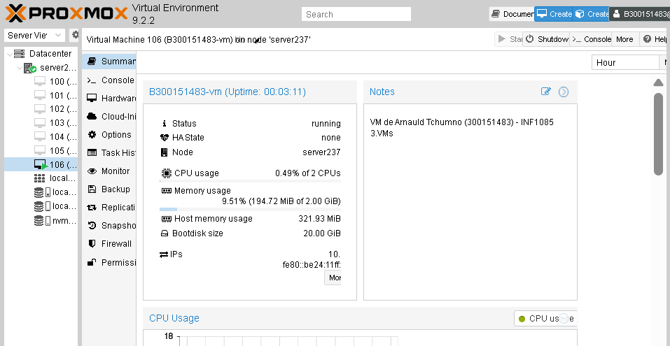
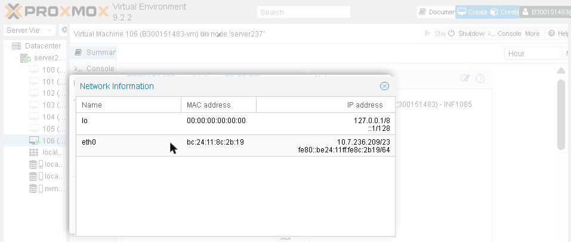

# 🏗️ VMs - Ma machine virtuelle sur Proxmox

| Champ | Valeur |
|-------|--------|
| Nom | Arnauld Tchumno |
| Numéro étudiant | 300151483 |
| Groupe | 1️⃣ |
| Serveur Proxmox | `server237` - [10.7.236.237](https://10.7.236.237:8006) (Rack 2, U34, HP G7, 64 Go, 16 CPU) |
| Machine virtuelle | **VM 106** - `B300151483-vm` |
| Adresse IP de ma VM | **`10.7.236.209/23`**, passerelle `10.7.237.1` |
| Compte SSH de la VM | `b300151483@10.7.236.209` |
| Date | 18 novembre 2026 |

## 🎯 Objectif

Créer ma propre machine virtuelle sur le serveur Proxmox de mon groupe, lui donner une adresse IP fixe et autoriser la clé du professeur pour qu'il puisse s'y connecter en SSH.

## Travail réalisé

- [x] VM créée sur `server237` (🥉)
- [x] Adresse IP fixe `10.7.236.209` assignée (🥈)
- [x] Clé du professeur ajoutée, VM accessible par SSH (🥇)

---

## 1. Première tentative : télécharger une ISO

J'ai d'abord essayé de télécharger une ISO dans **server237 → local → ISO Images → Download from URL**.



*Figure 1 : Première tentative refusée : `Parameter verification failed (400) - url: value does not match the regex pattern`.*

**Cause** : j'avais collé une commande complète (`curl -...`) dans le champ **URL**, alors que Proxmox attend uniquement l'adresse du fichier.

**Ce que j'ai retenu** : on colle seulement le lien direct, puis on clique sur **Query URL**. Au final, je n'ai pas eu besoin d'ISO : l'installateur Debian demande beaucoup d'étapes à la main. J'ai plutôt utilisé l'**image cloud officielle de Debian 13** avec **cloud-init**. Proxmox écrit lui-même la configuration (utilisateur, clés SSH, IP) dans la VM au premier démarrage.

---

## 2. Télécharger l'image cloud Debian 13

L'image `genericcloud` est un disque Debian déjà installé, prévu pour les hyperviseurs. Je l'ai téléchargée dans le stockage `local` (contenu **Import**) :

```text
server237 → local → Import → Download from URL
https://cloud.debian.org/images/cloud/trixie/latest/debian-13-genericcloud-amd64.qcow2
```

Équivalent en ligne de commande, sur le serveur :

```bash
wget -P /var/lib/vz/import https://cloud.debian.org/images/cloud/trixie/latest/debian-13-genericcloud-amd64.qcow2
```

Résultat dans le journal de la tâche : `saved [344260608/344260608]`, soit 344 Mo en 10 secondes, puis `TASK OK`.

---

## 3. Créer la VM 106

Paramètres choisis :

| Paramètre | Valeur | Pourquoi |
|-----------|--------|----------|
| ID / nom | `106` / `B300151483-vm` | 100 à 105 sont déjà pris par les autres étudiants du groupe |
| Mémoire / CPU | 2 Go / 2 cœurs (`host`) | suffisant pour un serveur Debian sans interface graphique |
| Disque | `scsi0`, importé depuis l'image cloud, agrandi à **20 Go** | contrôleur VirtIO SCSI, le plus performant |
| Réseau | `virtio`, pont `vmbr0` | même réseau que le serveur (10.7.236.0/23) |
| Affichage | console série `serial0` | les images cloud affichent leur console sur le port série |
| Cloud-init | lecteur `ide2` | transmet l'utilisateur, les clés et l'IP à la VM |

Commandes équivalentes avec `qm` :

```bash
qm create 106 --name B300151483-vm --memory 2048 --cores 2 --cpu host \
  --ostype l26 --scsihw virtio-scsi-pci --net0 virtio,bridge=vmbr0 \
  --serial0 socket --vga serial0 --boot order=scsi0
qm set 106 --scsi0 local-lvm:0,import-from=local:import/debian-13-genericcloud-amd64.qcow2
qm set 106 --ide2 local-lvm:cloudinit
qm disk resize 106 scsi0 20G
```

L'import du disque a copié 3,0 Gio (`scsi0: successfully created disk 'local-lvm:vm-106-disk-0'`), puis le disque est passé à 20 Go.



*Figure 2 : Onglet **Hardware** de la VM 106 : 2 Go de RAM, 2 cœurs, disque `local-lvm:vm-106-disk-0` de 20 Go, lecteur cloud-init sur `ide2`, carte réseau VirtIO sur `vmbr0`. Au chapitre 5.Storage, le disque sera déplacé sur `nvme-storage`.*

---

## 4. Adresse IP fixe et clé du professeur (cloud-init)

Dans l'onglet **Cloud-Init** de la VM :

```bash
qm set 106 --ciuser b300151483 \
  --ipconfig0 ip=10.7.236.209/23,gw=10.7.237.1 \
  --nameserver "10.7.237.1 8.8.8.8" --searchdomain boreal.local \
  --sshkeys cles.pub
```

Le fichier `cles.pub` contient deux clés publiques :
- la **clé du professeur** (`ssh-rsa ... b300098957@ramena`), donnée dans le README du chapitre ;
- **ma clé** (`ssh-ed25519 ... 300151483@monboreal.com`).

Aucun mot de passe n'est défini : la connexion se fait uniquement par clé, ce qui est plus sûr.



*Figure 3 : Configuration cloud-init : utilisateur `b300151483`, mot de passe `none`, deux clés SSH (`b300098957@ramena` et `300151483@monboreal.com`), IP `10.7.236.209/23` avec la passerelle `10.7.237.1`.*

> **Passerelle** : le réseau du labo est en `/23` (de 10.7.236.0 à 10.7.237.255). La passerelle est donc `10.7.237.1`, la même que celle du pont `vmbr0` de server237. Avec `10.7.236.1`, la VM n'aurait pas eu accès à Internet.

---

## 5. Démarrage et vérification

Une fois la VM démarrée, j'ai installé l'agent QEMU, pour que Proxmox puisse lire les informations de la VM :

```bash
sudo apt-get install -y qemu-guest-agent
qm set 106 --agent enabled=1   # puis redémarrage de la VM
```



*Figure 4 : Résumé de la VM 106 : état `running`, 2 CPU, 2 Gio de RAM (9,5 % utilisés), disque de démarrage de 20 Gio, et la note qui identifie la VM.*



*Figure 5 : **Network Information** remontée par l'agent QEMU : l'interface `eth0` (MAC `bc:24:11:8c:2b:19`) a bien l'adresse `10.7.236.209/23`.*

### Connexion SSH depuis mon PC

```text
$ ssh b300151483@10.7.236.209
$ whoami && hostname
b300151483
B300151483-vm
$ ip -4 -br addr show eth0
eth0             UP             10.7.236.209/23
$ ip route
default via 10.7.237.1 dev eth0 proto static
10.7.236.0/23 dev eth0 proto kernel scope link src 10.7.236.209
$ ls -l ~/.ssh/authorized_keys
-rw------- 1 b300151483 b300151483 504 Nov 18 13:41 /home/b300151483/.ssh/authorized_keys
$ awk '{print $1, $NF}' ~/.ssh/authorized_keys
ssh-rsa b300098957@ramena
ssh-ed25519 300151483@monboreal.com
```

- La connexion se fait **sans mot de passe**, grâce à ma clé.
- La clé du professeur est présente dans `authorized_keys`, avec les droits `600`. Le professeur peut donc se connecter avec `ssh b300151483@10.7.236.209`.
- `ping deb.debian.org` répond (0 % de perte), donc la VM a accès à Internet.

---

## 🛠️ Problèmes rencontrés

| Problème | Cause | Solution |
|----------|-------|----------|
| `Parameter verification failed (400)` au téléchargement | Commande `curl` collée dans le champ URL | Coller seulement le lien du fichier |
| Premier `Start` en erreur : `VM 106 already running` | J'ai lancé le démarrage pendant que l'agrandissement du disque était encore en cours | Aucune action : la VM avait déjà démarré, l'erreur était sans conséquence |
| `qemu-guest-agent` ne démarrait pas (`dependency job failed`) | Le port VirtIO de l'agent n'existe pas tant que l'option **QEMU Guest Agent** n'est pas activée | `qm set 106 --agent enabled=1`, puis redémarrage |

## ✅ Bilan

| Critère | Résultat |
|---------|----------|
| 🥉 VM créée | VM 106 `B300151483-vm`, Debian 13, 2 Go, 2 CPU, 20 Go |
| 🥈 Adresse IP assignée | `10.7.236.209/23`, passerelle `10.7.237.1`, vérifiée par Proxmox et par `ip addr` |
| 🥇 Accessible par la clé du prof | `b300098957@ramena` dans `~/.ssh/authorized_keys` (droits 600) |
