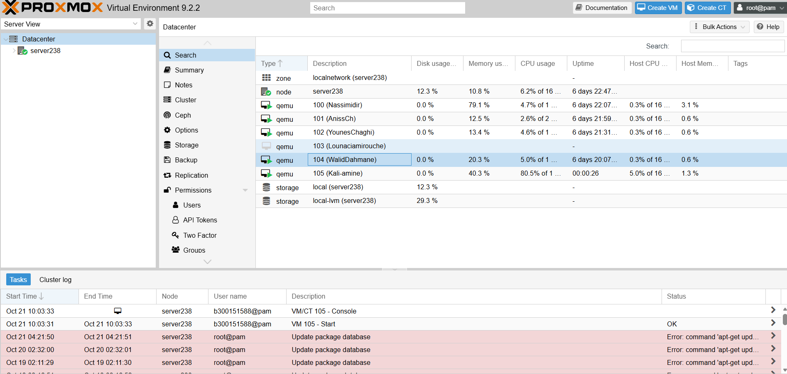
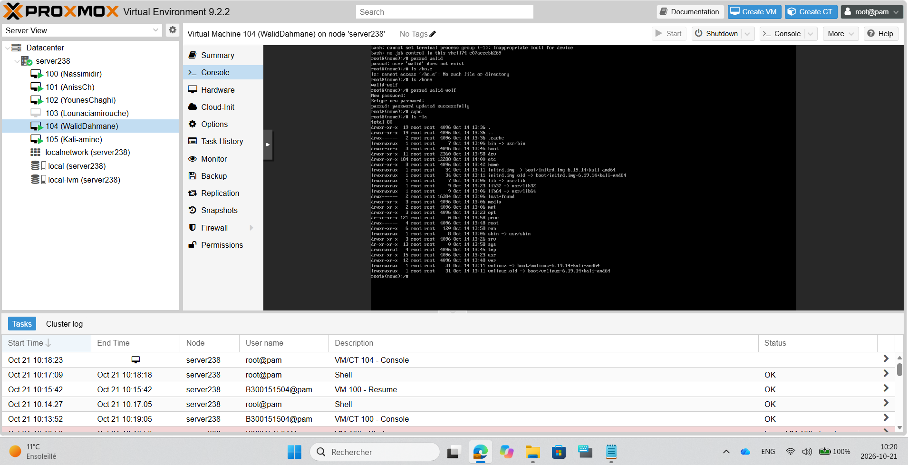

# Création d'une machine virtuelle Debian sur Proxmox VE

## 1. Objectif

L'objectif de ce TP est de créer une machine virtuelle Debian sur Proxmox VE, de vérifier sa configuration et d'utiliser quelques commandes Linux.

## 2. Connexion à Proxmox

J'ai ouvert mon navigateur et accédé à l'interface Web de Proxmox :

`https://10.7.236.235:8006`

Je me suis connecté au serveur `server238`.

## 3. Création de la machine virtuelle

J'ai cliqué sur **Create VM** et configuré les paramètres suivants :

- Nom : WalidDahmane
- VMID : 104
- Système d'exploitation : Debian
- Mémoire RAM : 2048 Mo (2 Go)
- Disque dur : 32 Go
- Réseau : carte réseau virtuelle configurée

Après avoir vérifié les paramètres, j'ai cliqué sur **Finish** pour créer la machine virtuelle.

## 4. Installation de Debian

J'ai démarré la VM avec **Start**, puis ouvert **Console** pour installer Debian.

## 5. Vérification des machines virtuelles

Dans le Shell de Proxmox, j'ai exécuté :

`qm list`

Cette commande affiche les machines virtuelles avec leur identifiant, leur état, leur mémoire et leur disque.

Ma VM 104 apparaît avec l'état `running`.

## 6. Commandes de vérification supplémentaires

Pour vérifier la configuration et l'état de ma VM, je peux utiliser :

`qm config 104`

`qm status 104`

## 7. Commandes Linux dans Debian

Après l'installation, j'ai ouvert la console Debian.

### Afficher les fichiers

`ls`

Cette commande affiche les fichiers et les dossiers du répertoire actuel.

### Afficher les permissions

`ls -la`

Cette commande affiche les fichiers, les dossiers, les fichiers cachés et leurs permissions.

### Vérifier les utilisateurs

`ls /home`

Cette commande permet d'afficher le contenu du répertoire des utilisateurs.

### Modifier le mot de passe

`passwd walid-wolf`

J'ai utilisé cette commande pour modifier le mot de passe de mon utilisateur.

### Synchroniser les données

`sync`

Cette commande permet de synchroniser les écritures en attente sur le disque.

## 8. Captures d'écran

### Machine virtuelle créée sur Proxmox

### Commandes Linux exécutées dans Debian

## 9. Conclusion

Ce TP m'a permis d'apprendre à créer une machine virtuelle sur Proxmox VE, à installer Debian et à utiliser des commandes Linux pour vérifier les fichiers, les permissions et gérer un utilisateur.
