# RAPPORT DE LABORATOIRE

## Installation et sécurisation d'une machine virtuelle Debian 13 avec Proxmox VE

**No étudiant : 300151834**

**Cours : INF1085 — Linux / Proxmox**

**Machine : amirouche@10.7.236.215**

**Date : 4 novembre 2026**

---

## 1. Objectif et environnement

Ce laboratoire consiste à installer une machine virtuelle Debian 13 sur le nœud Proxmox du collège, à la sécuriser avec un accès SSH, à créer un compte Proxmox individuel, puis à autoriser l'accès du professeur à la machine virtuelle avec sa clé publique.

L'environnement de travail est le suivant :

| Élément | Valeur |
|---|---|
| Nœud Proxmox | server238 (Proxmox VE 9.2.2) |
| Adresse Proxmox | https://10.7.236.235:8006 |
| Machine virtuelle | 103 (Lounaciamirouche) |
| Système installé | Debian 13 (image debian-13.7.0-amd64-netinst.iso) |
| Interface graphique | GNOME |
| Processeur | 1 (1 socket, 1 cœur) |
| Mémoire | 2,00 Gio |
| Disque dur | 32 Gio |
| Carte réseau | virtio, pont vmbr0, MAC BC:24:11:21:30:4E |
| Interface réseau dans la VM | ens18 |
| Compte utilisateur | amirouche |

Figure 1 : Matériel de la machine virtuelle 103 dans Proxmox.

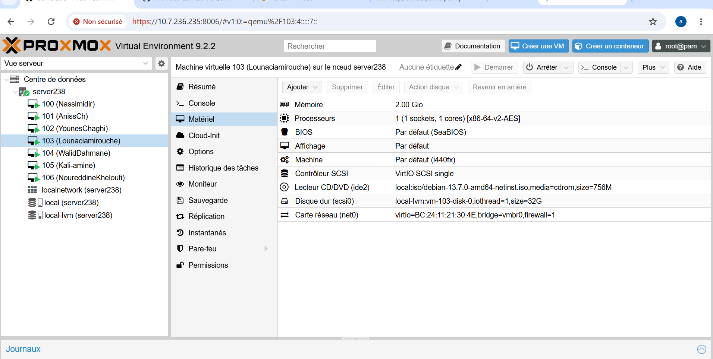

## 2. Installation de Debian 13

L'installation a été faite à partir de l'image debian-13.7.0-amd64-netinst.iso. L'installateur a d'abord proposé la liste des dispositions de clavier, puis il a détecté le matériel, configuré le réseau en DHCP sur l'interface ens18 et demandé le nom d'hôte de la machine.

Figure 2 : Choix du clavier, détection du réseau et demande du nom d'hôte pendant l'installation.

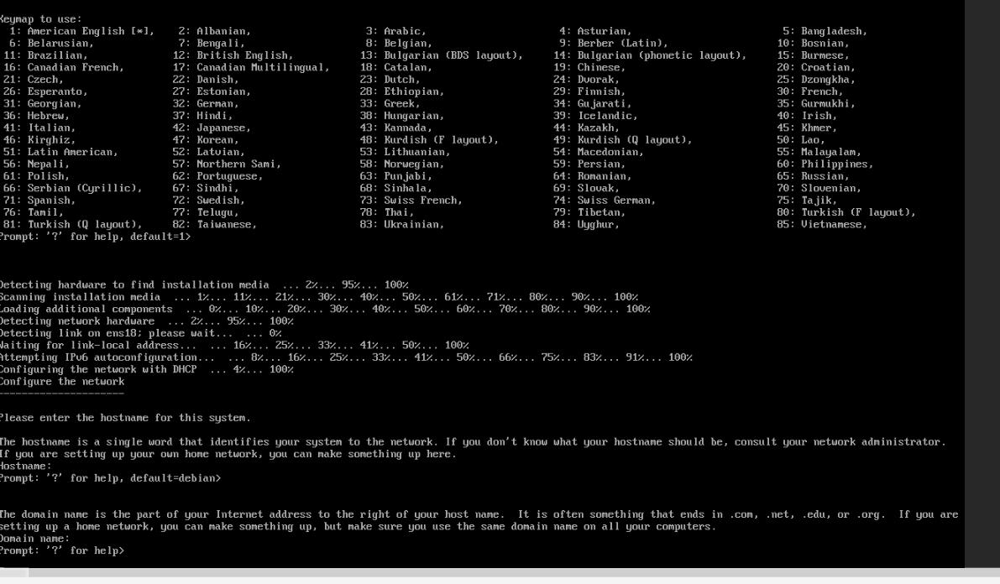

Ensuite, l'installateur a demandé le mot de passe root, puis la création du compte utilisateur. Un premier nom d'utilisateur a été refusé parce qu'il ne respectait pas les règles (il doit commencer par une lettre minuscule), puis le compte a été créé avec le nom complet de l'utilisateur.

Figure 3 : Mot de passe root, erreur de nom d'utilisateur et demande du nom complet.

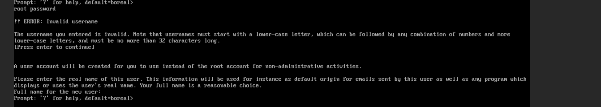

## 3. Démarrage et session graphique

Après l'installation, la machine virtuelle démarre normalement et présente son écran de connexion, accessible depuis la console Proxmox. Une fois la session ouverte, le bureau GNOME s'affiche avec sa vue d'ensemble (Activités) et son dock d'applications.

Figure 4 : Écran de connexion de la machine virtuelle dans la console Proxmox.

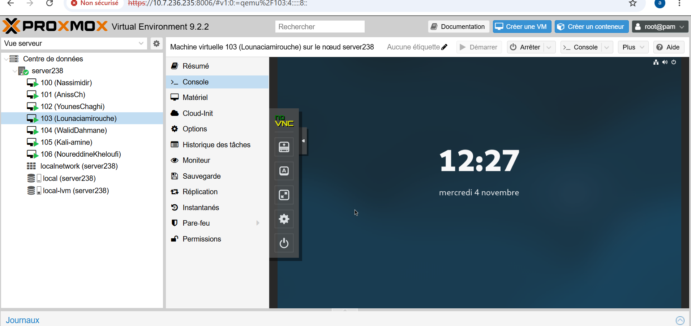

Figure 5 : Bureau GNOME de la machine virtuelle.

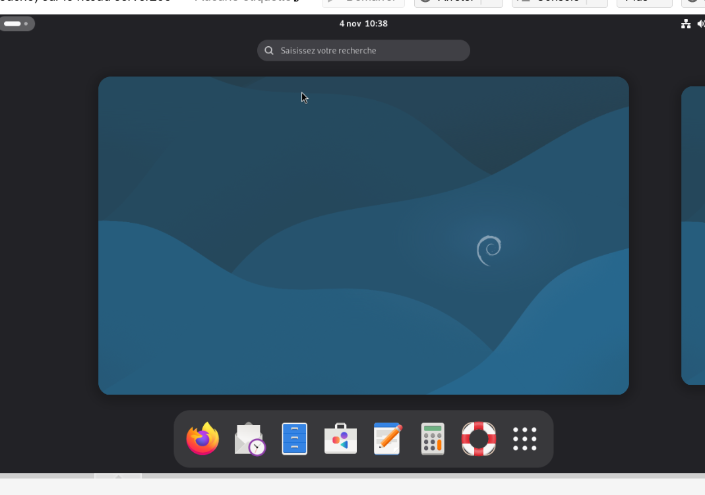

## 4. Adresse IP de la machine virtuelle

La commande `hostname -I` a d'abord donné l'adresse 10.7.236.175, obtenue automatiquement (DHCP). La commande `apt update` lancée avec le compte amirouche a échoué : les fichiers de verrouillage d'apt exigent les droits root. La commande `su -` a échoué trois fois avant de réussir à la quatrième tentative, ce qui a donné l'accès root.

Figure 6 : Adresse IP initiale (10.7.236.175), erreur d'apt sans root, puis accès root obtenu avec su -.

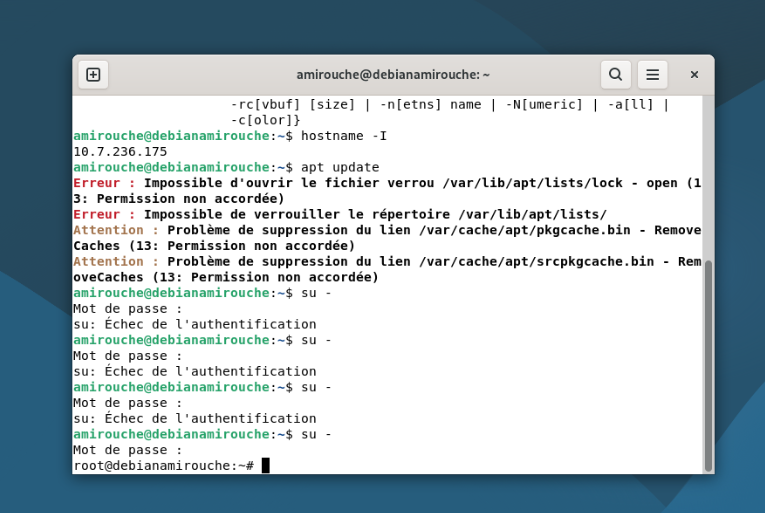

## 5. Installation et activation du serveur SSH

Avec le compte amirouche, la commande `sudo systemctl status ssh` a été refusée : amirouche ne fait pas partie du fichier sudoers. La commande `systemctl status ssh` a ensuite répondu « Unit ssh.service could not be found » : le serveur SSH n'était pas installé. La commande `nproc` a confirmé que la machine possède 1 processeur.

En root, la commande `apt install openssh-server` a installé le serveur : clés d'hôte ECDSA et ED25519 créées, utilisateur système `sshd` créé, service activé. La vérification avec `systemctl status ssh` montre le service `active (running)`, à l'écoute sur le port 22.

Figure 7 : 1 processeur (nproc), refus de sudo, et serveur SSH absent avant l'installation.

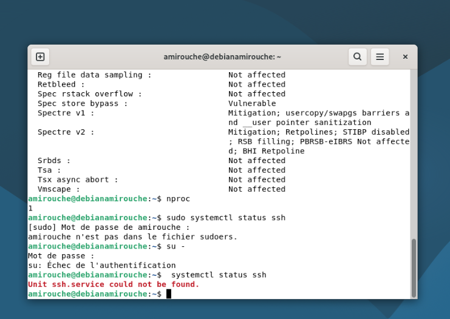

Figure 8 : Fin de l'installation d'openssh-server et vérification : ssh.service active (running), écoute sur le port 22.

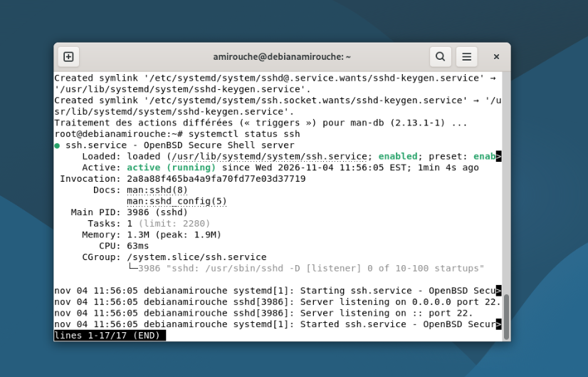

## 6. Connexion à distance depuis Windows

Depuis un terminal PowerShell de Windows, les premiers essais de connexion ont échoué : espace manquant entre `ssh` et le nom d'utilisateur, adresse 10.7.736.175 invalide (un octet ne peut pas dépasser 255), puis « Connection refused » parce que le serveur SSH n'était pas encore installé. Après l'installation, la connexion `ssh amirouche@10.7.236.175` a affiché la demande d'authenticité de l'hôte, avec l'empreinte ED25519 SHA256:fKSAW8D2poCh8PEPV8SgQdWyc+QMBjYqen05r8yXoyE. Après la réponse `yes` et le mot de passe d'amirouche, la bannière « Linux debianamirouche » s'est affichée avec l'invite `amirouche@debianamirouche`.

Figure 9 : Premiers essais SSH depuis Windows (erreurs), puis demande d'authenticité de l'hôte.

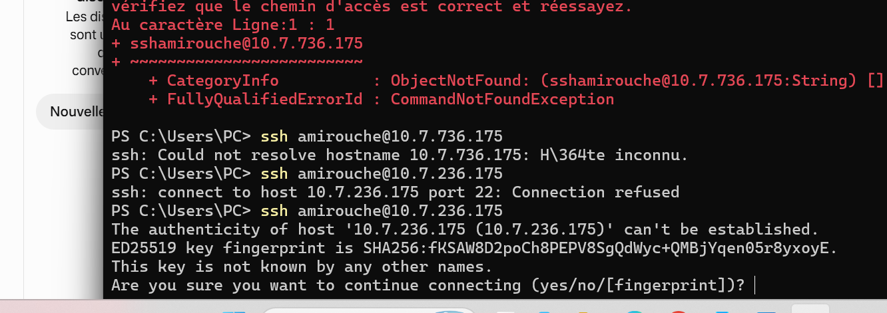

## 7. Compte individuel Proxmox et accès SSH

Un compte Linux `B300151834` a été créé sur le nœud server238, puis un compte Proxmox `B300151834@pam` a été ajouté avec `pveum user add`. La commande `pveum aclmod / --user B300151834 --role Administrator` a d'abord échoué (« invalid format ») parce qu'il manquait le domaine `@pam` ; avec `B300151834@pam`, la commande a réussi. La liste des ACL confirme le rôle Administrator sur `/` pour `B300151834@pam`. La connexion `ssh B300151834@10.7.236.235` fonctionne.

Figure 10 : Attribution du rôle Administrator à B300151834@pam et liste des ACL.

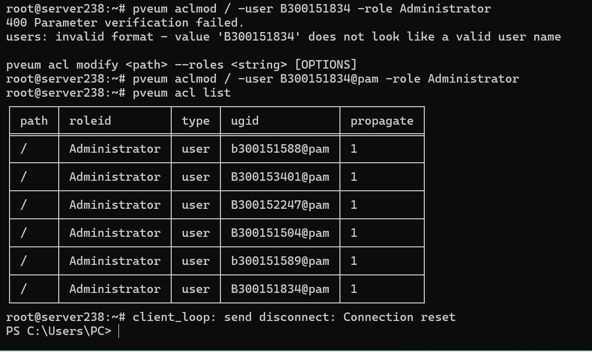

Figure 11 : Connexion SSH réussie avec le compte B300151834 sur le nœud server238.

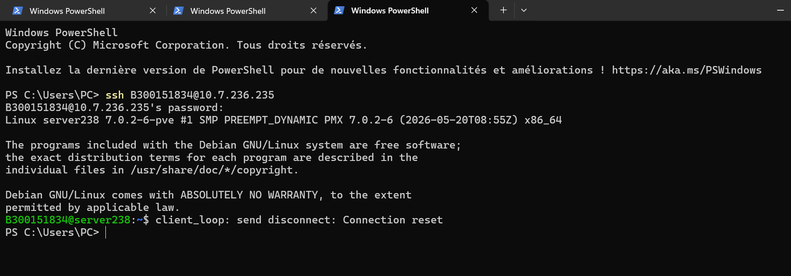

## 8. Ajout de la clé publique du professeur

Pour autoriser l'accès du professeur à la machine virtuelle, le dossier `~/.ssh` a été créé avec `mkdir -p ~/.ssh`, puis le fichier `~/.ssh/authorized_keys` a été ouvert avec `nano` (il s'agissait d'un nouveau fichier). La clé publique du professeur y a été collée exactement, sur une seule ligne, puis le fichier a été enregistré (Ctrl+O, Entrée, Ctrl+X). Les permissions ont été fixées avec `chmod 700 ~/.ssh` et `chmod 600 ~/.ssh/authorized_keys`. La vérification avec `cat ~/.ssh/authorized_keys` affiche la clé complète, qui se termine par le commentaire `b300098957@ramena`.

Remarque : il s'agit d'une clé publique, qui peut être partagée sans risque. La clé privée correspondante reste chez le professeur, et sa connexion effective n'a pas encore été testée.

Figure 12 : Ouverture du fichier authorized_keys dans nano (nouveau fichier).

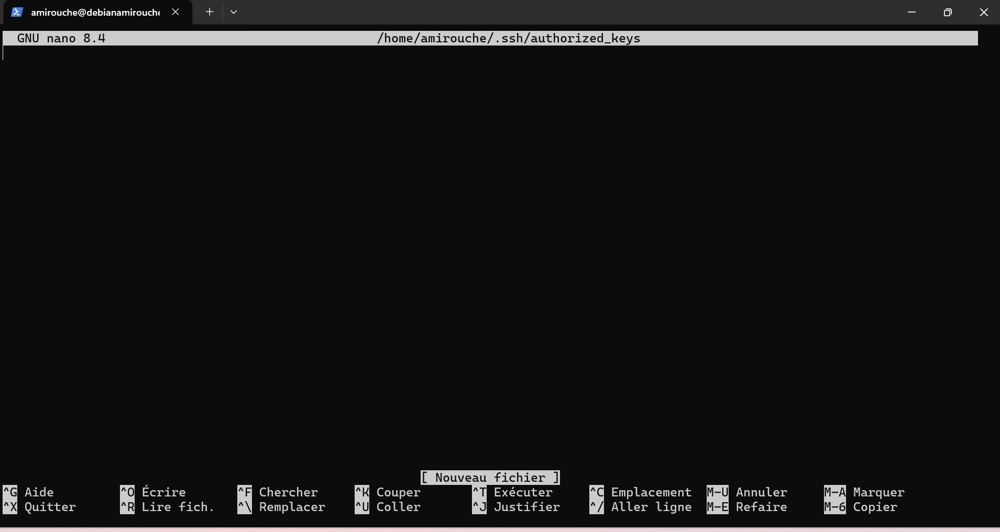

Figure 13 : Permissions appliquées et vérification de la clé du professeur avec cat.

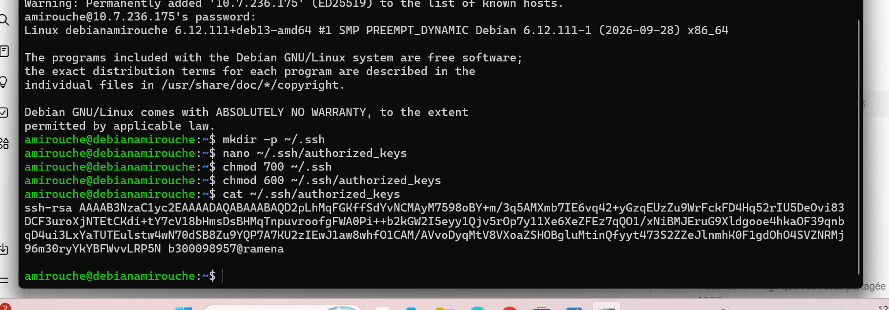

## 9. Changement d'adresse IP en statique

L'adresse de la machine virtuelle a ensuite été fixée en statique avec `nmcli`. La commande `nmcli con show` a confirmé que la connexion s'appelle « Wired connection 1 » (périphérique ens18). La commande `nmcli con mod` a défini la méthode manuelle avec l'adresse 10.7.236.215/23, la passerelle 10.7.237.1 et le DNS 8.8.8.8, puis `nmcli con up` a réactivé la connexion. La session SSH s'est coupée à ce moment, ce qui est normal puisque l'adresse a changé.

La reconnexion avec `ssh amirouche@10.7.236.215` a affiché la même empreinte d'hôte, et SSH a précisé que cette clé est connue sous l'ancien nom 10.7.236.175 : c'est bien la même machine, à sa nouvelle adresse. La commande `ip a` confirme `inet 10.7.236.215/23` sur ens18.

Remarque : le professeur doit désormais utiliser la nouvelle adresse, 10.7.236.215, et non plus l'ancienne.

Figure 14 : Changement d'adresse avec nmcli, coupure de session, puis reconnexion à 10.7.236.215.

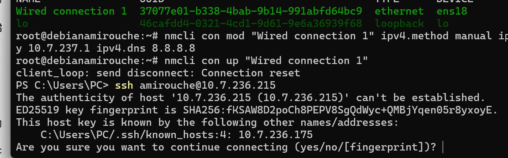

Figure 15 : Vérification avec ip a : 10.7.236.215/23 sur ens18.

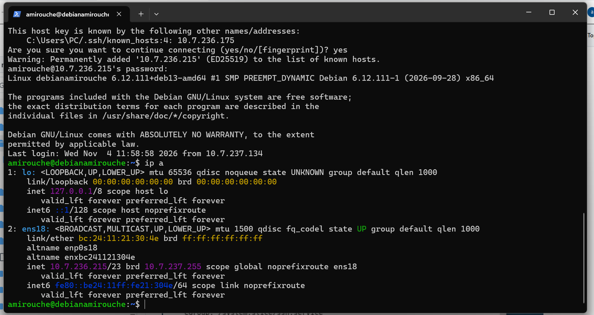

## 10. Bilan

| Objectif | Résultat |
|---|---|
| Installation de Debian 13 avec GNOME | Réussie |
| Session graphique | Fonctionnelle |
| Adresse IP | D'abord 10.7.236.175 (DHCP), puis 10.7.236.215/23 en statique |
| Serveur SSH | Installé, actif, à l'écoute sur le port 22 |
| Connexion SSH depuis Windows | Réussie (amirouche@10.7.236.215) |
| Compte Proxmox individuel | B300151834@pam, rôle Administrator, connexion SSH réussie |
| Clé publique du professeur | Ajoutée dans authorized_keys (700/600), vérifiée |
| Connexion du professeur avec sa clé | Non encore testée |

## 11. Conclusion

La machine virtuelle Debian 13 est installée et fonctionnelle sur le nœud server238, avec un bureau GNOME, une adresse IP statique et un serveur SSH actif. L'accès à distance depuis Windows fonctionne, le compte Proxmox individuel est en place avec le rôle Administrator, et la clé publique du professeur est installée dans le fichier authorized_keys du compte amirouche. Il ne reste qu'à faire tester la connexion par le professeur, avec la nouvelle adresse 10.7.236.215.

