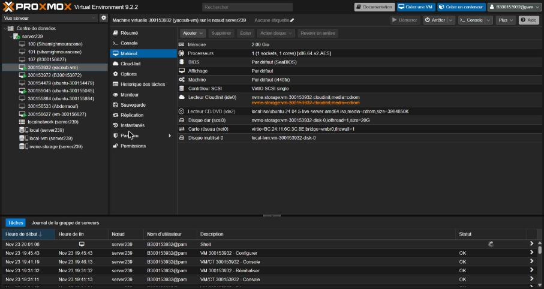

# Création et vérification d’une VM Linux

1. Sur le nœud Proxmox assigné au groupe, sélectionner **Create VM** et prendre un identifiant libre réservé au laboratoire.
2. Sélectionner l’ISO Linux du cours. Configurer le disque, les vCPU, la RAM et le bridge réseau selon les ressources attribuées.
3. Démarrer la VM, installer Linux depuis la console, retirer l’ISO et redémarrer sur le disque virtuel.
4. Vérifier l’OS, le disque, la mémoire et le réseau.

```bash
hostnamectl
lsblk -f
free -h
ip -br address
ip route
```

## Configuration documentée dans le rapport de référence

| Élément | Configuration |
|---|---|
| Distribution | Ubuntu Server 24.04.5 LTS |
| Processeur | 1 socket, 1 cœur |
| Mémoire | 2048 Mo |
| Disque virtuel | 20 Go, interface SCSI (`scsi0`) |

## Captures et résultats de référence

La capture présente l’onglet **Matériel** de la VM décrite dans le rapport.



[README source](https://github.com/CollegeBoreal/INF1085-201-26A-04/tree/main/3.VMs/300153932)
