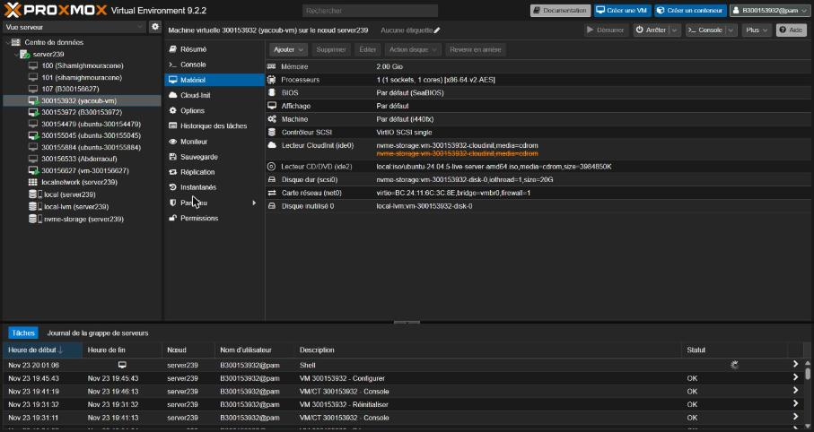

# 🏗️ Lab 3 - Ma VM Ubuntu Server sur Proxmox

| Champ | Valeur |
|-------|--------|
| Nom | Yacoub Bâ |
| Numéro étudiant | 300153932 |
| Serveur | `server239` - [10.7.236.239](https://10.7.236.239:8006) (Proxmox VE 9.2.2) |
| VM | ID `300153932`, nom `yacoub-vm` |
| Accès | 🏙️ `ubuntu@10.7.236.220` (adresse assignée dans le tableau de participation) |

## 🎯 Objectif

- [x] Créer sa propre VM sur le serveur Proxmox de son groupe
- [x] Ajouter la clé du prof dans la VM

## 1. Création de la VM

| Paramètre | Valeur |
|-----------|--------|
| Système | Ubuntu Server 24.04.5 LTS (ISO `ubuntu-24.04.5-live-server-amd64.iso`) |
| CPU | 1 socket, 1 cœur, type `x86-64-v2-AES` |
| Mémoire | 2048 Mo |
| Disque | `scsi0`, 20 Go, VirtIO SCSI single (déplacé ensuite sur `nvme-storage`, voir [5.Storage](../../5.Storage/300153932/README.md)) |
| Réseau | `net0` VirtIO sur le pont `vmbr0` |



*Figure 1 : Onglet Matériel de `yacoub-vm` dans Proxmox.*

## 2. Adresse IP statique

L'adresse assignée est `10.7.236.220`. J'ai d'abord vérifié qu'aucune machine ne répondait déjà sur cette adresse (`ping 10.7.236.220` : 100 % de perte).

La VM était en DHCP. J'ai remplacé `/etc/netplan/50-cloud-init.yaml` (l'ancienne version est gardée dans `/root/50-cloud-init.yaml.dhcp.bak`) :

```yaml
network:
  version: 2
  ethernets:
    ens18:
      match:
        macaddress: "bc:24:11:6c:3c:8e"
      set-name: ens18
      dhcp4: false
      addresses:
        - 10.7.236.220/23
      routes:
        - to: default
          via: 10.7.237.1
      nameservers:
        addresses: [10.7.237.3, 10.7.237.62, 8.8.8.8]
```

```bash
sudo netplan generate
sudo netplan apply
```

Cloud-init est désactivé par l'installateur d'Ubuntu (`/etc/cloud/cloud-init.disabled`), il ne remplace donc pas ce fichier au démarrage.

## 3. Utilisateur `ubuntu` et clé du prof

Le tableau de participation se connecte avec `ubuntu@10.7.236.220`. J'ai donc créé l'utilisateur `ubuntu` avec les droits sudo :

```bash
sudo useradd -m -s /bin/bash -G sudo ubuntu
echo "ubuntu ALL=(ALL) NOPASSWD:ALL" | sudo tee /etc/sudoers.d/90-ubuntu
sudo chmod 440 /etc/sudoers.d/90-ubuntu
sudo visudo -c
```

Puis j'ai ajouté la **clé du prof** ([X.Linux/3.keys](../../X.Linux/3.keys)) et ma clé (`ssh-keygen -t rsa -b 4096`, renommée `~/.ssh/b300153932`) dans `authorized_keys` :

```bash
sudo install -d -m 700 -o ubuntu -g ubuntu /home/ubuntu/.ssh
sudo nano /home/ubuntu/.ssh/authorized_keys      # une clé par ligne
sudo chown ubuntu:ubuntu /home/ubuntu/.ssh/authorized_keys
sudo chmod 600 /home/ubuntu/.ssh/authorized_keys
```

Vérification :

```text
$ ssh-keygen -lf ~/.ssh/authorized_keys
2048 SHA256:QjsnIAs7R7me0iGwUyFxHcoD4mLZZGfChh3OSCcDTVE b300098957@ramena (RSA)    <- clé du prof
4096 SHA256:pTpzIQU7bEcIyVEZ3EJDbjmGpXIK1uEfV7C8yDhcMVI b300153932 (RSA)          <- ma clé
```

## 4. Connexion SSH et tests

Depuis mon PC (PowerShell) :

```powershell
ssh -i ~/.ssh/b300153932 ubuntu@10.7.236.220
```

La connexion se fait avec la clé, sans mot de passe.

```text
$ lsb_release -ds
Ubuntu 24.04.5 LTS
$ ip -4 -br a show ens18
ens18            UP             10.7.236.220/23
$ ip r
default via 10.7.237.1 dev ens18 proto static
10.7.236.0/23 dev ens18 proto kernel scope link src 10.7.236.220
$ ping -c2 8.8.8.8
2 packets transmitted, 2 received, 0% packet loss
$ ping -c1 google.com
64 bytes from lcyyzn-in-f113.1e100.net (192.178.192.113): icmp_seq=1 ttl=110 time=3.78 ms
$ systemctl is-active ssh
active
$ id ubuntu
uid=1002(ubuntu) gid=1002(ubuntu) groups=1002(ubuntu),27(sudo)
$ ls -ld ~/.ssh ; ls -l ~/.ssh/authorized_keys
drwx------ 2 ubuntu ubuntu 4096 Nov 24 00:44 /home/ubuntu/.ssh
-rw------- 1 ubuntu ubuntu 1234 Nov 24 00:54 /home/ubuntu/.ssh/authorized_keys
```

## 5. Difficultés

- **Accès à la VM sans clé.** Au départ, la VM n'avait aucune clé SSH. Pour ajouter les clés sans passer par l'invite de connexion, j'ai démarré la VM en mode secours : dans GRUB (`Échap` au démarrage, puis `e`), j'ai ajouté `rw init=/bin/bash` à la ligne `linux`, puis démarré avec `F10`. On obtient un shell root sans mot de passe sur sa propre VM.
- **Clavier noVNC.** Dans la console noVNC, les touches `Maj` et `Ctrl` n'étaient pas transmises (pas de majuscules ni de `_ > | $ *`). J'ai contourné le problème avec des codes hexadécimaux dans `sed` (par exemple `\x41` pour `A`) et le drapeau `e` de GNU sed, qui exécute une commande.
- **Cloud-init.** J'ai essayé d'ajouter un lecteur cloud-init dans Proxmox. Ça n'a rien changé, parce que l'installateur d'Ubuntu désactive cloud-init après le premier démarrage. J'ai retiré ce lecteur.
- **sudo et noms en majuscules.** Une règle sudoers qui commence par un nom en majuscules (`B300153932 ALL=...`) est lue comme un alias. Pour un utilisateur nommé ainsi, il faut utiliser son UID (`#1001 ALL=...`).

## ✅ Résultat

- ✅ VM `300153932` créée sur `server239`
- ✅ IP statique `10.7.236.220/23`, passerelle `10.7.237.1`, DNS fonctionnel
- ✅ Utilisateur `ubuntu` avec sudo
- ✅ Clé du prof et ma clé dans `authorized_keys`, connexion SSH par clé
