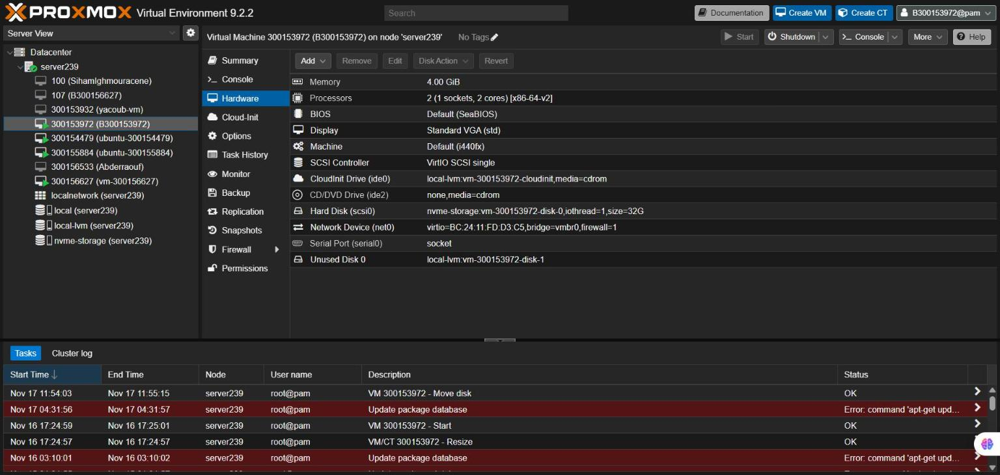
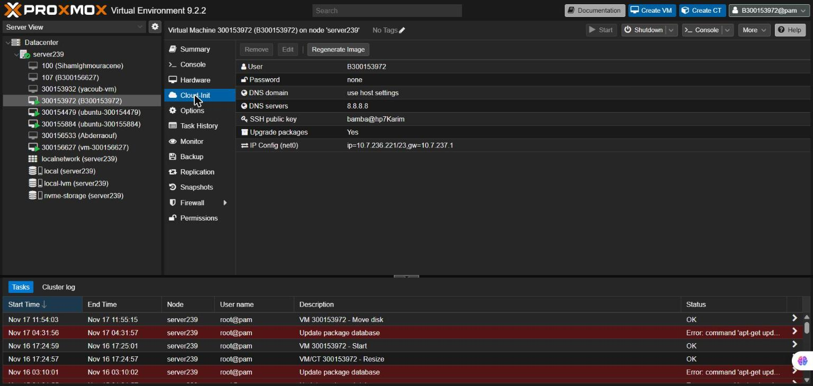
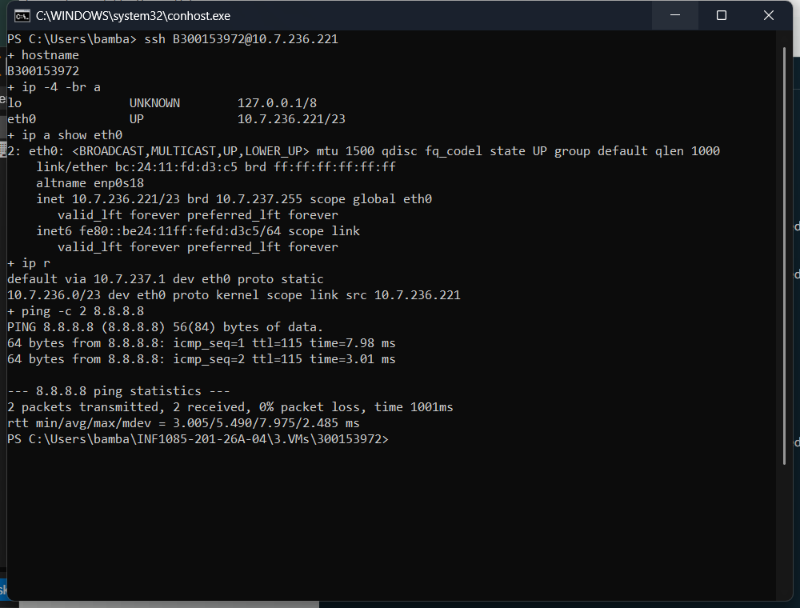

# Création d'une VM Ubuntu Server sur Proxmox

Karim Bamba – 300153972 – INF1085 Administration Linux, section 04, groupe 3

## Objectif

Créer ma machine virtuelle Ubuntu Server 24.04 sur le serveur Proxmox de mon groupe, lui donner une adresse IP statique et m'y connecter en SSH avec ma clé.

## Mon environnement

- Serveur : **server239** (HP ProLiant DL360 G7), adresse `10.7.236.239/23`
- Proxmox VE 9.2.2 (noyau `7.0.2-6-pve`)
- Passerelle du réseau : `10.7.237.1`
- Ma VM : **B300153972**, VM ID **300153972**

## 1. Connexion au serveur

Je me connecte au serveur avec mon compte (créé au lab 4.Root) :

```bash
ssh B300153972@10.7.236.239
pveversion
```

Résultat : `pve-manager/9.2.2/b9984c6d90a4bd80 (running kernel: 7.0.2-6-pve)`.

## 2. Création de la VM

J'ai créé la VM avec ces paramètres :

- Nom `B300153972`, VM ID `300153972`
- 2 cœurs, type de CPU `x86-64-v2`
- 4096 Mo de RAM
- Disque de 32 Go sur `local-lvm`, contrôleur VirtIO SCSI single
- Carte réseau VirtIO sur le bridge `vmbr0`

Difficulté : au premier démarrage, la VM refusait de partir avec le type de CPU `x86-64-v2-AES`. Le processeur du serveur (Xeon E5540) ne gère pas l'instruction AES. J'ai mis le type `x86-64-v2` et la VM a démarré.

## 3. Installation d'Ubuntu

J'avais d'abord monté l'ISO `ubuntu-24.04.5-live-server-amd64.iso`, mais l'installation n'avait pas été faite (le disque était encore vide). Pour finir, j'ai utilisé l'**image cloud officielle d'Ubuntu 24.04** avec **cloud-init**, qui permet de configurer la VM sans passer par l'installateur :

```bash
wget -O noble-cloud.img https://cloud-images.ubuntu.com/noble/current/noble-server-cloudimg-amd64.img
qm set 300153972 --scsi0 local-lvm:0,import-from=/var/lib/vz/template/noble-cloud.img,iothread=1
qm disk resize 300153972 scsi0 32G
```

Ensuite, j'ai ajouté le lecteur cloud-init et donné mon utilisateur, ma clé publique et mon adresse IP :

```bash
qm set 300153972 --ide0 local-lvm:cloudinit --boot order=scsi0 \
  --ciuser B300153972 --sshkeys karim.pub \
  --ipconfig0 ip=10.7.236.221/23,gw=10.7.237.1 --nameserver 8.8.8.8
qm start 300153972
```

Avant de choisir l'adresse `10.7.236.221`, j'ai vérifié qu'aucune machine ne répondait déjà au ping sur cette adresse.

## 4. Adresse IP statique

Cloud-init a écrit la configuration Netplan dans `/etc/netplan/50-cloud-init.yaml` :

```yaml
network:
  version: 2
  ethernets:
    eth0:
      match:
        macaddress: "bc:24:11:fd:d3:c5"
      addresses:
      - "10.7.236.221/23"
      nameservers:
        addresses:
        - 8.8.8.8
      set-name: "eth0"
      routes:
      - to: "default"
        via: "10.7.237.1"
```

L'interface s'appelle `eth0` (et pas `ens18`) parce que cloud-init la renomme avec `set-name`.

## 5. Connexion SSH et tests

Depuis PowerShell sur mon PC :

```powershell
ssh B300153972@10.7.236.221
```

La connexion marche directement avec ma clé, sans mot de passe. Les droits sont bons : `~/.ssh` est en `drwx------` et `authorized_keys` en `-rw-------`.

Tests dans la VM :

```bash
lsb_release -ds        # Ubuntu 24.04.5 LTS
ip -4 -br a            # eth0  UP  10.7.236.221/23
ip r                   # default via 10.7.237.1 dev eth0 proto static
ping -c 2 8.8.8.8      # 2 reçus, 0 % de perte
ping -c 1 google.com   # 1 reçu, 0 % de perte (le DNS marche)
systemctl is-active ssh   # active
```

## Captures

L'onglet Hardware de ma VM dans l'interface web de Proxmox. Les captures ont été prises le 17 novembre, après le lab 5 : c'est pour ça que le disque est maintenant sur `nvme-storage` et que l'ancien disque apparaît en « Unused Disk 0 ».



L'onglet Cloud-Init, avec mon utilisateur, ma clé SSH et l'adresse IP statique :



Ma connexion SSH depuis mon PC, avec l'adresse de `eth0`, la route par défaut et le ping vers Internet :



## Conclusion

Ma VM Ubuntu Server 24.04 tourne sur server239. Elle a l'adresse statique `10.7.236.221/23` et je m'y connecte en SSH avec ma clé. J'ai appris que le type de CPU virtuel doit correspondre au vrai processeur, qu'il faut vérifier qu'une adresse IP est libre sur un serveur partagé, et que cloud-init permet de préparer une VM (utilisateur, clé, réseau) sans faire l'installation à la main.
