# 🏗️ VMs - Machine virtuelle Ubuntu Server sur Proxmox VE

| Champ | Valeur |
|-------|--------|
| Prénom | Joris Dylane |
| Nom | Touossock Ngabou |
| Numéro étudiant | 300154479 |
| Serveur | `server239` - [10.7.236.239](https://10.7.236.239:8006) (Rack 2, U32) |
| VM | `300154479` - `ubuntu-300154479` |
| Accès | `ssh ubuntu@10.7.236.222` |
| Date du laboratoire | 11 novembre 2026 |

## 🎯 Objectif

Créer ma propre machine virtuelle Linux sur le serveur Proxmox de notre groupe, en ligne de commande (`qm`), comme dans le chapitre [Q.QEMU](../../Q.QEMU/README.md) :

- 1 vCPU, 2 Go de RAM, disque de 20 Go
- Installation d'Ubuntu Server 24.04.5 à partir de l'ISO
- Adresse IP fixe `10.7.236.222/23`
- Accès SSH pour l'utilisateur `ubuntu` avec la clé publique du professeur

---

## 1. Création de la VM avec `qm`

Connexion au nœud en `root` (`ssh root@10.7.236.239`), puis :

```bash
qm create 300154479 --name ubuntu-300154479 --memory 2048 --cores 1 --cpu host --ostype l26 --net0 virtio,bridge=vmbr0
qm set 300154479 --scsihw virtio-scsi-pci --scsi0 local-lvm:20
qm set 300154479 --ide2 local:iso/ubuntu-24.04.5-live-server-amd64.iso,media=cdrom
qm set 300154479 --boot "order=ide2;scsi0"
qm start 300154479
```

| Option | Rôle |
|--------|------|
| `300154479` | Identifiant de la VM (mon numéro étudiant, comme mes coéquipiers) |
| `--memory 2048` | 2 Go de RAM |
| `--cores 1` | 1 vCPU |
| `--cpu host` | La VM voit le vrai processeur du serveur |
| `--net0 virtio,bridge=vmbr0` | Carte réseau VirtIO branchée sur le pont `vmbr0` (réseau du labo) |
| `--scsi0 local-lvm:20` | Nouveau disque de 20 Go |
| `--ide2 …,media=cdrom` | ISO d'Ubuntu dans le lecteur CD virtuel |
| `--boot order=ide2;scsi0` | Démarrer sur le CD d'abord pour l'installation |

> 💡 Le chapitre Q.QEMU utilise le stockage `nvme-storage`, mais `pvesm status` montre que `server239` n'a que `local` (ISO) et `local-lvm` (disques). Le disque est donc sur `local-lvm`, comme pour les autres VMs du groupe.

Sortie complète de `qm list`, `qm config` et `pvesm status` : [images/qm-sortie.txt](images/qm-sortie.txt).

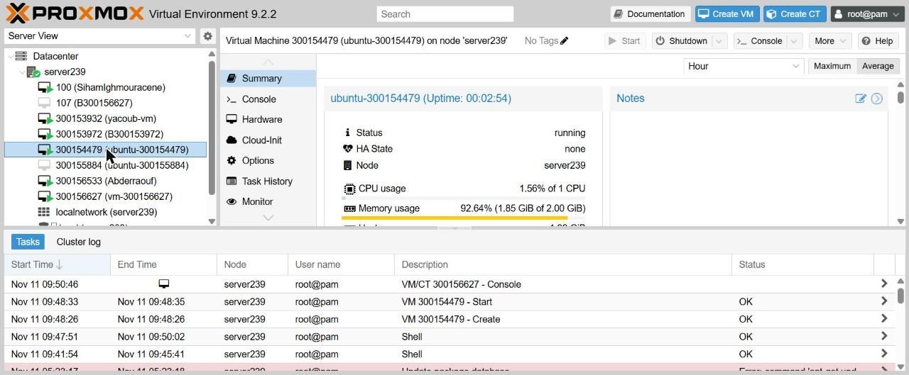

*Figure 1 : La VM `300154479 (ubuntu-300154479)` apparaît sous `server239` et tourne sur 1 CPU avec 2 Go de RAM.*

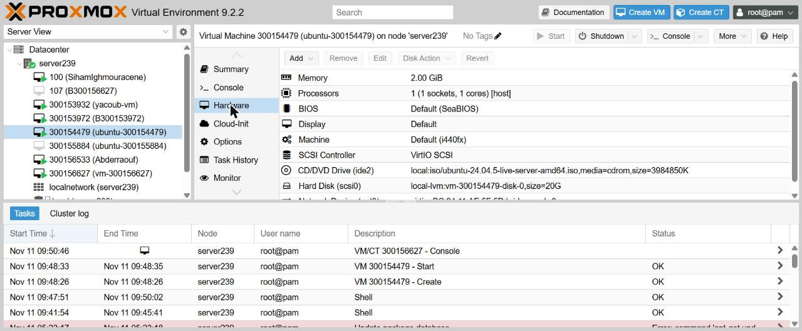

*Figure 2 : Onglet **Hardware** : 2 Go de mémoire, 1 processeur `[host]`, contrôleur VirtIO SCSI, ISO Ubuntu sur `ide2`, disque de 20 Go sur `scsi0`.*

## 2. Installation d'Ubuntu Server

L'installation se fait dans la **Console** (noVNC) de la VM.

| Écran | Choix |
|-------|-------|
| Langue | Français |
| Clavier | English (US) |
| Type | Ubuntu Server |
| Réseau | IP fixe (voir plus bas) |
| Proxy / miroir | Aucun proxy, miroir `archive.ubuntu.com` par défaut |
| Stockage | Disque entier de 20 Go avec LVM |
| Profil | serveur `ubuntu-300154479`, utilisateur `ubuntu` |
| SSH | ✅ Installer le serveur OpenSSH |

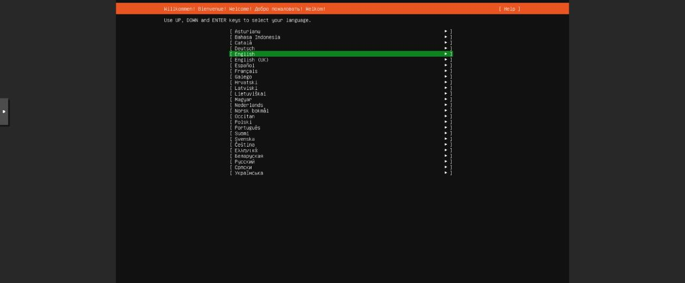

*Figure 3 : Premier écran de l'installateur : choix de la langue.*

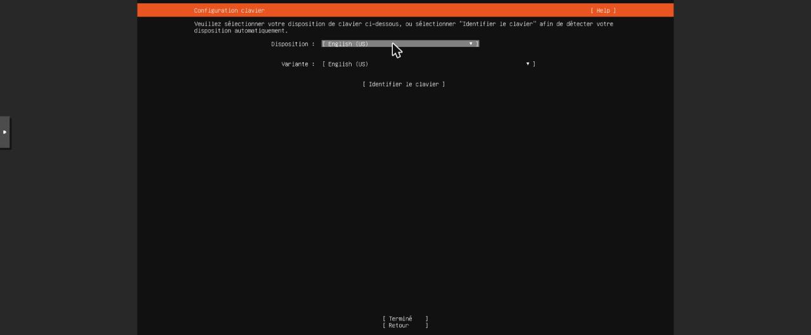

*Figure 4 : Clavier **English (US)**. Avec la console web noVNC, une disposition française donnait de mauvais caractères pour `.` et `/`, indispensables pour taper les adresses IP.*

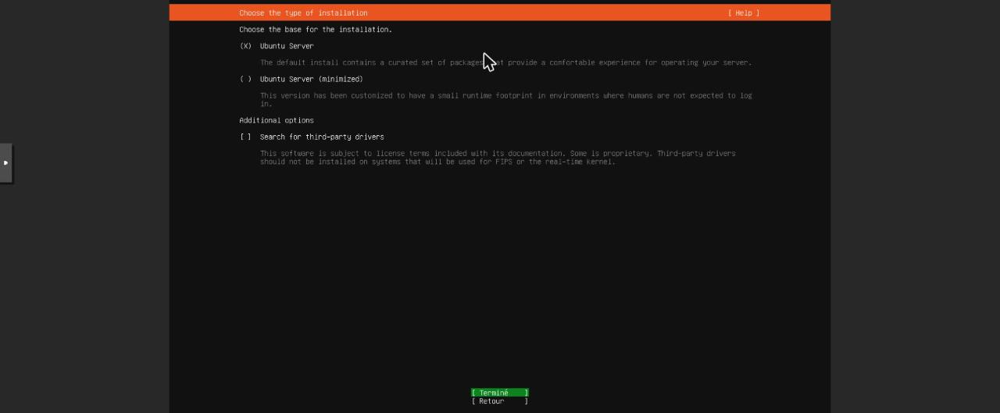

*Figure 5 : Installation standard **Ubuntu Server**.*

### Réseau : adresse IP fixe

Par défaut, l'interface `ens18` reçoit une adresse par DHCP (`10.7.236.153`). Je l'ai remplacée par l'adresse prévue pour moi dans le tableau de participation : **Edit IPv4 → Manuel**.

| Champ | Valeur |
|-------|--------|
| Sous-réseau | `10.7.236.0/23` |
| Adresse | `10.7.236.222` |
| Passerelle | `10.7.237.1` |
| DNS | `8.8.8.8` |

> Avant de choisir l'adresse, j'ai vérifié sur le serveur (`ip neigh`) qu'aucune autre machine n'utilisait déjà `10.7.236.222`.

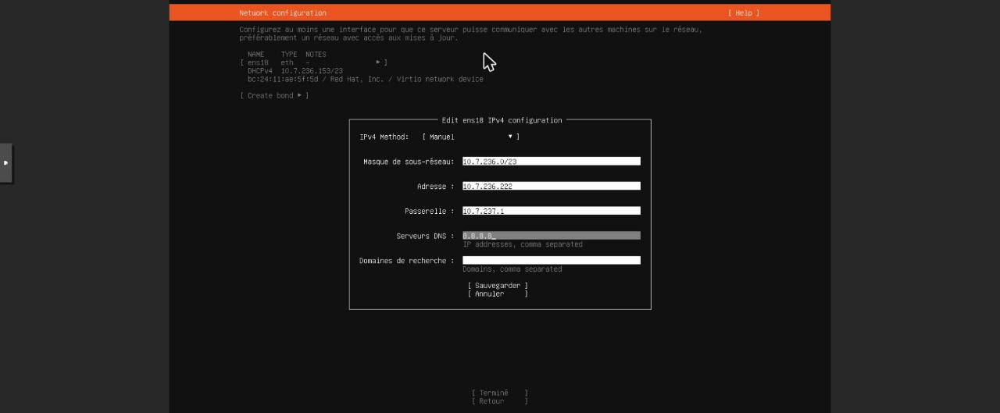

*Figure 6 : Configuration IPv4 manuelle de `ens18`.*

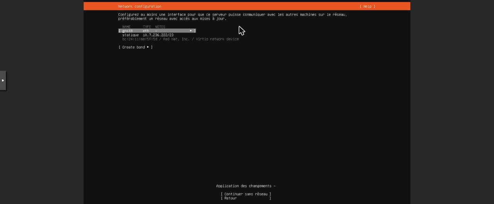

*Figure 7 : L'interface passe en `statique 10.7.236.222/23`.*

### Stockage, profil et SSH

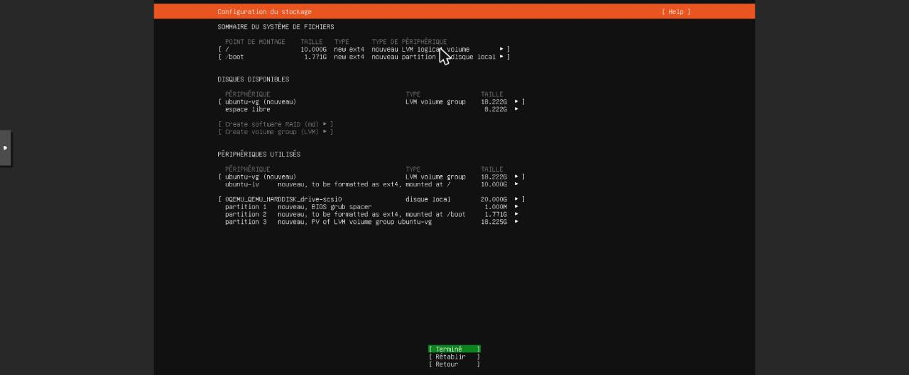

*Figure 8 : Le disque de 20 Go est découpé en `/boot` (1,7 Go) et un groupe LVM `ubuntu-vg` (18,2 Go) qui contient `/`.*

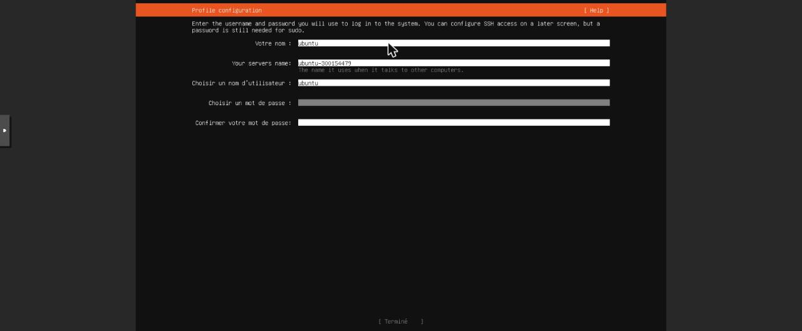

*Figure 9 : Nom du serveur `ubuntu-300154479`, utilisateur `ubuntu`.*

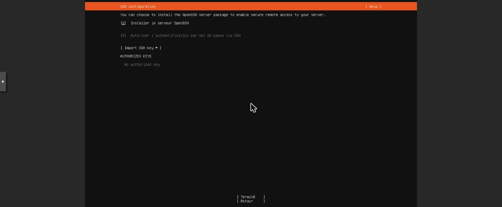

*Figure 10 : **Installer le serveur OpenSSH** est coché pour pouvoir administrer la VM à distance.*

## 3. Erreur à la fin de l'installation

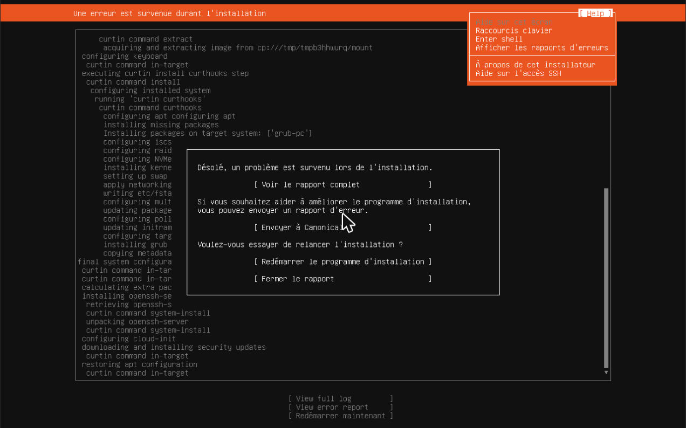

*Figure 11 : Après le téléchargement des mises à jour de sécurité, l'installateur affiche « Une erreur est survenue durant l'installation » à l'étape `restoring apt configuration`.*

Avant de recommencer, j'ai vérifié dans **Help → Enter shell** si le système était quand même installé dans `/target` :

| Vérification | Résultat |
|--------------|----------|
| `ls /target/boot` | ✅ noyau `vmlinuz-6.8.0-149-generic`, `initrd`, `grub` |
| `grep ubuntu /target/etc/passwd` | ✅ `ubuntu:x:1000:1000` |
| `ls /target/usr/sbin/sshd` | ✅ OpenSSH installé |
| `cat /target/etc/hostname` | ✅ `ubuntu-300154479` |

Le système était complet : seule la remise en place de la configuration `apt` avait échoué. J'ai donc fait `sync` pour écrire les données sur le disque, sans réinstaller.

> 💡 Dans ce shell, `|` et `*` arrivaient comme `\` et `8` : la console noVNC ne transmettait pas toujours la touche **Maj**. Il faut en tenir compte pour les mots de passe tapés dans la console.

## 4. Retirer l'ISO et démarrer sur le disque

```bash
qm stop 300154479
qm set 300154479 --delete ide2
qm set 300154479 --boot order=scsi0
qm start 300154479
```


*Figure 12 : La VM démarre sur son disque : `Ubuntu 24.04.5 LTS ubuntu-300154479 tty1` et l'invite `login:`.*

Configuration finale : [images/qm-config-final.txt](images/qm-config-final.txt) (`boot: order=scsi0`, plus de `ide2`).

## 5. Clés SSH : la mienne et celle du professeur

Depuis PowerShell sur mon portable (le mot de passe de `ubuntu` est demandé une seule fois) :

```powershell
ssh ubuntu@10.7.236.222 "mkdir -p ~/.ssh && chmod 700 ~/.ssh && echo 'ssh-rsa AAAA…P5N b300098957@ramena' >> ~/.ssh/authorized_keys && echo 'ssh-ed25519 AAAA…UvG dylan@joris' >> ~/.ssh/authorized_keys && chmod 600 ~/.ssh/authorized_keys"
```

| Clé | Propriétaire |
|-----|--------------|
| `ssh-rsa … b300098957@ramena` | Professeur (clé donnée dans [3.VMs/README.md](../README.md)) |
| `ssh-ed25519 … dylan@joris` | Mon portable |

Ensuite, `ssh ubuntu@10.7.236.222` se connecte **sans mot de passe** ✅.

---

## 🧪 Vérifications

Sortie complète : [images/verifications.txt](images/verifications.txt)

```text
$ hostnamectl
 Static hostname: ubuntu-300154479
  Virtualization: kvm
Operating System: Ubuntu 24.04.5 LTS
          Kernel: Linux 6.8.0-149-generic

$ free -h
               total        used        free
Mem:           1,9Gi       296Mi       1,5Gi

$ lscpu | grep '^CPU(s)'
CPU(s):                                  1

$ lsblk
sda                         20G  disk
├─sda2                     1,8G  part /boot
└─sda3                    18,2G  part
  └─ubuntu--vg-ubuntu--lv   10G  lvm  /

$ ip -br a
ens18            UP             10.7.236.222/23

$ ip r
default via 10.7.237.1 dev ens18 proto static

$ ping -c 2 8.8.8.8
2 packets transmitted, 2 received, 0% packet loss
```

| Vérification | Commande | Attendu | Résultat |
|--------------|----------|---------|----------|
| RAM | `free -h` | 2 Go | ✅ 1,9 Gi (une partie est réservée au noyau) |
| CPU | `lscpu` | 1 vCPU | ✅ `CPU(s): 1` |
| Disque | `lsblk` | 20 Go | ✅ `sda 20G` |
| Adresse IP | `ip -br a` | `10.7.236.222/23` | ✅ |
| Passerelle | `ip r` | `10.7.237.1` | ✅ |
| Internet | `ping 8.8.8.8` | réponse | ✅ 0 % de perte |
| SSH | `systemctl is-active ssh` | `active` | ✅ |
| Clé du prof | `~/.ssh/authorized_keys` | présente | ✅ (droits `600`, dossier `700`) |
| Démarrage sur disque | `qm config` | `boot: order=scsi0` | ✅ |

> 💡 `lsblk` montre que `/` ne fait que 10 Go alors que le groupe LVM `ubuntu-vg` en a 18,2 Go : l'installateur d'Ubuntu laisse volontairement de l'espace libre dans le groupe. On pourra l'ajouter plus tard avec `sudo lvextend -r -l +100%FREE /dev/ubuntu-vg/ubuntu-lv`.

## ✅ Résultat

- ✅ VM `300154479` créée en ligne de commande avec `qm`
- ✅ 1 vCPU, 2 Go RAM, 20 Go disque
- ✅ Ubuntu Server 24.04.5 installé à partir de l'ISO
- ✅ IP fixe `10.7.236.222/23`, accès Internet
- ✅ `ssh ubuntu@10.7.236.222` avec la clé du professeur
