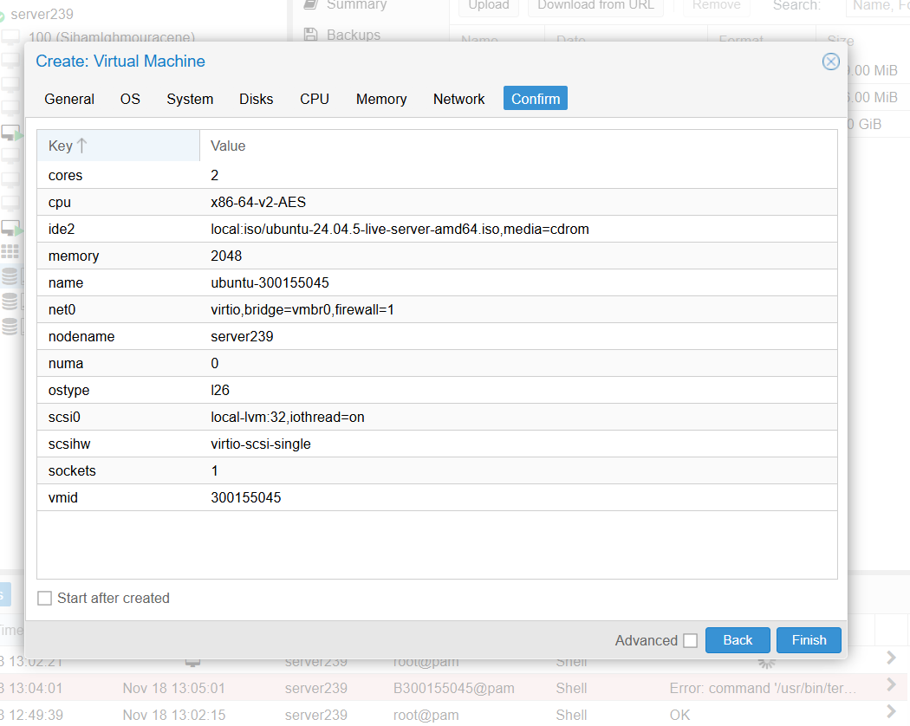
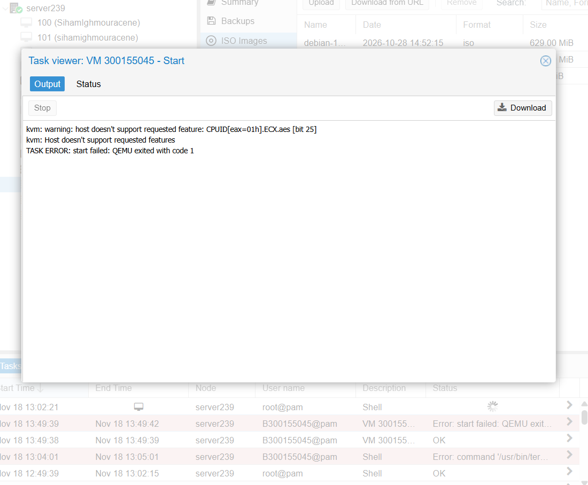
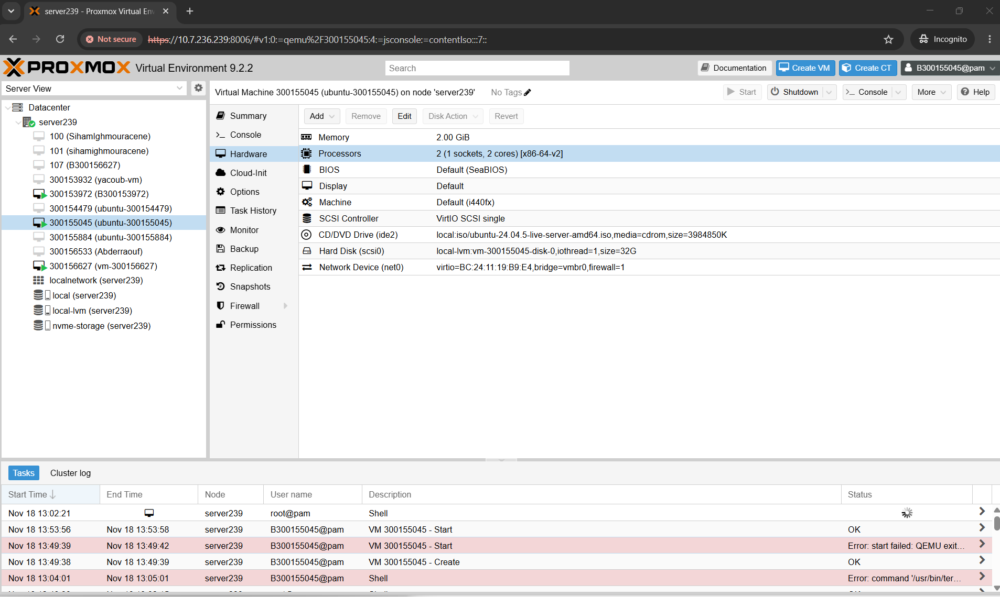
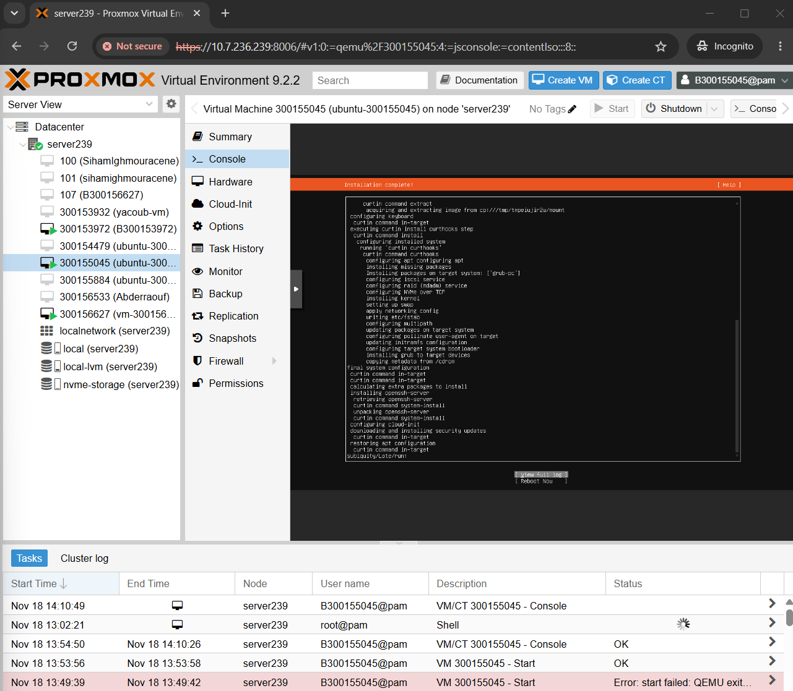
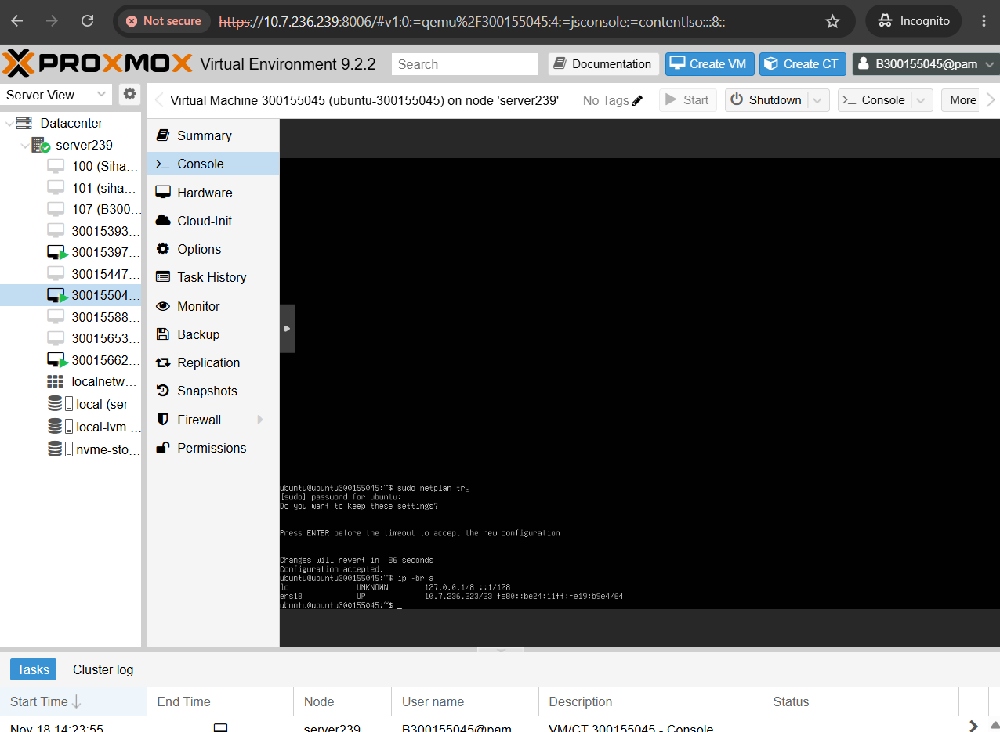
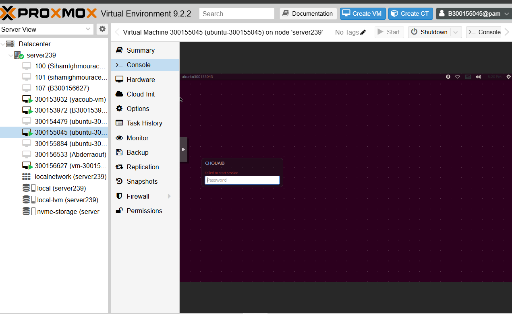

# Création d’une VM Ubuntu Server sur Proxmox

Chouaib Ait Chouaib · 300155045 · INF1085 Administration Linux, section 04, groupe 3

## Objectif

Créer ma VM Ubuntu Server sur le serveur Proxmox du groupe 3, lui attribuer une adresse IP fixe, vérifier l’accès SSH et installer le bureau XFCE.

## Mon environnement

| Élément | Configuration |
|---|---|
| Serveur Proxmox | `server239`, `10.7.236.239` |
| Version | Proxmox VE 9.2.2 |
| VM | `ubuntu-300155045`, ID `300155045` |
| Système | Ubuntu Server 24.04.5 LTS |
| Compte dans la VM | `ubuntu` |

## 1. Connexion au serveur

Je me suis connecté à l’interface Web avec mon compte `B300155045@pam`. J’ai aussi testé SSH depuis Windows PowerShell avec ma clé ED25519. La ligne `using "publickey"` confirme que le serveur Proxmox a accepté ma clé.


## 2. Création de la VM

- Nom `ubuntu-300155045`, ID `300155045`
- 1 socket, 2 cœurs, 2048 MiB de RAM
- Disque de 32 GiB sur `local-lvm`, contrôleur VirtIO SCSI single
- Carte réseau VirtIO sur le pont `vmbr0`



Au premier démarrage, QEMU a signalé que l’hôte ne prenait pas en charge l’extension AES demandée par le modèle `x86-64-v2-AES`. Dans **Hardware → Processors**, j’ai sélectionné `x86-64-v2`, puis la VM a démarré.





## 3. Installation d’Ubuntu

J’ai installé Ubuntu depuis l’ISO `ubuntu-24.04.5-live-server-amd64.iso` avec l’assistant dans la console Proxmox. J’ai utilisé le disque virtuel de 32 GiB, créé le compte `ubuntu` et coché **Install OpenSSH server**. Une fois l’installation terminée, j’ai retiré l’ISO et redémarré sur le disque.



## 4. Adresse IP statique

Au premier démarrage, la VM avait reçu `10.7.236.160` par DHCP. J’ai modifié `/etc/netplan/50-cloud-init.yaml` pour attribuer à `ens18` l’adresse prévue pour mon labo.

```yaml
network:
  version: 2
  ethernets:
    ens18:
      dhcp4: false
      addresses: [10.7.236.223/23]
      routes:
        - to: default
          via: 10.7.237.1
      nameservers:
        addresses: [10.7.237.3, 10.7.237.62, 10.7.236.7, 8.8.8.8]
```

J’ai accepté les paramètres avec `sudo netplan try` et vérifié l’adresse avec `ip -br a`.



## 5. Connexion SSH et tests

`sudo apt update` a réussi dans la VM, ce qui confirme que les dépôts Ubuntu étaient accessibles. Depuis Windows PowerShell, j’ai ensuite testé la connexion à la VM.

```powershell
ssh ubuntu@10.7.236.223
```

J’ai saisi le mot de passe du compte `ubuntu` et obtenu l’invite `ubuntu@ubuntu300155045:~$`.


## 6. Bureau graphique XFCE

J’ai installé XFCE et LightDM avec `sudo apt install xfce4 lightdm`. Au premier essai, LightDM a affiché **Failed to start session**. En SSH, j’ai vérifié que `xfce.desktop` était présent dans `/usr/share/xsessions/`.



J’ai défini `user-session=xfce` dans la section `[Seat:*]` du fichier `/etc/lightdm/lightdm.conf.d/90-xfce.conf`, puis relancé LightDM avec `sudo systemctl restart lightdm`. Après la connexion, le bureau s’est ouvert dans la console Proxmox.


## Conclusion

Ma VM Ubuntu fonctionne sur `server239`. Elle utilise l’adresse fixe `10.7.236.223/23`, répond en SSH avec le compte `ubuntu` et affiche le bureau XFCE dans Proxmox. J’ai corrigé deux problèmes pendant le labo, le modèle de processeur au démarrage et le choix de la session dans LightDM.


