# COLLÈGE BORÉAL

### Cours : INF1085 – Administration Linux

# Rapport de laboratoire

## Création, installation et configuration d'une machine virtuelle Ubuntu Server 24.04.5 LTS sur Proxmox VE

**Nom de l'étudiante :**  Patricia Nguemedzi

**Numéro étudiant :** 300155884

**Programme :** Techniques des systèmes informatiques et de réseaux (TSIQ)

**Date :** 10 novembre 2026

---

## 1. Introduction

Dans le cadre du cours **INF1085 – Administration Linux**, nous avons réalisé l'installation et la configuration d'une machine virtuelle Ubuntu Server sur la plateforme de virtualisation Proxmox VE.

L'objectif de ce laboratoire était de créer un serveur Linux fonctionnel, de configurer son réseau, de vérifier sa connectivité et de permettre son administration à distance à l'aide du protocole SSH.

Nous avons également configuré une authentification par clé publique SSH et ajouté la clé publique du professeur afin de lui permettre d'accéder à notre machine virtuelle.

## 2. Environnement de travail

| Élément | Configuration |
|---|---|
| Plateforme de virtualisation | Proxmox VE 9.2.2 |
| Nœud Proxmox | `server239` |
| Identifiant de la VM | `300155884` |
| Nom de la VM | `ubuntu-300155884` |
| Système d'exploitation | Ubuntu Server 24.04.5 LTS |
| Image ISO | `ubuntu-24.04.5-live-server-amd64.iso` |
| Processeur | 1 socket, 2 cœurs |
| Mémoire vive | 2048 Mo |
| Disque virtuel configuré | 20 Go |
| Carte réseau | VirtIO |
| Pont réseau | `vmbr0` |
| Interface réseau Ubuntu | `ens18` |
| Adresse IPv4 | `10.7.236.225/23` |
| Passerelle | `10.7.237.1` |
| Serveur DNS | `8.8.8.8` |
| Utilisateur Ubuntu | `ubuntu` |

## 3. Création de la machine virtuelle sur Proxmox

Nous avons commencé par accéder à l'interface Web de Proxmox VE sur le nœud `server239`.

À l'aide de l'option **Create VM**, nous avons créé une machine virtuelle portant l'identifiant `300155884` et le nom `ubuntu-300155884`.

Nous avons ensuite sélectionné l'image ISO d'Ubuntu Server 24.04.5 LTS et configuré les ressources matérielles nécessaires :

- **Disque virtuel :** 20 Go
- **Processeur :** 1 socket et 2 cœurs
- **Mémoire vive :** 2048 Mo
- **Interface réseau :** VirtIO, connectée au pont `vmbr0`

Avant de confirmer la création, nous avons vérifié les paramètres dans l'écran récapitulatif de Proxmox.

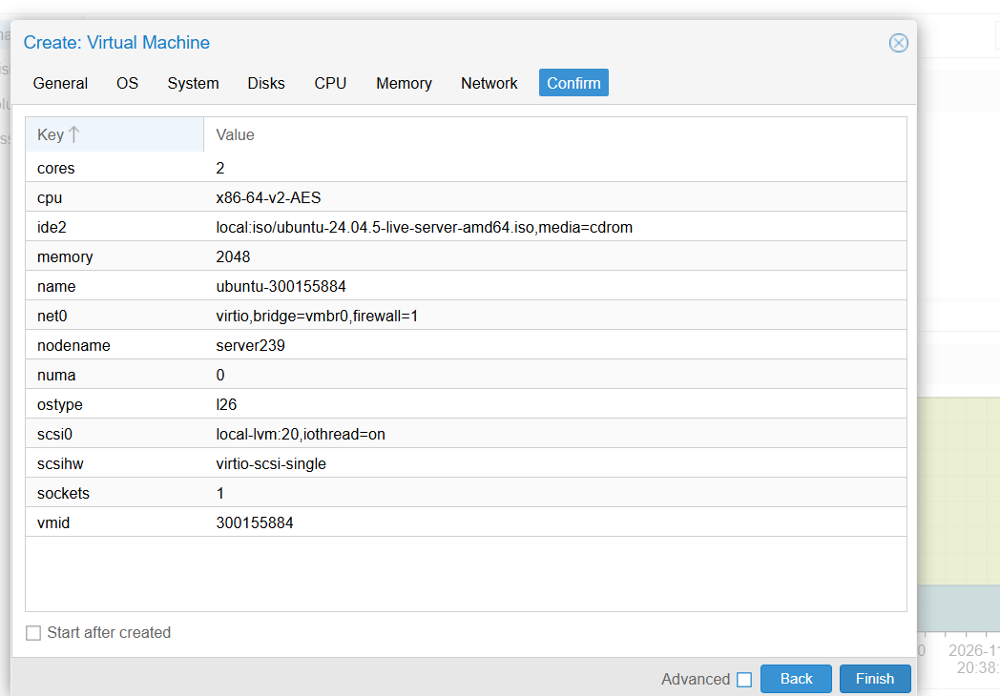

## 4. Problème rencontré lors du démarrage de la VM

Lors du premier démarrage de la machine virtuelle, une erreur liée à une fonctionnalité du processeur est apparue.

Le message signalait notamment :

```text
CPUID[eax=01h].ECX.aes
```

Cette erreur indiquait que la configuration du processeur virtuel demandait une fonctionnalité non prise en charge par le processeur physique du serveur.

Elle empêchait le démarrage de la machine virtuelle.

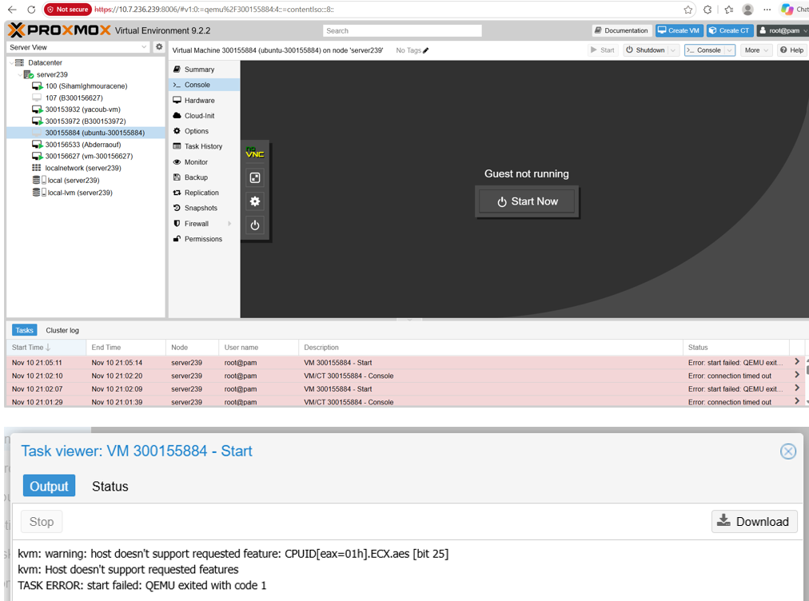

### 4.1 Résolution du problème

Pour résoudre cette difficulté, nous avons accédé à la configuration matérielle de la VM dans Proxmox.

Nous avons modifié le type de processeur virtuel afin d'utiliser un modèle compatible avec les capacités du serveur physique.

Après cette modification, la VM a pu démarrer correctement.

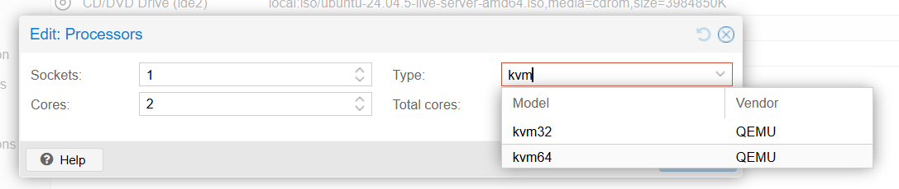

## 5. Installation d'Ubuntu Server 24.04.5 LTS

Après avoir résolu le problème de démarrage, nous avons lancé l'installation d'Ubuntu Server à partir de l'image ISO sélectionnée.

L'assistant d'installation nous a permis de configurer les paramètres du système, notamment le réseau, le stockage et le compte utilisateur.

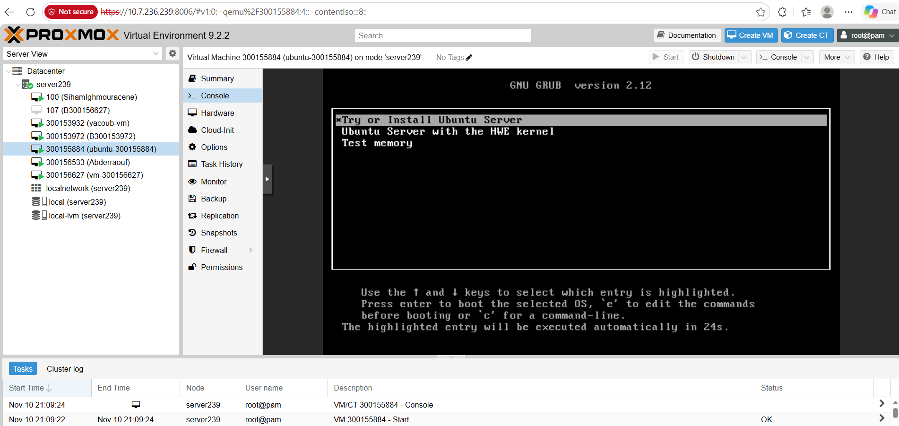

### 5.1 Configuration du réseau

Pendant l'installation, nous avons configuré manuellement l'interface réseau `ens18` afin d'attribuer une adresse IP statique à notre machine virtuelle.

Les paramètres utilisés étaient les suivants :

| Paramètre | Valeur |
|---|---|
| Interface réseau | `ens18` |
| Sous-réseau | `10.7.236.0/23` |
| Adresse IPv4 | `10.7.236.225` |
| Passerelle | `10.7.237.1` |
| DNS | `8.8.8.8` |

Cette configuration permet à la machine virtuelle de conserver une adresse IP fixe, facilitant les connexions à distance par SSH.

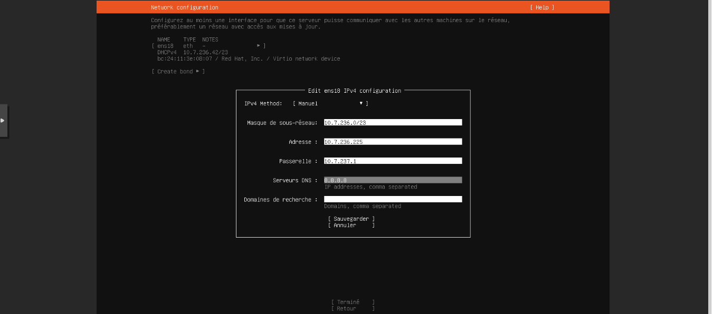

### 5.2 Configuration du stockage

Nous avons ensuite configuré le stockage destiné à accueillir le système d'exploitation.

Le disque virtuel avait été configuré avec une capacité de 20 Go dans Proxmox.

Nous avons validé les paramètres de stockage dans l'assistant d'installation avant de poursuivre.

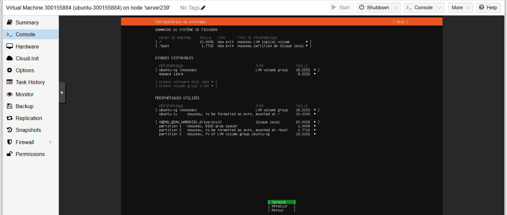

### 5.3 Création du compte utilisateur

Nous avons créé le compte utilisateur principal du serveur Ubuntu.

Les informations utilisées étaient :

- **Nom d'utilisateur :** `ubuntu`
- **Nom du serveur :** `ubuntu-300155884`

Un mot de passe a été défini pour sécuriser l'accès au compte.

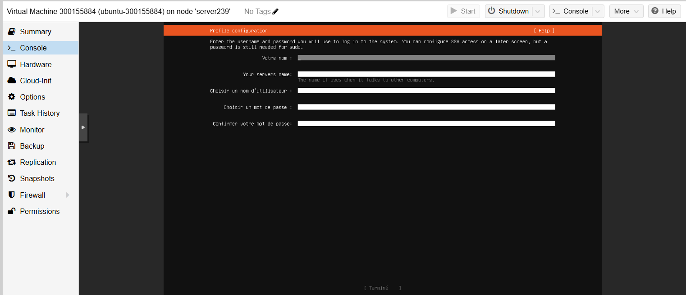

### 5.4 Fin de l'installation

Après la validation des différents paramètres, Ubuntu Server a procédé à l'installation du système.

Une fois l'installation terminée, nous avons redémarré la machine virtuelle afin d'accéder au système installé.

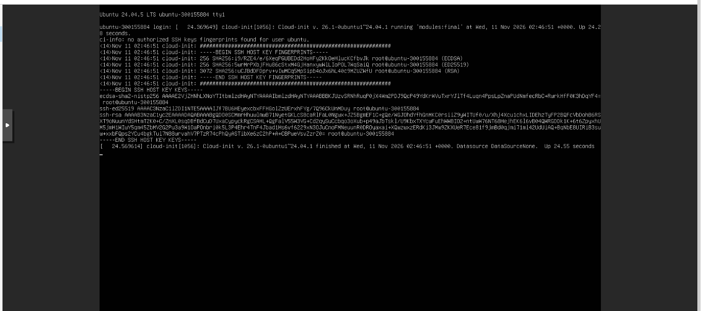

## 6. Première connexion au serveur Ubuntu

Après le redémarrage, nous avons ouvert la console de la machine virtuelle depuis Proxmox.

Nous nous sommes connectés avec le compte `ubuntu` créé pendant l'installation.

L'invite de commande suivante s'est affichée :

```bash
ubuntu@ubuntu-300155884:~$
```

Cela confirme que le système Ubuntu était installé et opérationnel.

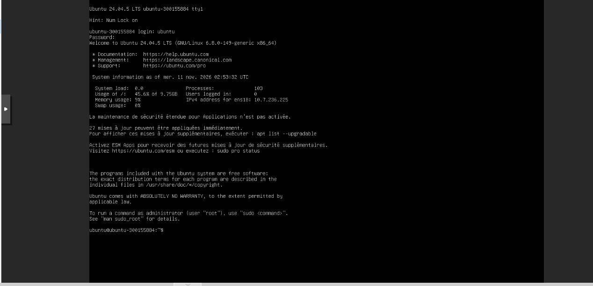

### 6.1 Vérification des informations système

Nous avons utilisé plusieurs commandes Linux afin de vérifier les caractéristiques de notre machine virtuelle.

**Vérification du nom du serveur, du système et de l'architecture :**

```bash
hostnamectl
```

**Affichage des interfaces réseau et de leurs adresses IP :**

```bash
ip -br a
```

**Vérification de la version exacte d'Ubuntu :**

```bash
lsb_release -a
```

Les résultats ont confirmé les informations suivantes :

- **Nom du serveur :** `ubuntu-300155884`
- **Système d'exploitation :** Ubuntu 24.04.5 LTS
- **Architecture :** x86-64
- **Type de virtualisation :** KVM
- **Interface réseau :** `ens18`
- **Adresse IPv4 :** `10.7.236.225/23`

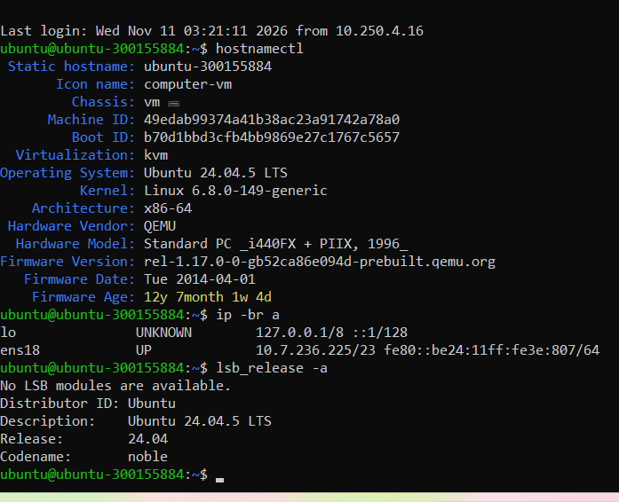

## 7. Vérification de la connectivité réseau

Après l'installation du système, nous avons vérifié que la machine virtuelle pouvait communiquer avec le réseau et accéder à Internet.

### 7.1 Test de communication avec la passerelle

Nous avons exécuté la commande suivante :

```bash
ping -c 4 10.7.237.1
```

Cette commande envoie quatre requêtes ICMP vers la passerelle du réseau.

Le test a réussi avec une perte de paquets de **0 %**.

### 7.2 Test de connectivité Internet

Nous avons ensuite exécuté :

```bash
ping -c 4 google.com
```

Cette commande permet de vérifier la connectivité Internet ainsi que la résolution DNS.

Le test a également réussi avec une perte de paquets de **0 %**.

Ces résultats confirment que la configuration réseau de la machine virtuelle fonctionne correctement.

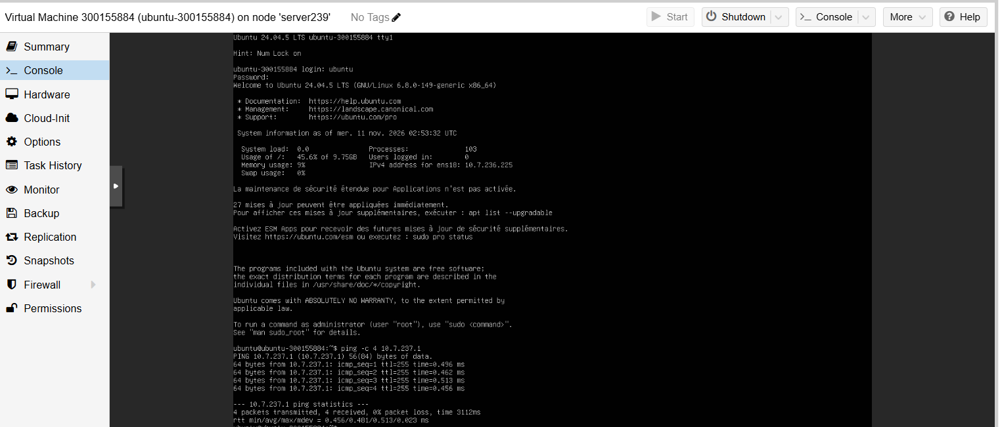

## 8. Installation et configuration du service SSH

Le protocole **SSH (Secure Shell)** permet d'administrer un serveur Linux à distance grâce à une connexion chiffrée.

Nous avons configuré le serveur OpenSSH afin de pouvoir accéder à notre machine virtuelle depuis Windows PowerShell.

### 8.1 Installation du serveur OpenSSH

La commande suivante permet d'installer le serveur SSH :

```bash
sudo apt install openssh-server
```

### 8.2 Activation du service SSH

Nous avons ensuite activé le service et configuré son démarrage automatique :

```bash
sudo systemctl enable --now ssh
```

### 8.3 Vérification du fonctionnement

Pour vérifier l'état du service, nous avons exécuté :

```bash
sudo systemctl status ssh
```

Le résultat indiquait :

```text
Active: active (running)
```

Cela confirme que le service SSH était actif et prêt à accepter des connexions sur le port 22.

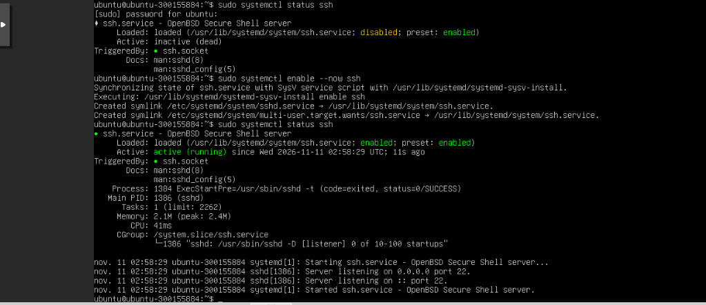

## 9. Connexion SSH depuis Windows PowerShell

Après avoir activé le serveur SSH, nous avons testé la connexion à distance depuis notre ordinateur Windows.

Nous avons ouvert PowerShell et exécuté :

```powershell
ssh ubuntu@10.7.236.225
```

Après avoir accepté la connexion et saisi le mot de passe du compte Ubuntu, nous avons obtenu l'accès au terminal distant.

L'invite de commande suivante s'est affichée :

```bash
ubuntu@ubuntu-300155884:~$
```

Cela confirme que la connexion SSH entre Windows et la machine virtuelle Ubuntu fonctionnait correctement.

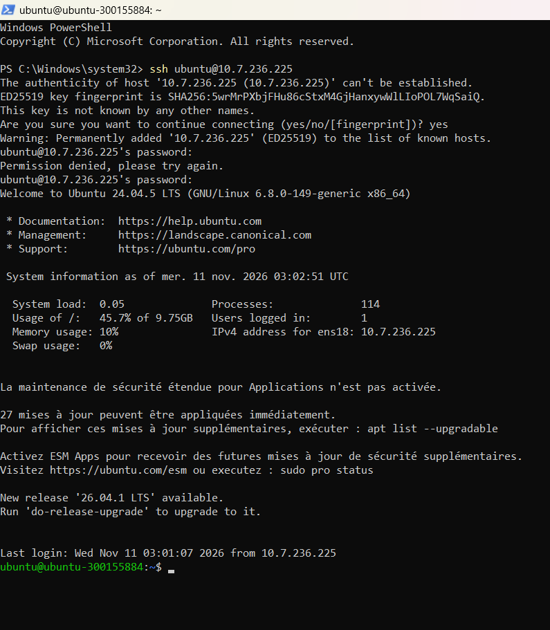

## 10. Génération et configuration d'une paire de clés SSH

Afin d'utiliser une méthode d'authentification par clé publique, nous avons généré une paire de clés SSH sur notre ordinateur Windows.

### 10.1 Génération des clés ED25519

Dans Windows PowerShell, nous avons exécuté :

```powershell
ssh-keygen -t ed25519 -C "ubuntu-300155884"
```

Cette commande a généré deux fichiers :

| Fichier | Fonction |
|---|---|
| `id_ed25519` | Clé privée conservée sur Windows |
| `id_ed25519.pub` | Clé publique destinée au serveur Ubuntu |

Nous avons également défini une phrase secrète (*passphrase*) pour protéger la clé privée.

La clé privée doit rester confidentielle et ne doit jamais être partagée.

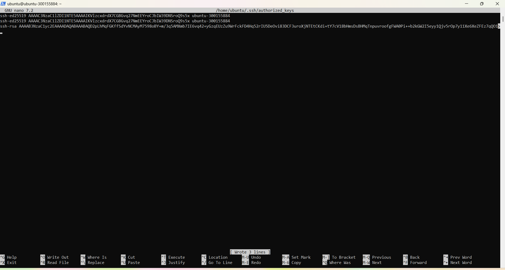

### 10.2 Installation de la clé publique sur Ubuntu

Nous avons transféré notre clé publique Windows vers le fichier `authorized_keys` du compte Ubuntu.

Depuis PowerShell, nous avons exécuté :

```powershell
Get-Content "$env:USERPROFILE\.ssh\id_ed25519.pub" | ssh ubuntu@10.7.236.225 "umask 077; mkdir -p ~/.ssh; cat >> ~/.ssh/authorized_keys"
```

Cette commande ajoute la clé publique au fichier :

```text
/home/ubuntu/.ssh/authorized_keys
```

### 10.3 Vérification de l'authentification par clé

Nous avons ensuite testé la connexion SSH en imposant l'authentification par clé publique :

```powershell
ssh -o PreferredAuthentications=publickey -o PasswordAuthentication=no ubuntu@10.7.236.225
```

Après la saisie de la passphrase de la clé privée, la connexion au serveur Ubuntu a réussi.

Ce test confirme que l'authentification SSH par clé publique fonctionne sans utiliser le mot de passe du compte Ubuntu.

## 11. Ajout de la clé publique du professeur

Pour autoriser le professeur à accéder à notre machine virtuelle avec sa propre clé SSH, nous avons ajouté sa clé publique au fichier `authorized_keys`.

### 11.1 Préparation du dossier SSH

Nous avons exécuté la commande suivante :

```bash
mkdir -p ~/.ssh && chmod 700 ~/.ssh && touch ~/.ssh/authorized_keys && chmod 600 ~/.ssh/authorized_keys
```

Cette commande permet de créer les éléments nécessaires s'ils n'existent pas et d'appliquer les permissions appropriées.

### 11.2 Modification du fichier authorized_keys

Nous avons ouvert le fichier avec l'éditeur Nano :

```bash
nano ~/.ssh/authorized_keys
```

Nous avons ensuite ajouté la clé publique du professeur, de type `ssh-rsa`, sur une nouvelle ligne.

Notre clé personnelle `ssh-ed25519` a été conservée afin de maintenir notre propre accès au serveur.

### 11.3 Suppression d'un doublon

Lors de la vérification du fichier, nous avons constaté que notre clé personnelle apparaissait deux fois.

Nous avons commencé par créer une copie de sauvegarde :

```bash
cp ~/.ssh/authorized_keys ~/.ssh/authorized_keys.bak
```

Puis nous avons supprimé les lignes identiques avec la commande suivante :

```bash
awk '!seen[$0]++' ~/.ssh/authorized_keys > ~/.ssh/authorized_keys.tmp && mv ~/.ssh/authorized_keys.tmp ~/.ssh/authorized_keys && chmod 600 ~/.ssh/authorized_keys
```

Cette opération a permis de conserver une seule copie de chaque clé publique.

### 11.4 Vérification des clés autorisées

Pour vérifier le contenu du fichier sans afficher les clés publiques complètes, nous avons exécuté :

```bash
grep -nE '^(ssh-rsa|ssh-ed25519) ' ~/.ssh/authorized_keys | cut -d' ' -f1
```

Le résultat obtenu était :

```text
1:ssh-ed25519
2:ssh-rsa
```

Ce résultat confirme que deux clés publiques distinctes sont présentes dans le fichier :

- Une clé ED25519 correspondant à notre ordinateur Windows.
- Une clé RSA correspondant au professeur.

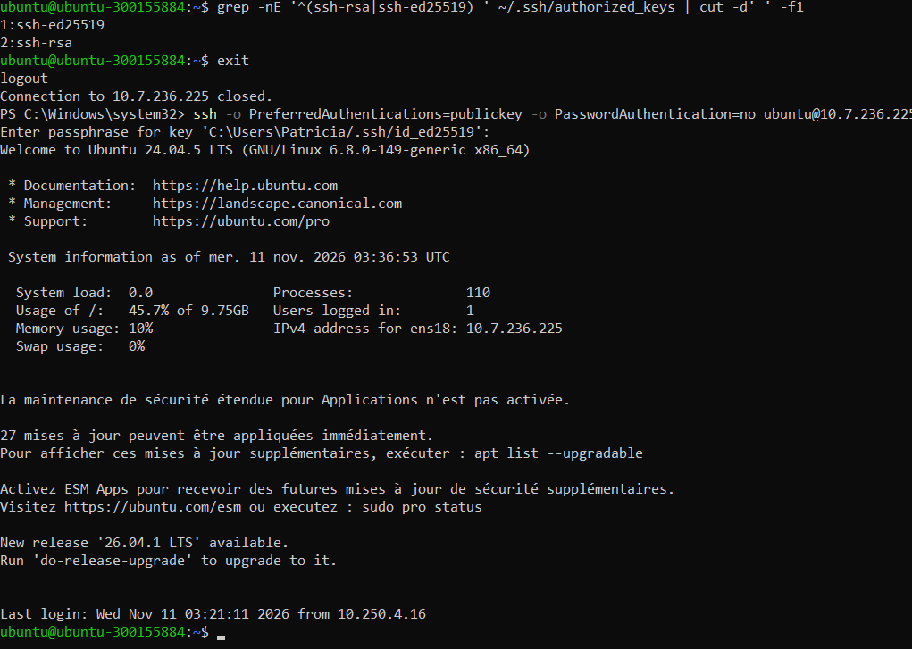

## 12. Vérification finale de l'accès SSH

Après l'ajout de la clé publique du professeur et la suppression du doublon, nous avons effectué un dernier test de connexion depuis Windows PowerShell.

Nous avons exécuté :

```powershell
ssh -o PreferredAuthentications=publickey -o PasswordAuthentication=no ubuntu@10.7.236.225
```

La connexion a réussi après la saisie de notre passphrase SSH.

Cela confirme que notre clé personnelle fonctionnait toujours après la modification du fichier `authorized_keys`.

L'accès du professeur pourra être vérifié séparément à l'aide de sa propre clé privée.

## 13. Difficultés rencontrées et solutions

| Difficulté rencontrée | Solution apportée |
|---|---|
| Erreur liée au processeur au premier démarrage | Modification du type de processeur virtuel dans Proxmox |
| Échecs lors de certaines tentatives de connexion SSH | Vérification et saisie correcte du mot de passe Ubuntu |
| Confusion entre le mot de passe Ubuntu et la passphrase SSH | Identification du rôle de chaque méthode d'authentification |
| Collage de la clé publique dans le terminal au lieu de Nano | Ouverture du fichier `authorized_keys` dans l'éditeur Nano |
| Présence de deux copies de la clé personnelle | Sauvegarde du fichier et suppression du doublon |

Ces difficultés nous ont permis de mieux comprendre le fonctionnement de la virtualisation, l'administration Linux et la configuration des accès SSH.

## 14. Conclusion

Ce laboratoire nous a permis de créer et de configurer une machine virtuelle Ubuntu Server 24.04.5 LTS sur Proxmox VE.

Nous avons installé le système d'exploitation, configuré une adresse IP statique, vérifié la connectivité réseau et mis en place un serveur SSH fonctionnel.

Nous avons également établi une connexion à distance depuis Windows PowerShell, généré une paire de clés ED25519 et configuré l'authentification par clé publique.

Enfin, nous avons ajouté la clé publique du professeur et vérifié le contenu du fichier `authorized_keys`.

À la fin du laboratoire, notre machine virtuelle `ubuntu-300155884` était fonctionnelle, connectée au réseau et accessible à distance par SSH.

Ce travail nous a permis de développer nos compétences en virtualisation, en administration Linux, en configuration réseau et en sécurisation des accès distants.
