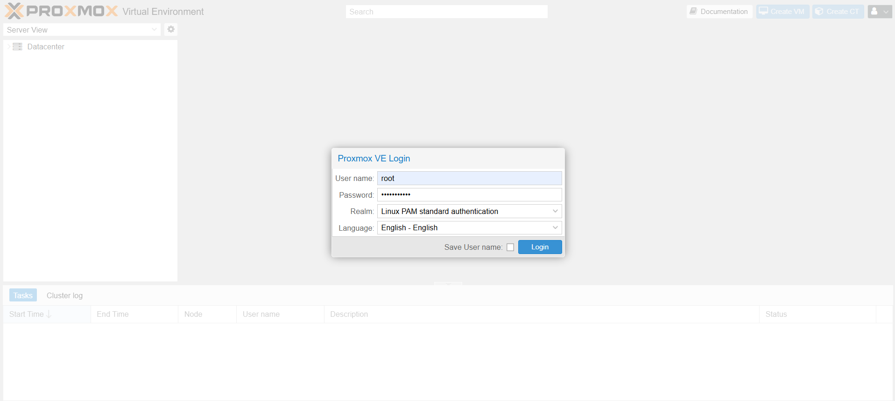
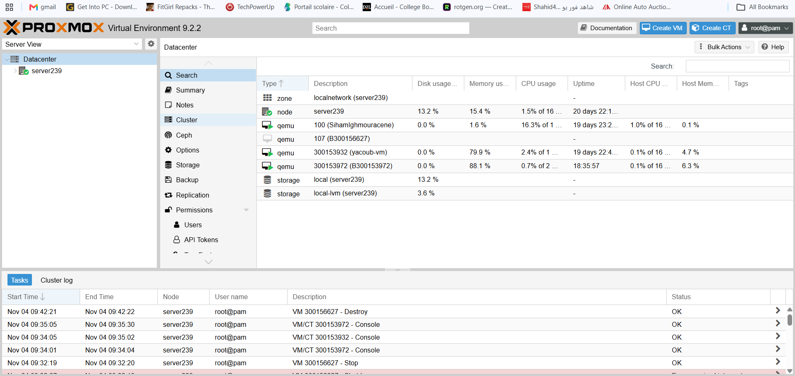
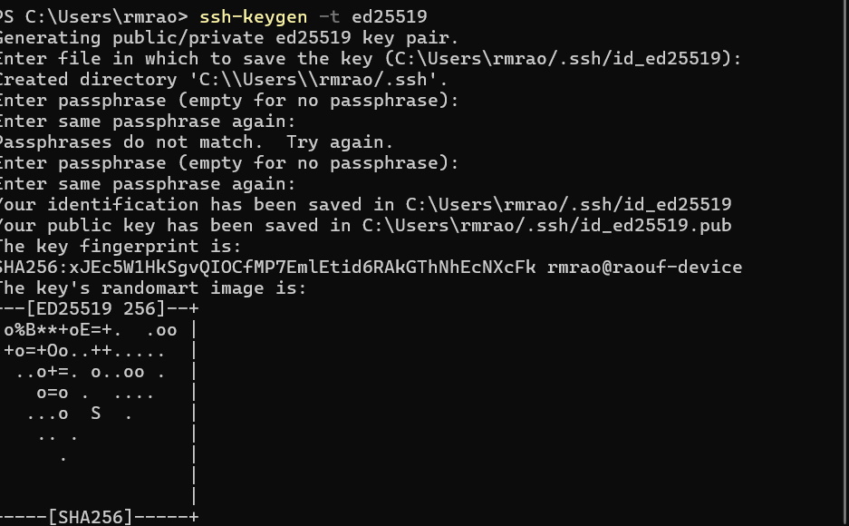
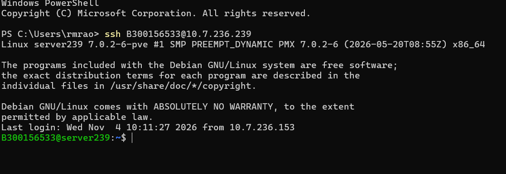
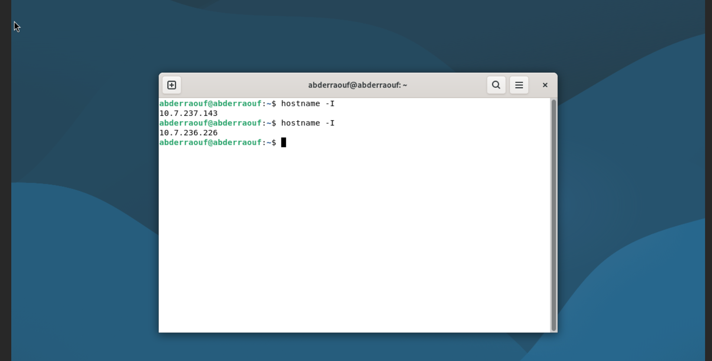
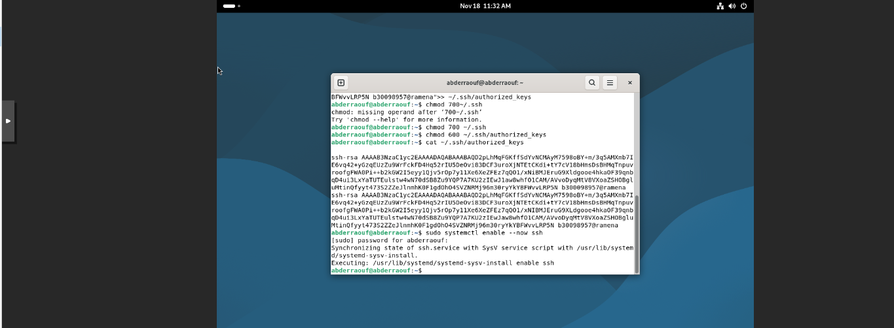

# 🚀 INF1085 - Création et administration d'une machine virtuelle Debian sur Proxmox
# 👨‍💻 Auteur
Nom : Abderraouf Moulla
Cours : INF1085

# 📖 Description du projet

Dans ce laboratoire, l'objectif était de créer et administrer une machine virtuelle Debian Linux sur un serveur Proxmox VE partagé.

# Les principales tâches réalisées sont :

✅ Accès à l'interface Proxmox
 ✅ Vérification du serveur attribué
 ✅ Gestion des utilisateurs et permissions
 ✅ Création d'une clé SSH sécurisée
 ✅ Configuration d'un accès distant sécurisé
 ✅ Installation de Debian 13
 ✅ Validation de la connectivité réseau de la VM

# 🖥️ Informations du serveur
Paramètre	Valeur
🌐 Serveur	server239
📍 Adresse IP	10.7.236.239
🧠 Mémoire RAM	64 GB
⚡ CPU	16 cœurs
💾 Stockage	1 TB NVMe
# 🔐 Étape 1 - Connexion à Proxmox

La première étape consistait à se connecter à l'interface web de Proxmox VE à l'aide des identifiants fournis.

L'accès à cette interface permet de gérer les machines virtuelles, le stockage et les ressources du serveur.

# 🏢 Étape 2 - Vérification du serveur

Après l'authentification, le serveur server239 apparaît dans le Datacenter Proxmox.

Cette interface permet notamment de :

Visualiser les machines virtuelles
Gérer le stockage
Consulter les ressources du serveur
Administrer le réseau

# 🔑 Étape 3 - Génération d'une clé SSH

Afin de sécuriser les connexions distantes, une paire de clés SSH a été générée depuis PowerShell.

Commande utilisée
PowerShell
ssh-keygen -t ed25519

Cette commande crée :

Plain Text
id_ed25519
id_ed25519.pub
id_ed25519 ➜ Clé privée conservée localement
id_ed25519.pub ➜ Clé publique envoyée au serveur

Cette méthode permet une authentification plus sécurisée qu'un simple mot de passe.

# 🌐 Étape 4 - Connexion SSH au serveur

Une fois la clé publique ajoutée sur le serveur, il est possible d'établir une connexion SSH sécurisée.

Commande utilisée
PowerShell
ssh B300156533@10.7.236.239

La connexion réussie démontre que l'authentification par clé SSH est correctement configurée.

Cette étape permet l'administration du serveur à distance sans devoir saisir le mot de passe à chaque connexion.

# 📡 Étape 5 - Vérification réseau de la machine virtuelle

Après l'installation de Debian, une vérification de la configuration réseau est réalisée.

Commande utilisée
Shell
hostname -I
Résultat obtenu
Shell
10.7.236.226

L'adresse IP retournée confirme que la machine virtuelle est correctement connectée au réseau et peut communiquer avec les autres équipements.

# 📝 Résumé des commandes utilisées
# 🔐 Gestion SSH
Génération de la clé SSH
PowerShell
ssh-keygen -t ed25519
Connexion au serveur Proxmox
PowerShell
ssh B300156533@10.7.236.239
Création du dossier SSH
Shell
mkdir -p ~/.ssh
Permissions du dossier SSH
Shell
chmod 700 ~/.ssh
Permissions du fichier authorized_keys
Shell
chmod 600 ~/.ssh/authorized_keys
# 📡 Réseau Debian
Affichage de l'adresse IP
Shell
hostname -I

# ✅ Résultats obtenus

À la fin de ce laboratoire :

✅ Accès au serveur Proxmox confirmé

✅ Utilisation d'un accès SSH sécurisé

✅ Génération et configuration d'une clé SSH

✅ Connexion distante fonctionnelle

✅ Installation de Debian 13 réussie

✅ Vérification de la connectivité réseau

✅ Machine virtuelle pleinement opérationnelle
