# Rapport de laboratoire : déploiement d’une VM sur Proxmox VE

**Auteur : B300157287 — Ibrahim Hamdan Alhamed**  
**Cours : INF1085-201-26A-04**  
**Environnement : Proxmox VE 9.2.2 — nœud `server1`**  
**Machine virtuelle : `101 — Ibrahim-Debian`**  
**Sujet : création, configuration et déploiement d’une machine virtuelle Debian 13**

## 1. Objectifs du travail

Ce laboratoire consiste à déployer une machine virtuelle Debian sur un serveur Proxmox VE, à configurer son réseau et à permettre son administration à distance. Les objectifs sont les suivants :

- Créer une VM et lui attribuer les ressources nécessaires.
- Installer Debian 13 et démarrer depuis son disque virtuel.
- Configurer une adresse IPv4 fixe et vérifier la connectivité.
- Installer et utiliser le bureau Xfce.
- Vérifier le fonctionnement du serveur SSH.
- Ajouter la clé SSH publique de l’enseignant pour son accès à la VM.
- Documenter les erreurs rencontrées et leurs corrections.

## 2. Procédure de déploiement et preuves

### 2.1. Environnement utilisé

| Élément | Configuration |
| --- | --- |
| Hyperviseur | Proxmox VE 9.2.2 |
| Nœud | `server1` |
| Adresse du serveur Proxmox | `10.7.236.240` |
| Accès Web | `https://10.7.236.240:8006` |
| Processeur physique | Intel Xeon X5550 à 2,67 GHz |
| Processeurs logiques de l’hôte | 16 |
| Mémoire totale observée de l’hôte | Environ 62 Gio |
| Système invité | Debian GNU/Linux 13 « trixie » |

L’hôte héberge plusieurs VM d’étudiants. Mon travail concerne uniquement la VM 101.

### 2.2. Accès à l’interface d’administration

J’ai accédé à l’interface Web de Proxmox à l’adresse `https://10.7.236.240:8006`, puis sélectionné le nœud `server1` et la VM `101 (Ibrahim-Debian)`. La console intégrée noVNC permet d’interagir avec Debian même lorsque la connexion SSH est indisponible.

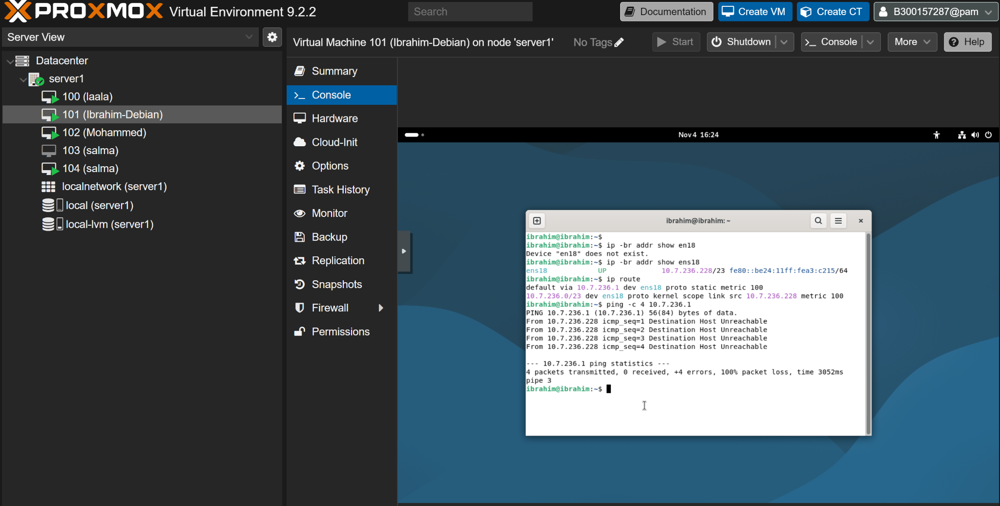

## 3. Création et configuration de la VM 101

| Ressource | Valeur utilisée |
| --- | --- |
| Identifiant | `101` |
| Nom | `Ibrahim-Debian` |
| Processeurs virtuels | 1 socket, 2 cœurs |
| Mémoire vive | 2 048 Mio |
| Disque système | 20 Gio, `scsi0` sur `local-lvm` |
| Contrôleur SCSI | `virtio-scsi-single` |
| Carte réseau | VirtIO, connectée au pont `vmbr0` |
| Interface dans Debian | `ens18` |
| Adresse MAC | `bc:24:11:a3:c2:15` |
| Média d’installation | `debian-13.7.0-amd64-netinst.iso` sur `ide2` |
| Démarrage | Installation depuis l’ISO, puis démarrage depuis `scsi0` |

La VM possède son propre système invité, son disque virtuel et sa configuration réseau. Le pont `vmbr0` assure sa connexion au réseau du laboratoire.

## 4. Installation de Debian et démarrage

L’installation a été lancée depuis l’image ISO de Debian 13. Le système utilise le nom d’hôte `ibrahim` et le compte utilisateur `ibrahim`.

Lors d’un redémarrage, la VM est revenue sur le média d’installation. La présence du système déjà installé a été vérifiée : le fichier `/etc/os-release` identifiait Debian 13 et le fichier de configuration GRUB existait sur le disque. L’ordre de démarrage a ensuite été ajusté pour privilégier le disque système et éviter de relancer l’installation.

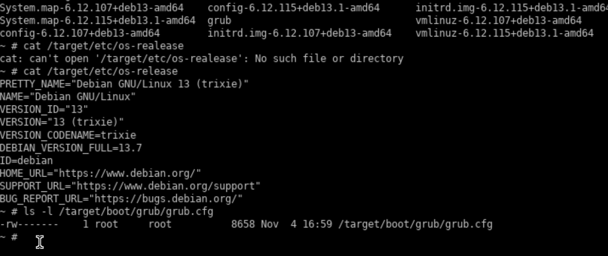

Le mot de passe root oublié a également été réinitialisé depuis un démarrage de récupération avec GRUB. L’accès administrateur dans Debian se fait ensuite avec `su -`. Le compte `ibrahim` n’étant pas autorisé à utiliser sudo, les commandes d’administration ont été exécutées dans le shell root.

### 4.1. Configuration réseau

L’adresse initiale était obtenue par DHCP : `10.7.236.171/23`, avec la passerelle `10.7.237.1`. J’ai attribué l’adresse fixe `10.7.236.228/23` à la VM.

| Paramètre | Configuration retenue après diagnostic |
| --- | --- |
| Profil NetworkManager | `Wired connection 1` |
| Interface | `ens18` |
| Adresse IPv4 | `10.7.236.228/23` |
| Masque | `255.255.254.0` |
| Réseau | `10.7.236.0/23` |
| Diffusion | `10.7.237.255` |
| Passerelle fonctionnelle | `10.7.237.1` |
| DNS configuré | `1.1.1.1` |

La passerelle `10.7.236.1`, configurée au départ, ne répondait pas : le ping indiquait « Destination Host Unreachable ». En revanche, le serveur Proxmox `10.7.236.240` et l’adresse `10.7.237.1` répondaient tous deux à quatre paquets sur quatre.

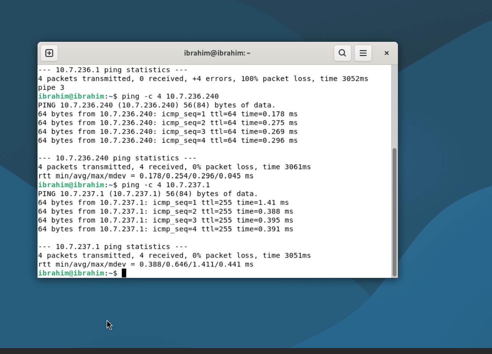

Un test avec une route temporaire vers `1.1.1.1`, via `10.7.237.1`, a également obtenu quatre réponses sur quatre. Cette route temporaire a été supprimée après le test.

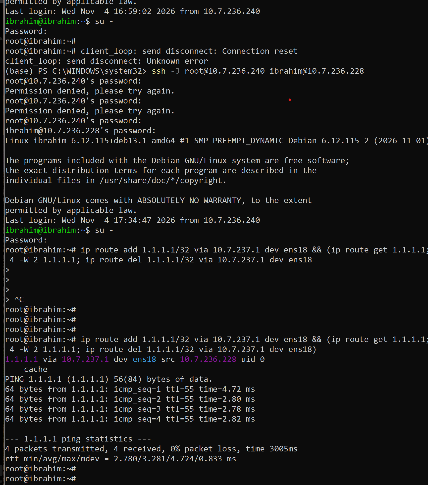

Les commandes de configuration correspondent au profil NetworkManager de la VM et sont exécutées en root dans Debian :

```bash
nmcli connection modify "Wired connection 1" ipv4.method manual ipv4.addresses "10.7.236.228/23" ipv4.gateway "10.7.237.1" ipv4.dns "1.1.1.1"
nmcli device reapply ens18
```

Pour contrôler le résultat :

```bash
ip -br addr show ens18
ip route
cat /etc/resolv.conf
```

Le nom du profil est sensible aux majuscules : `Wired connection 1` doit être saisi exactement. L’interface est `ens18`, et non `en18`.

## 5. Installation de l’interface graphique Xfce et résolution des erreurs

### 5.1. Diagnostic des erreurs

Le bureau initial était GNOME. Dans un terminal de la session graphique, la commande suivante retournait `GNOME` :

```bash
echo "$XDG_CURRENT_DESKTOP"
```

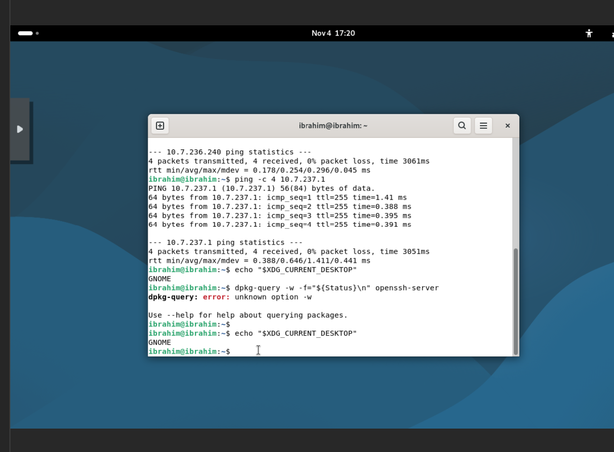

Plusieurs difficultés ont empêché l’installation de Xfce au premier essai :

| Erreur observée | Diagnostic et correction |
| --- | --- |
| `Insufficient privileges` | La modification du profil réseau exigeait les droits root ; utilisation de `su -`. |
| `Temporary failure resolving` dans APT | La résolution DNS échouait ; `/etc/resolv.conf` ne contenait aucun serveur DNS. Configuration du DNS et correction de la passerelle. |
| Aucun retour de `1.1.1.1` avec la première configuration | Le problème concernait aussi le routage, et pas seulement le DNS. Un test via `10.7.237.1` a réussi. |
| Signature APT : `Not live until` | L’horloge de la VM était en retard sur la date des signatures des dépôts. Correction manuelle de l’heure. |
| `Failed to set ntp: NTP not supported` | La synchronisation automatique n’a pas pu être activée avec les services présents. Une mise à l’heure manuelle a permis de poursuivre. |
| Xfce absent du menu de connexion | L’installation des extensions `xfce4-goodies` avait été réalisée, mais il fallait compléter l’installation du bureau et de sa session. |

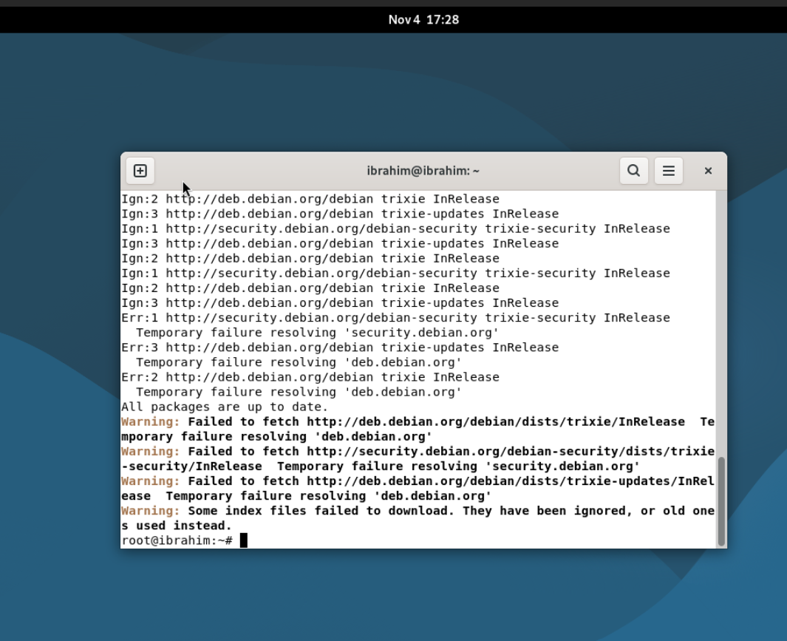

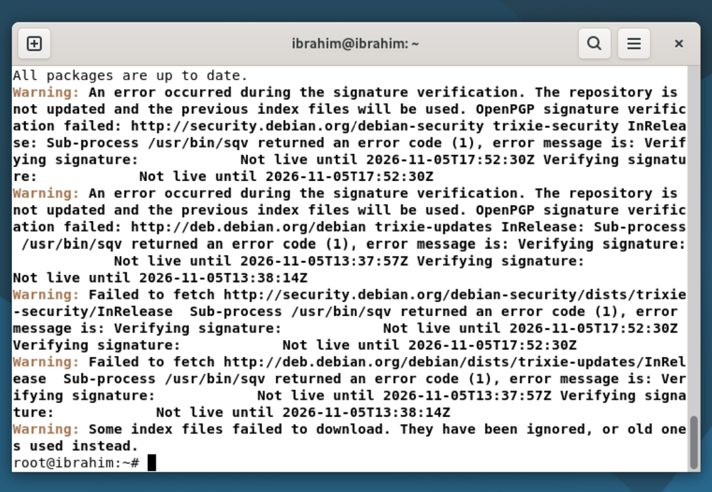

Les erreurs de saisie ont aussi été corrigées : `ssh` au lieu de `shh`, `systemctl` correctement orthographié et la lettre `l` dans `dpkg -l`, au lieu du chiffre `1`. Les commandes Linux doivent être exécutées dans Debian ; elles ne sont pas des commandes PowerShell Windows.

### 5.2. Résolution et validation

Après correction de la passerelle et du DNS, l’horloge a été réglée dans le shell root de la VM. La commande utilisée lors du laboratoire était :

```bash
date -u -s '2026-11-05 19:36:00'
```

Cette date correspond au moment de l’intervention et ne doit pas être réutilisée comme heure actuelle lors d’une autre exécution. La synchronisation automatique de l’heure reste à mettre en place pour éviter un nouveau décalage.

La mise à jour des index a ensuite réussi :

```bash
apt update
```

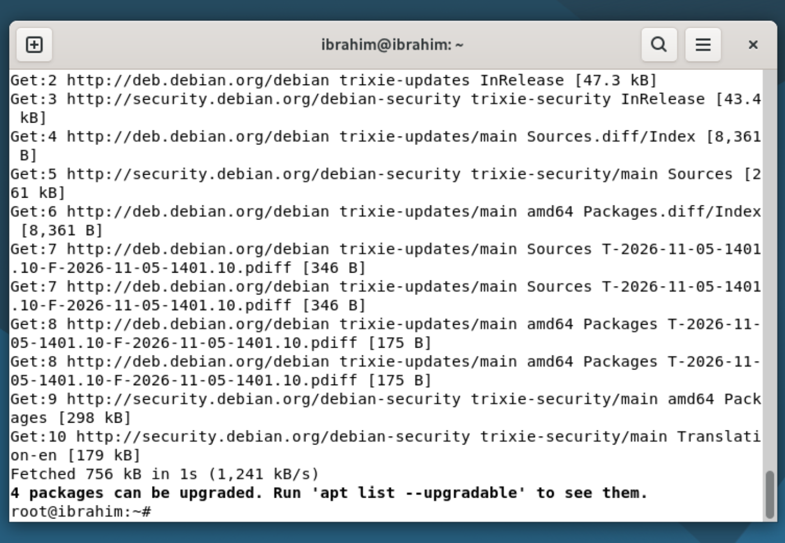

Les extensions ont été installées, puis l’installation complète de Xfce a été assurée avec les paquets suivants :

```bash
apt install xfce4 xfce4-goodies
apt install xfce4 xfce4-session
```

Lors du choix du gestionnaire de connexion graphique, j’ai sélectionné **LightDM**. L’installation s’est terminée avec la configuration de `xfce4`, `xfce4-session`, `xfwm4` et `xfdesktop4`.

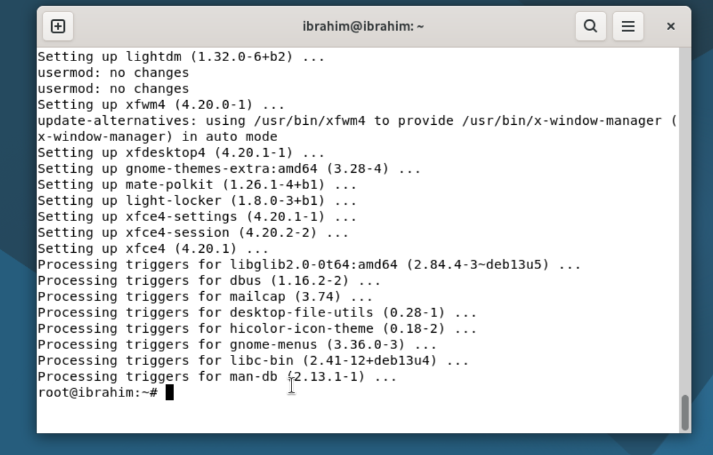

Après le redémarrage de la VM, j’ai choisi **Xfce Session** dans le menu des sessions de LightDM, puis ouvert la session utilisateur.

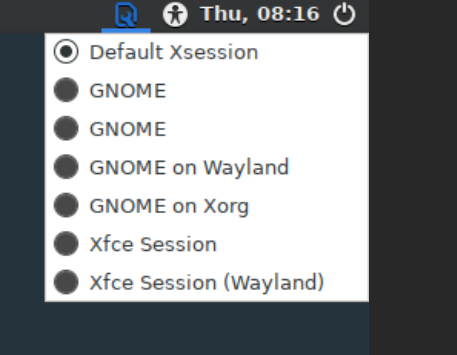

La vérification a été faite dans un terminal du bureau de la VM :

```bash
echo "$XDG_CURRENT_DESKTOP"
```

Résultat obtenu :

```text
XFCE
```

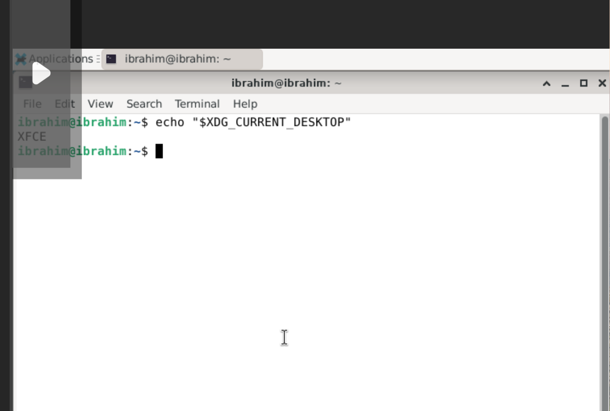

## 6. Installation du serveur SSH sur la VM

Le serveur SSH permet l’administration de Debian à distance. Sur Debian, le paquet correspondant est `openssh-server`. La commande d’installation, si nécessaire, est :

```bash
apt install openssh-server
```

La preuve recueillie dans ce laboratoire est celle du fonctionnement du service et de l’accès SSH ; elle ne montre pas l’étape initiale d’installation du paquet.

Les vérifications suivantes ont été exécutées :

```bash
hostname
systemctl is-active ssh
```

Résultats :

```text
ibrahim
active
```

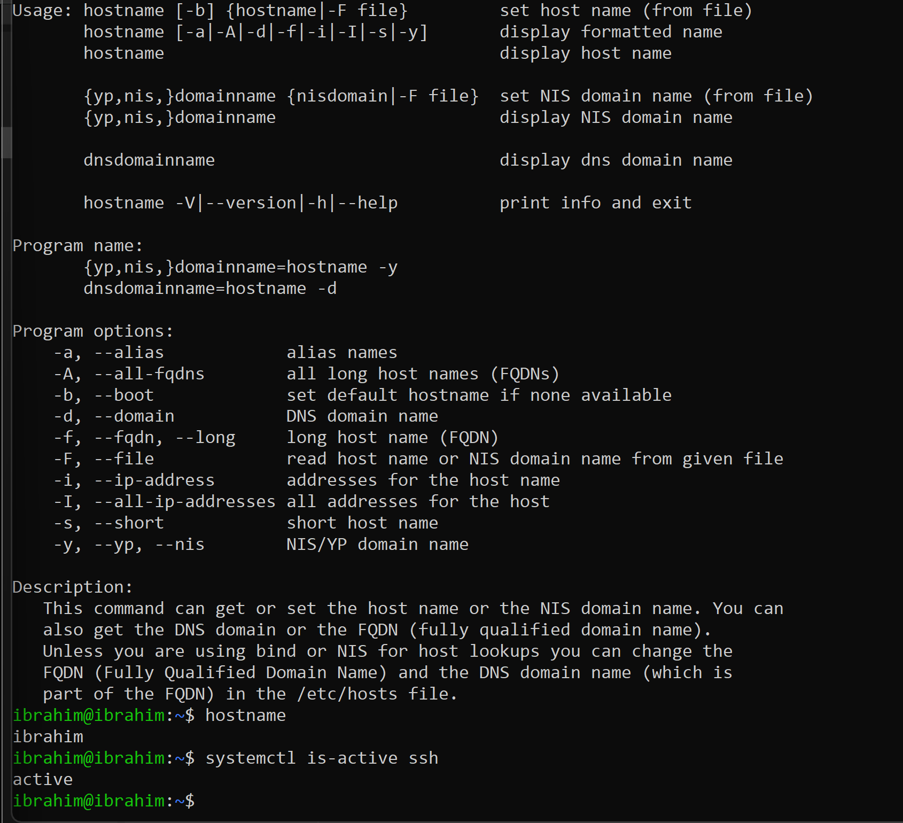

Une session SSH avec le compte `ibrahim` a été ouverte. Pendant les difficultés de routage, la connexion via le serveur Proxmox comme relais a permis d’accéder à la VM depuis PowerShell :

```powershell
ssh -J root@10.7.236.240 ibrahim@10.7.236.228
```

Les authentifications du serveur relais et de la VM concernent deux comptes distincts. Une fois connecté à Debian, l’invite `ibrahim@ibrahim:~$` permet d’identifier le système sur lequel les commandes sont exécutées.

## 7. Ajout de la clé SSH publique de l’enseignant

La clé publique fournie par l’enseignant a été ajoutée au fichier `authorized_keys` du compte **ibrahim**. Les permissions ont été réglées pour protéger le répertoire et le fichier :

```bash
mkdir -p ~/.ssh
chmod 700 ~/.ssh
chmod 600 ~/.ssh/authorized_keys
cat ~/.ssh/authorized_keys
```

L’ajout de la clé a été réalisé entre la création du répertoire et le réglage des permissions du fichier. Le contrôle du contenu a confirmé la présence de la clé publique portant le commentaire `b300098957@ramena`.

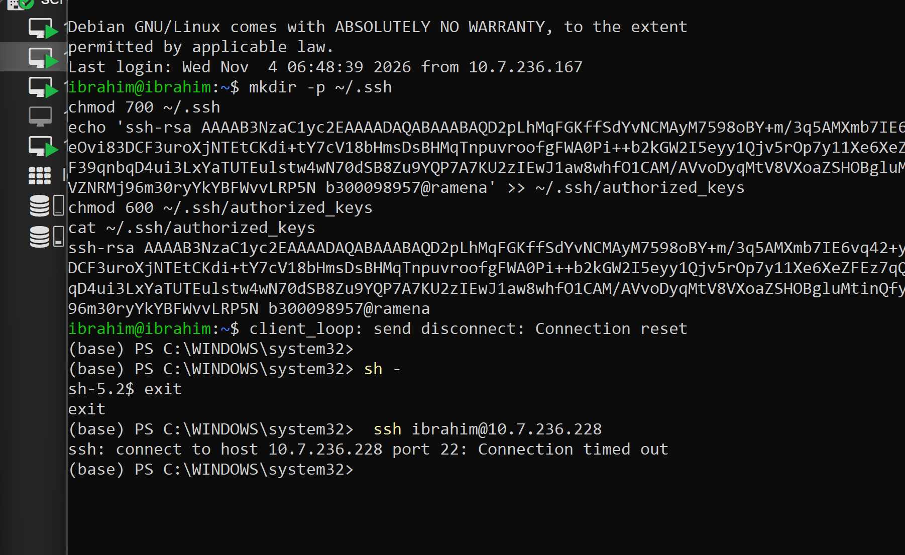

Le compte destiné à l’accès est `ibrahim`, sur la VM `10.7.236.228`. La clé privée reste détenue par l’enseignant. **L’enseignant effectuera lui-même le test de connexion avec sa clé privée après la remise.**

## 8. Conclusion

La VM `101 — Ibrahim-Debian` a été déployée sur le nœud Proxmox `server1`. Debian 13 démarre depuis son disque virtuel et utilise l’adresse fixe `10.7.236.228/23`. Les tests ont permis d’identifier `10.7.237.1` comme passerelle fonctionnelle et de rétablir l’accès aux dépôts Debian avec un DNS configuré.

Les problèmes de résolution de noms et de date ont été corrigés pour permettre l’installation du bureau. Xfce est installé et son utilisation a été confirmée par le résultat `XFCE`. Le service SSH est actif et la clé publique de l’enseignant est présente dans le compte `ibrahim`.

Le test d’authentification par la clé de l’enseignant sera effectué par celui-ci. La synchronisation automatique de l’horloge demeure un point à compléter ; la correction effectuée pendant ce laboratoire était manuelle.
