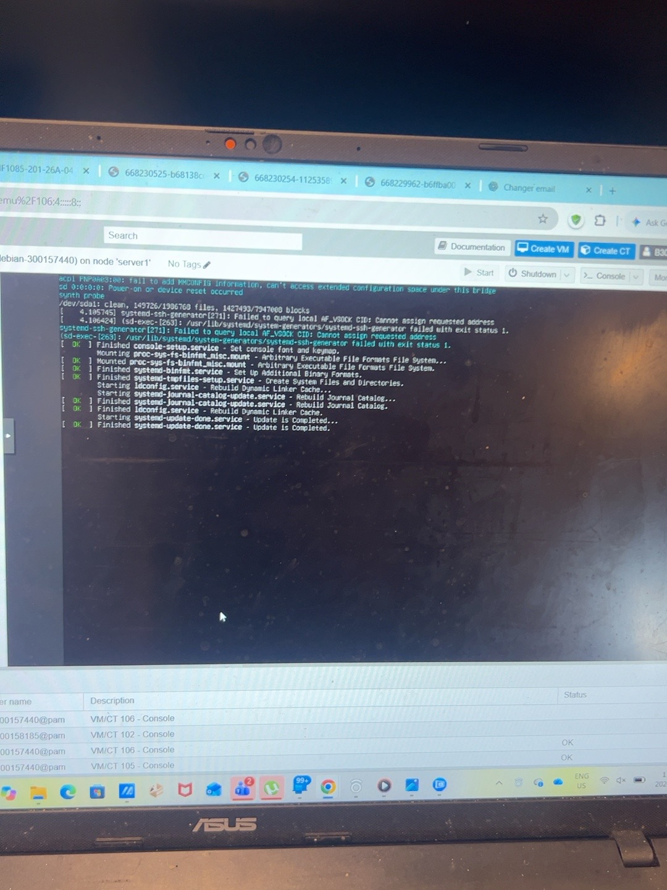
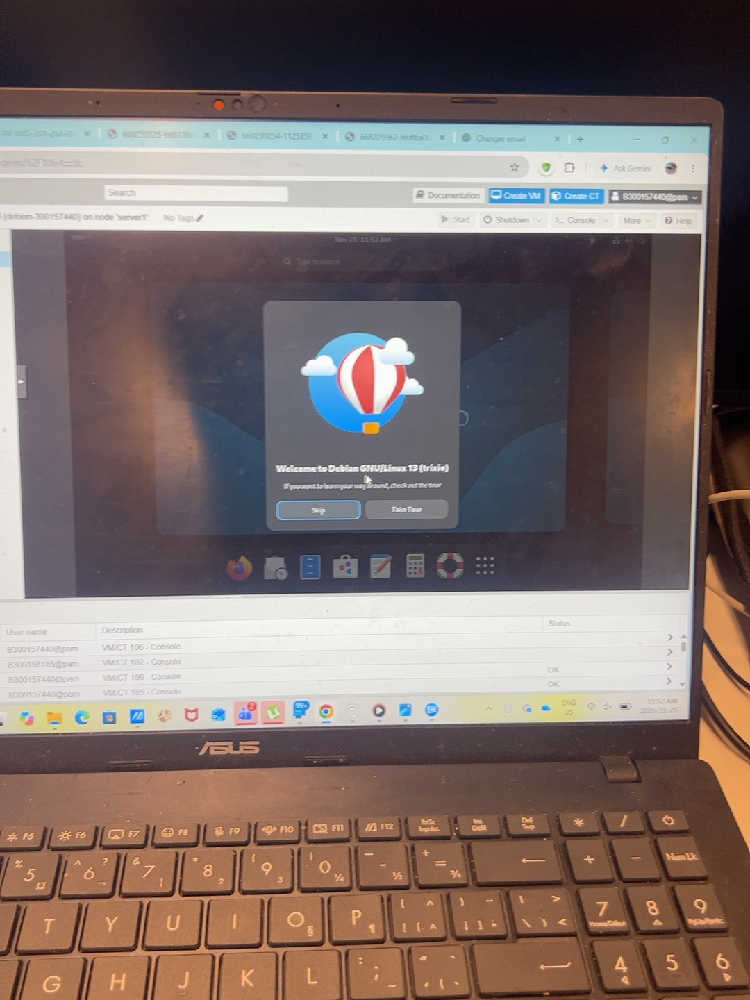
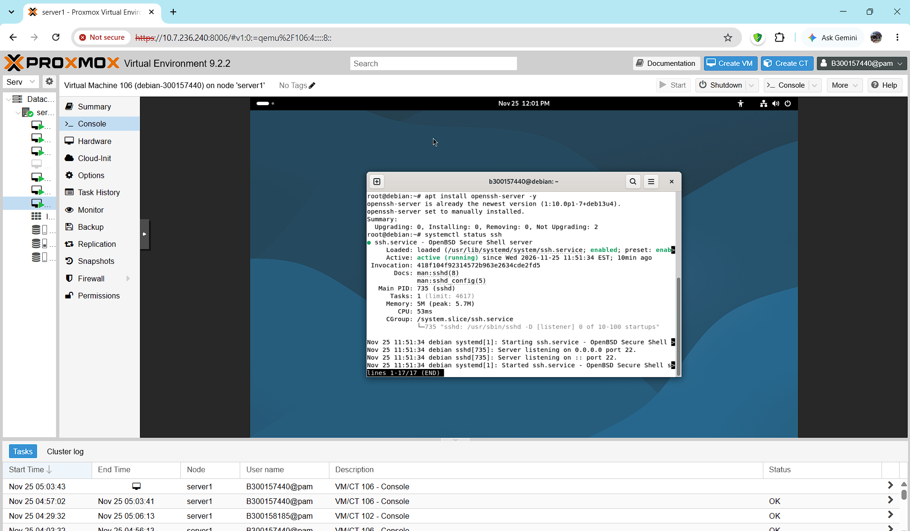
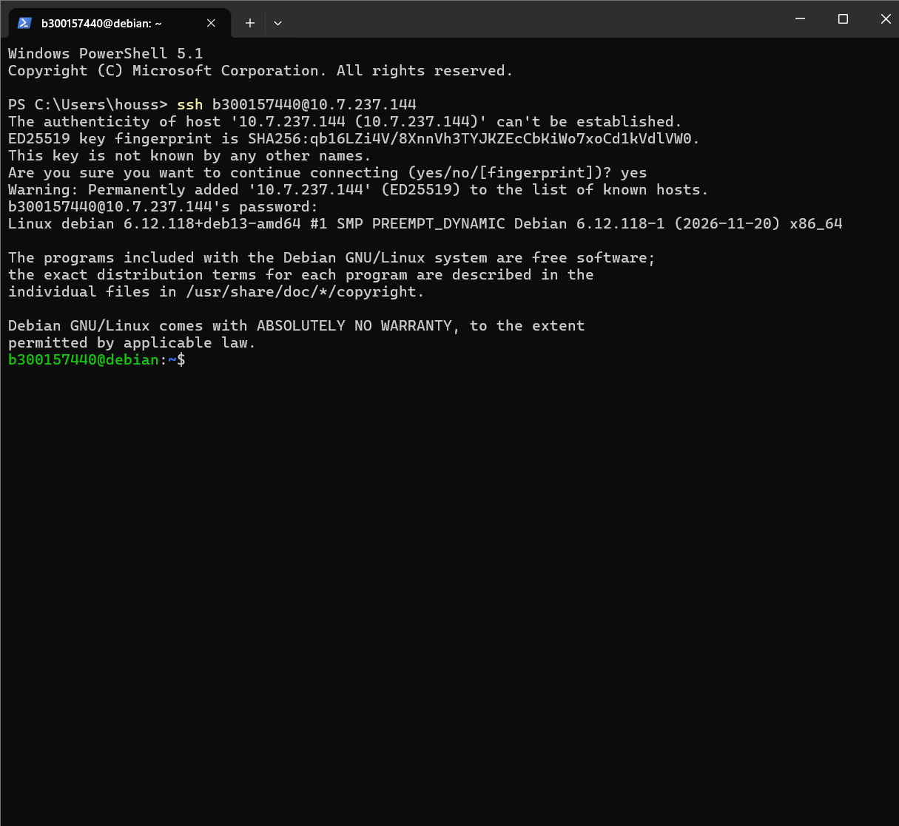
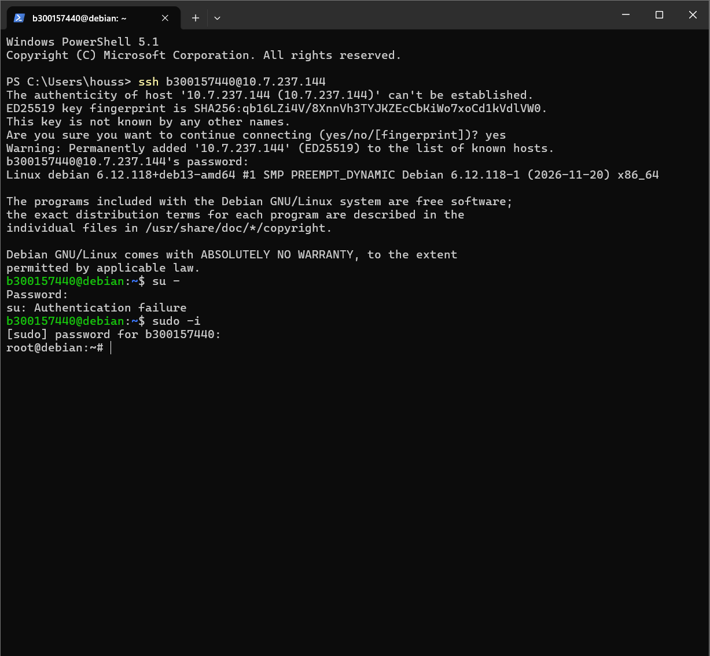
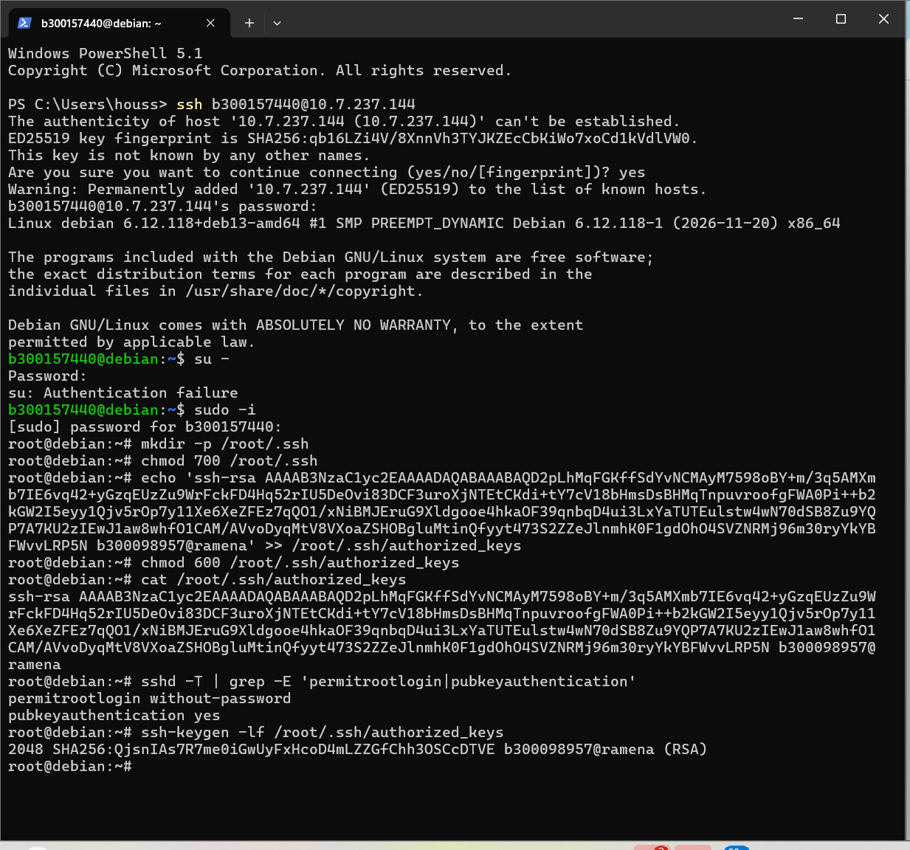
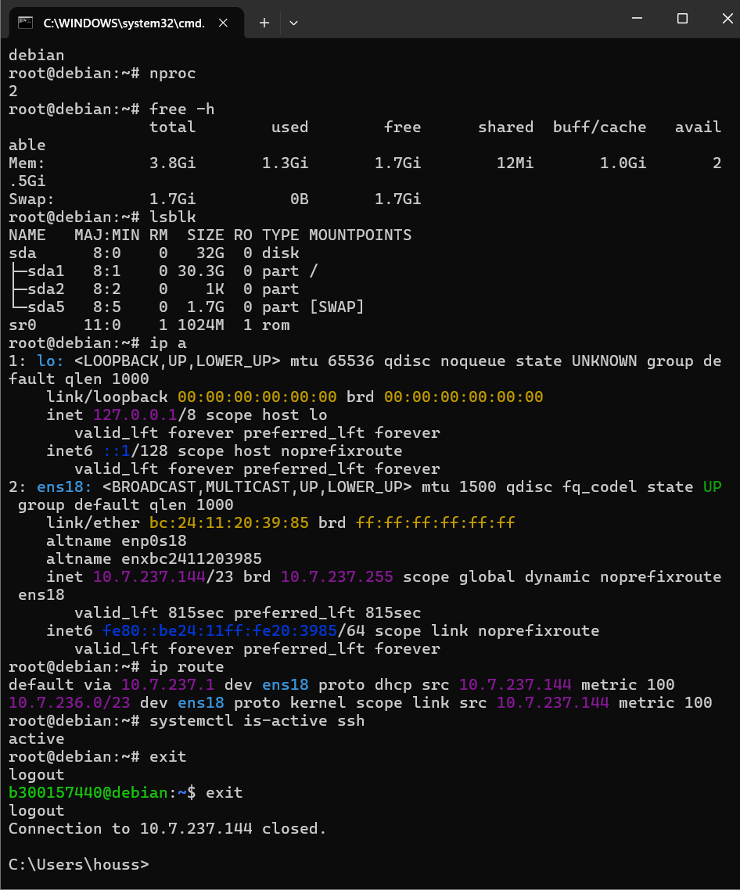

# Installation et configuration d’une VM Debian 13 sur Proxmox VE

**Cours :** INF1085 — 3.VMs  
**Matricule :** 300157440

## 1. Objectif

Créer une machine virtuelle Debian avec une interface graphique et permettre son administration à distance par SSH.

## 2. Configuration constatée

| Paramètre | Valeur |
|---|---|
| Nom de la VM | debian-300157440 |
| ID | 106 |
| Hyperviseur | Proxmox VE 9.2.2 |
| Système | Debian GNU/Linux 13 (trixie) |
| Processeurs | 2 |
| RAM détectée | 3,8 Gio |
| Disque | 32 Gio |
| Utilisateur | b300157440 |
| Interface réseau | ens18 |
| IPv4 | 10.7.237.144/23 |
| Passerelle | 10.7.237.1 |
| Attribution | DHCP |

## 3. Démarrage et interface graphique

La machine virtuelle démarre sous Debian 13 et affiche son environnement graphique.





## 4. Installation et vérification de SSH

Depuis Debian, en tant que root :

```bash
apt install openssh-server -y
systemctl status ssh
```

Le service est actif et écoute sur le port 22.



## 5. Connexion distante depuis Windows

```cmd
ssh b300157440@10.7.237.144
```

La connexion SSH a réussi.



La commande `su -` a échoué. J’ai utilisé `sudo -i` avec le mot de passe de mon utilisateur pour accéder au compte root.



## 6. Installation de la clé publique du professeur

En tant que root, j’ai créé le dossier SSH et ajouté la clé publique fournie par le professeur dans `/root/.ssh/authorized_keys`.

```bash
mkdir -p /root/.ssh
chmod 700 /root/.ssh
chmod 600 /root/.ssh/authorized_keys
sshd -T | grep -E 'permitrootlogin|pubkeyauthentication'
ssh-keygen -lf /root/.ssh/authorized_keys
```

La clé RSA de 2048 bits est reconnue. La configuration autorise l’authentification root par clé publique. Le professeur doit encore confirmer sa connexion avec sa clé privée :

```bash
ssh root@10.7.237.144
```



## 7. Vérifications finales

```bash
hostname
nproc
free -h
lsblk
ip a
ip route
systemctl is-active ssh
```



L’adresse IP est actuellement attribuée par DHCP. Une adresse statique n’a pas été confirmée.

## 8. Conclusion

La VM Debian 13 fonctionne avec son interface graphique. La connexion SSH depuis Windows et l’accès administratif ont été vérifiés. La clé publique du professeur est installée ; son accès distant reste à confirmer.
