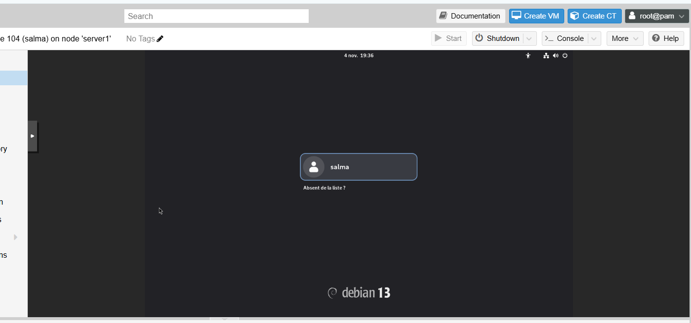
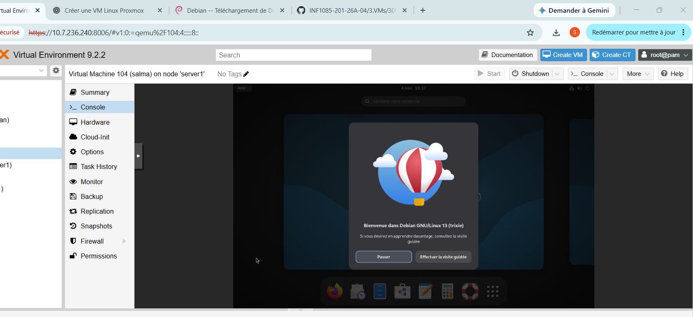

# Rapport de laboratoire : déploiement d'une VM Debian 13 sur Proxmox VE

| | |
|---|---|
| **Cours** | INF1085-201-26A-04 — 3. VMs |
| **Étudiante** | Salma Baali (300158383) |
| **Hyperviseur** | Proxmox VE 9.2.2 |
| **Nœud** | `server1` |
| **Accès Web** | `https://10.7.236.240:8006` |
| **Machine virtuelle** | `104 — salma` |
| **Système invité** | Debian GNU/Linux 13 « trixie » |

---

## 1. Objectifs

- Créer une VM sur Proxmox VE et lui attribuer des ressources (CPU, mémoire, disque, réseau).
- Installer Debian 13 et démarrer depuis le disque virtuel.
- Configurer et vérifier le réseau de la VM.
- Installer et vérifier le serveur SSH.
- Ajouter la clé SSH publique de l'enseignant pour son accès à la VM.
- Documenter les erreurs rencontrées et leurs corrections.

## 2. Environnement

La VM 104 est hébergée sur le nœud `server1` du serveur Proxmox du laboratoire (`10.7.236.240`). Ce serveur héberge aussi les VM d'autres étudiants : mon travail concerne uniquement la VM 104.

## 3. Création de la VM 104

[À COMPLÉTER : tableau des ressources lues dans l'onglet Hardware de la VM 104]

| Ressource | Valeur |
|---|---|
| Identifiant | 104 |
| Nom | salma |
| Mémoire vive | [À COMPLÉTER] |
| Processeurs | [À COMPLÉTER] |
| Disque système | [À COMPLÉTER] |
| Carte réseau | [À COMPLÉTER] (pont `vmbr0`) |
| Média d'installation | [À COMPLÉTER : nom de l'ISO Debian 13] |

[CAPTURE : onglets Summary et Hardware de la VM 104]

## 4. Installation de Debian 13

Debian 13 « trixie » est installé sur la VM 104. À la fin de l'installation, l'écran de connexion affiche l'utilisateur `salma`.



*Figure 1 — Console de la VM 104 (nœud `server1`) : écran de connexion de Debian 13.*

Après la connexion, le bureau affiche l'écran d'accueil « Bienvenue dans Debian GNU/Linux 13 (trixie) ». Le bureau installé est **GNOME**.



*Figure 2 — VM 104 : bureau GNOME et message de bienvenue, dans la console de l'interface Proxmox VE 9.2.2 (`https://10.7.236.240:8006`).*

## 5. Configuration réseau

[À COMPLÉTER : résultat de `ip a`, `ip route`, `ping`]

```bash
ip a
ip route
ping -c 3 10.7.237.1
ping -c 3 8.8.8.8
```

Paramètres du laboratoire : réseau `10.7.236.0/23`, **passerelle `10.7.237.1`**, DNS `8.8.8.8`.

[CAPTURE : `ip a`, `ip route` et les `ping`]

## 6. Serveur SSH

```bash
su -
apt update
apt install -y openssh-server
systemctl enable --now ssh
systemctl is-active ssh
```

[CAPTURE : `systemctl status ssh` avec `active (running)`]

Connexion depuis PowerShell :

```powershell
ssh salma@ADRESSE_DE_LA_VM
```

[CAPTURE : connexion SSH réussie depuis PowerShell]

## 7. Clé SSH publique de l'enseignant

```bash
mkdir -p ~/.ssh
chmod 700 ~/.ssh
nano ~/.ssh/authorized_keys
chmod 600 ~/.ssh/authorized_keys
cat ~/.ssh/authorized_keys
```

La clé publique de l'enseignant (commentaire `b300098957@ramena`) est ajoutée dans `authorized_keys` du compte `salma`.

[CAPTURE : `cat ~/.ssh/authorized_keys`]

## 8. Problèmes rencontrés et corrections

[À COMPLÉTER avec ce qui s'est réellement passé. Pièges classiques sur ce laboratoire :]

| Erreur possible | Cause probable | Correction |
|---|---|---|
| `Destination Host Unreachable` vers la passerelle | Mauvaise passerelle (par exemple `10.7.236.1`) | Utiliser `10.7.237.1` |
| `Temporary failure resolving` avec `apt` | Aucun serveur DNS configuré | Ajouter `nameserver 8.8.8.8` dans `/etc/resolv.conf` |
| `Not live until` (signatures APT) | Horloge de la VM en retard | Régler l'heure |
| `sudo : commande introuvable` ou utilisateur absent de sudoers | Le compte n'a pas les droits sudo | Utiliser `su -` |

## 9. Conclusion

[À COMPLÉTER : résumer ce qui a été réalisé et vérifié.]
